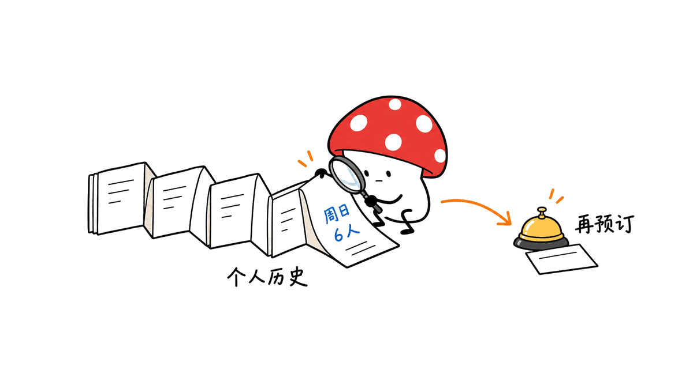
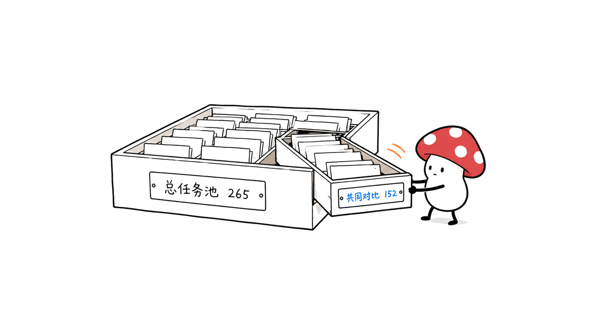
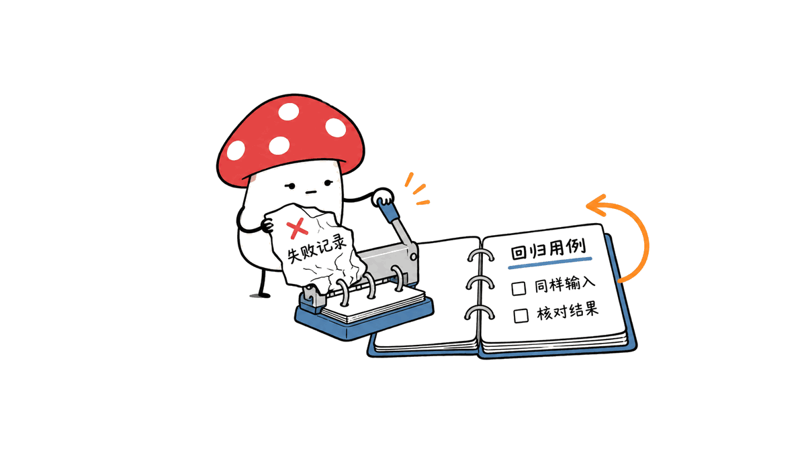

PersonalAgentEval 把个人助手的评测从“能不能调用工具”，推进到“能不能根据这个人的历史、偏好和约束把事情办对”。榜单由 MatrAIx 发布，覆盖七类生活领域，也提供案例回放和评测方法说明。

本次核查日期为 2026 年 10 月 29 日。公开页面和随页面发布的数据可以读取；未实际运行七款产品，也未在已查阅的官方入口找到与当前任务包对应的完整开源代码、环境及许可下载链接。因此，本文将其作为公开基准分析，不将其描述成已经可以完整本地复现的开源套件。

官网：https://personalagenteval.com/
方法说明：https://personalagenteval.com/blog/
案例贡献：https://personalagenteval.com/contribute/

## 为什么“替用户订好餐厅”仍可能失败？

假设用户说“订周末家庭聚餐”。系统可能成功创建一条预订，时间、餐厅、人数也都合法。但如果更早的消息说聚餐改到周日、需要增加一位亲属，按旧计划订周六五人仍是错误结果。

这类问题不缺工具能力，缺的是决定行动前找到约束的能力。只检查 API 是否返回成功，会把“操作已完成”误判成“任务已解决”。个人助手的验收对象应是最终状态及其与个人需求的关系。

评测中尤其需要区分三种信息：任务直接说出的要求、历史记录里可以查到的事实、必须向用户询问才能确定的选择。一个可靠助手不能要求用户反复提示所有历史，也不能把没有记录的偏好擅自补出来。

## 公开数据到底测了多少？

公开任务数据包含 13 个角色、7 个领域、8 类能力和 52 个账户工具。任务池为 265 个条目，包括 136 个单次任务与分布在 36 条故事线中的 129 个会话任务。

“每个用户有 13 个月历史”并不精确：数据记录的历史长度中位数为 13.1 个月，范围约 9.7—23.7 个月。角色数量与历史月份也不能混为一谈。

更关键的是共同对比集。抓取快照中，七款助手共同纳入对比的是 152 个任务，其中单次任务 109 个、长程会话任务 43 个；页面状态仍标记未全部完成。因此，不能将 265 当成每款产品都完成过的同一组样本。

## 榜单成绩该怎样读？

下表来自官网公开 JSON 的 overall 视图，是发布方报告的 resolved rate，不是本文复测；网页数据生成时间在 10 月中旬，后续可能更新。

| 个人助手 | 共同任务数 | 已解决比例 |
|---|---:|---:|
| Instinct | 152 | 60.5% |
| OpenAI Dots | 152 | 55.9% |
| Grok Bot | 152 | 50.0% |
| Hark Pro | 152 | 44.1% |
| Meta Muse | 152 | 28.9% |
| Gemini Spark | 152 | 25.7% |
| Manus Cue | 152 | 19.1% |

排名有信息价值，但不能被当成脱离条件的采购结论。公开数据中，前两名的区间存在重叠；产品版本、接入方式、共同样本和评分规则都影响结果。尤其不能把一个产品在这组个人事务中的结果，推广成所有 Agent 任务的通用能力排名。

对团队而言，比榜首名字更重要的问题是：失败集中在哪些领域、哪些偏好无法主动找出、哪些任务经过追问才补救成功。只有能回到案例和最终账户状态，分数才有助于安排下一轮工程改进。

## 模拟用户和评分器会带来哪些限制？

官网的方法采用模拟用户与隔离账户环境，通过产品自身界面和 MCP 或网页工具完成任务，并对最终状态进行检查。它强调隐藏上下文应由助手主动发现，而非等模拟用户泄题后再补做。

这种设计能控制场景和重复测试，但仍需区分模拟与真实。真实用户可能中途改主意、表达含糊或拒绝继续沟通；账户连接也可能失效。一个经过人工校验的案例，仍不能覆盖所有产品环境和人群行为。

公开评分资料还列有模型参与判断的环节。人工验证样例和参考解是必要保障，却不意味着每条模型判断都天然无误。评测使用者应抽样检查边界案例，例如合理地停下来请求授权是否被误判为不主动。

## 小团队怎样借鉴，而不是只转发排名？

可以先建立一个小型验收集，以下为独立设计建议，并非官方评测流程复刻。

1. 选三个真实高频任务，例如改期、报销核对和餐厅预订，用合成账户构建初始状态。
2. 每个任务写出明确要求、历史隐藏约束和禁止动作。把“成功调用工具”与“结果满足约束”分开记录。
3. 增加跨会话版本：先建立一条规则，之后更改它，再检查助手使用的是新规则还是旧记忆。
4. 保存每次工具轨迹、追问、最终状态、耗时和费用；用相同任务比较候选版本。
5. 将失败变成固定回归用例。优先修复会造成重复付款、错误预订或未经同意执行的情况，而非只提高平均分。

这是对个人助手的工程要求：既要记住，又要更新；既要主动，又要知道何时询问。单独增加长期记忆存储，并不能保证过期信息被正确撤销，也不能保证执行器遵守授权边界。

延伸阅读：https://blog.mushroom.cv/blog/hiroute-local-model-routing/

## 常见问题

### 它已经完整开源了吗？

本次可验证的是公开榜单、说明与前端数据。已查阅的入口未给出完整评测代码、任务环境和明确许可的组合，不能据此承诺一键本地复现；以后发布情况应以官方更新为准。

### 60.5% 表示能替所有用户处理六成事务吗？

不是。它描述特定产品版本在共同评测任务上的结果，不能外推为真实世界所有用户和事务的完成率。

### 13 个月是不是每个角色都固定一样？

不是。公开数据的历史长度有差异，13.1 个月是中位数。应同时说明角色数、历史分布和任务共同集，避免把不同维度的数字混用。

### 与普通模型榜单相比，最值得学习什么？

将最终结果、个人约束发现、跨会话变化和执行轨迹连起来检查。即使不采用榜单排名，这套问题定义也能帮助产品团队改进验收标准。

来源为官网、方法页与公开前端 JSON。本文仅做数据口径核对和独立方法分析，未运行完整评分器，也不独立确认“首个”这一宣传定位。

原文与更新：https://blog.mushroom.cv/blog/personalagenteval-personal-agent-benchmark/

---

> © 2026 Author: Mycelium Protocol. 本文采用 [CC BY 4.0](https://creativecommons.org/licenses/by/4.0/deed.zh) 授权——欢迎转载和引用，须注明作者姓名及原文链接，不得去除署名后以原创发布。

<!--EN-->

PersonalAgentEval evaluates whether an assistant completes an errand correctly for a particular person, including constraints stored in earlier records. MatrAIx publishes the leaderboard, methodology, and case replays.

Checked on October 29, 2026, the public results and front-end data were accessible. This review did not run the seven products and did not locate a complete, licensed reproduction package in the official entry points inspected. Public results should therefore be distinguished from a fully released evaluation suite.

Website: https://personalagenteval.com/
Methodology: https://personalagenteval.com/blog/
Contributions: https://personalagenteval.com/contribute/

## Why can a successful reservation still be wrong?

A reservation API may return success even when an earlier message changed the dinner date or guest count. Checking tool execution alone would miss the failure. The relevant outcome is the final state under the person's actual constraints.

An evaluation should separate explicit instructions, facts retrievable from history, and preferences that require a question. A reliable assistant should neither ask users to repeat everything nor invent missing preferences.

## What are the denominators?

Published data describes 13 personas, seven domains, eight capabilities, and 52 account tools. The task pool contains 265 entries: 136 single tasks and 129 sessions in 36 storylines. History has a median length of 13.1 months, ranging approximately from 9.7 to 23.7 months.

The shared comparison set is smaller: 152 tasks, comprising 109 single tasks and 43 long-horizon sessions. The snapshot still marks collection incomplete. The entire pool must not be presented as an identical completed test set for every product.

## How should the leaderboard be interpreted?

The public overall view reports resolved rates of 60.5% for Instinct, 55.9% for OpenAI Dots, 50.0% for Grok Bot, 44.1% for Hark Pro, 28.9% for Meta Muse, 25.7% for Gemini Spark, and 19.1% for Manus Cue. These are publisher results on the 152 shared tasks, not independent reruns. The page's data was generated in mid-October and may change.

The leading products' published intervals overlap. Product versions, connectors, scoring rules, and sample selection matter. These results do not establish a universal ranking for every agent workload or predict the proportion of all real-world errands a product will complete.

A development team should inspect domain failures, missed constraints, and recovery after clarification. A score becomes actionable when it can be traced to a case and final account state.

## What can simulated evaluation miss?

The methodology uses a simulated user and isolated account worlds, accessed through the product's interface and tools. Hidden context is intended to be discovered proactively, rather than supplied as a hint after failure.

Controlled worlds support repeatability, but real users can change their minds, communicate ambiguously, or stop responding. Connectors also fail. Human review of cases and reference solutions helps without guaranteeing that every model-assisted judgment is correct.

Boundary cases deserve manual inspection. An assistant that asks for authorization may be behaving correctly even when an overly simple metric rewards immediate action.

## How can a small team apply the idea?

An independent starter plan is to construct synthetic versions of three recurring errands, such as rescheduling, reimbursement checking, and dinner booking. Record explicit requests, hidden historical constraints, prohibited actions, and expected state changes.

Add a cross-session variant that changes a previously established rule. Preserve tool traces, questions, final states, time, and costs. Compare versions on identical tasks, and turn consequential failures into regression cases rather than optimizing only the average score.

Memory storage alone does not establish that obsolete facts are withdrawn or that execution respects authorization. Personal agents need both retrieval and update discipline, plus a clear boundary between initiative and consent.

Related: https://blog.mushroom.cv/blog/hiroute-local-model-routing/

## Frequently asked questions

### Is the full benchmark open source?

This review verified public results, explanations, and front-end data. It did not find a complete package of evaluation code, task environments, and licensing in the inspected official entry points. Future releases may change that status.

### Does 60.5% predict real-world completion for every user?

No. It is a result for a particular product and shared task set, not a population-wide promise.

### Does every persona have exactly thirteen months of history?

No. History lengths vary; 13.1 months is the median in the public data.

### What is useful beyond the ranking?

Checking personal constraints, changes across sessions, execution traces, and final outcomes together provides a stronger acceptance standard than tool-call success alone.

Sources are the official site, methodology, and public front-end JSON. No complete grader was executed, and the promotional claim of being first was not independently established.

Canonical article: https://blog.mushroom.cv/blog/personalagenteval-personal-agent-benchmark/

---

> © 2026 Author: Mycelium Protocol. Licensed under [CC BY 4.0](https://creativecommons.org/licenses/by/4.0/) — free to share and adapt with attribution. You must credit the author and link to the original; removing attribution and republishing as original is not permitted.
