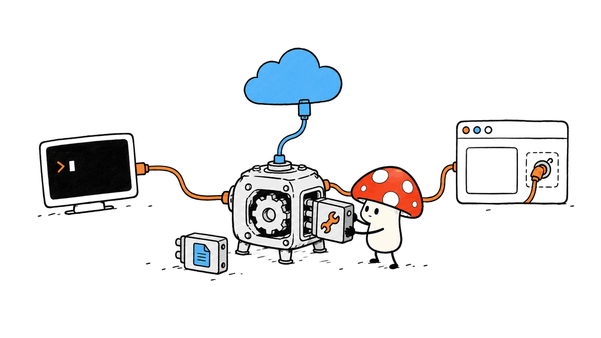
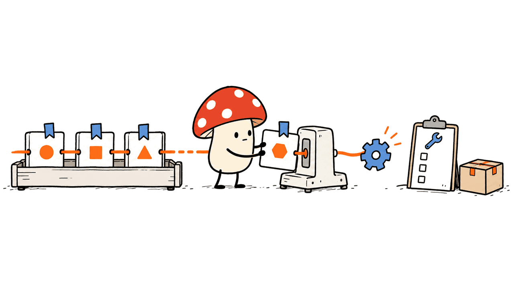
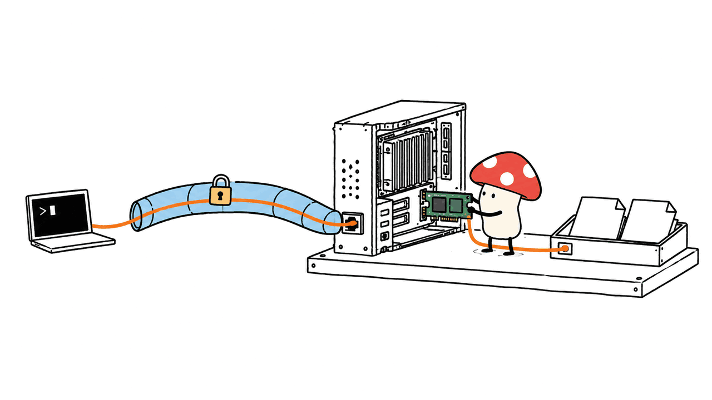

pi-rust是一个能嵌入自己程序的编程Agent运行时，也提供现成的终端助手rpi。它适合希望控制模型、工具、会话和执行过程的开发者；如果只想装好就用，仍应先评估其功能与文档成熟度。

项目采用MIT许可，源自Mario Zechner的Pi TypeScript SDK设计，后来加入独立的Rust插件与执行基础设施。它不加载TypeScript运行时，也不能因此直接运行Pi的npm扩展。

本文原文：https://blog.mushroom.cv/blog/pi-rust-agent-runtime/

代码：https://github.com/bigfish1913/pi-rust

文档：https://rpi.bigfisharc.cn/docs.html

Mycelium Protocol在2026年10月27日核对固定提交`21849cc2fe157889034aee4772b2b904e2d028c1`及GitHub发布v0.10.0，并在Apple Silicon Mac上完成一个真实工具执行闭环。没有调用付费模型，没有评测修复代码的成功率，也没有复现官方速度对比。封面为模块化运行时的主题示意，非软件截图。

## 为什么它不只是另一个终端聊天工具？

rpi把代理循环作为库提供，而终端只是一个使用者。你可以直接运行CLI，也可以把代理嵌进自己的桌面程序、服务或开发平台，订阅事件、注册工具、控制取消和输出，不必把外部CLI的终端文本再解析一遍。

当前工作区有10个`rpi-*`库，另外还有4个示例成员；不能把14个工作区成员都算成产品库。README部分发布说明仍写“九个库”，因此本文以Cargo工作区实际清单为准。

| 层 | 主要职责 | 适合谁关心 |
| --- | --- | --- |
| rpi-ai | 模型消息、流式输出、供应商适配 | 接入自定义模型网关 |
| rpi-agent | 代理循环、事件、工具、取消 | 嵌入自己的应用 |
| rpi-tools | 文件与命令工具、执行环境接口 | 控制代理能做什么 |
| rpi-harness | 会话树、压缩、持久化与恢复 | 管理长任务和会话 |
| rpi-runtime | 模型目录、凭据与执行绑定 | 复用宿主运行配置 |
| rpi-cli / rpi-tui | 终端入口与界面 | 直接使用编程助手 |
| rpi-plugin-sdk / extensions | 原生插件契约及加载 | 扩展工具和功能 |
| rpi-telemetry | 事件与观测契约 | 可选接入监控 |



我的判断是，这个结构对“我要做自己的Agent产品”比“我要再装一个聊天终端”更有价值。它提供的是可控制的执行底座，不会因为换成Rust就自动让模型更会写代码。

## Mac怎样安装？需要多少内存？

当前源码和v0.10.0变更记录要求Rust 1.88+；部分网页缓存仍显示旧版1.78，不应照抄。使用预编译包则不需要Rust工具链。发布资产同时有Apple Silicon与Intel macOS版本，以及Linux和Windows版本。

Apple Silicon可按项目提供的Homebrew路径安装：

```bash
brew tap bigfish1913/tap
brew install rpi
rpi --version
```

从源码包安装可固定版本：

```bash
cargo install rpi-cli --version 0.10.0 --locked
```

也可以从GitHub Releases选择对应架构的压缩包，核验配套SHA-256后解压运行。本次使用`rpi-v0.10.0-aarch64-apple-darwin.tar.gz`，没有覆盖系统安装目录，隔离了配置目录，也未导入现有API凭据。

它是Agent客户端与运行时，不是模型权重。若调用远端模型，本机不需要装下大模型；若接入本地兼容接口，模型内存、上下文容量和推理速度要另算。不能把CLI的小内存占用当成“任意大模型都能在小内存Mac上跑”。

## 本次实际验证了什么？

官方发布包与同发布页校验文件一致；`--version`返回`rpi 0.10.0`，帮助页和离线模型目录查询均正常。哈希校验确认下载内容与发布者的校验文件一致，不是额外的发布签名或独立安全审计。

为了比“能启动”多验证一步，我建立了只监听`127.0.0.1`的确定性Chat Completions流式接口。它不运行语言模型，第一轮固定返回`write`工具调用，第二轮确认工具结果后固定回复完成。

测试仅开放`write`工具，关闭扩展、技能、上下文文件和会话保存，工作目录设在任务专用目录。结果是：

- CLI退出码为0，完成两次HTTP请求。
- 真正的内置`write`工具创建了`smoke.txt`，内容逐字匹配预期。
- 第二次请求包含工具结果，最终JSON事件报告任务完成。

这验证了发布包的供应商适配、流式工具调用解析、实际文件写入和结果回传。测试不能证明真实模型会选择正确工具，也没有覆盖交互TUI、崩溃恢复、原生插件或远程服务端。

值得注意的是：测试同时启用了`--offline`，仍能调用我们明确配置的本机接口。帮助页也写明它关闭的是启动网络操作。因此，`--offline`不是网络沙箱，也不是“所有推理自动离线”的开关。

## 怎样接自己的模型？

模型可以通过Anthropic或Chat Completions兼容接口接入。自定义网关写入隔离目录下的`models.json`，再用`RPI_CODING_AGENT_DIR`选择配置目录。不要把真实密钥写进仓库。

```json
{
  "providers": {
    "local": {
      "api": "openai-completions",
      "baseUrl": "http://127.0.0.1:8000/v1",
      "apiKey": "local-placeholder",
      "models": [
        { "id": "your-model", "name": "Your local model" }
      ]
    }
  }
}
```

```bash
RPI_CODING_AGENT_DIR=/path/to/isolated-config \
  rpi --model local/your-model --tools read,docs \
  --no-extensions --no-skills --no-context-files \
  -p "阅读README并概括项目结构"
```

这里的`your-model`必须换成服务端真实模型ID，端口和认证也要按服务端设置调整；本次只测试了确定性接口，不宣称某个本地模型已经兼容。

对于推理模型，`thinkingFormat`、`requiresReasoningContent`等兼容配置影响请求格式与历史回放，不能只凭“支持OpenAI兼容”就认定任意网关都能无缝接入。

当前默认工具包括`read`、`bash`、`edit`、`write`和`docs`。帮助页有一条示例把`read,bash`称作只读，但`bash`可以修改文件，所以不能把那条示例当成权限保证。只读评估应使用明确的工具白名单，并结合工作区与操作系统权限。

## 会话恢复能保证工具绝不重复执行吗？

项目把会话组织成树，以JSONL和持久化帧记录执行进度，目标是在崩溃后从已经提交的状态继续。v0.10.0还涉及持久化批处理、可选帧侧文件及请求准备优化，但本次没有做故障注入验证。



工程上要区分“代理记住了什么”和“外部世界已经发生了什么”。写文件、发消息、扣款、部署等副作用不一定与会话日志在同一事务里。即使宿主有恢复机制，也不应直接推广成所有外部工具的端到端exactly-once保证。

做业务集成时，给有副作用的工具加入幂等键、结果查询和可重试设计，再用“工具已完成、日志尚未落盘”等故障点验证恢复行为。这是我们的集成建议，不是本次已经测得的能力。

## 插件、子代理和远程模式有哪些边界？

rpi插件是Rust `cdylib`，通过带版本协商的C ABI与宿主交互，可以扩展工具、供应商、命令与资源。它不是TypeScript插件的二进制兼容替代品；ABI稳定也不代表跨平台、跨架构的插件文件可以混用。

网页搜索、网页正文抓取是可选扩展。它们不等于交互浏览器，不能据此获得登录、点击和运行网页JavaScript的完整能力。

子代理扩展继承模型、工具和审批等配置，工具集只能缩小，不能任意扩大；文档明确说明它提供的是会话及能力范围隔离，不是操作系统沙箱。原生动态库仍应作为宿主进程中的可信代码管理。



远程模式把代理、工具和会话放在服务端，客户端主要负责输入与显示。服务端默认绑定回环地址并使用token认证；远程客户端也不支持所有本地会话树命令。token认证本身不等于传输加密，跨机器部署应结合受保护网络或隧道，而非直接公开执行端口。

本次帮助输出末尾仍残留“RPC不在当前实现内”的说明，与同页已有RPC模式及远程文档不一致。它说明文档存在漂移；我们没有因为帮助文字就断言远程功能不能用，也没有将未测的远程功能写成实测。

## 官方“启动快10倍”该怎样理解？

README报告Windows 11、x86_64、rustc 1.97.1、release构建下，rpi冷启动17.7ms、Pi为189.5ms；就绪RSS分别为12.0MiB和91.5MiB。约10.7倍与7.6倍描述的是该环境的启动与就绪占用。

其冷启动口径明确排除了LLM工作。它不是修复Bug快10倍，也不是每秒token数高10倍，更不是本次Mac实测。报告也未覆盖长会话、工具循环吞吐或TUI帧成本。

对短生命周期、频繁拉起的Agent，启动成本确实可能重要；对一次持续数分钟、主要等待模型和测试的任务，总耗时未必由启动决定。选型时应测你自己的任务完成率、模型费用、工具耗时和恢复成本。

## 常见问题

### 可以直接使用Pi的npm扩展吗？

不可以这样假设。rpi重用了设计思想与许可来源，使用独立Rust运行时和原生插件ABI，不加载原Pi的TypeScript SDK及npm扩展。

### 没有API Key也能验证吗？

可以运行版本、目录查询及项目提供的确定性测试路线。本次本机假接口工具闭环不需要真实密钥；要获得真实模型回答，仍需配置可用的模型服务。

### 是否值得取代现有编程助手？

想拥有并嵌入代理循环的Rust团队值得试用。只追求现成终端体验时，先验证模型兼容、常用工具、权限和恢复路径，不要仅凭启动速度决定迁移。

发布记录：https://github.com/bigfish1913/pi-rust/releases/tag/v0.10.0

性能口径：https://github.com/bigfish1913/pi-rust/blob/21849cc2fe157889034aee4772b2b904e2d028c1/docs/performance/benchmark-vs-pi.md

许可：https://github.com/bigfish1913/pi-rust/blob/21849cc2fe157889034aee4772b2b904e2d028c1/LICENSE

相关文章：https://blog.mushroom.cv/blog/pstack-engineering-workflow/

---

> © 2026 Author: Mycelium Protocol. 本文采用 [CC BY 4.0](https://creativecommons.org/licenses/by/4.0/deed.zh) 授权——欢迎转载和引用，须注明作者姓名及原文链接，不得去除署名后以原创发布。

<!--EN-->

pi-rust provides an embeddable coding-agent runtime and a ready-to-use terminal application called rpi. It is most interesting to developers who want control over models, tools, sessions and execution inside their own products.

The MIT-licensed project began as a Rust reimplementation of Mario Zechner's Pi TypeScript SDK and developed its own runtime and native plugin infrastructure. It does not load Pi's TypeScript runtime or npm extensions.

Original article: https://blog.mushroom.cv/blog/pi-rust-agent-runtime/

Code: https://github.com/bigfish1913/pi-rust

Docs: https://rpi.bigfisharc.cn/docs.html

Mycelium Protocol reviewed commit `21849cc2fe157889034aee4772b2b904e2d028c1` and release v0.10.0 on October27,2026. We ran a verified Apple Silicon binary against a deterministic local HTTP fixture. We did not evaluate real-model coding quality, reproduce performance ratios, or test crash recovery. The cover illustrates modular runtime components rather than showing software.

## What makes the architecture useful?

The agent loop is a library; the terminal is one consumer. An application can register tools, subscribe to events, cancel work and handle outputs directly instead of parsing another CLI's terminal output.

The workspace contains ten `rpi-*` crates plus four example members. A remaining README release summary says nine crates, so count the manifest rather than treating every workspace member as a product library.

| Layer | Responsibility |
| --- | --- |
| rpi-ai | Messages, streaming and provider adapters |
| rpi-agent | Agent loop, tools, events and cancellation |
| rpi-tools | File/command tools and execution-environment interface |
| rpi-harness | Session trees, persistence, compaction and recovery |
| rpi-runtime | Model catalogs, credentials and execution bindings |
| rpi-cli / rpi-tui | Terminal application and interface |
| rpi-plugin-sdk / extensions | Native plugin contract and loading |
| rpi-telemetry | Optional instrumentation contracts |


This is a reason to evaluate rpi as an application foundation. Rust implementation alone does not make the connected model a better programmer.

## How do you install it on a Mac?

Current source and v0.10.0 require Rust1.88+, despite older cached pages reporting1.78. Prebuilt binaries require no Rust toolchain. Release assets cover Apple Silicon and Intel Macs, Linux and Windows.

```bash
brew tap bigfish1913/tap
brew install rpi
rpi --version
# Alternative, with Rust1.88+:
cargo install rpi-cli --version 0.10.0 --locked
```

Our test used the official `aarch64-apple-darwin` archive in an isolated task directory, without replacing a system installation or importing existing credentials. Its SHA-256 matched the accompanying release checksum. That confirms agreement with the publisher's checksum, not an independent signature or security audit.

rpi is a client/runtime, not model weights. Remote inference does not require enough Mac memory to hold the model. Local inference has separate model, context and serving requirements; a small CLI footprint says nothing about whether a large model fits.

## What did the local smoke test prove?

The release binary returned `rpi 0.10.0`; help and offline model-catalog listing exited successfully. We then configured a deterministic Chat Completions SSE fixture listening only on loopback. No language model ran: its first response requested `write`, and its second acknowledged the returned tool result.

With only the write tool enabled, extensions/skills/context discovery disabled and no session persistence, the CLI completed two HTTP requests, created `smoke.txt` with exactly the expected content, returned the tool result and emitted a completed JSON result. Exit status was zero.

This exercises the provider adapter, streamed tool-call parsing, actual built-in file writing and result feedback. It does not measure reasoning, coding success, latency, interactive TUI quality, plugin behavior or recovery guarantees.

The test also used `--offline` while calling the explicitly configured local endpoint. That flag disables startup network operations; it is not a firewall or a guarantee that model calls stay offline.

## How do you connect a model?

Custom providers use a `models.json` file under the directory selected with `RPI_CODING_AGENT_DIR`. For a separately running local compatible server:

```json
{
  "providers": {
    "local": {
      "api": "openai-completions",
      "baseUrl": "http://127.0.0.1:8000/v1",
      "apiKey": "local-placeholder",
      "models": [{ "id": "your-model", "name": "Your local model" }]
    }
  }
}
```

```bash
RPI_CODING_AGENT_DIR=/path/to/isolated-config \
  rpi --model local/your-model --tools read,docs \
  --no-extensions --no-skills --no-context-files \
  -p "Read README and summarize the project"
```

Replace the endpoint, authentication and model ID with those of your actual server. This is configuration guidance, not a compatibility test of a particular local model. Reasoning-history and request-format settings can also differ between gateways.

Default tools include read, bash, edit, write and docs. One help example labels `read,bash` read-only, but bash can modify files. A tool allowlist and appropriate OS permissions matter more than that example's label. Do not commit real credentials to a repository.

## Does durable recovery mean exactly-once side effects?

The harness persists a session tree and execution frames so it can resume committed progress. Version0.10.0 includes durability batching, optional frame sidecars and request-preparation changes. We did not inject crashes to verify those behaviors.


An external operation and the agent log may not share a transaction. Recovery should therefore not be generalized into an end-to-end exactly-once promise for arbitrary deployments, messages or payments. Integration tests should cover completion-before-log-commit failures, using idempotency keys and result lookup where needed. This is our recommendation, not a tested feature claim.

## What are the extension and remote boundaries?

Native Rust `cdylib` plugins communicate through a versioned C ABI. A stable ABI does not make binaries interchangeable across architectures or operating systems, and Pi npm packages are not automatically compatible.

Web search and readable-page fetch are optional extensions. They are not an interactive browser with login, clicking and JavaScript execution. Child agents inherit effective model, tool and approval configuration; their tool set can be narrowed. Documentation describes capability/session isolation, not an OS sandbox. Native plugins run as trusted host code.


Remote mode places models, tools and session files on the server. The client handles input and rendering. The server defaults to loopback with token authentication, and some local session-tree commands are unavailable remotely. A token is not transport encryption; use a protected network or tunnel for cross-machine access.

Our binary's help footer still says RPC is outside the implementation, conflicting with RPC options and remote documentation. This is documentation drift, not evidence that remote mode either works or fails. We did not test it.

## How should you read the performance claims?

The README reports17.7ms cold start versus189.5ms for Pi and12.0MiB ready RSS versus91.5MiB, measured on Windows11 x86_64 with rustc1.97.1 and release builds. The stated10.7× startup and7.6× memory differences belong to that setup.

Cold start explicitly excludes LLM work. These numbers do not mean coding tasks complete ten times faster or token generation accelerates. They are not Mac measurements from this review. Long sessions, tool-loop throughput and TUI frame costs are outside that comparison.

Frequent short-lived agents may benefit from lower startup costs. For longer jobs dominated by inference and tests, evaluate actual completion rate, model cost, tool time and recovery effort.

## FAQ

### Can I load Pi npm extensions?

Do not assume compatibility. rpi uses an independent Rust runtime and native extension ABI rather than loading Pi's TypeScript SDK or npm extensions.

### Can I test without a real API key?

Yes. Version/catalog checks and deterministic fixtures need no real provider credentials. Useful language-model responses still require a configured model service.

### Should it replace an existing coding assistant?

It is worth evaluating for Rust teams embedding or controlling an agent loop. Validate model compatibility, tools, permissions and recovery before migrating; startup benchmarks alone are insufficient.

Release: https://github.com/bigfish1913/pi-rust/releases/tag/v0.10.0

Benchmark method: https://github.com/bigfish1913/pi-rust/blob/21849cc2fe157889034aee4772b2b904e2d028c1/docs/performance/benchmark-vs-pi.md

License: https://github.com/bigfish1913/pi-rust/blob/21849cc2fe157889034aee4772b2b904e2d028c1/LICENSE

Related: https://blog.mushroom.cv/blog/pstack-engineering-workflow/

---

> © 2026 Author: Mycelium Protocol. Licensed under [CC BY 4.0](https://creativecommons.org/licenses/by/4.0/) — free to share and adapt with attribution. You must credit the author and link to the original; removing attribution and republishing as original is not permitted.
