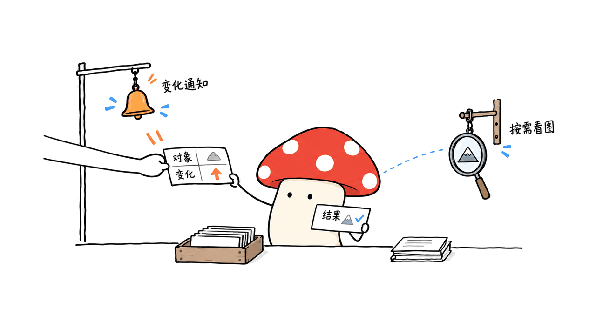
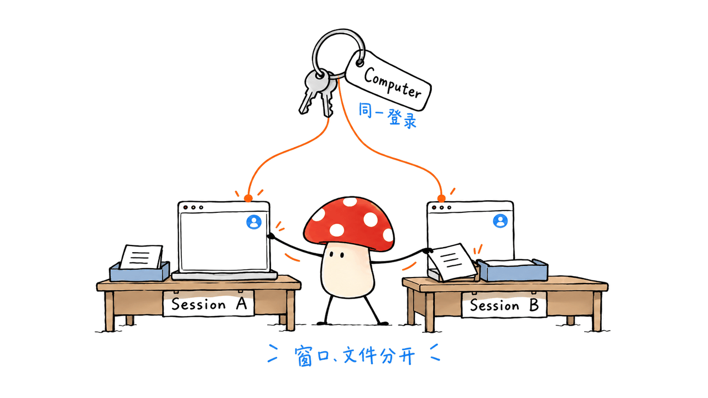
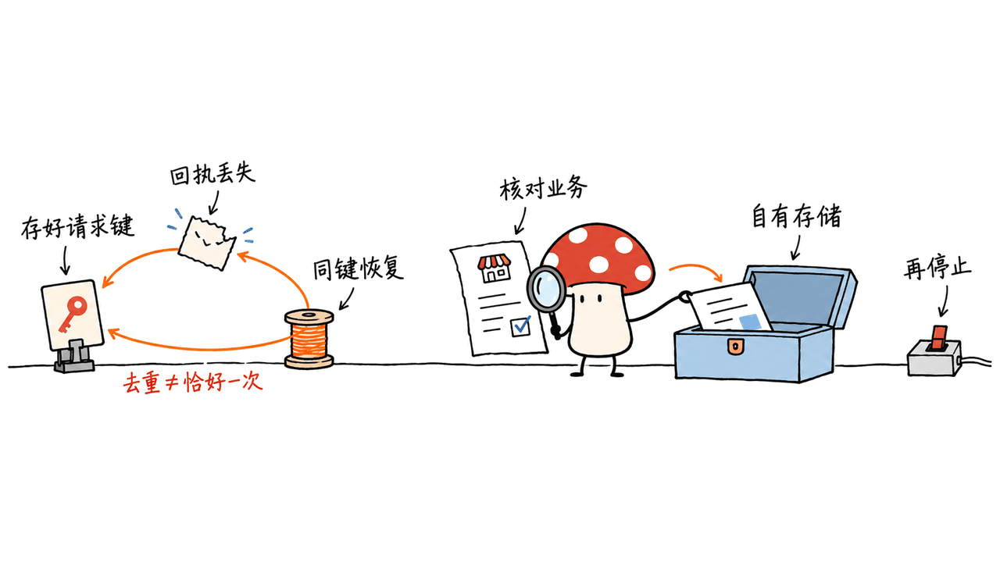

Pine Computer 把浏览器、桌面、Shell和Agent执行环境一起交付给开发者，试图减少AI在“看屏幕、猜变化、再操作”上浪费的上下文。真正值得研究的是观察协议、会话身份、恢复语义和业务验收。本文核对官方发布、产品文档和公开评测，并离线复算106条结果；没有开通私有测试、调用云端Agent或复现其速度。

## 发布故事，哪些已经核实？

Stanley Wei是Pine AI创始人兼CEO，官方公司资料可以确认。Pine Computer的公司新闻稿发布于2026年10月9日；官网介绍文章则标注10月5日，署名Dylan Wang。公司新闻稿将Dylan介绍为联合创始人及首席架构师，不能把视频传播账号、博客作者与所有技术工作混成一个人。

公司资料：https://www.19pine.ai/ai-information-page

发布新闻稿：https://www.prnewswire.com/news-releases/pine-ai-introduces-pine-computer-a-computer-built-for-ai-302903667.html

官网介绍：https://pinecomputer.io/blog/introducing-pine-computer/

官方发布页提供1分43秒视频，与素材中的103秒一致。“最初约1200粉丝”和“约2430万浏览”没有拿到同期原帖快照，本报告不将其作为已核验统计。参与发布的AISC在案例页列出了2300万浏览，并披露创作者网络参与；这能说明传播背景，不能推算全部流量来源或付费比例。

传播方披露：https://aiscwork.com/case-studies

流量是发现产品的线索，不是运行时正确性或市场付费的证据。下面只讨论可以从公开接口、文档和记录中判断的工程事实。

## 它改变的究竟是哪一层？

Pine Computer是托管云服务，组合了计算环境、运行时、Agent harness、浏览器、文件与工具。安全页面披露每台Computer使用独立的gVisor容器；它不是一台需要购买的新电脑硬件，也不是只卖一个模型接口。

官网强调三种变化：页面可以按结构读取，变化可以主动通知模型，视觉输入在需要时使用；虚拟显示在内存中按需渲染。这个方向可以减少重复读取完整画面，但不能据此宣称每种网站都能完全摆脱截图，或已经知道其浏览器补丁、事件合并算法及全部OS实现。

这里的 `epoll` 是官方对事件驱动感知的比喻。SDK向产品前端发送的任务活动和画面事件，也不等于模型内部接收变化的协议。没有公开内部源码时，不能拿一个SSE事件流就证明整套感知机制。

| 层 | 可以确认的公开信息 | 尚需实测或实现证据的部分 |
|---|---|---|
| 感知 | 官方描述结构化页面、变化通知和按需视觉 | 变化覆盖率、漏报、乱序、视觉回退比例 |
| 执行 | 有浏览器、Shell、文件、Agent与人工接管接口 | 不同网站的稳定性、动作成功与业务结果 |
| 身份 | Computer保有登录身份，多个Session复用 | 具体部署的租户权限与异常恢复表现 |
| 交付 | SDK/API、Web桌面查看器、私有测试申请 | 自托管安装、公开完整runtime源码和独立复现 |

作为工程推断，一套同类系统要可靠，变化通知至少需要关联页面或对象身份、版本与动作结果。否则“看到了新内容”仍可能误用旧控件；事件风暴也可能把省下的截图token换成大量无关通知。这是对设计的评审问题，不是我们读到了Pine内部代码。



## Computer、Session、Task和Turn如何分工？

Computer是可持续使用的身份容器；Session是其中一次工作空间，拥有自己的浏览器窗口、Shell和文件；Agent的Task容纳该Session的多个Turn。当前公开文档把一次run或answer接收的工作定义为Turn，调用方应该保存它的标识。

这不等于每个Session都拥有独立登录。官方明确：同一Computer的Session共享浏览器profile和登录身份，窗口和工作目录分开。我的工程建议是按客户身份创建Computer，在同一身份下用Session拆任务；不要拿Session名字冒充租户隔离边界。

Session中同一时刻只有一个输入控制者，Agent工作与人工接管不能同时抢焦点。多个Session并行，解决的是工作空间组织，不会自动解决多个流程修改同一远程订单、表格或账户设置的冲突。

会话文档：https://console.pinecomputer.io/docs/sessions

整体说明：https://console.pinecomputer.io/docs/how-a-computer-works

Mycelium Protocol认为，这里比“给每个Agent一个浏览器”更难的部分是明确控制权和身份：哪个用户授予了哪个工作流什么权限，谁能接管，重试是否会再做一次对外操作。这些规则需要落进你的业务数据模型。



## 长任务怎样接入，而不在重试时重复提交？

当前Agent文档提供run的幂等键、指定Turn等待与回答，以及按Task关联的事件游标。关键是先保存请求标识，再发出调用；网络断开后使用同一个标识恢复，不是重新发起一个“看起来一样”的任务。

事件为至少一次交付，因此需要去重。建议将自己的任务记录、事件应用结果和游标放进同一事务。若Session被销毁重建，即使名称一样，也不能把旧Task的游标接过去。

下面是本文设计的业务记录示意，不是Pine API请求体。凭证只记录你自己密钥系统里的引用：

```json
{
  "job_id": "invoice-export-2026-09-customer-42",
  "tenant_id": "customer-42",
  "computer_id": "stored-computer-id",
  "session_name": "invoice-export",
  "task_id": "observed-task-id",
  "turn_id": "accepted-turn-id",
  "request_key": "persisted-before-submit",
  "last_event_id": "applied-event-id",
  "business_state": "running",
  "credential_ref": "vault://customer-42/pine",
  "artifact_manifest": []
}
```

外部系统的提交还需要另一层保护。SDK对同一次run去重，并不等于远程网站上的付款、发信或建单获得“恰好一次”保证。重连后先查业务后置条件；取消Agent也不能当作撤销已经发生的操作。

`needs_input`表示该Turn以提问结束，回答开启后续Turn；业务任务仍待完成。`completed`也只表示Agent结束处理，不能直接把数据库里的业务状态改成成功。应检查返回文件及外部记录，再由你的验收逻辑确认。

Agent文档：https://console.pinecomputer.io/docs/agent

这也是不宜直接复制旧博客示例的原因：早期展示代码与当前按Turn寻址的接口可能不同。实际集成应固定SDK版本，核对runtime协议；文档提供 `require_agent_protocol!` 检查，旧runtime不支持时需要明确升级，不能把协议不支持当成普通任务冲突无限重试。

## 持久化最容易误解：保存身份，不等于保存整台工作现场

| 状态 | Stop后重新Start |
|---|---|
| Cookies、已保存的技能、获准创建的Passkeys | 按各自保存规则恢复，Beta有尽力而为的限制 |
| localStorage | 从已保存版本恢复；保存时机与Cookies不同 |
| 标签页、Session、Agent对话 | 不恢复原工作现场 |
| 工作目录、下载、产物、Session HOME | 不恢复，重要文件必须另存 |
| Session secrets | 不恢复，需要重新提供 |

`checkpoint`保存Cookies与技能，不保存工作文件或localStorage；正常Stop会尝试完成额外保存再释放运行时，但保存失败或超时仍可能释放，所以返回“已停止”不能当作“最后状态完整落盘”。Pause/Resume则保留整份内存状态，适用于获准开启该能力的项目，也仍受过期限制。

这意味着任务完成后的顺序应当是：下载产物→校验文件→写入自己的对象存储与任务记录→确认验收→再Stop。不要把浏览器登录还在，理解成昨天下载的报表、打开的标签页和Agent记忆也会回来。

持久化规则：https://console.pinecomputer.io/docs/persistence

## 登录、密钥和人工接管，边界在哪里？

应用后端持有项目密钥及Computer私钥，前端只获得短期桌面访问凭证。官方支持Blind Session让人输入密码或验证码；操作后仍要区分“人已授权这个登录身份”和“Agent可以执行哪些业务动作”。屏幕访问权、业务批准权和服务器密钥不应合并。

安全页面披露gVisor隔离、网络策略、AES-256-GCM保存状态、TPM保护和令牌有效期等控制。这些是供应商的公开说明，本文没有验证生产部署或获取独立审计材料；SOC 2 Type II在页面上的状态是“审计进行中”，不是已经获证。

还有一个容易忽略的地域区别：选择浏览器出口国家，不代表数据就存放在该国家。当前安全页面说数据存于美国。采购或数据边界评审应分别问出口位置、存储位置、子处理商与执行时访问控制，不能只看“使用自己的密钥”一句话。

安全说明：https://pinecomputer.io/trust/

对于网页中的恶意指令或被篡改文件，页面内容应作为业务数据，而不是越过用户授权的指令。本文建议把站点范围、可提交的动作、审批条件、费用上限和下载去向写成业务策略；这不是声称Pine已经通过了我们的提示注入防护测试。

## “学习技能”是不是模型会自动训练自己？

公开的Skills机制产出的是可读的 `SKILL.md` 工作流。它可以从完成的任务或人的演示形成草稿，经过审阅和激活后供后续任务使用。这和在线更新模型权重不是一回事。

技能的来源字段也不应充当安全策略。官方文档说明 `origin` 用来记录来源，不限制使用范围；因此你的站点授权仍需独立执行。一个流程跑通一次，可以成为复用候选，却不能替代版本管理和回归验收。

技能说明：https://console.pinecomputer.io/docs/skills



## 公开评测究竟说明什么？

UniPat的SaaS-Bench v1.1页面列出106个任务、23个应用和6个领域。下面是其公开系统表的相关行，成本保留各自口径；这些不是本文重跑的成绩。

| 系统 | 检查点CS | 完整任务RS | 页面列出的每任务成本 |
|---|---:|---:|---:|
| GPT-5.6 Sol + Codex | 71.1% | 29.2% | 约20.50美元 |
| Opus 5 + Claude Code | 74.3% | 31.1% | 约26.50美元 |
| Pine Computer Runtime | 78.3% | 27.4% | 约3.60美元 |

Pine官方说明该成本比较使用GPT-5.6 Luna，产品也列有自有模型；任意模型与API key接入仍在路线图中。

因此能说Pine这一行的检查点进度最高，不能说整项任务完成率最高。不同模型、harness、预算、工具和运行设置一起变化，也不能把差异全部归因于事件驱动感知。

榜单：https://unipat.ai/benchmarks/SaaS-Bench

本次对Pine公开数据仓库固定revision `bd9df2a8a140f30bf67e4c4409e9323b579d2577`，下载最新发布的结果、摘要、方法和证据索引，四个文件的SHA-256均与发布方清单一致，再用独立脚本复算：

| 复算项目 | 本次结果 |
|---|---:|
| 已接受记录／唯一任务 | 106／106 |
| 通过检查点／全部检查点 | 1,077／1,375，即78.3273% |
| 完整完成任务 | 29／106，即27.3585% |
| Agent以completed结束／超时 | 98／8 |
| 最终采用第1次／第2次尝试 | 87／19 |

106条记录不是整个尝试历史。方法说明总共125次尝试，19次因环境／评分器修复或评分错误被替换，其中16个医疗任务重跑；失败任务与8次超时仍保留。它不是纯首轮成绩，且批次元数据没有记录不可变的Computer镜像版本。

另一个复算陷阱是 `score`：它是加权积分比例，106条直接平均约76.1028%，不是检查点CS。这里的CS按检查通过数汇总计算。哈希核对只证明下载文件与发布清单一致，私有原始轨迹并未供我们重放，不能把发布方的证据索引说成独立验证任务成功。

公开数据：https://huggingface.co/datasets/pine-ai/pine-computer-saasbench-results

## 速度与成本，工程预算应该怎样算？

官网的约1.02美元是按公开模型单价计算的token成本，覆盖该评测全部尝试后摊到106项任务。榜单的约3.60美元是Pine消费者产品定价口径，两个数字不能混成同一张账；前者也不是开发者使用云服务的全部账单。

当前Overview另列标准Computer运行每分钟0.003美元，空闲计时，Pause或Stop不计该运行费用；区域代理流量每GB为4美元，直连流量免费。实际预算还需加外部API、你的存储与人工介入。举一个明确假设的例子：模型1.02美元、运行20分钟0.06美元、代理0.1GB为0.40美元，合计1.48美元，再加其他项目。它不是Pine实测平均总价。

官方另一个视频制作对比为18分08秒与5分24秒，来自各一次记录；两边模型不同，转录也分别使用本地与托管工具。它能展示一个案例，不能当作隔离runtime变量后的统一加速比，本文也没有复现“2—5倍”。

计费资料：https://console.pinecomputer.io/docs/overview

演示方法说明：https://pinecomputer.io/blog/screw-agents-workflows-context-skills-and-connectors/

工程上应同时看每项成功任务成本、端到端p50／p95耗时、人工分钟数、超时率和重试率。只降低模型账单，却增加人工收尾，并不一定降低业务总成本。

## 给产品团队的接入与验收方案

下面是本文提出的接入设计，不是Pine内部架构图，也不是已执行的客户PoC。先选择一个只读任务，例如从获准访问的门户下载账单；稳定后再做草稿录入，最后才增加需要明确批准的提交动作。

1. 后端建立用户到Computer的映射，私钥放密钥系统，任务与产物归你的数据库和对象存储。
2. 给每次业务请求持久化幂等身份，创建Session，记录Task／Turn标识和目标后置条件。
3. 前端使用短期桌面凭证展示工作，人工接管与交回要有清晰状态；超时、断网不能默认为新任务。
4. 处理事件时按Task去重并保存游标；收到结束结果后验证外部状态和文件内容，而不是只读summary。
5. 下载并保存产物，再执行停止／恢复策略；失败重试先查是否已有外部副作用。

| 验收情形 | 应保存的证据 |
|---|---|
| 页面未变、局部变化、长时间加载 | 实际动作、观察与等待耗时，避免把动画当业务变化 |
| 网络断在run返回之前 | 请求键与Turn恢复记录，没有新增重复任务 |
| 人工MFA及接管 | 控制权切换和恢复后的目标身份 |
| Stop／Start及保存失败 | 哪些状态恢复、哪些产物已在自有存储 |
| 最后一步失败 | 外部后置条件、可恢复进度与人工收尾成本 |

若任务有稳定且受支持的API，直接集成可能更简单；若工作主要跨多个无接口门户，带身份、恢复和人工接管的云端执行环境更值得试。需要完全自托管或不能接受美国数据存储时，当前Pine产品形态并不满足该约束，不应把未来开源计划当成已有部署选项。

## 目前哪些还不能当成已交付？

官网仍标注私有测试，一些集成页、SDK下载与API文档需要获批账号。公开路线图说安全审计后逐步开源harness、runtime及登录实现；本次没有找到可确认的完整公开runtime仓库，也没有访问受限页面或提交测试申请。

公开评测结果采用CC BY 4.0，但这不赋予私有轨迹或底层runtime的源码许可。GitHub上其他同名Pine桌面项目不能直接当作Stanley Wei这家公司提供的代码。

本报告的独立工作是源头交叉核查、文件校验和106条结果复算，以及据此提出的接入设计。我们没有调用Pine云端Agent，没有独立验证隔离、加密、UI操作、延迟或成本。

## 常见问题

### Pine Computer是不是另一个更强的大模型？

它交付的是云端计算与执行环境，包含运行时、浏览器、工具与Agent。模型是其中一层；不能仅根据产品口号判断任意模型都能获得相同提升。

### 78.3%意味着大多数完整业务任务已经自动完成吗？

不是。该数字是检查点通过率；最新公开批次29／106项任务完整完成，约27.36%。两种指标回答的问题不同。

### 今天可以下载源码并部署到自己的机器吗？

本次未确认完整公开runtime仓库，当前产品是私有测试云服务。评测数据公开和未来开源承诺，都不能替代可安装源码、许可证与部署文档。

## 一手资料

官网：https://pinecomputer.io/

发布介绍：https://pinecomputer.io/blog/introducing-pine-computer/

产品文档：https://console.pinecomputer.io/docs

评测与方法：https://huggingface.co/datasets/pine-ai/pine-computer-saasbench-results

上游基准：https://unipat.ai/benchmarks/SaaS-Bench

相关研究：https://blog.mushroom.cv/blog/harness2-recursive-agent-improvement/

封面为本地生成的云端隔离工作空间概念图，不是Pine机房、产品界面或本次实测环境照片。

---

> © 2026 Author: Mycelium Protocol. 本文采用 [CC BY 4.0](https://creativecommons.org/licenses/by/4.0/deed.zh) 授权——欢迎转载和引用，须注明作者姓名及原文链接，不得去除署名后以原创发布。

<!--EN-->

Pine Computer packages a browser, desktop, shell and agent execution environment for developers, aiming to reduce context spent interpreting screens and rediscovering changes. The engineering questions are observation protocols, identity, recovery and business acceptance. We checked official sources and independently recomputed 106 public result records. We did not activate private-beta access, call its hosted agent or reproduce its speed.

## What is verified about the launch?

Pine AI’s official company information identifies Stanley Wei as founder and CEO. The company announcement is dated October 9, 2026; the introductory blog is dated October 5 and signed Dylan Wang, whom the release identifies as co-founder and chief architect. The distribution account, article author and engineering contributors should not be collapsed into one person.

Company facts: https://www.19pine.ai/ai-information-page

Announcement: https://www.prnewswire.com/news-releases/pine-ai-introduces-pine-computer-a-computer-built-for-ai-302903667.html

Introduction: https://pinecomputer.io/blog/introducing-pine-computer/

The official page offers a 1:43 video, consistent with 103 seconds. We did not obtain contemporaneous evidence for approximately 1,200 initial followers or exactly 24.3 million views. Launch participant AISC lists 23 million views and discloses participation by its creator network; that does not establish the provenance or paid share of all traffic.

Disclosure: https://aiscwork.com/case-studies

Exposure is a discovery signal, not evidence of runtime correctness or paying adoption.

## Which layer does it change?

Pine combines hosted computing, a runtime, an agent harness, browser, files and tools. Its trust page describes an individual gVisor container per Computer. It is neither a physical computer to buy nor just another model endpoint.

The product describes structured page reading, change notifications and visual observation when required, with virtual displays rendered in memory. These mechanisms could reduce redundant observations. Public material does not establish screenshot-free coverage for every application or disclose every browser patch and event-coalescing mechanism.

The company’s epoll analogy describes event-driven perception. Application-facing SDK activity and frame events are not necessarily the model-facing observation protocol. An SSE stream alone does not prove the internal mechanism.

| Layer | Public disclosure | Evidence still needed |
|---|---|---|
| Perception | Structured reading, changes, optional vision | Coverage, missed updates, ordering and visual fallback |
| Execution | Browser, shell, files, agents and takeover | Site reliability and verified business outcomes |
| Identity | Computer identity shared by sessions | Tenant boundaries and failure behavior in deployment |
| Delivery | SDK/API, desktop viewer, beta access | Complete public runtime source and self-hosted reproduction |

As an engineering inference, a comparable design needs observations associated with page/object identity, versions and action results. Otherwise an update can still trigger action on a stale control, and event noise can replace screenshot overhead with notification overhead. These are review questions, not recovered Pine implementation details.


## Computer identity and concurrent workspaces

A Computer is the durable identity boundary. Sessions separate browser windows, shells and files. An agent Task contains successive Turns; current documentation addresses accepted run or answer work by Turn identity.

Sessions on the same Computer share its browser profile and sign-ins. Our recommendation is to map distinct customer identities to distinct Computers and use sessions for workflows within an identity. Session naming is not a tenant isolation mechanism.

Only one driver controls session input at a time. Human takeover and agent interaction cannot both own it. Concurrent sessions also do not automatically serialize conflicting changes to the same remote order or account.

Sessions: https://console.pinecomputer.io/docs/sessions

Architecture overview: https://console.pinecomputer.io/docs/how-a-computer-works

Mycelium Protocol’s assessment is that identity and control ownership matter more than merely provisioning another browser. Record which user authorized which workflow and how takeover or retries affect external actions.


## Integrate long jobs without duplicate submissions

Current Agent documentation offers request idempotency, Turn-addressed waiting and answers, and Task-bound event cursors. Persist request identity before calling. A lost response should recover the same work rather than submit an equivalent-looking new job.

Events are delivered at least once. Apply each event and advance its cursor transactionally with your business changes. Recreating a session under the same name does not make an old Task cursor valid for the replacement.

This is our application record proposal, not a Pine API request:

```json
{
  "job_id": "invoice-export-2026-09-customer-42",
  "tenant_id": "customer-42",
  "computer_id": "stored-computer-id",
  "session_name": "invoice-export",
  "task_id": "observed-task-id",
  "turn_id": "accepted-turn-id",
  "request_key": "persisted-before-submit",
  "last_event_id": "applied-event-id",
  "business_state": "running",
  "credential_ref": "vault://customer-42/pine",
  "artifact_manifest": []
}
```

Request deduplication does not grant exactly-once payments, emails or orders in remote websites. After uncertain execution, inspect the business postcondition. Cancellation does not undo already committed side effects.

A needs_input ending requires a continuation, while completed only establishes that the agent ended processing. Neither automatically establishes business success. Validate artifacts and remote state independently.

Agent contract: https://console.pinecomputer.io/docs/agent

Do not mix earlier launch snippets with a newer protocol. Pin the SDK and check runtime support; the documented require_agent_protocol! check can identify older runtimes. Unsupported protocol is not an ordinary job conflict to retry forever.

## Persistence preserves selected state

| State | After Stop and Start |
|---|---|
| Cookies, saved skills and approved passkeys | Restored according to their save rules, with beta limitations |
| localStorage | Restored from its separately saved version |
| Tabs, sessions and agent conversation | The original working context does not return |
| Working files, downloads, artifacts and session HOME | Not restored; export them |
| Session secrets | Supply them again |

Checkpoint saves cookies and skills, not localStorage or work files. Stop attempts to save before releasing the runtime, but failed or timed-out saves can still lead to release. A stopped result is not a complete durability certificate. Pause/Resume preserves memory for enabled projects and remains subject to expiry.

Our proposed closeout order is export, validate, store artifacts and business progress, confirm acceptance, then Stop. A restored sign-in does not imply yesterday’s report or conversation is restored.

Lifecycle reference: https://console.pinecomputer.io/docs/persistence

## Keys, login and human control

The backend owns project credentials and Computer private keys; the frontend receives short-lived desktop access. Blind Sessions let a person enter a password or code. Login authorization still needs to be separated from authorization for subsequent business actions.

The trust page discloses gVisor, network policies, AES-256-GCM saved-state encryption, TPM protection and scoped tokens. These are supplier disclosures, not controls we independently tested. The page says its SOC 2 Type II audit is in progress, not completed certification.

Egress country and storage jurisdiction are distinct: the current page states data is stored in the United States. Review storage, subprocessors and runtime access separately from where a browser exits to the internet.

Trust: https://pinecomputer.io/trust/

Treat hostile page text and downloaded files as task data rather than new authority. We recommend explicit site scope, permitted actions, approval conditions, spend limits and output destinations. We did not test Pine’s prompt-injection defenses.

## Learned skills are reviewed workflow artifacts

The public Skills mechanism produces a readable SKILL.md from finished work or a human demonstration. A draft is reviewed and activated before future runs use it. This is not evidence of online model-weight training.

The documented origin field records provenance, not an enforced site boundary. Keep authorization policy separate. A successful demonstration makes a workflow reusable, but does not replace versioning and regression acceptance.

Skills: https://console.pinecomputer.io/docs/skills


## What the public benchmark establishes

UniPat’s SaaS-Bench v1.1 covers 106 tasks in 23 applications and 6 domains. Selected published rows follow; none was rerun by us:

| System | Checkpoint CS | Fully resolved RS | Listed task cost |
|---|---:|---:|---:|
| GPT-5.6 Sol with Codex |71.1%|29.2%|~$20.50|
| Opus 5 with Claude Code |74.3%|31.1%|~$26.50|
| Pine Computer Runtime |78.3%|27.4%|~$3.60|

Pine identifies GPT-5.6 Luna in its cost comparison and also lists a proprietary model in the product. Bring-your-own-model/key access remains on its roadmap.

Pine leads checkpoint progress here, not full-task completion. Model, harness, budget and tools vary together; this is not an ablation isolating event-driven perception.

Table: https://unipat.ai/benchmarks/SaaS-Bench

We pinned Pine’s dataset to revision bd9df2a8a140f30bf67e4c4409e9323b579d2577. The result, summary, methodology and evidence-index files matched the publisher’s SHA-256 list. Our separate script recomputed:

| Check | Recomputed value |
|---|---:|
| Accepted records / unique tasks |106/106|
| Passed / total checks |1,077/1,375 =78.3273%|
| Fully resolved tasks |29/106 =27.3585%|
| Completed endings / timeouts |98/8|
| Accepted attempt1 / attempt2 |87/19|

The accepted rows are not the entire attempt history. The methodology reports 125 attempts, with 19 replaced following environment/grader fixes or grading errors, including 16 healthcare reruns. Failures and 8 timeouts remain. This is not a first-attempt-only result, and immutable Computer image identity was not recorded in batch metadata.

The score field is a weighted-points ratio. Averaging its 106 values gives approximately 76.1028%, not checkpoint CS; the latter aggregates check counts. Public-file hashes establish file identity against the publisher’s manifest. Private raw traces were not replayed, and an evidence index is not independent verification of task success.

Dataset: https://huggingface.co/datasets/pine-ai/pine-computer-saasbench-results

## Reconcile speed and billing

Pine’s approximately $1.02 is model-token cost at public model prices, averaged across106 tasks including all attempts. The approximately $3.60 leaderboard figure uses Pine’s consumer-product pricing. Neither should be silently substituted for an all-in developer-cloud bill.

Current Overview pricing lists $0.003 per standard Computer minute, including idle time; paused and stopped Computers incur no runtime charge. Regional proxy traffic costs $4 per decimal GB; direct traffic is free. Add external APIs, your storage and human intervention.

An explicit hypothetical budget is$1.02 in model usage + 20 runtime minutes at$0.06 +0.1GB proxy traffic at$0.40 =$1.48 before other costs. This is arithmetic, not Pine’s measured average total price.

A separate official video-production comparison records one 18:08 turn versus one 5:24 turn. It changes models and uses local versus hosted transcription. It illustrates one workload, not a controlled runtime speedup. We did not reproduce the 2–5× claim.

Pricing: https://console.pinecomputer.io/docs/overview

Demo methodology: https://pinecomputer.io/blog/screw-agents-workflows-context-skills-and-connectors/

Measure cost per successful job, end-to-end p50/p95, human minutes, timeouts and retries. Lower model spend does not necessarily lower the total cost of a workflow requiring more manual completion.

## An integration and acceptance plan

This is our proposed design, not Pine’s internal architecture or a completed customer PoC. Start with authorized, read-only invoice retrieval. Add draft entry after that works, then separately approved submission actions.

1. Map customers to Computer identities; store private keys in a credential system and business progress/artifacts in your own storage.
2. Persist request identity, Task/Turn references and expected postconditions before execution.
3. Use short-lived desktop access for the frontend and explicit human takeover states; uncertain responses must not imply a new task.
4. Deduplicate Task events and verify remote state and file contents after the agent finishes.
5. Export outputs before lifecycle cleanup; inspect side effects before retrying failed work.

| Acceptance scenario | Evidence to retain |
|---|---|
| Unchanged page, local update, prolonged loading | Actions, observations and waiting time |
| Network loss before run returns | Same request identity, recovered Turn, no duplicate job |
| MFA and human takeover | Ownership transitions and restored target identity |
| Stop/Start or failed save | Restored state versus separately stored artifacts |
| Final-step failure | Remote postcondition, recoverable progress, manual cost |

A stable supported API may be simpler for narrow workflows. A cloud execution environment becomes more relevant across portals without interfaces. Full self-hosting or a requirement excluding US data storage is not met by the current hosted product; a future release promise is not an available deployment option.

## Availability and verification limits

The site remains private beta. Some integration material, SDK downloads and API references need approval. Its roadmap promises phased source releases after security review; we did not locate a confirmed complete public runtime repository or attempt restricted access.

The public benchmark records are CC BY 4.0. That license does not grant access to private traces or license the runtime. Unrelated GitHub projects named Pine are not automatically this company’s code.

Our independent work was source comparison, public-file integrity checks, result recomputation and integration analysis. We did not call Pine’s hosted agent or independently test isolation, encryption, UI behavior, latency or cost.

## FAQ

### Is Pine Computer another stronger model?

It provides a hosted execution environment including a runtime, browser, tools and agent. A model is one component. The product claim does not prove equal improvements with arbitrary models.

### Does 78.3% mean most whole workflows finish autonomously?

No. It is a checkpoint pass rate. The latest published batch fully resolves 29 of 106 tasks, approximately 27.36%. These measure different outcomes.

### Can I download and self-host it now?

We did not confirm a complete public runtime repository. The product is a private-beta cloud service. Public evaluation records and a future open-source plan do not replace installable source, licensing and deployment instructions.

## Primary sources

Product: https://pinecomputer.io/

Introduction: https://pinecomputer.io/blog/introducing-pine-computer/

Documentation: https://console.pinecomputer.io/docs

Results and methodology: https://huggingface.co/datasets/pine-ai/pine-computer-saasbench-results

Upstream benchmark: https://unipat.ai/benchmarks/SaaS-Bench

Related research: https://blog.mushroom.cv/blog/harness2-recursive-agent-improvement/

The cover is a locally generated concept of isolated cloud workspaces, not a photograph of Pine infrastructure, its interface or our test environment.

---

> © 2026 Author: Mycelium Protocol. Licensed under [CC BY 4.0](https://creativecommons.org/licenses/by/4.0/) — free to share and adapt with attribution. You must credit the author and link to the original; removing attribution and republishing as original is not permitted.
