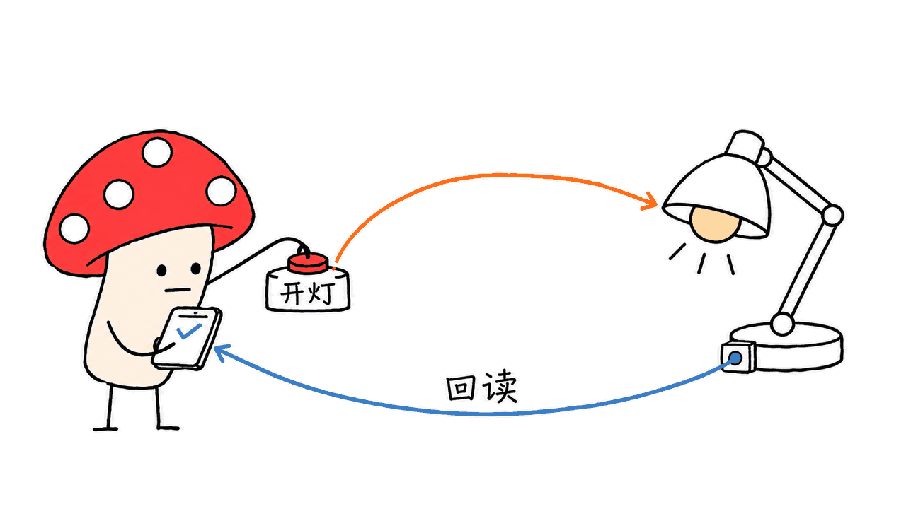

松果派（Pinea Pi）是面壁智能面向端侧 AI 应用的开发套件，想把本地模型、感知外设和智能体工具整合到同一块开发平台。对工程师而言，它最值得关注的是集成体验：从“模型能回答”走到“设备能执行”。

截至 2026 年 11 月 16 日，可以核实的不止早期开发板规划：面壁官网已记录 9 月与 Intel 联合发布松果派 Lite；Pinea Pi 于 8 月通过美通社公布了 Lite、Pro 两款设备与早鸟价格。但本次仍未找到整套硬件的独立开源仓库，也未核验当前发货状态。旧产品页还保留“正在筹备中”，不能用它否定后续发布。

> 官方产品页：https://pineapi.modelbest.cn/
> 面壁智能产品说明：https://modelbest.cn/baike
> 海外产品入口：https://pineapi.com/
> 8 月官方新闻稿：https://www.prnewswire.com/news-releases/pinea-pi-defining-the-edge-ai-device-for-the-ai-native-generation-302859474.html

## Pinea Pi 到底是什么？

面壁智能官网将它定义为 AI 原生端侧智能开发板，支持本地部署和调用 MiniCPM 系列模型，用于端侧应用开发、模型验证与智能硬件原型设计。官方公司介绍提到 NVIDIA Jetson 系列模组，并列出 275 TOPS（INT8）算力。这是厂商给出的计算规格，不是本次实测的生成速度，也不能直接换算成每秒能完成多少次 Agent 任务。

官方 8 月新闻稿进一步区分了两款产品：Lite 使用 Intel 平台、标称最高 180 TOPS，早鸟价 1,999 美元；Pro 使用 NVIDIA 平台、标称 275 TOPS，早鸟价 2,999 美元。这些是当时的厂商报价，不能当作当前含税到手价，也不能跨平台只凭 TOPS 比较真实推理性能。

发布方还描述了 Ubuntu、本地 MiniCPM 模型、摄像头、麦克风阵列和扬声器，以及名为 Piny 的伴侣功能。自然语言编排工具、视觉与语音交互、本地记忆构成它的产品想象。其“零延迟”“数据不出设备”等宣传，本次没有实测，不宜按字面变成性能或隐私保证。

具体采购前仍应索取实际模组型号、内存容量、接口表、散热和供电要求、系统镜像及支持的模型版本。“Jetson 系列”不足以唯一确定一块板的配置；网上关于特定型号的转述，也不能替代当前供货规格。

普通开发板提供的是计算资源。Agent 硬件套件如果做好，还应提供稳定的摄像头和音频接入、模型运行服务、工具接口、任务状态和故障恢复。真正节省的时间，往往发生在这些连接处。

## 它开源了吗？应该看哪几个仓库？

先分清三件事：模型开放、Agent 软件开放、开发板硬件开放。它们有不同的交付物和许可证，不能互相代替。

| 层次 | 本次找到的入口 | 能确认到什么程度 |
|---|---|---|
| 开发套件 | 官网及官方新闻稿 | 有 Lite / Pro 发布信息与历史早鸟价，当前交付待确认 |
| 多模态模型 | OpenBMB/MiniCPM-V | 有实际公开代码和模型入口，需按具体版本核对许可 |
| 相邻 Agent 软件 | OpenBMB/EdgeClaw | 有公开仓库，但不能直接视为松果派整机固件 |
| 硬件设计与整机镜像 | 本次未找到明确对应仓库 | 未核验原理图、BOM、刷机包与完整再制造授权 |

相关模型部署分析：https://blog.mushroom.cv/blog/minicpm-v47-moe-vision-deployment/

模型入口：https://github.com/OpenBMB/MiniCPM-V
Agent 软件入口：https://github.com/OpenBMB/EdgeClaw

我们通过 GitHub API 枚举了 OpenBMB 当前 94 个公开仓库，再检查官方产品页的可见链接，没有定位到名称明确的 Pinea Pi 专属仓库。这是有范围的检索结果，不是“它永远不会开源”的结论。社区或商务渠道是否另外提供资料，需要继续确认。

MiniCPM-V 仓库同时覆盖视觉与全模态方向，代码许可与具体模型使用条款应分别阅读。EdgeClaw 的 README 将自身描述为端云协同个人助手，列出路由、记忆与工具治理等组件。它可以作为学习软件结构的入口；本次没有验证它在松果派上的安装兼容性，也没有把端云协同写成默认完全离线。

## 工程师怎样把“硬件 Agent”做成可靠功能？

下面是 Mycelium Protocol 的实现建议，不是松果派已交付 API 的说明。

先选一个可验收的小任务，例如“按键后拍摄桌面物品，识别类别，再点亮对应指示灯”。让摄像头产生带时间戳的输入，模型输出受约束的类别，工具层只接受合法灯号，最后读取设备状态，判断灯是否真的亮起。

这里至少需要区分四种状态：已理解、已请求、已执行、已确认。模型说“完成了”只能算文本输出；驱动返回、传感器回读或可观察的设备状态，才构成执行证据。重复下发同一请求，还要避免让电机重复移动或让继电器反复动作。

再把系统拆开：感知负责采集与缓冲，推理负责理解，任务控制负责超时和取消，工具适配负责设备访问。模型不直接持有任意 shell 或全部设备权限。先给它三个稳定、可回读的小工具，比一开始开放整个操作系统更容易定位问题。

实时性也要分开看。语音附和、图像理解、工具执行、机械控制有不同的时间要求；涉及持续运动的控制环应由适当的控制器承担，不要把每个控制周期都交给语言模型等待生成。

## 买之前应如何验收？

建议用自己的输入做一张验收表，不把演示视频当成稳定性报告。

- 固定模型、量化格式、输入分辨率、上下文长度和功耗模式，记录完整配置。
- 分别记录采集、首个响应、完整回答、工具执行和结果确认耗时，观察中位数与慢请求。
- 在断开外网后重做任务，区分安装下载依赖与运行时云端依赖；检查实际出站流量。
- 连续运行并观察内存、温度、降频、音频积压，以及取消任务后设备是否停下。
- 对识别错误、相机断开、工具超时、重启后的任务重放给出明确结果。

本次没有拿到开发板，也没有运行板端模型，因此不提供延迟、功耗、准确率或离线成功率数据。上面的项目是建议的验收方法，不是声称已经通过的测试。

## 常见问题

### Pinea Pi 是开源版树莓派吗？

不能这样下结论。它是面壁智能的端侧 AI 开发平台；是否开放硬件、开放哪些设计文件，需要对应仓库和许可证支持。名字里的 Pi 不构成硬件开放许可。

### 现在可以买到、多少钱？

官方 8 月给过 Lite 1,999 美元、Pro 2,999 美元的早鸟价，不是本次核验的当前售价。海外官网本次访问发生 TLS 握手失败，未完成下单或交付核验；应向官方确认现货、税费、套件清单和售后。

### 不等开发板，今天能先做什么？

可以从公开模型和 Agent 软件研究感知、推理、工具、回读的接口设计，在已有设备上验证一个小闭环。等硬件规格明确，再迁移驱动和推理后端，避免把业务逻辑绑死在尚未确认的专有接口上。

松果派的价值，要由一套可复现的端侧开发体验来证明。工程师值得借鉴的，是把模型能力组织成有边界、有反馈的设备功能；选型则应等交付规格、许可和自己的验收结果说话。

## 来源与核查范围

核查日期：2026-11-16。结合 8 月官方海外新闻稿与 9 月公司新闻更新纠正旧页面时间线；海外官网访问失败不代表产品停服。未进行购机、账号登录、GPU 推理或真实硬件控制测试。封面与正文配图均为概念示意，并非产品实拍。

https://pineapi.modelbest.cn/
https://modelbest.cn/baike
https://www.modelbest.cn/
https://www.prnewswire.com/news-releases/pinea-pi-defining-the-edge-ai-device-for-the-ai-native-generation-302859474.html
https://www.prnewswire.com/news-releases/three-native-capabilities-how-pinea-pi-defines-the-edge-ai-device-302860026.html
https://api.github.com/orgs/OpenBMB/repos?per_page=100
https://github.com/OpenBMB/MiniCPM-V
https://github.com/OpenBMB/EdgeClaw

---

> © 2026 Author: Mycelium Protocol. 本文采用 [CC BY 4.0](https://creativecommons.org/licenses/by/4.0/deed.zh) 授权——欢迎转载和引用，须注明作者姓名及原文链接，不得去除署名后以原创发布。

<!--EN-->

Pinea Pi is ModelBest’s edge AI development kit, intended to bring local models, perception and agent tools into a usable hardware platform. Its potential engineering value is the integration work between a model response and a confirmed device action.

As of November 16, 2026, official updates go beyond the early board plan: ModelBest records a September Lite launch with Intel, and an August Pinea Pi press release announced Lite and Pro with early-bird pricing. A dedicated complete-hardware repository and current fulfillment were not verified. The old product page retains preparation text; that does not negate the later announcement.

Product: https://pineapi.modelbest.cn/
Company product description: https://modelbest.cn/baike
Overseas product entry: https://pineapi.com/
August vendor release: https://www.prnewswire.com/news-releases/pinea-pi-defining-the-edge-ai-device-for-the-ai-native-generation-302859474.html

## What is Pinea Pi?

ModelBest describes an AI-native edge development board for local MiniCPM deployment, application development, model validation and hardware prototyping. Its company overview names NVIDIA Jetson modules and a 275 TOPS INT8 compute specification. This is a vendor specification, not our measurement of generation speed or completed agent tasks per second.

The August vendor release distinguishes Lite, using Intel with up to 180 TOPS and a $1,999 early-bird price, from Pro, using NVIDIA with 275 TOPS and a $2,999 early-bird price. These historical quotes are not verified current delivered prices; cross-platform TOPS figures do not establish real inference performance.

The release also describes Ubuntu, local MiniCPM models, camera and audio hardware, and a Piny companion. The product combines natural-language workflows, multimodal interaction and personal memory. Its zero-latency and local-data claims were not independently tested here.

Before purchasing, request the actual module, memory capacity, interface list, power and cooling requirements, OS image, and supported model versions. A reference to the Jetson family does not determine a unique shipping configuration.

A useful agent kit needs more than compute. Stable sensor ingestion, inference services, tool adapters, task state and recovery determine how much integration work it actually removes.

## Is the complete kit open source?

Model availability, agent software licensing and open hardware are separate questions. A public model repository does not license a board design or provide a flashable system image.

| Layer | Verified entry point | Evidence boundary |
|---|---|---|
| Development kit | Website and vendor release | Lite/Pro announcement and historical prices; fulfillment unverified |
| Multimodal models | OpenBMB/MiniCPM-V | Public code and model links; check version-specific terms |
| Adjacent agent software | OpenBMB/EdgeClaw | Public software, not proof of complete board firmware |
| Board design and system image | No dedicated repository located in this review | Schematics, BOM, flashing artifacts and reproduction rights unverified |

We enumerated all 94 public repositories returned for OpenBMB and checked visible product-page links. We did not identify a clearly named Pinea Pi repository. This bounded search does not prove permanent nonavailability, nor exclude documentation distributed through other official channels.

MiniCPM-V covers visual and omni-modal model work; examine code licensing and the selected model’s terms separately. EdgeClaw describes an edge–cloud collaborative assistant with routing, memory and tool governance. It is a software learning resource, not a tested Pinea Pi installation recipe. Edge–cloud collaboration also does not imply a default offline-only deployment.

Related model deployment review: https://blog.mushroom.cv/blog/minicpm-v47-moe-vision-deployment/

Models: https://github.com/OpenBMB/MiniCPM-V
Agent software: https://github.com/OpenBMB/EdgeClaw

## How should engineers build a reliable hardware agent?

The following is Mycelium Protocol’s proposed implementation approach, not documentation of shipping Pinea Pi APIs.

Start with one observable task: press a button, photograph a tabletop object, classify it, and illuminate the matching indicator. Timestamp the captured input, constrain the model’s category output, restrict the tool to valid indicator IDs, and read device state after execution.

Track understood, requested, executed and confirmed as separate states. A generated sentence saying “done” is not physical confirmation. Use driver results or observable feedback. Deduplicate repeated requests where replay could move a motor twice or toggle a relay unexpectedly.

Separate sensor capture and buffering, model inference, task cancellation and timeouts, and device adapters. Begin with three narrow tools with observable results rather than unrestricted shell and device access. This also makes failures easier to diagnose.

Speech responsiveness, visual reasoning, tool calls and physical control have different timing requirements. Use suitable controllers for continuous motion loops instead of waiting for a language model on every control cycle.

## What should an acceptance test measure?

Use your own inputs and retain the configuration. Record the model revision, quantization, image resolution, context length and power mode. Measure capture, first response, complete answer, tool execution and physical confirmation separately, including slow requests.

Repeat the task without external connectivity. Separate setup downloads from runtime dependencies, and inspect actual outbound traffic. Run sustained workloads to observe memory, temperature, throttling, audio queues and whether cancellation stops the device.

Include wrong classifications, camera loss, tool timeouts and task replay after reboot. A repeatable success path plus explicit failure behavior is more useful than a single polished demonstration.

We did not obtain a board or run on-board inference. No latency, power, accuracy or offline success rate is claimed here. These are proposed acceptance checks, not completed hardware tests.

## FAQ

### Is this an open-source Raspberry Pi alternative?

That description is unsupported by the evidence reviewed. Pinea Pi is ModelBest’s edge AI development platform. Hardware openness requires identifiable design artifacts and licensing; the name does not establish either.

### Can I buy it now, and at what price?

The August early-bird quotes were $1,999 for Lite and $2,999 for Pro. They are not verified current prices. Access to the overseas website failed with a TLS handshake error, so no checkout or fulfillment was confirmed. Ask about stock, taxes, contents and support.

### What can I do before the board specification is confirmed?

Study the public model and agent software, and implement one perception–inference–tool–feedback loop on existing equipment. Keep application logic independent from device drivers and inference backends so later hardware migration remains practical.

The engineering case for Pinea Pi ultimately rests on reproducible integration and actual delivery. Borrow the idea of a bounded, observable device workflow today; base procurement on confirmed specifications, licenses and your own acceptance results.

## Sources and review scope

Reviewed November 16, 2026. August vendor releases and September company news update the stale landing-page timeline. Failure to access the overseas website does not establish service closure. No purchase, account login, GPU inference or physical device control was performed. All article images are conceptual illustrations, not product photographs.

https://pineapi.modelbest.cn/
https://modelbest.cn/baike
https://www.modelbest.cn/
https://www.prnewswire.com/news-releases/pinea-pi-defining-the-edge-ai-device-for-the-ai-native-generation-302859474.html
https://www.prnewswire.com/news-releases/three-native-capabilities-how-pinea-pi-defines-the-edge-ai-device-302860026.html
https://api.github.com/orgs/OpenBMB/repos?per_page=100
https://github.com/OpenBMB/MiniCPM-V
https://github.com/OpenBMB/EdgeClaw

---

> © 2026 Author: Mycelium Protocol. Licensed under [CC BY 4.0](https://creativecommons.org/licenses/by/4.0/) — free to share and adapt with attribution. You must credit the author and link to the original; removing attribution and republishing as original is not permitted.
