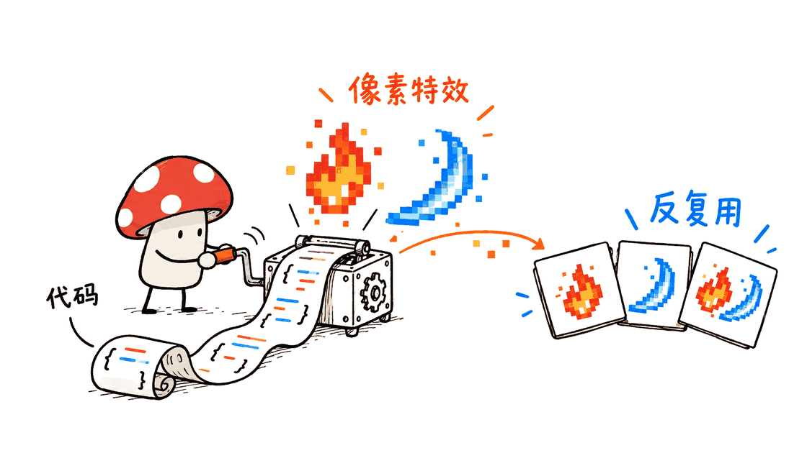
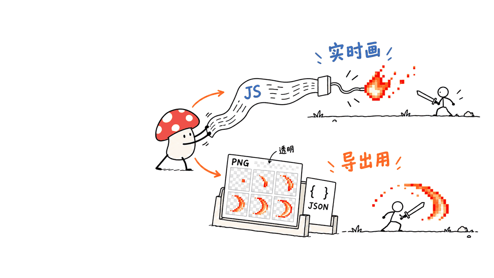

pixelfx是一套可以用代码修改的二维像素特效库：既能放进网页游戏实时播放，也能先导出精灵图，再交给其他游戏引擎。它把现成效果、预览工具和Agent改稿流程放在同一个仓库里。

原始项目是Patch发布的 `patch-gg/pixelfx`，代码与特效采用MIT许可。此次核查确认了232款特效、20个分类和27套命名色板；画廊字体另有许可，后文单独说明。

仓库：https://github.com/patch-gg/pixelfx

在线画廊：https://patch-gg.github.io/pixelfx/

核查固定到提交 `fe7103c36d94e02f2d7df7d8f7a341e493837cde`，日期为2026年10月31日。GitHub API记录的建仓时间为10月30日，本次读取时为451星；这是动态快照，不是对“一天新增多少星”的独立统计。

封面采用官方README中的特效展示动画画面。它展示项目本身的效果，不是另用图片模型生成的示意图。

## 232款特效，实际覆盖什么？

逐个导入效果模块并统计目录，得到以下分布：

| 类型 | 数量 | 类型 | 数量 |
|---|---:|---|---:|
| 火焰 | 12 | 爆炸 | 12 |
| 水 | 12 | 冰 | 10 |
| 闪电 | 11 | 科幻 | 12 |
| 近战 | 12 | 命中 | 11 |
| 投射物 | 13 | 生成与死亡 | 10 |
| 奥术 | 12 | 神圣 | 10 |
| 暗影 | 12 | 状态 | 13 |
| 自然 | 13 | 天气 | 12 |
| UI反馈 | 12 | 拾取物 | 11 |
| 转场 | 10 | 小生物 | 12 |

所以它不只是刀光和法术库。按钮反馈、拾取闪光、角色状态和天气，也可以使用同一套绘制与导出工具。不过，这些是不同设计的效果，不代表232套完整游戏机制。

每个效果对应 `src/fx/<category>/<name>.js`。本次统计中，112个走按时间直接绘制的接口，120个走带状态的模拟接口。后者包含粒子等持续更新的对象。

两类效果都向颜色与光照缓冲区写像素。它们没有在运行时调用图片生成模型；Agent的作用是编写、阅读和修改这些程序。



## 画廊能直接导出什么？

画廊支持预览、换色、镜像、重新取随机种子，并生成精灵图。代码中的27套色板，在界面里表现为27个命名选项，另加一个使用效果原配色的默认选项，共28项。

本次用Chrome打开本地仓库画廊，实际进入特效详情、切换冰系色板并生成PNG，未遇到页面脚本错误。这验证了本地页面的这条操作路径；没有把线上托管状态或所有浏览器兼容性一并算作通过。

这里需要把“PNG序列帧”说得更准确：**画廊生成的是把各帧排进一张图的透明PNG精灵图；命令行还会配套输出帧信息JSON。** 本次没有看到默认逐帧下载成几十张独立PNG的按钮。

这一区别会影响后续工作。只拿到PNG时，还需要知道每帧尺寸、播放速度与支点；拿到配套JSON，就能少做一些手工切片和对齐。

## 本地导出实际通过了吗？

本次在Apple M4、16GB内存、macOS 26.6.2上，使用仓库原有Node工具导出了三个效果，没有安装模型或使用生成API。

| 样例 | 导出帧数 | 单帧尺寸 | 输出 |
|---|---:|---|---|
| `ice/frost-nova` | 103 | 288×192 | PNG精灵图＋JSON |
| `melee/sword-slash` | 24 | 136×104 | PNG精灵图＋JSON |
| `fire/torch` | 60 | 72×120 | PNG精灵图＋JSON |

三份PNG都检查到了透明和非透明像素，图像尺寸与JSON一致，帧数与元数据一致。三个样例的播放元数据均为30fps；这不是游戏实际运行帧率测试。

程序还附有全库质检脚本，用于发现越界绘制、循环接缝、随机性不一致等问题。本次全量运行结果为232项通过、0项失败，4个效果触发逐帧耗时告警。这是脚本在本机该次执行的阈值判断，不是目标设备的游戏性能基准；自动检查也不能替代对动作节奏与实际画面的判断。

没有在本次把资产导入Godot、Unity或真实游戏项目，也没有测量大量特效同时播放的性能。因此，“导出文件有效”与“在某台手机上能稳定跑多少特效”需要分开看。

## Skill如何让Agent改出更好的特效？

仓库带有 `skills/pixelfx/SKILL.md`，可以通过Claude Code插件安装，或复制到对应技能目录。它规定的核心过程是：找参考、写草稿、渲染、看图、改最差的地方，再检查。

```text
/plugin marketplace add patch-gg/pixelfx
/plugin install pixelfx@pixelfx
```

它要求Agent读取渲染出的contact sheet，也就是把若干帧拼到一起的检查图。这样能够比较轮廓、亮度变化和收尾，而不是只根据代码推测画面。

Contact sheet仍有局限：静态排列很难完整表达速度与冲击感。仓库另提供GIF和MP4预览，但需要本地有ffmpeg。判断动作时，应该同时看静态帧与连续播放。

这套方法也有明确来源。README与NOTICE致谢Hugo Duprez，并标明部分代码改编自Sprite Fusion的MIT特效。Hugo在原文中强调多方案试稿、视觉判断和参考积累；pixelfx把这一思路组织成了可反复执行的工具流程。

方法原文：https://www.spritefusion.com/blog/how-to-make-good-pixel-art-effects-with-claude

Skill源码：https://github.com/patch-gg/pixelfx/tree/main/skills/pixelfx

此次阅读了Skill并执行渲染与检查工具，没有让Claude重新创作一款效果。因此，不能把现有库的观感说成本次Agent自主迭代的成绩。


## 怎样接入游戏，Mac需要什么？

项目声明Node.js 18或以上。基础PNG渲染工具使用Node内置模块，浏览器运行的核心库没有运行时依赖；构建画廊有esbuild开发依赖，GIF与MP4输出需要可选的ffmpeg。

没有本地大模型的显存门槛，也没有必须购买Mac Studio的要求。若要Agent帮助改稿，模型或订阅费用需要另算；播放已有特效和导出PNG本身不需要调用模型。

一条可复现的入门路径是：

```bash
git clone https://github.com/patch-gg/pixelfx.git
cd pixelfx
git checkout fe7103c36d94e02f2d7df7d8f7a341e493837cde
node tools/serve.mjs
# 浏览器打开 http://localhost:8080/gallery/
# 结束预览后用 Ctrl+C 关闭本地服务
node tools/render.mjs ice/frost-nova --sheet
node tools/check.mjs ice/frost-nova
```

工具会把生成物写进 `records/ice/frost-nova/`。需要换配色时，可以通过参数传入色阶，先不用修改效果源文件。

| 接入方式 | 适合什么情况 | 需要补的工作 |
|---|---|---|
| JavaScript实时绘制 | 网页游戏、每个实例需要不同参数 | 更新时间、绘制层级、画布或纹理上传 |
| PNG＋JSON精灵图 | 其他引擎、提前确定的动画 | 切片、帧率、支点、导入设置 |
| 移植绘制逻辑 | 原生引擎需要动态行为 | 重写模拟与绘图接口，再对照输出 |

“Aseprite风格JSON”是数据格式描述，不保证每个引擎默认就认识它。仍应检查实际导入器，使用最近邻采样，并核对支点是否与角色位置一致。

另一个容易漏掉的问题是辉光。实时版把光照单独累加；导出精灵图则将它烘焙进颜色和透明度。深色场景中好看的效果，到了明亮地图可能显得发灰或不够亮，需要重新配色或调整合成方式。

对于独立开发者，实用的第一步不是批量导出232款，而是挑一个命中反馈、一个拾取反馈和一个技能效果，放到自己的背景与角色旁边比较。轮廓、节奏和亮度都合适，才值得扩展到整套视觉风格。



## 商用时还要注意什么？

代码与特效的MIT许可允许商业使用，同时要求保留版权与许可通知。仓库内对Hugo Duprez改编代码的说明也应该保留。

但是，`gallery/fonts/PatchPixel-Regular.woff2` 是Patch自有字体，明确不在仓库MIT许可之内。可以使用MIT特效，不代表可以把画廊字体一并复制到商业游戏或另一个网站。

许可：https://github.com/patch-gg/pixelfx/blob/main/LICENSE

例外说明：https://github.com/patch-gg/pixelfx/blob/main/NOTICE.md

如果还在考虑更完整的游戏生成流程，可以结合本站的GameFactory-3A调研阅读。pixelfx适合补齐像素特效制作环节，本次没有验证两者已经直接集成。

https://blog.mushroom.cv/blog/gamefactory-3a-open-source-coding-agent-game-generation-ue5-blender-unity/

## 常见问题

### 它是AI图片生成模型吗？

不是。现有特效由JavaScript计算像素，运行和PNG导出不依赖模型。Skill用于帮助编程Agent查找、改写和检查效果代码。

### 导出的PNG有透明背景吗？

本次三个命令行样例都验证了透明通道。它们是多帧排布的精灵图，配有JSON；不同效果仍要检查边缘、支点和目标场景的合成表现。

### 免费开源是否意味着全部文件都能直接商用？

不能一概而论。MIT覆盖代码与特效，但画廊的Patch Pixel字体被明确排除；复制时需要按实际文件核对许可和保留通知。

---

> © 2026 Author: Mycelium Protocol. 本文采用 [CC BY 4.0](https://creativecommons.org/licenses/by/4.0/deed.zh) 授权——欢迎转载和引用，须注明作者姓名及原文链接，不得去除署名后以原创发布。

<!--EN-->

pixelfx is a collection of editable, code-drawn 2D pixel effects. Developers can play them in JavaScript games or export sprite sheets for other engines. Ready-made effects, inspection tools and an agent authoring workflow live in the same repository.

Patch publishes `patch-gg/pixelfx` under MIT for its code and effects, with a separate font exception. This review confirmed 232 effects across 20 categories and 27 named palettes.

Repository: https://github.com/patch-gg/pixelfx

Gallery: https://patch-gg.github.io/pixelfx/

The inspected commit is `fe7103c36d94e02f2d7df7d8f7a341e493837cde`, checked October 31, 2026. GitHub's API recorded creation on October 30 and 451 stars at inspection time. That is a changing snapshot, not an independently measured daily growth rate.

The cover uses a frame from the official README effects montage.

## What does the collection contain?

Importing and counting the modules confirmed 20 categories: fire, explosions, water, ice, lightning, sci-fi, melee, impacts, projectiles, spawn/death, arcane, holy, shadow, status, nature, weather, UI, pickups, transitions and critters.

Counts range from ten to thirteen effects per category, totaling232. These are visual effects rather than complete combat or interaction systems. UI feedback, weather and collectibles extend the library beyond weapon slashes and spells.

Each effect is a JavaScript file under `src/fx`. Of the232 modules,112 use the pure time-based interface and120 use stateful simulation. Both draw pixels into color and additive-light buffers. No image-generation model is called during playback; the agent writes or revises the program.


## What does export actually produce?

The gallery offers playback, palette selection, mirroring, reseeding and sprite-sheet creation. Its palette selector contains27 named ramps plus one option for the effect's own colors:28 interface entries in total.

A local Chrome check opened the gallery, entered an effect dialog, selected the ice palette and generated a PNG without page-script errors. This covers that local interaction, not every browser or the availability of the hosted website.

The exported PNG is a grid of animation frames, rather than a default download of separate PNG files. CLI export additionally writes an Aseprite-style JSON file with frame rectangles, durations and pixelfx metadata. This distinction matters when choosing a slicing and playback workflow.

## What was verified locally?

Three upstream CLI exports ran on Apple M4,16GB RAM, macOS26.6.2:

| Effect | Frames | Frame size | Output |
|---|---:|---|---|
| `ice/frost-nova` |103|288×192|Transparent PNG atlas and JSON|
| `melee/sword-slash` |24|136×104|Transparent PNG atlas and JSON|
| `fire/torch` |60|72×120|Transparent PNG atlas and JSON|

All three PNGs contained transparent and visible pixels. Atlas dimensions and frame counts matched their metadata. Each example declares30fps, which is animation metadata rather than a measured game frame rate.

The upstream quality checker examines canvas spills, loop seams and randomness consistency. The full run reported232 passes, zero failures and four per-frame timing warnings. Those warnings reflect this checker’s threshold on this host/run, not target-game performance. Automated checks do not establish artistic quality, and this review did not import assets into Godot, Unity or a production game, or benchmark concurrent effects.

## How does the skill guide an agent?

The repository supplies `skills/pixelfx/SKILL.md`, installable as a Claude Code plugin:

```text
/plugin marketplace add patch-gg/pixelfx
/plugin install pixelfx@pixelfx
```

Its workflow finds references, drafts code, renders a contact sheet, inspects it, fixes the weakest feature and repeats. Contact sheets help expose silhouettes, brightness changes and endings. GIF/MP4 previews, requiring ffmpeg, remain useful for judging actual timing.

The repository credits Hugo Duprez and identifies code adapted from Sprite Fusion's MIT effects. His source article advocates multiple drafts, visual judgment and reference gathering; pixelfx packages a related process with reusable tooling. This review inspected the skill and used the render/check tools, but did not run a new Claude-authored effect through the full loop.

Method: https://www.spritefusion.com/blog/how-to-make-good-pixel-art-effects-with-claude

Skill: https://github.com/patch-gg/pixelfx/tree/main/skills/pixelfx


## How should it enter a game workflow?

The package specifies Node18 or newer. Basic PNG tools use Node built-ins; the runtime core has no runtime dependencies. Gallery building uses the esbuild development dependency, while GIF/MP4 previews optionally use ffmpeg.

No local language-model VRAM requirement or Mac Studio purchase is implied. Model assistance may incur separate subscription or API costs. Existing effects and PNG export do not need model inference.

```bash
git clone https://github.com/patch-gg/pixelfx.git
cd pixelfx
git checkout fe7103c36d94e02f2d7df7d8f7a341e493837cde
node tools/serve.mjs
# Open http://localhost:8080/gallery/ ; stop the server with Ctrl+C
node tools/render.mjs ice/frost-nova --sheet
node tools/check.mjs ice/frost-nova
```

Outputs appear in `records/ice/frost-nova/`. Palette options allow recoloring before editing source files.

| Route | Useful when | Remaining integration work |
|---|---|---|
| Live JavaScript | Parameters vary by instance | Timing, layer order, canvas or texture uploads |
| PNG/JSON atlas | Animation can be baked | Slicing, frame rate, pivot and importer configuration |
| Ported drawing logic | A native engine needs dynamic behavior | Reimplement interfaces and compare outputs |

An Aseprite-style JSON file is a format, not proof of automatic support in every engine. Check the actual importer, nearest-neighbor sampling and pivot alignment.

Glow also changes between routes. Live playback accumulates a separate light buffer; sprite sheets bake it into color and alpha. An attractive effect on a dark background may need recoloring or compositing adjustments on a bright map.

Start with a hit, pickup and spell effect in the real scene. Judge silhouette, timing and brightness next to the game's characters before adopting the full collection.


## What does the license cover?

MIT permits commercial use of code and effects while requiring preservation of copyright and license notices, including relevant adapted-code credits. It does not cover Patch's proprietary `gallery/fonts/PatchPixel-Regular.woff2`. Reusing effects does not grant permission to redistribute that gallery font.

License: https://github.com/patch-gg/pixelfx/blob/main/LICENSE

Exceptions: https://github.com/patch-gg/pixelfx/blob/main/NOTICE.md

For a broader game-generation pipeline, see the existing GameFactory-3A review. No direct integration between the two projects was tested here.

https://blog.mushroom.cv/blog/gamefactory-3a-open-source-coding-agent-game-generation-ue5-blender-unity/

## FAQ

### Is pixelfx an image-generation model?

No. JavaScript draws the effects. The skill helps a coding agent find, edit and inspect that code; existing playback and PNG exports need no model.

### Are the PNGs transparent?

The three tested CLI atlases contain alpha transparency. They arrange frames into a sheet with JSON metadata. Edges, pivots and compositing still require inspection in the intended scene.

### Can every repository file be used commercially under MIT?

No. Code and effects are MIT, while the Patch Pixel gallery font is explicitly excluded. Preserve notices and check the files actually copied.

---

> © 2026 Author: Mycelium Protocol. Licensed under [CC BY 4.0](https://creativecommons.org/licenses/by/4.0/) — free to share and adapt with attribution. You must credit the author and link to the original; removing attribution and republishing as original is not permitted.
