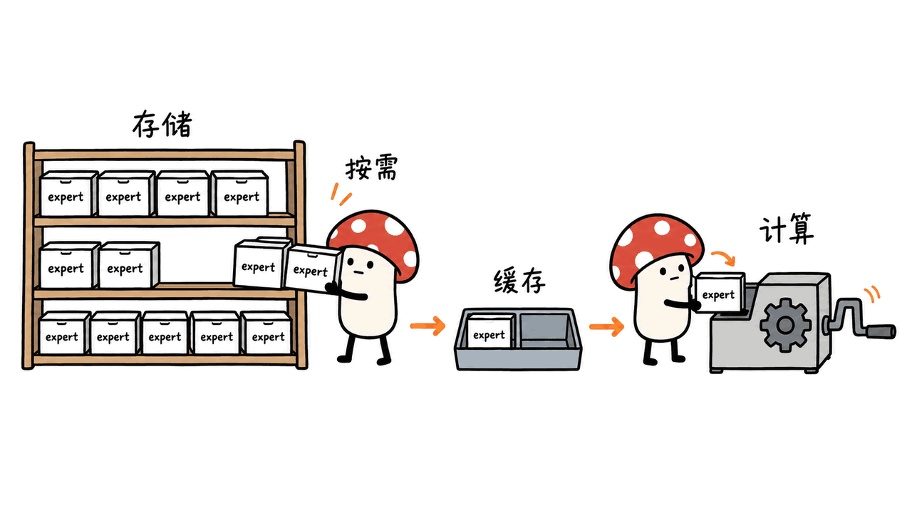
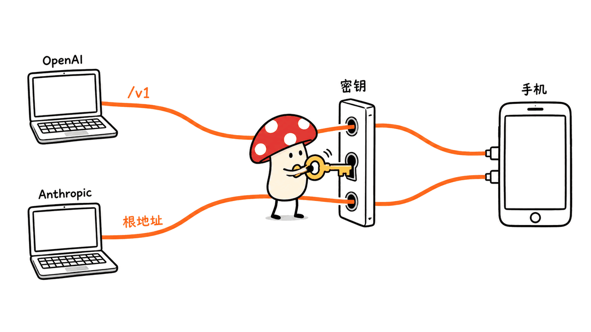
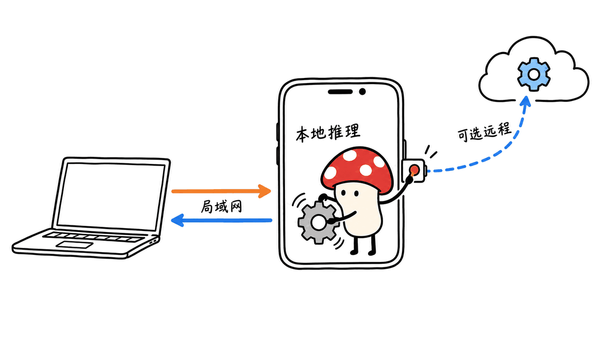

PocketOrca-LLM把安卓手机变成局域网里的大模型服务端：手机加载模型，电脑或其他客户端通过兼容接口发请求。v1.4.3的重点是加入35B级MoE专家流式加载，同时增加局域网开放开关和API Key认证。原始项目是PocketOrca/PocketOrca-LLM，应用自有代码采用MIT许可。

这不等于“任意手机都能把35B放进NPU”。官方成绩来自Galaxy S25、骁龙8 Elite、12GB内存与特定量化模型；我们完成了源码和发布APK的静态检查，没有安卓真机推理、速度或后台稳定性实测。

仓库：https://github.com/PocketOrca/PocketOrca-LLM

v1.4.3发布页：https://github.com/PocketOrca/PocketOrca-LLM/releases/tag/v1.4.3

该版本发布于2026年10月14日；本文核对日期为10月16日。源码与v1.4.3标签指向`c44f529a21158e57d2344a3da5af0939b17bd6cb`。下文区分官方更新说明、源码快照和APK资产，避免把三种证据混成一次真机验证。

## 12GB手机运行35B，靠的是什么？

v1.4.3推荐Qwen3.6-35B-A3B-Q4_K_M.gguf。官方报告在Galaxy S25上稳定解码约5–6 token/s，首字约3秒。这里的35B是总参数量，A3B表示每次激活的参数规模；未激活的专家仍需要存放在设备存储中。

专家流式加载把部分专家留在存储里，需要时读取，并用内存缓存减少重复读取。它降低常驻权重的压力，但不会取消完整模型文件、上下文、系统占用或存储带宽需求。速度还会受到提示词长度、缓存冷热、上下文、散热和可用内存影响。

官方建议先把MoE模型导入应用目录，并启用O_DIRECT直接I/O以改善读取。APK里的bmoe配置也包含`--moe-stream`、`--cache-mb auto`、`--cache-ceil-mb 4000`和4096上下文。这些是配置参数，不是整机内存峰值或任意设备的容量保证；不要把缓存上限4000MB写成“35B总共只用4GB”。

作者还称与全量加载结果byte-identical。我们没有比对模型输出、数值或完整参数矩阵，因此仅保留为作者宣称。它更不等于不同量化格式没有精度差异。



我的判断是，这个方案首先扩展了“能不能加载”，随后才是“能不能持续好用”。约5–6 token/s可以用于部分个人交互和后台任务，但不能据此推出多用户吞吐、长文预填充速度或整晚服务稳定性。

## NPU、GPU、CPU、MoE和MTP是什么关系？

README说三种硬件引擎；发布APK中则有五个profile。硬件后端、专家加载策略和推测解码并不是同一个分类维度。

| 路径 | 主要用途 | 条件与边界 |
| --- | --- | --- |
| Hexagon NPU | 用高通加速器执行支持的模型运算 | 芯片、驱动和GGUF量化格式需要匹配 |
| Adreno GPU/OpenCL | GPU推理 | GPU兼容性不等同NPU兼容性；Mali不在该GPU支持范围 |
| CPU | ARM CPU推理 | 可作为兼容入口，速度与内存仍受设备限制 |
| bmoe | 专家权重从存储流式读取 | 单独的MoE运行路径，不代表35B全在NPU常驻 |
| MTP | 使用模型支持的预测路径做推测解码 | APK标为NPU + MTP，要求对应的Qwen3.5 MTP-GGUF，不能套到任意GGUF |

APK中确实包含`libbmoehttp.so`和`libbmoecli.so`，bmoe配置指向后者。文件存在只能证明发行物带了相关组件，不能单凭文件名验证接口语义或模型正确性。

官方优先推荐骁龙8 Elite及以上用于该MoE路径；旧设备是可尝试而非已全面验证。README还显示，骁龙8 Gen 2上的GPU虽然修复过输出问题，作者仍倾向推荐CPU。选引擎应看具体设备、模型与量化，不能只按芯片宣传的NPU算力排序。

## 兼容接口，怎样接入现有客户端？

OpenAI兼容入口以`http://<phone-ip>:8080/v1`为基础地址，聊天路径是`/v1/chat/completions`。Anthropic兼容路径为`/v1/messages`；官方给Claude Code的基础地址示例是根地址`http://<phone-ip>:8080`，不要不加区别地给两个客户端都拼一遍`/v1`。

建议先查看模型列表，确认服务返回的模型ID，再接入聊天客户端：

```bash
curl http://PHONE_IP:8080/v1/models   -H "Authorization: Bearer YOUR_SERVER_API_KEY"
```

这是接入示例，本文没有对手机执行请求。实际需要在手机上选择模型和profile、启动服务、按界面开放局域网，并在客户端填入服务端设置的密钥。

兼容端点可以减少更换客户端的工作，但不自动等于所有工具调用、图片、音频、流式事件、错误格式及客户端版本都完全等价。README列出的视觉或ASR能力也依赖对应模型和投影文件；不能把某一路径的多模态支持直接推广到所有MoE模型。



## “数据永不出设备”应怎样理解？

本地模式中，模型加载和推理发生在手机，而不是云端；但局域网服务本来就要收取其他设备的请求，并把回答发回去。准确的描述应是“本地推理，通过授权局域网客户端收发”，不能把这句话理解为没有任何网络传输。

此外，应用明确提供远程OpenAI-compatible聊天模式。源码的`chatStart`在传入远程URL时调用远程端点，因此远程模式的对话会经过配置的服务。模型下载也需要访问模型分发站点。这些路径与“离线运行已下载的本地模型”需要分开看。

这里还有两种不同的密钥：远程供应商的凭证与手机服务端的入站访问密钥。前者的Keystore/AES-GCM存储，不足以证明后者已经强制启用。v1.4.3更新说明宣布新增入站API Key认证与LAN开关，但本文没有真机验证认证执行、默认状态或会话隔离，不会用旧版源码替它作安全背书。

官方用户指南把用途限定为个人局域网服务，提醒不要直接暴露公网。对实际使用，更有用的验收是：关闭LAN后其他设备是否无法访问，错误密钥是否被拒绝，切换远程模式是否清楚可见。它们是建议的验收步骤，不是本文已经完成的测试。



## 为什么说当前源码与发布APK需要分别看？

我们下载了公开的v1.4.3 APK，文件80,831,356字节，未安装或执行。ZIP CRC检查通过；Manifest显示版本1.4.3、versionCode 117。APK资产包含htp、ocl、cpu、bmoe、mtp五个profile，应用脚本也标记为1.4.3。

但同一个公开Git标签下，`scripts/build.sh`仍声明`VN=1.3.5`、`VC=61`，源码的`profiles.json`只有htp、ocl、cpu。该快照的服务启动路径还直接传入`0.0.0.0`。这说明不能拿这份旧启动实现来断言v1.4.3的LAN开关是否生效，也不能把公开构建脚本当成已经可重建同一APK的证据。

| 核对对象 | 看到的内容 | 能证明什么 |
| --- | --- | --- |
| README与更新记录 | MoE、MTP相关说明、LAN与API Key变更 | 作者公布的版本能力 |
| 源码标签 | 构建版本仍1.3.5，三个profile | 当前公开快照的具体实现 |
| v1.4.3 APK | Manifest 1.4.3/117，五个profile及MoE二进制 | 发行物中确有这些静态资产 |
| 真机运行 | 本次未做 | 无法证明速度、正确性、认证或持续运行 |

这不是说APK不可用，而是可重建性和审计链条需要补齐。希望二次开发或部署在敏感环境的团队，应先要求源码、依赖运行时和发布制品对齐。

还有一个兼容性细节：更新记录要求Android 12及以上、arm64；APK Manifest的minSdk是29，即Android 10。声明门槛不等于真实系统兼容性，不能仅凭minSdk就替作者扩展支持范围。本文按发布说明给出使用建议，不承诺Android 10可用。

固定源码入口：
https://github.com/PocketOrca/PocketOrca-LLM/blob/c44f529a21158e57d2344a3da5af0939b17bd6cb/scripts/build.sh
https://github.com/PocketOrca/PocketOrca-LLM/blob/c44f529a21158e57d2344a3da5af0939b17bd6cb/app/src/main/assets/profiles.json

## 本机检查到哪里，谁适合先试？

在M4 Mac上，我们检查了发布包的ZIP完整性、Manifest和资产，运行源码及APK脚本的`node --check`，并用`bash -n`检查两个构建脚本语法。没有执行构建脚本、签名、安装APK或原生库；本机缺少Java Runtime与Android SDK，仓库提供的JVM逻辑测试未运行。语法成功不能替代功能测试。

对已有闲置高通手机、愿意管理模型文件和散热的个人用户，它是值得进一步验收的本地服务方案。先用小模型把接口与权限跑通，再尝试35B流式路径，比直接把所有变量一起打开更容易定位问题。长时间运行要关注功耗、温度、存储占用、后台策略及电池状态；作者也要求接电并保持散热。

应用自有代码是MIT，更新记录标注MoE引擎为Apache-2.0，llama.cpp及其他组件仍各有条款。仓库特别限定预构建Hexagon与vendor组件用于用户自己的高通设备；模型权重也有独立许可。不能把“应用MIT”理解为全部组件都无条件按MIT分发。

对照阅读：Mac原生推理引擎的内存与速度取舍。
https://blog.mushroom.cv/blog/h3c-minimax-h3-metal-inference/

## 常见问题

### 35B模型是全部装进NPU内存吗？

不是，v1.4.3介绍的是专家流式加载。总权重仍占设备存储，缓存与上下文仍占内存。

### 5–6 token/s是我们的实测吗？

不是，是作者在Galaxy S25上的报告；本文只做静态检查。

### 本地模式和远程聊天都有数据不出机的保证吗？

不能这样说。LAN会向客户端返回内容，远程模式会调用所配置的外部模型服务。

---

> © 2026 Author: Mycelium Protocol. 本文采用 [CC BY 4.0](https://creativecommons.org/licenses/by/4.0/deed.zh) 授权——欢迎转载和引用，须注明作者姓名及原文链接，不得去除署名后以原创发布。

<!--EN-->

PocketOrca-LLM turns an Android phone into a local-network model server. Version 1.4.3 adds 35B-class MoE expert streaming plus LAN exposure and API-key controls. The original project is PocketOrca/PocketOrca-LLM; its own application code uses MIT.

This is not a claim that every phone places a complete 35B model on its NPU. The reported result uses a Galaxy S25, Snapdragon 8 Elite, 12GB RAM and a specific quantization. We inspected source and a released APK, without device inference, speed or background-lifecycle testing.

Repository: https://github.com/PocketOrca/PocketOrca-LLM

Release: https://github.com/PocketOrca/PocketOrca-LLM/releases/tag/v1.4.3

Released October 14, reviewed October 16, 2026. Source and v1.4.3 tag point to `c44f529a21158e57d2344a3da5af0939b17bd6cb`. Release notes, source and APK inspection are separate evidence below.

## How does 35B fit a 12GB phone?

The release recommends Qwen3.6-35B-A3B-Q4_K_M.gguf and reports roughly 5–6 tokens/s steady decode and three seconds to first token on the S25. Total and active parameters are different: inactive experts still occupy device storage.

Streaming loads experts as needed and caches some in RAM. It reduces residency, not the complete file, context, OS or bandwidth requirements. Prompt length, cold/warm caches, temperature and available RAM affect results. The author recommends importing into the app directory and enabling O_DIRECT.

The APK bmoe profile contains moe-stream, automatic cache sizing, a 4000MB cache ceiling and 4096 context. A cache limit is not total process memory. The author's byte-identical-to-full-load claim was not reproduced here and does not establish that different quantizations preserve accuracy.


Expanding what can load comes before proving sustained usability. Decode speed alone establishes neither multi-user throughput nor long-prompt prefill or overnight availability.

## How do the engine profiles relate?

| Path | Role | Boundary |
| --- | --- | --- |
| Hexagon NPU | Supported accelerator computation | Chip, drivers and quantization must match |
| Adreno/OpenCL | GPU inference | GPU support differs from NPU support; Mali is excluded |
| CPU | ARM CPU inference | Compatibility does not remove performance/memory limits |
| bmoe | Expert streaming from storage | Separate path, not complete NPU residency |
| MTP | Supported model's speculative decoding | APK names NPU + MTP for Qwen3.5 MTP-GGUF, not arbitrary GGUF |

The APK contains libbmoehttp.so and libbmoecli.so, and its profile selects the latter. File presence is not proof of API semantics or model correctness. The author recommends 8 Elite or newer for MoE; older devices are not comprehensively tested. Even where a GPU output bug was fixed on 8 Gen 2, the README still recommends CPU on that device. Choose by actual model/device behavior rather than advertised NPU throughput.

## How do clients connect?

OpenAI-compatible clients use http://PHONE_IP:8080/v1, with /v1/chat/completions for chat. The Anthropic-compatible route is /v1/messages; the documented Claude Code base is the root http://PHONE_IP:8080. Avoid adding /v1 indiscriminately to both clients.

```bash
curl http://PHONE_IP:8080/v1/models   -H "Authorization: Bearer YOUR_SERVER_API_KEY"
```

This is guidance, not a request we ran against a phone. Start the service, choose a model/profile, configure LAN exposure and the server key, then inspect returned model IDs. Compatibility does not guarantee every tool call, multimodal input, streaming event or client version behaves identically. Vision/ASR also require matching models and projection files, not every MoE configuration.


## Does data never leave the device?

Local inference keeps model execution on the phone, but a LAN server receives requests and returns answers to other devices. That involves network transfer by design. The app also offers a remote OpenAI-compatible mode; source chatStart calls the supplied remote URL. Downloads contact distribution sites. These are distinct from offline inference with downloaded weights.

Remote-provider credentials and the phone server's inbound API key are different controls. Keystore/AES-GCM storage for one does not prove enforcement of the other. The release announces inbound authentication and LAN controls, but we did not verify defaults, authorization enforcement or session isolation on hardware, and the older source snapshot cannot establish them for the APK.

The guide describes personal LAN use and advises against public exposure. Suggested acceptance checks are rejected wrong keys, disabled LAN reachability and visible remote-mode selection; none were performed in this review.


## Why inspect source and APK separately?

We downloaded the 80,831,356-byte public APK without installing or executing it. ZIP CRC passed; Manifest identifies version 1.4.3/build117. Assets contain five profiles—htp, ocl, cpu, bmoe, mtp—and JavaScript labels itself 1.4.3.

At the same public tag, build.sh still declares version1.3.5/build61 and source profiles contain only htp, ocl and cpu. Its server startup directly passes 0.0.0.0. This older implementation cannot prove whether the release LAN switch works, and the public build recipe is not evidence of reproducing the same APK.

| Evidence | Observation | Limit |
| --- | --- | --- |
| README/release notes | MoE/MTP, LAN and API-key announcements | Author statements |
| Source tag | Build1.3.5, three profiles | Current public implementation snapshot |
| Released APK | Version1.4.3/117, five profiles and MoE binaries | Static presence, not execution correctness |
| Device run | Not performed | No verified speed, auth or availability |

This does not show that the APK fails. It identifies a reproducibility/audit gap to resolve before relying on source review for a sensitive deployment.

Release notes require Android12+/arm64, whereas the APK Manifest minSdk29 denotes Android10. A declaration does not prove runtime compatibility, so we do not extend support to Android10. The old build recipe's settings are not a substitute for release requirements.

Pinned source:
https://github.com/PocketOrca/PocketOrca-LLM/blob/c44f529a21158e57d2344a3da5af0939b17bd6cb/scripts/build.sh
https://github.com/PocketOrca/PocketOrca-LLM/blob/c44f529a21158e57d2344a3da5af0939b17bd6cb/app/src/main/assets/profiles.json

## What did our local checks establish?

On an M4 Mac, we checked ZIP integrity, Manifest and assets, parsed source/APK JavaScript with node --check and checked two shell scripts with bash -n. We did not execute build scripts, sign or install the APK or run native libraries. Java Runtime and Android SDK are absent; the repository's JVM tests were not run. Syntax success is not functional validation.

An unused compatible Snapdragon phone is a reasonable candidate for further personal evaluation. Start with a smaller model and verify permissions/interfaces before adding 35B streaming. Sustained use also depends on power, cooling, storage and Android background policies; the author recommends external power and cooling.

MIT covers application-owned code. Release notes identify the MoE engine as Apache-2.0; llama.cpp and other dependencies retain their terms. Prebuilt Hexagon/vendor components are restricted to building/running on the user's Qualcomm hardware. Model licenses remain separate.

Related native-inference tradeoffs: https://blog.mushroom.cv/blog/h3c-minimax-h3-metal-inference/

## Frequently asked questions

### Is the whole 35B model resident on the NPU?

No. The release describes expert streaming; storage, caches and context still matter.

### Did we measure 5–6 tokens/s?

No. That is the author's S25 result. Our checks are static only.

### Do local and remote modes both keep all data on the phone?

No. LAN responses go to clients, and remote mode uses the selected external endpoint.

---

> © 2026 Author: Mycelium Protocol. Licensed under [CC BY 4.0](https://creativecommons.org/licenses/by/4.0/) — free to share and adapt with attribution. You must credit the author and link to the original; removing attribution and republishing as original is not permitted.
