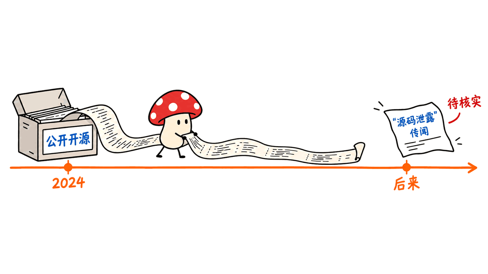
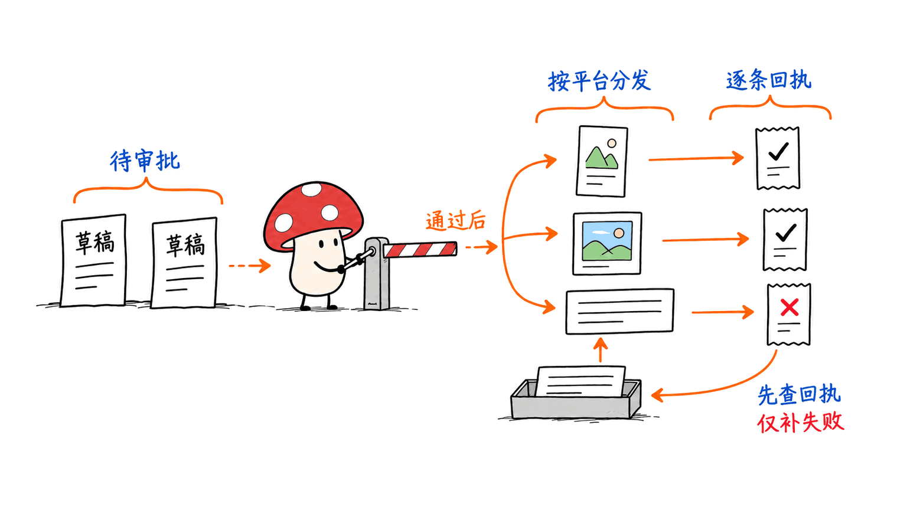
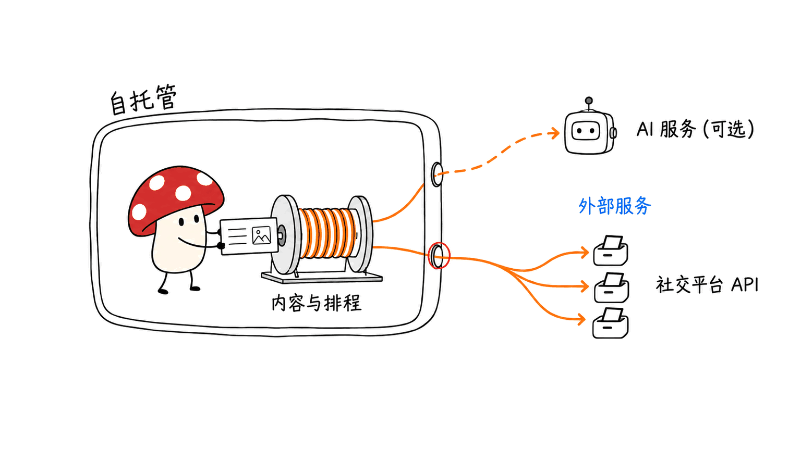

Postiz 是一个支持团队协作、多平台排期和自动化接入的社交媒体管理工具。“被解雇后才把整套源码放出来”不是理解它的可靠起点：官方在 2024 年 10 月 26 日的公告中，就明确给出了同一个开源仓库地址。

本文于 2026-10-27 在原文章链接上更新，复用既有选题，补充传闻核查并纠正旧文错误。没有另建重复文章，也没有把旧公众号创建凭证当成当前草稿仍存在的证据。

官方仓库：https://github.com/gitroomhq/postiz-app
官网：https://postiz.com
文档：https://docs.postiz.com
本文原文：https://blog.mushroom.cv/blog/postiz-agentic-social-media-scheduling-open-source/

## “被炒后泄密”，哪些已经能核实？

用户提供的故事涉及 Will 与创始人 Nevo，核心传播句是离职后公开完整代码。要判断它，必须拆开三个命题。

| 命题 | 本次核验结果 | 能得出的结论 |
|---|---|---|
| 这次才首次公开源码 | 官方 2024-10-26 公告已指向 gitroomhq/postiz-app | 不成立，公开源码早于这轮故事 |
| Will 确实被解雇，且担任营销负责人 | 未取得足以独立确认劳动或顾问关系的一手材料 | 不能把社交说法升级为已核实人事事实 |
| 双方联合策划了营销戏码 | 未取得直接承认或其他充分证据 | 可以分析传播机制，不能断言合谋 |

最直接的一手证据是 Nevo David 署名的旧公告：发布日期 2024-10-26，介绍 v1.6.7、自托管和团队功能，文末同时列出注册、开源与文档地址。这已经足以否定“最近才开放这份产品源码”，不需要借助猜测当事人动机。

公告：https://postiz.com/news/postiz-v1-6-7-more-social-media-platforms

本次 GitHub API 返回仓库创建时间为 2023-07-08，星标 39,076。创建时间本身不能证明当日仓库就公开，星标也不是实际部署量或收入，因此文章用有日期的官方公告确立公开历史，不把仓库年龄和 forks 当商业成功证明。

## 它的产品价值是什么？

Postiz 把素材、渠道、团队评论、排期和发布操作放到同一个工作台，并提供公共 API、Node SDK 与自动化集成。对于一个同时运营多个社媒账号的小团队，价值是减少重复上传与排期操作，让每条内容的渠道版本有迹可查。

当前 README 同时提供官方云服务与自托管开源版。支持哪些渠道、哪些操作可以自动化，应以对应渠道文档和实际账号权限为准。“支持某个平台”不代表能绕过它的开发者申请、OAuth、付费接口和限流。

官方列出的技术栈包含 pnpm 工作区、Next.js、NestJS、Prisma/PostgreSQL、Temporal 和邮件服务；不能继续沿用“前端加 Redis 就能完整运行”的简化描述。上线需要按当前 Docker Compose 与环境变量说明配置实际依赖。

## Agent 应该如何进入发布流程？

合理的落地顺序是：Agent 提供渠道变体与配图建议，人工确认，排期服务执行，最后读取平台回执。模型决定“可能发什么”，发布服务负责执行已授权的动作，两者之间保留审核记录。

例如一家小型软件公司发布新版本，可以先只接一个测试社媒账号。给同一主题准备短帖、专业长帖和视频简介，审核链接、图片版权、产品事实和时区。第一次不要同时向所有正式账号发送。

发布账本至少记录内部任务 ID、内容版本哈希、目标账号、计划时间、平台返回 ID 与状态。网络超时后先查平台或服务端记录：超时只说明客户端没收到结果，不证明发布失败。这个幂等设计是本文的工程建议，不是声称 Postiz 已为所有渠道提供统一的去重保证。

试运行一周看三个指标：从定稿到成功排期的时间、重复发布次数、失败能否定位到渠道/凭证/素材。浏览量可以评估内容效果，却不能替代交付可靠性。

API入口：https://docs.postiz.com/public-api

## 自托管真的意味着数据不出设备吗？

不是。自托管意味着你可以控制应用服务、数据库和存储的位置。发布到外部社交平台仍需把内容发送出去；使用外部 AI、邮件服务、对象存储或其他集成，也会形成相应出网链路。

因此评估时画出实际数据路径：账号令牌放哪里、哪些进日志、谁能执行发布、备份如何加密、离职成员如何撤权。云版少运维，自托管增加控制权，也增加升级、备份、故障恢复和凭证管理责任。本文没有连接真实社媒账号，也未完成自托管安装验收。

## AGPL 能阻止别人做商业克隆吗？

不能这样概括。仓库当前为 AGPL-3.0，许可允许依条件使用、修改与分发，也允许商业用途。其网络交互相关源码提供义务需要结合实际修改、交互与分发方式判断；并不是“只要收费就违法”，也不是“企业内部使用一律没有义务”。

旧文把 AGPL 描述成阻断竞品 SaaS 的工具，并把个人与内部部署一概说成无须关注许可，这些表述过度，本次已删除。部署前应检查仓库 LICENSE、所用依赖与具体业务安排；商标、托管服务和源码许可也要分开看。

许可原文：https://github.com/gitroomhq/postiz-app/blob/main/LICENSE

## 常见问题

### 能免费跑起来吗？

开源版源码可按许可使用，但服务器、数据库、存储、邮件、模型和社媒接口可能有成本。开源不等于整个运营链路零成本。

### 有 3.9 万星就能证明成熟吗？

只能说明关注度。本次采集数值是时间点快照；可靠性要看自己的渠道、权限和故障恢复验收。

### 所以这一定是营销 stunt？

不能据此定案。可以确认“早就开源”，不能从“故事有流量”反推双方提前协商。读者更值得关注的是产品能否解决排期问题。

## 给中小团队的判断

传播把“公开代码”包装成冲突事件，容易让人错把叙事新鲜度当产品新鲜度。更稳妥的判断流程是先找官方仓库与历史公告，再核对许可，最后用一个真实渠道跑通草稿、审核、排期、回执与恢复。

已有多 Agent 工具的读者，可以结合 Magpie 的连接与资源管理分析阅读：https://blog.mushroom.cv/blog/magpie-multi-agent-model-gateway/

资料均来自官方仓库、README、许可与带日期公告。未核实的人事关系和策划动机不作为事实发布。

---

> © 2026 Author: Mycelium Protocol. 本文采用 [CC BY 4.0](https://creativecommons.org/licenses/by/4.0/deed.zh) 授权——欢迎转载和引用，须注明作者姓名及原文链接，不得去除署名后以原创发布。

<!--EN-->

Postiz is a social media management product for team collaboration, scheduling and automation. Its source was already publicly linked in an official announcement dated October 26, 2024. A recent “fired employee releases the source” narrative should not be mistaken for the project's first open-source release.

This October 27, 2026 update keeps the existing article URL, adds the fact check and corrects earlier overstatements. It does not create a duplicate article or treat an archived WeChat receipt as proof that a draft still exists.

Repository: https://github.com/gitroomhq/postiz-app
Website: https://postiz.com
Documentation: https://docs.postiz.com
Original article: https://blog.mushroom.cv/blog/postiz-agentic-social-media-scheduling-open-source/

## What can be established about the story?

Separate three claims: whether the source became public for the first time; whether the reported dismissal and marketing role are accurate; and whether the parties coordinated a campaign.

The first claim is contradicted by an official, dated announcement. We did not obtain sufficient primary evidence to independently establish the employment relationship or coordinated intent. Neither should be presented as a proven personnel event or conspiracy.

Nevo David's October 26, 2024 announcement covers v1.6.7, team functions and self-hosting, and explicitly links the same source repository:
https://postiz.com/news/postiz-v1-6-7-more-social-media-platforms

The GitHub API returned a repository creation date of July 8, 2023 and 39,076 stars at retrieval. Creation does not establish when a repository became public. Stars and forks do not establish production adoption or revenue. The dated announcement is the relevant evidence for prior public availability.

## What is the product useful for?

Postiz centralizes channel-specific content, team comments, schedules and publishing. Its README offers a managed cloud product and a self-hosted open-source edition, with a public API, Node SDK and automation integrations.

Platform support remains subject to each channel's permissions, OAuth requirements, API access and rate limits. It does not bypass those requirements.

The current listed stack includes pnpm workspaces, Next.js, NestJS, Prisma/PostgreSQL, Temporal and email services. Follow the current deployment documentation and dependency configuration rather than assuming a front end plus Redis is a complete installation.

## How should an agent participate?

A practical workflow is: generate channel-specific drafts, review facts and assets, approve a schedule, execute publishing, and read receipts. Keep model suggestions distinct from permission to publish.

Start with one test account. Check links, image rights, product claims and time zones before broad distribution. A useful ledger records task ID, content hash, target account, schedule, returned platform ID and status.

After a network timeout, reconcile server or platform state before retrying. A missing response is not proof of failure. This is our engineering recommendation, not a claim that Postiz guarantees uniform idempotency across every channel.

Measure time from approved copy to successful scheduling, duplicate publications and whether failures can be traced to credentials, assets or channels. Impressions measure content performance, not delivery correctness.

API documentation: https://docs.postiz.com/public-api

## Does self-hosting keep all data local?

No. It gives control over application infrastructure, databases and storage. Publishing still sends content to social platforms. Optional AI, email, storage and other integrations have their own data paths.

Review token storage, logs, publishing permissions, backups and member offboarding. Self-hosting adds operational responsibilities as well as control. This review did not connect social accounts or validate a deployed installation.

## Does AGPL prevent commercial clones?

That is an incorrect generalization. The current repository uses AGPL-3.0, which permits commercial use subject to its conditions. Source-offer obligations depend on relevant modifications, network interaction and distribution circumstances. Charging money alone is not the violation test, and internal enterprise use is not a universal exemption.

The earlier article overstated both points and claimed self-hosting prevented all third-party data transfer. Those statements have been removed. Review the actual license and dependencies for a deployment; trademarks and hosted-service terms are separate matters.

License: https://github.com/gitroomhq/postiz-app/blob/main/LICENSE

## FAQ

### Is the whole system free to operate?

No. Infrastructure, storage, models, email and platform APIs may cost money even when the source is available under an open-source license.

### Do the stars prove reliability?

No. They measure attention at a point in time. Test the exact channels, permissions and recovery paths you require.

### Was the firing story definitely staged?

The evidence reviewed does not establish that. Prior public availability is verified; coordinated intent is not.

## Assessment

The useful evaluation sequence is repository history, license, channel requirements and a real draft-to-receipt trial. A dramatic source-release narrative changes none of those engineering checks.

Related gateway and resource-management review: https://blog.mushroom.cv/blog/magpie-multi-agent-model-gateway/

Sources are the official repository, README, license and dated announcement. Unverified employment claims and campaign intent are not treated as established facts.

---

> © 2026 Author: Mycelium Protocol. Licensed under [CC BY 4.0](https://creativecommons.org/licenses/by/4.0/) — free to share and adapt with attribution. You must credit the author and link to the original; removing attribution and republishing as original is not permitted.
