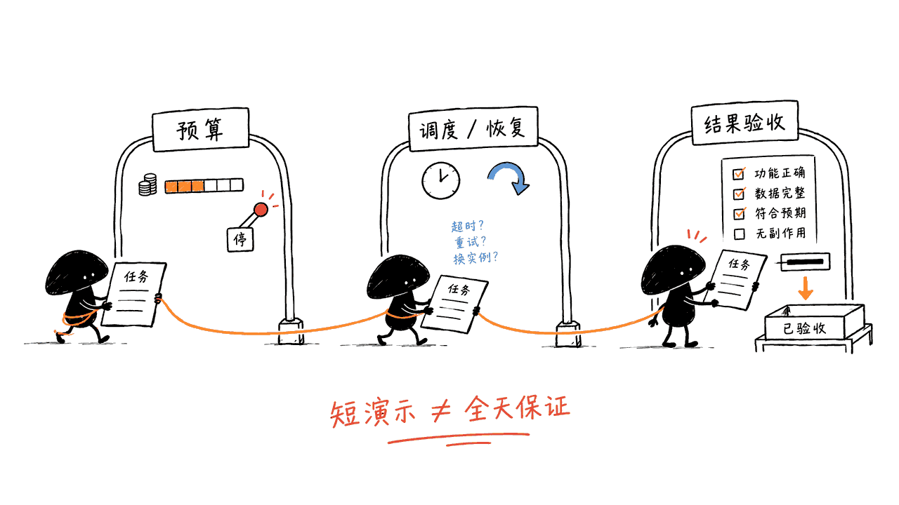
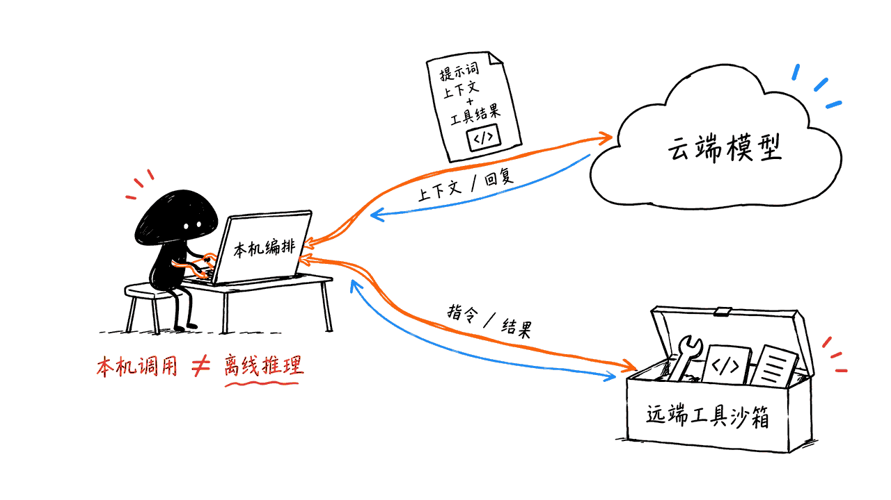

*by Mycelium Protocol*

---

项目地址：https://github.com/MervinPraison/PraisonAI
官方文档：https://docs.praison.ai/docs/
一键安装：https://praison.ai/install.sh
授权：MIT

---

PraisonAI 是一个把多个 AI 角色、工具和任务流程组织起来的开源框架。五行示例能快速起步；长期自主运行还要配置调度、预算和故障恢复。

## 一句话结论

PraisonAI 最值钱的东西不是它的功能表，是它那张分层图。 它把一个 Agent 拆成五层——Prompt、Context、Harness、Loop、Graph——每一层只回答一个问题，外面再套一层「它到底在哪台机器上跑」。当 Agent 行为不对时，你先定位是哪一层的问题，再去改那一层的参数。

这个框架本身可以脱离 PraisonAI 使用，你用别的框架也照样能拿它当排查清单。

历史快照（2026-09-07）：9027 stars、1435 forks、54 个 open issue；这些不是当前计数。项目采用 MIT 授权，主要使用 Python。

## 五层分别在问什么

先把这张表看懂，这篇文章后面都是它的展开：

| 层 | 它回答的问题 | PraisonAI 里对应什么 |
|:--|:--|:--|
| 1 · Prompt | 我说清楚了吗？ | `instructions=`、`role`/`goal`/`backstory`、`output=` |
| 2 · Context | 窗口里放的是对的东西吗？ | `memory=`、`knowledge=`、`context=`、handoff |
| 3 · Harness | 它能动手吗，动完能被检查吗？ | `tools=`、`MCP()`、`guardrails=`、`approval=`、`sandbox=` |
| 4 · Loop | 什么时候该停？ | `execution=ExecutionConfig(...)`、`reflection=`、doom-loop 检测 |
| 5 · Graph | 谁先跑谁后跑，谁检查谁？ | `AgentFlow`、`route()`、`parallel()`、`loop()`、`repeat()` |
| ⬡ Managed | *它到底在哪儿跑？* | `tools_run_on="docker"`、`run_on="anthropic"` |

每层包住里面那层。README 的原话是：当 agent 行为异常时，层数告诉你该去哪儿找。

这句话是整个设计的价值所在。大部分人调 Agent 的方式是「改改 prompt 再试试」——因为除了第 1 层他们没有别的抓手。分层之后你至少知道：输出格式不对是第 1 层；该记住的没记住是第 2 层；工具调错了是第 3 层；转圈停不下来是第 4 层；顺序错了是第 5 层。


## 60 秒跑起第一个 Agent

```bash
pip install praisonaiagents
export OPENAI_API_KEY="your-api-key"
```

```python
from praisonaiagents import Agent

agent = Agent(instructions="You are a senior data analyst.")
agent.start("Analyze the top 3 tech trends of 2026 and format as a markdown table.")
```

就这样。`praisonaiagents` 是轻量核心 SDK；如果你要 CLI、看板、可视化编排，装的是另一个包：

| 包 | 用途 | 安装 |
|---|---|---|
| `praisonaiagents` | 纯 Python 开发的核心 SDK | `pip install praisonaiagents` |
| `praisonai` | 终端用户的 CLI | `pip install praisonai` |
| `praisonai[claw]` | Claw 看板——直连 Telegram / Slack / Discord | `pip install "praisonai[claw]"` |
| `praisonai[flow]` | 拖拽式可视化编排 | `pip install "praisonai[flow]"` |
| `praisonai[ui]` | 干净的聊天界面 | `pip install "praisonai[ui]"` |

也有 JavaScript SDK：`npm install praisonai`。

## 五行代码能直接变成全天候团队吗？

2026-10-19，我们复核官方 README 的固定提交 `d27f03229bff65796419a4e26de114f41763eb67`。官网的“24/7 AI Workforce”是产品定位，不是本文验证过的可用性指标。上面的短示例只创建一个 `Agent`，也没有挂载联网搜索工具；要求它分析趋势，不代表它已检索当天资料。

官方多智能体入口需要显式声明角色，再交给 `Agents` 组织：

```python
from praisonaiagents import Agent, Agents

research_agent = Agent(instructions="Research about AI")
summarise_agent = Agent(instructions="Summarise research agent's findings")
team = Agents(agents=[research_agent, summarise_agent])
team.start()
```

这是编排示例。真正的资料采集还要提供检索工具、模型凭证和可验收的输出约束。需要分支、并行或复核循环时，再使用 `AgentFlow`，把执行顺序和结束条件写清楚。

长期运行建议按以下四步验收，而不是仅看进程还在：

1. 先跑一个小任务：明确输入、输出文件、来源要求及人工验收标准。
2. 加预算、迭代和超时限制；工具报错、模型限流和任务失败必须留记录。
3. 接入调度及进程托管。官方 CLI 提供 `schedule start/list/stop`，但调度触发不等于宕机后必然恢复。
4. 用任务 ID 记录提交、执行和结果；支付、发信等副作用应具备去重与确认机制。区分“程序退出成功”和“业务结果已验收”，失败进入告警或人工接管。

这些是我们的上线建议，不是框架已替你完成的承诺。本次只复核文档和代码示例，没有调用模型、执行沙箱任务或进行 24 小时稳定性测试。



固定版本来源：https://github.com/MervinPraison/PraisonAI/blob/d27f03229bff65796419a4e26de114f41763eb67/README.md
调度文档：https://docs.praison.ai/docs/cli/scheduler

## 第 4 层值得单独说：怎么让它停下来

这是我认为 PraisonAI 做得最实在的一层，因为「Agent 停不下来」是真实世界里最贵的失败模式——不是答错，是烧着 token 转圈。

```python
from praisonaiagents import Agent, ExecutionConfig

agent = Agent(
    instructions="Fix the failing tests.",
    execution=ExecutionConfig(max_iter=30, max_budget=0.50, on_budget_exceeded="stop"),
    autonomy=True,
)
result = agent.run_autonomous("Refactor the auth module", max_iterations=5)

print(result.completion_reason)
# goal | no_tool_calls | max_iterations | timeout | doom_loop | needs_help | error
```

当前 README 说明：预算耗尽选择 `stop` 会抛出 `BudgetExceededError`，在自主运行结果中表现为 `completion_reason="error"`；不能只看原因枚举判断是哪一种错误，还要检查日志。

三个刹车是显式的：硬迭代上限（`max_iter`）、预算天花板（`max_budget`，单位是钱）、无进展检测。`completion_reason` 提供停止原因，但多个异常可能归入 `error`。

doom-loop 检测默认开启，抓两种模式：重复的相同工具调用，以及 A→B→A→B 的震荡。值得称道的是它说明了设计上应当排除什么：一个输出一直在变的轮询器不算 doom loop。这个边界划得很清楚——很多同类实现会把正常的轮询当成死循环掐掉。

## 那「它到底在哪儿跑」这层呢？

这是套在五层外面的一圈，也是 PraisonAI 押的一个判断：harness 正在商品化，「在哪儿执行」才是下一个乘数。

最简单的入口是 `tools_run_on=`——整个团队或工作流共享一个沙箱，所以第 1 步写的文件第 2 步能读到，而思考仍然留在你的机器上：

```python
from praisonaiagents import Agent, AgentFlow

writer = Agent(name="Writer", instructions="You write files.")
reader = Agent(name="Reader", instructions="You read files.")

flow = AgentFlow(tools_run_on="docker", steps=[writer, reader])  # 或 e2b | modal | daytona | flyio
flow.run("Write 'hello' to /workspace/note.txt, then read it back")
```

对单个 agent，两个参数回答的是不同的问题，别搞混：

```python
# A. 只有工具挪走，思考留在本机
agent = Agent(name="builder", instructions="...", tools_run_on="docker")

# B. 整个 agent 挪走——模型调用、循环、工具全都在远端
agent = Agent(name="teacher", instructions="...", run_on="anthropic")
```

这里有个我很喜欢的 API 设计细节：你可以直接问对象它在哪儿跑，而且答案是人话：

```python
>>> agent.where_does_it_run()
Thinking (the AI model calls) happens on this machine.
Tools run on a Docker container.
Your own tools (check_db) still run on this machine -- only shell, file and
code tools move. They read and write this machine's files.
```

最后那句尤其关键——你自己写的工具不会被挪走，只有 shell / 文件 / 代码这三类内置工具会。这是个特别容易踩的坑，它选择在运行时主动告诉你，而不是等你调试三小时才发现。

同样，写错地方时它报的是类型错误而不是默默降级：

```python
>>> Agent(name="x", instructions="i", run_on="e2b")
TypeError: Agent(run_on='e2b') is not valid: run_on= places the whole agent
-- model calls, loop and tools -- on a managed runtime, and 'e2b' runs
commands but cannot host an agent loop.
  To run only the tools there:  Agent(tools_run_on='e2b')
```

报错里直接给出正确写法，这个应该成为行业默认。

沙箱会在闲置时自动关（`auto_shutdown`、`idle_timeout_s`），并且会复用装好依赖后的快照，下次跑就跳过拉镜像和装依赖。把 `.praisonai/environment.yaml` 提交进仓库，环境就跟着代码走。

“模型调用留在本机”指调度和调用逻辑的位置，不等于模型推理离线。若配置云端模型，提示、上下文或工具结果仍可能发送给模型服务。上面的自定义工具说明来自 `tools_run_on` 示例，不能据此保证所有托管后端的工具边界；应逐个后端核对。



## 不用写 Python 也行

同一套图可以纯 YAML 表达：

```yaml
name: remote-demo
tools_run_on: docker
agents:
  writer: {role: Writer, goal: Write files}
  reader: {role: Reader, goal: Read files}
steps:
  - agent: writer
    action: "Write 'hello' to /workspace/note.txt"
  - agent: reader
    action: "Read /workspace/note.txt"
```

CLI 的覆盖面也相当大——执行、研究、规划、工作流、记忆、知识库、会话、工具、MCP、调度，各有一组子命令：

```bash
praisonai --auto            # 自动模式
praisonai research --deep-research
praisonai memory search
praisonai managed ps        # 看有哪些沙箱在跑
praisonai managed stop --all
```

## 该泼的冷水

这个项目营销做得很足，有几处得看清楚：

- 「14 μs 实例化」这个数字基本没有信息量。 它测的是构造一个 Python 对象的耗时，跟 Agent 实际干活的性能毫无关系——实际端到端开销还包括模型调用、工具、网络、存储和调度，那是几百毫秒到几十秒的量级。拿微秒级的对象构造当性能指标，是把一个不重要的维度包装成卖点。
- README 顶部挂着「Highlighted by Elon Musk」徽章。 这是社交媒体转发，不是技术背书，跟代码质量没有关系。
- 25 个特性堆在一个包里，API 面积非常大。 `memory=`、`knowledge=`、`context=`、`guardrails=`、`approval=`、`hooks=`、`sandbox=`、`autonomy=`、`reflection=`、`planning=`、`caching=`、`web=`……每个都是一个参数。好处是开箱即用，坏处是你很难判断某个行为到底由哪个参数决定，出问题时排查面很宽。分层图缓解了这个问题，但没有消除它。
- 历史 issue 数不能证明稳定性；选型时应核对当前版本、兼容性测试和故障恢复行为。

## 该不该用

适合：你要快速搭一个多 Agent 流水线，不想自己写 MCP 客户端、记忆层、RAG、沙箱调度和循环控制。它把这些都给你了，5 行代码起步，YAML 也能写。第 4 层的刹车设计和第 ⬡ 层的沙箱抽象是真本事，不是包装。

不适合：你要的是一个薄的、可审计的、每一行都在你控制之下的 Agent 循环。那 25 个特性对你来说是负担不是资产，你会更想自己拼。

我的判断：先把那张五层表抄下来当调试清单，这是马上就能用上的；框架本身用不用，取决于你更怕「自己写太多」还是更怕「不知道行为从哪来」。

顺带一提，它的 ⬡ Managed 层和 Wemux 那种 worker-first 架构在处理同一个问题——执行到底发生在哪台机器上——但方向相反：PraisonAI 是把工具推到远端沙箱，Wemux 是把执行拉回你自己的机器。哪个对，取决于你的约束是「不想管机器」还是「代码不能出本机」。

## FAQ

### 核心 SDK 和 CLI 是同一个包吗？
不是。`pip install praisonaiagents` 是轻量核心 SDK，`pip install praisonai` 是 CLI 和更完整的生态（Claw 看板、Flow 可视化、UI 都是它的 extras）。

### 支持哪些模型？
100+ LLM，OpenAI、Anthropic、Gemini 以及本地模型都在内。

### `tools_run_on` 和 `run_on` 有什么区别？
`tools_run_on` 只把 shell / 文件 / 代码这三类内置工具挪到沙箱，模型调用和循环留在本机；`run_on` 把整个 agent——模型调用、循环、工具——都放到托管运行时上。自定义工具的执行位置需按具体后端确认；不能把 `tools_run_on` 示例扩展成所有 `run_on` 后端的保证。

### doom-loop 检测会误伤正常的轮询吗？
按官方设计，它抓的是重复的相同工具调用和 A→B→A→B 震荡；一个输出持续变化的轮询器不算。

### 能不写 Python 吗？
能。同一套 agent 图可以用纯 YAML 表达，配合 CLI 运行。

---

> © 2026 Author: Mycelium Protocol. 本文采用 [CC BY 4.0](https://creativecommons.org/licenses/by/4.0/deed.zh) 授权——欢迎转载和引用，须注明作者姓名及原文链接，不得去除署名后以原创发布。

<!--EN-->

*by Mycelium Protocol*

---

Repository: https://github.com/MervinPraison/PraisonAI
Documentation: https://docs.praison.ai/docs/
One-line install: https://praison.ai/install.sh
License: MIT

---

PraisonAI is an open-source framework for coordinating AI roles, tools and workflows. A short example gets an agent started; sustained operation still requires scheduling, budgets and recovery.

## The Short Version

The most valuable thing in PraisonAI is not its feature list — it is the layer diagram. It splits an agent into five layers — Prompt, Context, Harness, Loop, Graph — where each layer answers exactly one question, wrapped by an outer layer about which machine the thing actually runs on. When an agent misbehaves, you first locate the layer, then change that layer's parameters.

The framework travels: you can use it as a debugging checklist with any agent library, not just this one.

Historical snapshot (2026-09-07): 9,027 stars, 1,435 forks and 54 open issues. These are not current counts. The project uses the MIT license and is primarily Python.

## What Each Layer Asks

Read this table and the rest of the article is just its expansion:

| Layer | The question it answers | What it maps to |
|:--|:--|:--|
| 1 · Prompt | Did I say it clearly? | `instructions=`, `role`/`goal`/`backstory`, `output=` |
| 2 · Context | Is the right thing in the window? | `memory=`, `knowledge=`, `context=`, handoffs |
| 3 · Harness | Can it act, and be checked? | `tools=`, `MCP()`, `guardrails=`, `approval=`, `sandbox=` |
| 4 · Loop | When do we stop? | `execution=ExecutionConfig(...)`, `reflection=`, doom-loop detection |
| 5 · Graph | Who runs when, and who checks whom? | `AgentFlow`, `route()`, `parallel()`, `loop()`, `repeat()` |
| ⬡ Managed | *Where does it actually run?* | `tools_run_on="docker"`, `run_on="anthropic"` |

Each layer wraps the one inside it. The README puts it well: when an agent misbehaves, the layer tells you where to look.

That sentence is where the value sits. Most people debug agents by "tweaking the prompt and retrying" — because layer 1 is the only handle they have. With layers, you at least know: wrong output format is layer 1; it forgot what it should have remembered is layer 2; it called the wrong tool is layer 3; it will not stop spinning is layer 4; wrong ordering is layer 5.


## First Agent in 60 Seconds

```bash
pip install praisonaiagents
export OPENAI_API_KEY="your-api-key"
```

```python
from praisonaiagents import Agent

agent = Agent(instructions="You are a senior data analyst.")
agent.start("Analyze the top 3 tech trends of 2026 and format as a markdown table.")
```

That is it. `praisonaiagents` is the lightweight core SDK; the CLI, dashboards and visual builders live in a different package:

| Package | Purpose | Install |
|---|---|---|
| `praisonaiagents` | Core SDK for pure Python | `pip install praisonaiagents` |
| `praisonai` | CLI for terminal developers | `pip install praisonai` |
| `praisonai[claw]` | Claw dashboard — Telegram / Slack / Discord | `pip install "praisonai[claw]"` |
| `praisonai[flow]` | Drag-and-drop workflow builder | `pip install "praisonai[flow]"` |
| `praisonai[ui]` | Clean chat interface | `pip install "praisonai[ui]"` |

There is a JavaScript SDK too: `npm install praisonai`.

## Can Five Lines Really Deliver a 24/7 Agent Team?

On 2026-10-19 we reviewed the official README at commit `d27f03229bff65796419a4e26de114f41763eb67`. “24/7 AI Workforce” is the project's positioning, not an availability result measured here. The short example above creates one `Agent` and attaches no web-search tool. Asking for trends does not establish that it retrieved current sources.

The official multi-agent entry point explicitly declares roles and passes them to `Agents`:

```python
from praisonaiagents import Agent, Agents

research_agent = Agent(instructions="Research about AI")
summarise_agent = Agent(instructions="Summarise research agent's findings")
team = Agents(agents=[research_agent, summarise_agent])
team.start()
```

This demonstrates orchestration. Real research still needs retrieval tools, model credentials and verifiable output requirements. Use `AgentFlow` when branches, parallel work or review loops need explicit order and stopping conditions.

Before leaving a workflow unattended, we recommend four acceptance steps:

1. Run a small task with explicit inputs, output files, source requirements and a human acceptance criterion.
2. Set budget, iteration and timeout limits; record tool failures, model rate limits and unsuccessful tasks.
3. Add scheduling and process supervision. The official CLI exposes `schedule start/list/stop`, but triggering a job does not establish crash recovery.
4. Record submission, execution and outcomes under a task ID. Deduplicate consequential actions such as payments or messages, and require confirmation where appropriate. Separate process success from accepted business outcomes; route failures to alerts or human takeover.

These are our deployment recommendations, not guarantees that the framework has implemented them for you. This update reviews documentation and examples only: no model calls, sandbox workloads or 24-hour soak test were run.


Pinned source: https://github.com/MervinPraison/PraisonAI/blob/d27f03229bff65796419a4e26de114f41763eb67/README.md
Scheduler documentation: https://docs.praison.ai/docs/cli/scheduler

## Layer 4 Deserves Its Own Section: How Do You Make It Stop?

This is the layer PraisonAI handles most seriously, because "the agent won't stop" is the expensive failure mode in the real world — not being wrong, but burning tokens in circles.

```python
from praisonaiagents import Agent, ExecutionConfig

agent = Agent(
    instructions="Fix the failing tests.",
    execution=ExecutionConfig(max_iter=30, max_budget=0.50, on_budget_exceeded="stop"),
    autonomy=True,
)
result = agent.run_autonomous("Refactor the auth module", max_iterations=5)

print(result.completion_reason)
# goal | no_tool_calls | max_iterations | timeout | doom_loop | needs_help | error
```

The current README notes that a budget stop raises `BudgetExceededError`, surfaced by autonomous execution as `completion_reason="error"`. Inspect the error details and logs rather than assuming every brake has its own result label.

Three brakes, all explicit: a hard iteration cap, a budget ceiling in actual money, and no-progress detection. `completion_reason` exposes stop categories, with multiple exceptions potentially mapped to `error`.

Doom-loop detection is on by default, catching repeated identical tool calls and A→B→A→B oscillation. The documented intended exclusion is: a poller whose output keeps changing is not a doom loop. That boundary is drawn clearly — plenty of similar implementations would kill a healthy polling loop.

## And That Outer Layer — Where Does It Actually Run?

This ring around the five layers is a bet PraisonAI is making: the harness is commoditising; where the agent executes is the next multiplier.

The simplest way in is `tools_run_on=` — a whole team or workflow shares one sandbox, so a file written by step 1 is there for step 2, while thinking stays on your machine:

```python
from praisonaiagents import Agent, AgentFlow

writer = Agent(name="Writer", instructions="You write files.")
reader = Agent(name="Reader", instructions="You read files.")

flow = AgentFlow(tools_run_on="docker", steps=[writer, reader])  # or e2b | modal | daytona | flyio
flow.run("Write 'hello' to /workspace/note.txt, then read it back")
```

For a single agent, two parameters answer different questions — do not conflate them:

```python
# A. Only the tools move. Thinking stays local.
agent = Agent(name="builder", instructions="...", tools_run_on="docker")

# B. The whole agent moves — model calls, loop and tools
agent = Agent(name="teacher", instructions="...", run_on="anthropic")
```

There is an API design detail here I genuinely like: you can ask the object where it runs, and the answer is in plain English:

```python
>>> agent.where_does_it_run()
Thinking (the AI model calls) happens on this machine.
Tools run on a Docker container.
Your own tools (check_db) still run on this machine -- only shell, file and
code tools move. They read and write this machine's files.
```

That last sentence matters most — your own tools do not move; only the built-in shell, file and code tools do. It is an easy trap, and the library chooses to tell you at runtime rather than letting you debug it for three hours.

Likewise, naming an impossible place raises a type error instead of silently degrading:

```python
>>> Agent(name="x", instructions="i", run_on="e2b")
TypeError: Agent(run_on='e2b') is not valid: run_on= places the whole agent
-- model calls, loop and tools -- on a managed runtime, and 'e2b' runs
commands but cannot host an agent loop.
  To run only the tools there:  Agent(tools_run_on='e2b')
```

The error message hands you the correct call. This should be the industry default.

Sandboxes shut down when idle (`auto_shutdown`, `idle_timeout_s`) and reuse a post-setup snapshot, so the next run skips the image pull and dependency install. Commit `.praisonai/environment.yaml` and the environment travels with the repo.

“Model calls stay local” describes where orchestration initiates requests, not offline model inference. With a cloud model, prompts, context or tool results can still reach that service. The custom-tool statement above comes from the `tools_run_on` example; it does not establish the boundary of every managed backend. Verify each backend separately.


## You Can Skip Python Entirely

The same graph is expressible as pure YAML:

```yaml
name: remote-demo
tools_run_on: docker
agents:
  writer: {role: Writer, goal: Write files}
  reader: {role: Reader, goal: Read files}
steps:
  - agent: writer
    action: "Write 'hello' to /workspace/note.txt"
  - agent: reader
    action: "Read /workspace/note.txt"
```

The CLI surface is broad too — execution, research, planning, workflows, memory, knowledge, sessions, tools, MCP and scheduling each get a command group:

```bash
praisonai --auto
praisonai research --deep-research
praisonai memory search
praisonai managed ps
praisonai managed stop --all
```

## The Cold Water

The marketing here is heavy, and a few things deserve to be seen clearly:

- The "14 μs instantiation" figure carries almost no information. It measures constructing a Python object, which has nothing to do with how the agent performs while working — end-to-end work also includes model calls, tools, networking, storage and scheduling, at hundreds of milliseconds to tens of seconds. Presenting microsecond object construction as a performance metric packages an irrelevant dimension as a selling point.
- The README carries a "Highlighted by Elon Musk" badge. That is a social-media repost, not a technical endorsement, and says nothing about code quality.
- 25 features in one package means a very large API surface. `memory=`, `knowledge=`, `context=`, `guardrails=`, `approval=`, `hooks=`, `sandbox=`, `autonomy=`, `reflection=`, `planning=`, `caching=`, `web=` — each is a parameter. The upside is batteries included; the downside is that it gets hard to tell which parameter caused a given behaviour. The layer diagram mitigates this; it does not eliminate it.
- A historical issue count does not establish stability; check version compatibility and recovery behavior directly.

## Should You Use It?

Good fit: you want to stand up a multi-agent pipeline quickly without writing your own MCP client, memory layer, RAG, sandbox scheduling and loop control. It hands you all of it, starting at five lines, or YAML if you prefer. The layer-4 brakes and the layer-⬡ sandbox abstraction are real engineering, not packaging.

Bad fit: you want a thin, auditable agent loop where every line is under your control. Those 25 features are a liability rather than an asset for you, and you will prefer to assemble your own.

My read: copy the five-layer table down as a debugging checklist — that part is useful immediately. Whether you adopt the framework depends on whether you fear "writing too much yourself" more than "not knowing where a behaviour came from."

Worth noting: its ⬡ Managed layer and Wemux's worker-first architecture attack the same question — which machine does execution happen on — from opposite directions. PraisonAI pushes tools out to a remote sandbox; Wemux pulls execution back onto your own machine. Which is right depends on whether your constraint is "I don't want to manage machines" or "code cannot leave the machine."

## FAQ

### Are the core SDK and the CLI the same package?
No. `pip install praisonaiagents` is the lightweight core SDK; `pip install praisonai` is the CLI plus the fuller ecosystem (Claw dashboard, Flow builder and UI are its extras).

### Which models are supported?
100+ LLMs, including OpenAI, Anthropic, Gemini and local models.

### What is the difference between `tools_run_on` and `run_on`?
`tools_run_on` moves only the built-in shell / file / code tools into a sandbox, keeping model calls and the loop local; `run_on` places the entire agent — model calls, loop and tools — on a managed runtime. Confirm custom-tool execution per backend; the `tools_run_on` example does not prove this for every `run_on` backend.

### Will doom-loop detection kill a healthy polling loop?
The documented design catches repeated identical tool calls and A→B→A→B oscillation; a poller whose output keeps changing is not flagged.

### Can I avoid writing Python?
Yes. The same agent graph is expressible in pure YAML and run from the CLI.

---

> © 2026 Author: Mycelium Protocol. Licensed under [CC BY 4.0](https://creativecommons.org/licenses/by/4.0/) — free to share and adapt with attribution. You must credit the author and link to the original; removing attribution and republishing as original is not permitted.
