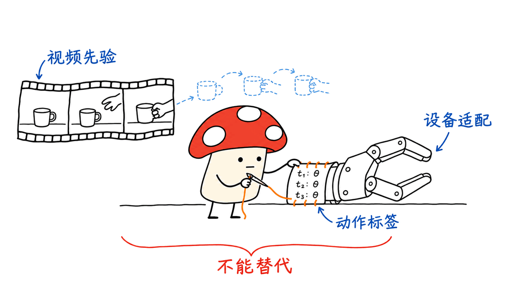
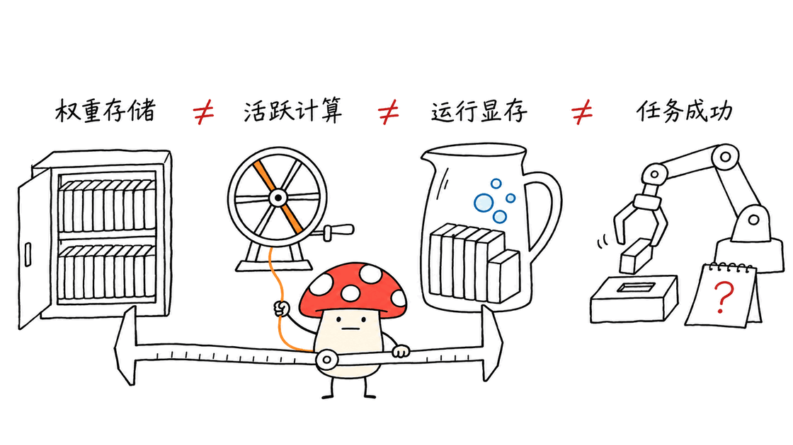
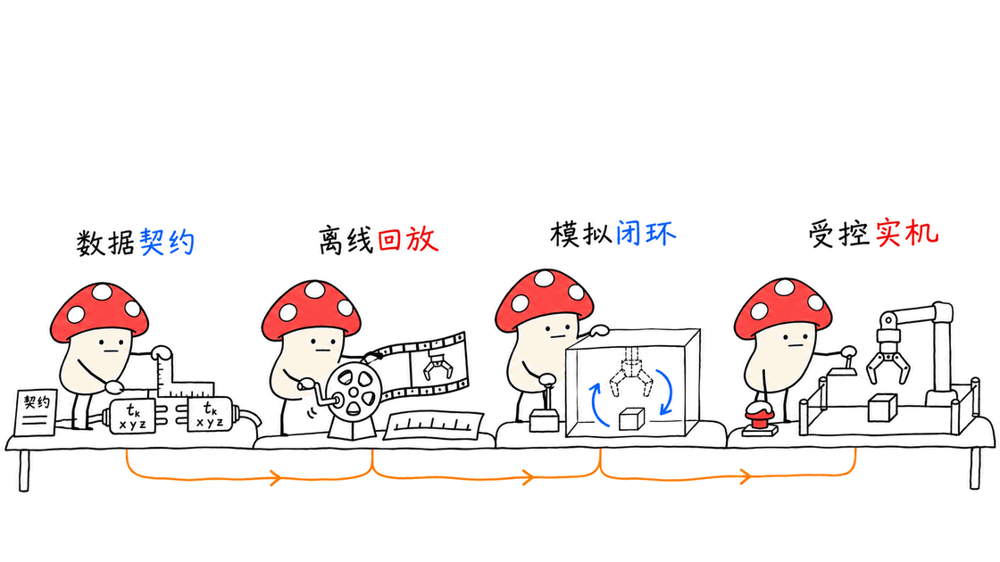

Praxis-1 把未来视频预测和机器人动作预测接在一起。开放权重与代码后，团队可以检查和适配这套策略，数据对齐、设备控制和闭环验证仍要自己完成。

Runway 于 2026 年 11 月 11 日宣布公开发布。官方仓库是 https://github.com/runwayml/praxis-1-oss ，权重集合是 https://huggingface.co/collections/runwayml/praxis-1 。本次开放采用 Apache-2.0，但不能因此推断 Runway 的全部原始预训练视频也一并开放。

## 开放的到底是什么？

仓库包括推理、策略服务器、MuJoCo 模拟、评估，以及全量和 LoRA 微调代码。权重入口覆盖 base、单臂 DROID、双臂 YAM，还有量化相关变体；适配新设备时应按对应 checkpoint 与配置选择，不能把它们视为同一个已经验证过的部署组合。

这比只提供远程接口多了几种工程能力：可以固定快照和采样配置复查行为；可以检查观测如何变成动作；可以在自己的任务和设备上做适配；也可以分析失败究竟来自视频预测、动作解码还是控制接口。

这些能力降低了进入世界动作模型研究的门槛。它们没有自动补齐所有训练数据、设备标定和实机评估，也不能保证继承发布方在特定硬件上的性能。

## 网络视频能替代遥操作数据吗？

应先区分训练阶段。一般视频能帮助模型学习物体运动、接触前后的视觉变化和任务过程；控制机器人还需要把这些视觉先验对应到具体动作空间。

官方技术报告的训练路线仍包含具身视频中训练、视频与动作联合训练，以及目标机器人微调。联合阶段会给机器人窗口附加动作目标，目标设备再通过自己的输入输出投影适配。DROID 的示例微调也使用真实机器人示范。

所以，“网络视频可以作为有效预训练来源”不能直接推成“普通视频已经完全替代带动作标签的数据”。单段网络视频通常没有机器人关节、末端位姿、夹爪命令和控制频率；这些缺失不会因为画面看起来像机器人任务就自然消失。

用户提出的判断有一半值得保留：数据清洗和对齐能力会更重要。另一半需要修正：采集不会彻底退出，而会更集中在动作对应、目标设备、接触行为和失败边界上。

### 数据工程师具体能贡献什么？

可复用的资产应是带来源和版本的数据管线：切分连续动作片段、处理重复和镜头切换、对齐指令与片段、保留帧率与时间戳、统一相机顺序、记录设备坐标系和归一化统计。训练、验证与测试还应按任务、场景和采集会话分开，避免相似片段穿透评估边界。

画面“干净”不等于监督正确。手遮住夹爪、相机错位、动作时间偏移或成功标签失真，都可能让模型学到错误对应。拥有可追踪、可重算的数据契约，比只攒一批视频文件更有长期价值。

## 27B 模型如何输出动作？

模型由视频骨干、动作专家、冻结的 VAE 和文本编码器等部分组成。动作专家读取视频骨干中间特征，联合去噪出视频与动作片段。MoE 每个 token 只激活部分专家，可以减少计算，却仍要存放大量权重。

策略按块返回控制命令：通常每次 24 行、15 Hz，覆盖 1.6 秒运动；上下文窗口第一块返回 21 行。模型接口还规定相机布局、位姿、旋转表示、夹爪和归一化方式。

这说明真正能借鉴的不只是网络结构，还有观测与动作之间的稳定合同。换机械臂时，单位、坐标系或工具偏移出错，不能指望更大的模型补救。

## “单张消费卡能跑”有哪些条件？

当前仓库对这一点比发布口号更谨慎。BF16 策略权重约 54.4 GB，加上文本编码器和 VAE，参考路径需要大显存 GPU。

可选的 NVFP4 路径针对 SM120 硬件，把策略权重降到约 17.5 GB；再加文本编码器和 VAE，权重本身约 23.5 GB，尚未计激活。仓库据此认为 32 GB RTX 5090 应能容纳，同时明确峰值尚未实测，24 GB 卡不够。

量化也会改变动作。README 给出的两个既往比较，一组没有清晰差异，另一组明显下降，并注明真实 SM120 闭环尚未完成。这不能写成“消费卡已经无损、实时、稳定可用”。下载体积、显存峰值、推理延迟和任务成功率必须分别验证。

## 我们实际验证了什么？

Mycelium Protocol 固定仓库快照，在 CPU 上运行机器人输入输出、设备坐标变换与采样器三组上游测试：二十一项通过。

它们检查旋转往返、相对位姿、动作打包、归一化、不同客户端的末端坐标变换及采样时间网格等。测试包含录下的位姿请求，但不加载大模型权重、不驱动实物机器人，也没有复现闭环成功率或显卡性能。

这类验证适合工程接入的第一步：先证明接口和单位没有错，再花算力测模型。仓库中客户端工具偏移的检查，也说明毫米级约定可能比一句笼统的“支持某机械臂”更重要。

## 工程师应该怎样借鉴？

建议按可验证的小阶段推进。先固定仓库 commit、checkpoint、依赖和采样配置，跑无权重 CPU 测试。再用录制观测检查动作单位、帧率、夹爪范围和相机布局。随后在固定的模拟任务集上建立基线，保存成功、失败、延迟及配置。

进入适配时，先把一种设备和少量任务的数据契约做对，再比较原模型、LoRA 与其他基线。全量微调、单卡 LoRA 和量化推理是不同资源问题，不能用“能单卡推理”估算训练预算。

最终实机阶段需要独立的控制约束、动作幅度检查、急停与人工接管。模型生成的“未来视频”只是预测，不是对现实环境的确认；仍须由下一次真实观测修正。

真正有价值的开放，是让不同团队能在同一底座上积累可比较的工程经验。视频来源可能扩展，稀缺能力会转向可靠的数据对应、评估和设备集成；它们也正是无法靠一份权重文件直接交付的部分。

## 常见问题

### 是否无需机器人数据就能控制新设备？

不能由当前发布物得出这个结论。视频预训练提供先验，目标设备仍需动作空间适配、数据对应和验证。

### 27B 是否意味着每次推理都用满所有参数？

MoE 只激活部分专家，但未激活专家的权重存储需求仍然存在，不能把活跃参数量等同于显存占用。

### 本文是否实测了消费卡运行和真实机器人成功率？

没有。本次只运行二十一项无权重 CPU 测试；消费卡显存和量化表现按固定快照的官方说明标注了未验证条件。

官方发布：https://runway.com/news/company-news/praxis-1-is-now-available
技术报告：https://runway.com/research/praxis-1-video-pretraining-to-robot-control
代码：https://github.com/runwayml/praxis-1-oss
模型：https://huggingface.co/collections/runwayml/praxis-1

---

> © 2026 Author: Mycelium Protocol. 本文采用 [CC BY 4.0](https://creativecommons.org/licenses/by/4.0/deed.zh) 授权——欢迎转载和引用，须注明作者姓名及原文链接，不得去除署名后以原创发布。

<!--EN-->

Praxis-1 joins future-video prediction with robot-action prediction. Open weights and code let teams inspect and adapt the policy; data alignment, device control, and closed-loop validation remain their responsibility.

Runway announced public availability on November 11, 2026. Code: https://github.com/runwayml/praxis-1-oss . Models: https://huggingface.co/collections/runwayml/praxis-1 . The Apache-2.0 release does not imply that Runway's complete original video corpus was published alongside it.

## What does the release make possible?

The repository includes inference, policy serving, MuJoCo simulation, evaluation, full fine-tuning, and LoRA workflows. Base, DROID, YAM, and quantization-related checkpoints serve different purposes and need matching configurations.

Teams can pin a snapshot, inspect the observation-to-action path, adapt a device, and separate prediction failures from decoding or controller failures. That is more useful than a remote endpoint alone. It does not automatically reproduce the publisher's training data, hardware results, or device calibration.

## Can ordinary video replace teleoperated robot data?

Different training stages answer different questions. General video supplies visual priors about objects, contact, and task progression. Robot control also needs a mapping to an actual action space.

The technical report still includes embodied-video mid-training, joint video/action training, and target-robot fine-tuning. Robot windows receive action targets, and each embodiment has input/output projections. The DROID adaptation uses real demonstrations.

An effective video-pretraining source therefore does not establish that ordinary footage replaces all action-labeled data. Web footage generally lacks joint states, end-effector poses, gripper commands, and control timing.

The engineering bottleneck can shift toward alignment without making collection disappear. Collection becomes more focused on device behavior, contact, failures, and action correspondence.

A reusable pipeline should track provenance, versions, motion segments, frame rates, timestamps, camera order, instructions, coordinate frames, and normalization statistics. Separate evaluation by task, scene, and collection session. Visually clean footage is not necessarily correct supervision.

## How does the policy produce motion?

A video backbone and action expert jointly predict short video and action chunks, with a frozen VAE and text encoder supporting the pipeline. MoE activates only some experts per token, but the full weight-storage requirement remains.

A typical call returns 24 action rows at 15 Hz, covering 1.6 seconds; the first context chunk returns 21 rows. Camera layout, rotation representations, gripper semantics, and normalization are part of the interface contract. Incorrect units or tool offsets cannot be fixed simply by using a larger model.

## What does the consumer-GPU claim require?

The BF16 policy is approximately 54.4 GB before its supporting encoders. The optional SM120 NVFP4 path reduces policy weights to about 17.5 GB; including the text encoder and VAE brings weights to about 23.5 GB before activations.

The pinned README consequently says a 32 GB RTX 5090 should fit, while peak memory has not been measured and 24 GB is insufficient. It also states that quantization changes actions, gives mixed earlier evaluation results, and notes missing real SM120 closed-loop validation. These qualifications do not support a universal claim of lossless, real-time consumer-card operation.

## What did our verification establish?

Mycelium Protocol ran three upstream CPU suites covering robot I/O, rig frames, and sampler behavior: 21 tests passed. They check rotations, relative poses, packing, normalization, client-frame conversions, and timestep grids, including recorded pose requests.

No model weights, GPU inference, simulated policy rollout, or physical robot was used. These results establish interface behavior in those cases, not closed-loop success or consumer-GPU performance.

## What should engineers borrow?

Start by pinning code, checkpoints, dependencies, and sampler settings. Run weight-free tests, then replay recorded observations to validate units, timing, camera layout, and gripper ranges. Establish a fixed simulation baseline before adapting one embodiment and a small task set.

Compare the starting model, LoRA, and alternatives using the same evaluation. Full fine-tuning, one-GPU LoRA, and quantized inference have different resource requirements.

Physical deployment also needs independent motion constraints, emergency stop, and supervised handover. Predicted future video is a hypothesis, not confirmation of the real environment; actual observations must close the loop.

The lasting value is a shared foundation on which teams can accumulate comparable engineering evidence. More video can broaden pretraining, while reliable correspondence, evaluation, and device integration remain necessary work.

## FAQ

### Does this remove the need for robot data?

The release does not establish that. Video priors and action-space adaptation are different stages.

### Does active MoE parameter count equal memory use?

No. Inactive experts still need weight storage, and runtime activations add memory requirements.

### Did this article reproduce consumer-GPU or real-robot results?

No. It reports 21 weight-free CPU tests and clearly qualified official hardware claims.

Sources: https://runway.com/news/company-news/praxis-1-is-now-available ; https://runway.com/research/praxis-1-video-pretraining-to-robot-control ; https://github.com/runwayml/praxis-1-oss ; https://huggingface.co/collections/runwayml/praxis-1 .

---

> © 2026 Author: Mycelium Protocol. Licensed under [CC BY 4.0](https://creativecommons.org/licenses/by/4.0/) — free to share and adapt with attribution. You must credit the author and link to the original; removing attribution and republishing as original is not permitted.
