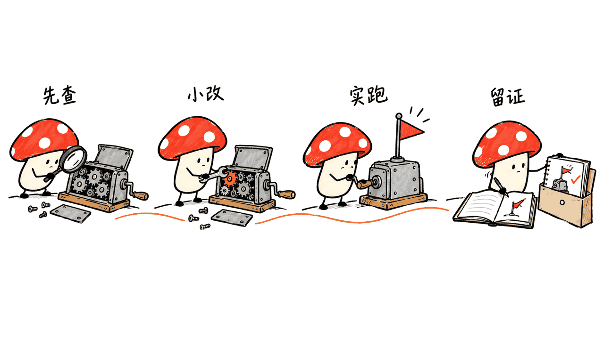
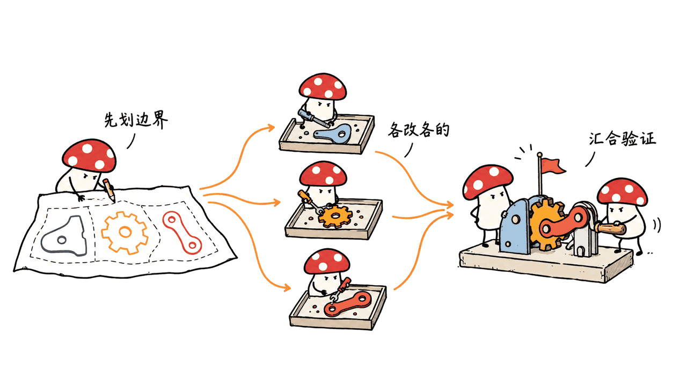

pstack 把调查、实现、审查和运行验证组织成一套 AI 编程工作流。它最值得借鉴的地方，是先让一个代理把问题查清、把验收跑通，再扩大并行规模。

这是 Lauren Tan（@poteto）维护的 MIT 开源插件，官方源码位于 cursor/plugins 仓库的 pstack 目录。本文固定核查 0.15.32 版本、提交 e73df471cd4bd918367e99f3dd9c51bd53ddf5f0，日期为 2026-10-25。

官方源码：https://github.com/cursor/plugins/tree/main/pstack
插件市场：https://cursor.com/marketplace/cursor/pstack
作者主页：https://github.com/poteto

## 先校正：54 项技能还是 58 项？

我们实际读取了固定提交的目录和插件清单：58 个技能目录，其中 24 个以 principle- 开头，另外 34 个是流程、审查、解释和配置等技能；另有 2 个子代理定义、23 个任务剧本。Cursor 官方市场页面也显示 58 项技能。

这不代表每项技能都是一种独立工具，也不意味着要同时加载和运行 58 项。“54 项”不能作为当前版本的准确数量；没有对应历史提交时，也不应替它编造一个发布日期。

还有两处容易转述错：当前目录没有 /catchup，实际命令是 /ketchup；/teach 的用途是帮助人理解系统，它组合 how 与 why，不是自动把工作沉淀成新技能。捕捉经验看 /reflect，生成个人工作模式看 /automate-me。

作者 GitHub 当前公司栏为 @xai-org，README 则介绍了在 Meta、Netflix 和 Cursor 的经历。本文直接使用作者姓名与账号，避免把不同时间的身份标签混成项目能力证明。

## pstack 的核心不是技能菜单，而是任务剧本

入口 /poteto-mode 先判断任务属于哪一类，再按剧本调用相应技能。修 bug、加功能、性能调查、原型试验、恢复会话和照看 PR，需要的证据与交付物并不相同。

例如 bug-fix 剧本要求先在对应运行界面复现，逐步排除原因，再实现修复，最后回到同一界面验证。它没有把“单元测试绿了”直接写成“用户遇到的问题消失了”。涉及跨函数边界的变化，先通过 /architect 梳理调用方式、类型和模块结构。



| 阶段 | 常用入口 | 应留下什么 |
|---|---|---|
| 调查 | /how、/why、/recall | 当前行为、证据来源、已排除假设 |
| 构建 | /architect、/poteto-mode | 数据结构、边界清楚的最小修改 |
| 比较与审查 | /arena、/interrogate、/blast-radius | 候选差异、风险、接受或拒绝的理由 |
| 验证 | /create-verification-skill、/benchmark-checklist | 可重复的操作、真实输出、证据范围 |
| 交接与学习 | /ketchup、/show-me-your-work、/reflect | 当前状态、决策轨迹、可复用改进 |

这里要区分 /arena 与 /swarm：前者让多个候选解决同一个问题，再选取与整合；后者把不同范围分给不同工作者，最终汇总。两个都并行，但它们解决的是不同问题。

## 普通团队如何开始用？

先接入一个真实的小任务，不要第一天就让十个代理改同一仓库。Cursor 官方 README 的安装与设置入口是：

```text
/add-plugin pstack
/setup-pstack
```

/setup-pstack 用来配置角色对应的模型与推理预算，不是购买模型，也不会保证所有平台都能调用同一组模型。完成配置后，按项目说明开始新会话，让规则被加载。

给第一个任务同时写清目标、边界和验收条件。例如：

```text
/poteto-mode 给导出命令增加 --json。
保留原来的文本输出，先调查现有调用者。
用一个固定样例分别运行两种输出，验证 JSON 可解析、字段正确，
并证明默认文本输出保持不变。最后说明实际运行了哪些检查。
```

这是本文建议的试用任务，不是我们已经执行的产品测试。它比“优化一下导出功能”更容易验收，因为成功和失败都有可观察的定义。

如果项目没有可靠的操作入口，再运行 /create-verification-skill。它要建立项目自己的启动、操作、证据收集与清理方法；生成了说明文件之后，还应该真的按说明跑一次。界面改动后，用 /maintain-verification-skill 维护它，避免脚本还在检查旧按钮。

## Claude Code、Grok Bot 和 Pi 能直接照抄吗？

官方 README 已提供 Claude Code 安装方式：

```text
/plugin marketplace add cursor/plugins
/plugin install pstack@cursor-plugins
/pstack:setup-pstack
/pstack:poteto-mode 描述任务和验收条件
```

Claude Code 的命令带 pstack 前缀。官方适配文档还说明，Cursor 的工具名、子代理字段和模型配置需要转换；遇到非 Claude 模型标识时，适配层会使用会话模型并说明，而不是凭一个字符串获得其他厂商的模型访问权。

依赖 Cursor 专属能力的步骤，例如 Bugbot 或 Automations，也有明确的降级处理。README 另外提醒第三方市场自动更新默认关闭，可通过插件市场设置开启，或按说明手动更新。因此“同一套方法”不等于“每个平台都有同样的执行能力”。

素材提到的 Grok Bot 安装，应在该产品的插件目录中核实可用项。不要把 Cursor 的 /add-plugin、Claude Code 的 /plugin 和其他产品的插件命令混用。社区 Pi 移植也要核对自己的版本、适配器与权限；本文不把移植包视为官方插件的等价安装。

## 为什么要先深入，再并行？

多个代理可以同时写代码，也可以同时放大错误。若它们共享一个错误的数据模型、修改同一个文件，或拿不同环境的测试当成同一份证据，汇总工作会比串行还难。

我建议先用单代理确认三个事实：任务究竟要改变什么；哪些模块互不干扰；用什么真实操作证明完成。之后才按模块分工，分离工作目录，约定输入输出，并由一个负责人检查合并后的整体行为。



不需要每个任务都开多模型评审。拼写修正、简单配置和复杂状态机，值得花的预算不一样。pstack 的并行能力需要宿主工具、模型权限和算力支持；MIT 开源并不包含模型调用账单。

Mycelium Protocol 的判断是：小团队先学会“怎样验收一个代理的输出”，收益通常比堆技能数量更明确。至少把同一问题的复现与修复验证配成一对，再讨论并发代理数量。

## 24 条原则，最该先落地哪几条？

不用把原则整段贴到每次对话。先挑容易转成项目约束的几条：幂等操作让重试收敛到同一结果；边界校验集中处理外部输入；分离共享状态减少并发冲突；行为测试验证用户能观察到的结果；经验最终进入类型、检查脚本或 CI。

例如一次任务重试不应创建两份同样的订单；这首先是数据键和事务设计问题，不能只给代理一句“别重复”。一次接口迁移也不应长期留下无人负责的旧入口；应写清调用者迁移与旧 API 删除的完成条件。

这些规则的价值，在于能不能变成可运行的约束。提示词可以提醒代理，不能替代数据库约束、权限隔离或代码审查。


## 我们核验了什么，没有证明什么？

本次做的是固定版本的静态核查：目录计数、插件版本、技能用途、bug-fix 剧本和 Claude Code 适配说明，结果与来源一并保存。我们没有重新安装插件、启动 Grok Bot、运行多代理对照实验，也没有测量节省多少 Token 或提升多少开发速度。

仓库说明的工作方法具有可操作性，但“更高质量”仍需你在自己的项目上验收。可以连续挑三个小任务，记录是否正确复现、是否误改范围、是否留下可重复证据，以及人工返工时间。这里的三个任务是建议的试点设计，不是对效果的统计证明。

想进一步理解真实验证门如何落地，可以对照本站的 Unlazy 介绍：https://blog.mushroom.cv/blog/unlazy-depth-tree-anti-laziness-gate-contract-claude-code/ 。

## 常见问题

### 安装后需要记住全部命令吗？

不需要。先配置 /setup-pstack，再用 /poteto-mode 带着明确目标启动。只有需要单独调查、审查或解释时，再选择对应技能。

### /teach 和 /reflect 有什么区别？

/teach 让人理解代码与设计原因；/reflect 回看工作过程并把经验落实到技能改进。解释清楚与保存方法是两个不同结果。

### 它能保证代理不会出错吗？

不能。它提供调查、分工、验证与交接的方法，结果仍受模型能力、运行环境、权限和验收质量影响。需要真实输出，不能只相信代理的完成声明。

## 一手资料

- 官方仓库：https://github.com/cursor/plugins/tree/main/pstack
- 官方市场：https://cursor.com/marketplace/cursor/pstack
- 固定版本 README：https://github.com/cursor/plugins/blob/e73df471cd4bd918367e99f3dd9c51bd53ddf5f0/pstack/README.md
- Claude Code 适配：https://github.com/cursor/plugins/blob/e73df471cd4bd918367e99f3dd9c51bd53ddf5f0/pstack/docs/harness/claude-code.md
- 作者账号：https://github.com/poteto

原文：https://blog.mushroom.cv/blog/pstack-engineering-workflow/

---

> © 2026 Author: Mycelium Protocol. 本文采用 [CC BY 4.0](https://creativecommons.org/licenses/by/4.0/deed.zh) 授权——欢迎转载和引用，须注明作者姓名及原文链接，不得去除署名后以原创发布。

<!--EN-->

pstack organizes investigation, implementation, review and runtime verification into an AI coding workflow. Its most useful idea is to establish depth and a working acceptance check with one agent before expanding parallel work.

Lauren Tan (@poteto) maintains the MIT-licensed plugin in cursor/plugins under pstack/. This review pins version 0.15.32 at commit e73df471cd4bd918367e99f3dd9c51bd53ddf5f0, checked on October 25, 2026.

Source: https://github.com/cursor/plugins/tree/main/pstack
Marketplace: https://cursor.com/marketplace/cursor/pstack
Author: https://github.com/poteto

## Is the current count 54 or 58?

We inspected the pinned directory and manifests: 58 skill directories, including 24 principle skills and 34 other skills. There are two subagent definitions and 23 playbooks. The official Cursor marketplace also displays 58 skills. This is a versioned inventory, not a claim that every task runs 58 independent tools.

Two details in the circulated summary need correction. The command is /ketchup, not /catchup. /teach explains a system by combining how and why; /reflect and /automate-me address capturing methods and personal workflows. Without a historical revision, we cannot assign a date to the supplied count of 54.

The author's current GitHub company field is @xai-org; the README describes work at Meta, Netflix and Cursor. Her name and account are more useful identifiers here than merging employment labels from different dates.

## What turns the skills into a workflow?

/poteto-mode chooses a playbook for the task and routes to relevant skills. A bug fix, performance investigation, feature, prototype, session pickup or PR watch needs a different sequence and evidence.

The bug-fix playbook starts by reproducing the defect on the relevant surface. It narrows causes before implementation and returns to that same surface for verification. Unit tests passing are not automatically proof that the reported user problem disappeared. Changes crossing function boundaries call for /architect to settle usage, types and module shape first.


| Stage | Useful entry points | Evidence to preserve |
|---|---|---|
| Investigate | /how, /why, /recall | Current behavior, sources and rejected hypotheses |
| Build | /architect, /poteto-mode | Data shape and a bounded change |
| Compare and review | /arena, /interrogate, /blast-radius | Differences, risks and reasons for choices |
| Verify | /create-verification-skill, /benchmark-checklist | Repeatable operations and actual outputs |
| Handoff and learn | /ketchup, /show-me-your-work, /reflect | State, decisions and reusable improvements |

/arena compares multiple attempts at the same problem. /swarm assigns separate slices and aggregates results. Both use parallelism, but with different ownership and comparison needs.

## How should a small team start?

The documented Cursor entry points are:

```text
/add-plugin pstack
/setup-pstack
```

Setup maps roles to available models and reasoning budgets; it does not buy access to models. Start a new conversation as instructed so configuration rules load.

Choose one bounded real task before launching a fleet:

```text
/poteto-mode Add --json to the export command.
Investigate existing callers first. Preserve default text output.
Run a fixed sample through both forms. Prove JSON parsing and fields
are correct, and default text stays unchanged. Report actual checks.
```

This is our proposed adoption exercise, not a test we executed. It makes success observable, unlike a broad request to improve exporting.

If the project lacks a reliable way to drive behavior, /create-verification-skill builds a project-specific procedure for launch, operations, evidence and cleanup. Execute the resulting procedure at least once. Use /maintain-verification-skill when the product changes so it does not keep verifying an obsolete button.

## Can other hosts use identical commands?

The official README includes a Claude Code path:

```text
/plugin marketplace add cursor/plugins
/plugin install pstack@cursor-plugins
/pstack:setup-pstack
/pstack:poteto-mode Describe the task and acceptance check
```

Commands gain the pstack prefix. The official adapter maps tool names, subagent fields and configuration. Non-Claude model identifiers fall back to the session model with an explanation; a model name alone does not grant access to another vendor.

Cursor-specific features such as Bugbot and Automations have explicit fallback behavior. The README also notes that third-party marketplace auto-update is off by default and explains manual updates. Shared methodology does not imply identical host capabilities.

For the supplied Grok Bot installation claim, check that product's own plugin catalog. Do not interchange Cursor's /add-plugin, Claude Code's /plugin and another host's commands. Community Pi ports need their own version, permission and adapter checks; they are not assumed equivalent to upstream.

## Why go deep before going parallel?

Several agents can amplify the same misunderstanding. Shared files, inconsistent data models and mismatched test environments make integration difficult even when every individual report sounds successful.

First establish what must change, which modules are independent and which real operation proves completion. Then assign bounded slices, isolate working directories, agree on interfaces and have one owner verify the integrated result.


A spelling correction and a concurrent state machine do not justify the same review budget. Parallel execution depends on host tooling, permissions and model access. MIT licensing does not include inference costs.

Mycelium Protocol recommends learning how to accept one agent's work before increasing the agent count. Pair the original reproduction with the repaired behavior, then expand concurrency.

## Which principles should become project constraints?

Start with idempotent operations, input checks at boundaries, separation of shared state, observable behavior tests and encoding lessons into types or checks. A retried task must not create duplicate orders: keys and transactions enforce that better than a reminder. An API migration needs explicit caller migration and removal criteria for the old API.

Instructions guide agents. Database constraints, permissions and automated checks enforce properties. Converting recurring lessons into these structures is more durable than pasting a growing list into every prompt.


## What did this review verify?

We performed a pinned static audit of directory counts, plugin version, command purposes, the bug-fix playbook and the Claude Code adapter. Sources and inventory results are preserved. We did not reinstall the plugin, launch Grok Bot, run a multi-agent controlled trial or measure token savings and development speed.

Try several small tasks in your own repository and record reproduction quality, unintended scope changes, repeatable evidence and human rework time. That is a proposed pilot, not statistical proof of improvement.

Our related Unlazy article discusses executable verification gates: https://blog.mushroom.cv/blog/unlazy-depth-tree-anti-laziness-gate-contract-claude-code/

## FAQ

### Must I memorize all commands?

No. Configure roles with /setup-pstack and start with /poteto-mode plus a clear goal. Use individual skills when you specifically need investigation, review or explanation.

### How do /teach and /reflect differ?

/teach helps a person understand code and design reasons. /reflect reviews the work and captures improvements in skills. Understanding and preserving a method are separate outcomes.

### Does the plugin guarantee correct agents?

No. Models, permissions, environment and acceptance checks still determine results. Require actual outputs rather than accepting a completion claim as evidence.

## Primary sources

- Official source: https://github.com/cursor/plugins/tree/main/pstack
- Official marketplace: https://cursor.com/marketplace/cursor/pstack
- Pinned README: https://github.com/cursor/plugins/blob/e73df471cd4bd918367e99f3dd9c51bd53ddf5f0/pstack/README.md
- Claude Code adapter: https://github.com/cursor/plugins/blob/e73df471cd4bd918367e99f3dd9c51bd53ddf5f0/pstack/docs/harness/claude-code.md
- Author: https://github.com/poteto

Original article: https://blog.mushroom.cv/blog/pstack-engineering-workflow/

---

> © 2026 Author: Mycelium Protocol. Licensed under [CC BY 4.0](https://creativecommons.org/licenses/by/4.0/) — free to share and adapt with attribution. You must credit the author and link to the original; removing attribution and republishing as original is not permitted.
