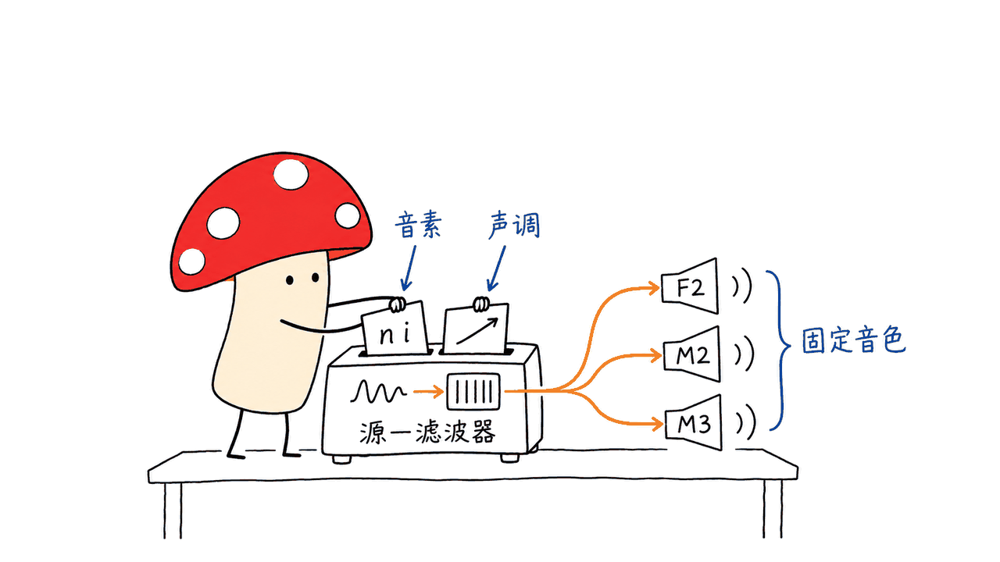

qora-voca-zh 是一个能在本地 CPU 合成普通话的小模型。它适合固定音色、受控文本的朗读；接入产品前，最该检查的是文本有没有被完整读出来。

项目由 ValueMoonLab 发布，基于 tiny-voca，代码和权重采用 Apache-2.0，语料文本采用 CC BY 4.0。原消息链接断行且多出一个字母，实际仓库为下方地址。本次抓取了 README、模型卡、数据卡和训练文档，并实际运行发布权重。

代码与文档：https://github.com/ValueMoonLab/qora-voca-zh
模型卡：https://github.com/ValueMoonLab/qora-voca-zh/blob/main/docs/model-card.md
上游：https://github.com/n4ze3m/tiny-voca

## 450 万参数，为什么能直接输出语音？

模型有 4,532,299 个参数、F2／M2／M3 三种固定音色，输出为 24kHz 单声道语音。它不需要在推理时加载 Qwen3-TTS，也没有用一个大型神经声码器把中间表示转换成波形。

具体路径是：中文文本经 jieba 分词和 pypinyin 转成音素及声调；文本编码器预测时长、停顿，展开到帧后预测音高、浊音和能量，再由源—滤波器合成器生成波形。合成头本身只有 25,862 个参数，其余容量承担文本与声学预测。

这是用结构限制换取小体积：模型不提供任意音色克隆，也不面向多语言、方言、歌唱和丰富情绪表达。三个声音是用 Qwen3-TTS 设计出来的固定音色，而非对真人声音的克隆。小模型解决的是“在普通硬件上读出来”，并不自动拥有大模型的自然度和表达范围。

## 不加载预训练权重，是否等于不依赖大模型？

语音模型本体从零训练，但训练材料依赖上游模型。作者用 Qwen3-TTS 生成语音，用中文 CTC 音素识别器做离线强制对齐，再以质检后的样本训练小模型；faster-whisper 用于离线评测。这些步骤与部署时的推理依赖应分开看。

数据卡报告：10,696 句自建模板／古诗语料，经过生成与质检后得到 28,231 条、25.25 小时合成语音。完整训练音频和特征没有随仓库打包，提供的是语料、参考音色、模型权重以及复现脚本。它不是下载一个仓库就拥有全部训练中间产物。

训练耗时也要读细：README 概括为 RTX 3060、160,000 步、约 21 小时；模型卡和训练文档则明确，75,471 秒、约 21 小时属于续训阶段。流程先有 100,000 步双音色基础模型，再扩展音色续训到 160,000 步。不能把这个时间直接当作从生成数据到训练结束的全部成本。本次没有复训或核算费用。

## 发布权重在 Mac CPU 上实际跑通了吗？

跑通了。本次固定到提交 63390ae6cd376c2f725f164191ad902b12db163f，在 Apple Silicon macOS、Python 3.12.14 上使用 PyTorch 2.15.0 和 ONNX Runtime 1.32.0，均走 CPU。我们没有把 MPS、CoreML 或 GPU 加速混入结果。

检查直接加载仓库内的发布 checkpoint 和 ONNX 图，使用同一句“今天天气真不错，我们一起去公园散步吧。”合成三个音色，而不是只用随机权重测模型前向。

| 音色 | PyTorch 输出采样数 | ONNX 输出采样数 | 波形时长 |
| --- | --- | --- | --- |
| F2 | 92,416 | 92,416 | 约 3.85 秒 |
| M2 | 80,640 | 80,640 | 3.36 秒 |
| M3 | 86,016 | 86,016 | 约 3.58 秒 |

这里的“秒”是音频长度，不是生成耗时。六次合成都产生有限值、非空波形，三个音色在两个运行时中长度一致。相同长度不等于逐采样数值一致；项目存在随机噪声路径，本次没有重做作者的严格 ONNX 数值一致性评测。

我们还检查了参数总数和文件大小：PyTorch 文件为 18,193,797 字节，约 17.35MiB；ONNX 为 21,366,340 字节，约 21.37MB。文件大小不等于进程内存，运行时、前端词典、张量与缓冲还会占用空间。

原仓库测试结果为 68 项通过、1 项跳过，另有 8 个子测试通过，子测试不再当作独立顶层项重复计数。跳过项是需要 librosa 和 pyarrow 的数据准备往返测试。它与六次发布权重合成互为补充，但都不能替代听感评估。

本次没有做盲听、ASR 字错率、韵律质量或性能计时。模型卡所称四线程 ONNX 约 50–53 倍实时，是作者报告，不是本次测得；它也不能直接转化成应用启动或首段出声延迟。

## 最需要防的，是文本静默少读

本次五组前端输入给出了很明确的边界：纯英文“Hello world”和纯数字“2026”抛出无可朗读内容异常；但混合内容并不是整句拒绝。

“你好AI世界”“你好2026世界”和“你好世界”得到完全相同的音素与声调序列，没有未知音素提示。也就是说，在这些实际输入中，英文和阿拉伯数字被省略，中文部分继续保留。

因此不能把 README 中“不支持英文”和“数字采用默认读法”的概括，理解成所有不支持内容都会清楚报错。对含年份、订单编号、金额、缩写的提示语，发出一段有效 WAV 仍可能丢失关键信息。

我的建议是把文本归一化作为独立交付层：先将数字、日期、缩写转为经过核对的中文口语，再检查原始内容与可发音片段的覆盖关系；遇到未覆盖片段就拒绝生成或走备用引擎。不要让一个成功退出码成为“已完整朗读”的唯一证据。

## ONNX 部署是否已经完全摆脱 PyTorch？

单独运行 ONNX 图，可以把神经网络计算交给 ONNX Runtime。但仓库当前的安装依赖包含 torch，tiny_voca 包初始化会导入模型，README 推荐的 check_onnx_zh.py 也同时导入 PyTorch，用于导出与对照。因此，“图能在 ONNX Runtime 运行”与“现成 Python 部署包完全没有 torch”是两件事。

还有一个小文档差异：README 的 ONNX 示例带有 --text 和 --voice，而固定提交中的检测脚本只声明 --checkpoint、--onnx、--output。直接照抄前者会遇到参数问题；本次使用自编检查脚本调用发布图，没有宣称 README 那条命令已经验证成功。

模型卡给出的单句上限是 512 token、3000 帧，后者按 256 点步长约合 32 秒；Python 的 speak_text 会为长文本分句、切分后拼接。这与持续输入、低延迟流式出声仍有距离。

真正做轻量部署，应单独整理中文前端、符号表、ONNX 图、音色映射和输出幅度限制，再确认整个安装环境。发布图不自动提供长文本服务、权限控制、队列或流式首包；这些都需要应用层实现。

## 什么场景值得试？

Mycelium Protocol 的判断是：这是一个边界清楚、可用于研究的小型普通话 TTS 候选。固定文本播报、离线朗读工具、教学实验，比较容易把输入约束与三音色限制纳入产品设计。已有权重、ONNX、训练配方和测试，比单纯展示样音更方便复核。

如果需要自然聊天、中英混读、可靠的任意数字播报、方言或音色克隆，应先拿真实文本做验收。优先级不是继续缩小模型，而是证明每个重要词都被读出来，再检查听感、启动时间、内存和并发。

## 常见问题

### 合成一句话必须连接云端吗？

不需要。发布权重可以在本地 CPU 推理；本次实际合成未调用云端语音 API。重建合成训练数据是另一套离线模型依赖流程。

### 三音色是否就是零样本克隆？

不是。它提供 F2、M2、M3 三种固定的合成设计音色，不支持上传一个新声音就立即克隆。

### “CPU 实时”是否已经由本文复现？

没有。本文验证了发布权重在 CPU 生成有效音频，没有做性能计时、峰值内存或主观质量测评；50–53 倍实时仍是作者的报告。

相关阅读：https://blog.mushroom.cv/blog/sophon-realtime-full-duplex-local-voice-guide/
来源与完整复现说明：https://github.com/ValueMoonLab/qora-voca-zh

---

> © 2026 Author: Mycelium Protocol. 本文采用 [CC BY 4.0](https://creativecommons.org/licenses/by/4.0/deed.zh) 授权——欢迎转载和引用，须注明作者姓名及原文链接，不得去除署名后以原创发布。

<!--EN-->

qora-voca-zh is a small local Mandarin text-to-speech model. It is a plausible candidate for fixed-voice reading with controlled inputs; the first integration check should be whether every important part of the text survives the frontend.

ValueMoonLab publishes this tiny-voca derivative with Apache-2.0 code and weights and CC BY 4.0 corpus text. We corrected a broken, line-wrapped repository address, fetched the README and model/data/training cards, and ran the released weights locally.

Repository: https://github.com/ValueMoonLab/qora-voca-zh
Model card: https://github.com/ValueMoonLab/qora-voca-zh/blob/main/docs/model-card.md
Upstream: https://github.com/n4ze3m/tiny-voca

## How does a 4.5M model produce speech?

The model has 4,532,299 parameters, three fixed voices called F2, M2 and M3, and 24kHz mono output. It does not load Qwen3-TTS during synthesis or require a large neural vocoder.

Jieba and pypinyin produce phones and tones. A text encoder predicts duration and pauses; frame-level blocks predict pitch, voicing and energy. A source-filter synthesizer with 25,862 parameters produces the waveform. The remaining parameters handle linguistic and acoustic prediction.

This constrained architecture trades expressive range for size. It is not a multilingual, dialect, singing or arbitrary voice-cloning system. The three voices are synthetic designs produced using Qwen3-TTS, rather than clones of real speakers. Producing speech on ordinary hardware does not establish the naturalness of a large TTS model.

## Does training from scratch mean independence from larger models?

The speech model starts without pretrained weights, but its training materials depend on other models. Qwen3-TTS generates speech, a Mandarin CTC recognizer supplies offline forced alignment, and faster-whisper supports offline evaluation. These are separate from deployed inference dependencies.

The data card reports 10,696 template/poetry sentences and 28,231 accepted synthetic utterances totaling 25.25 hours. Full training audio and features are not included in the repository. Corpus text, reference voices, released weights and reconstruction scripts are available; a clone is not a complete snapshot of all training intermediates.

The training-time wording needs care. The README summarizes 160,000 steps and about 21 hours on an RTX 3060. The model card and training guide identify 75,471 seconds, approximately 21 hours, as the continuation phase. A 100,000-step two-voice base precedes extension to 160,000 steps. That number is not total data-generation-plus-training cost. We did not retrain the model or calculate its cost.

## Did the released weights actually synthesize on a Mac CPU?

Yes. At commit 63390ae6cd376c2f725f164191ad902b12db163f, we used Python 3.12.14, PyTorch 2.15.0 and ONNX Runtime 1.32.0 on Apple Silicon macOS. Both paths used CPU, without MPS, CoreML or GPU acceleration.

The test loaded the repository's checkpoint and released ONNX graph and synthesized the same Chinese park-walk sentence in all three voices. These are released-weight runs, not random-weight forward checks.

| Voice | PyTorch samples | ONNX samples | Audio duration |
| --- | --- | --- | --- |
| F2 | 92,416 | 92,416 | About 3.85 seconds |
| M2 | 80,640 | 80,640 | 3.36 seconds |
| M3 | 86,016 | 86,016 | About 3.58 seconds |

Durations describe output audio, not generation latency. All six runs produced finite, nonempty waveforms, and output lengths matched across runtimes. Matching length does not prove sample-level parity; the implementation includes stochastic noise. We did not repeat the author's strict numerical parity benchmark.

We verified the parameter total and actual file sizes: 18,193,797 bytes for PyTorch, about 17.35MiB, and 21,366,340 bytes for ONNX, about 21.37MB. Artifact size is not process memory: runtime libraries, dictionaries, tensors and buffers add overhead.

The original test suite produced 68 passes, one skip and eight passing subtests. Subtests are not counted again as top-level tests. The skip concerns preparation roundtrips requiring librosa and pyarrow. Unit tests and the six released-weight syntheses provide different kinds of evidence; neither replaces a listening evaluation.

We ran no listening panel, ASR error-rate evaluation, prosody assessment or performance timing. The model card's 50–53× real-time ONNX speed with four threads is author-reported. It does not establish application startup or first-audio latency.

## Can mixed text silently lose important content?

Our frontend fixtures expose a concrete constraint. Pure English “Hello world” and pure digits “2026” raise NothingToPronounce. Mixed content is not necessarily rejected as a whole.

“你好AI世界”, “你好2026世界” and “你好世界” produce identical phone and tone sequences, with no unknown-phone warning. In these actual fixtures, Latin text and digits disappear while the Chinese words remain.

The README's unsupported-English and default-number-pronunciation descriptions should therefore not be read as a promise that every unsupported span raises a clear error. An apparently successful WAV can omit important parts of years, identifiers, amounts or abbreviations.

Treat text normalization as an explicit delivery layer. Convert numbers, dates and abbreviations into reviewed spoken Chinese, then compare original spans with pronounceable coverage. Reject uncovered content or send it to a fallback engine. A successful exit code is not sufficient evidence of complete reading.

## Is the supplied ONNX deployment already free of PyTorch?

The graph can execute in ONNX Runtime. However, package dependencies currently include torch, importing tiny_voca loads its model module, and the recommended check_onnx_zh.py imports PyTorch for export and comparison. Graph execution and a torch-free deployment package are separate claims.

The README also supplies --text and --voice in an ONNX example, while the pinned checking script declares only --checkpoint, --onnx and --output. Copying that example literally encounters argument problems. Our own smoke script invokes the released graph; we do not claim that README command succeeded.

The model card limits an utterance to 512 tokens and 3000 frames, about 32 seconds at a 256-sample hop. Python speak_text splits and joins longer input; that is not a guarantee of continuous-input, low-latency streaming delivery.

A lightweight distribution needs an independently packaged frontend, symbol inventory, graph, voice mapping and amplitude handling. The exported graph alone does not provide long-text serving, authorization, queues or streaming first-audio delivery.

## Where is it worth trying?

Mycelium Protocol considers this a bounded, inspectable Mandarin TTS candidate. Fixed prompts, offline reading and educational experiments can accommodate controlled inputs and three voices. Released weights, ONNX, recipes and tests make the project easier to inspect than an audio demo alone.

For conversational naturalness, mixed Chinese/English, arbitrary numbers, dialects or voice cloning, test actual production text first. Establish that important content is spoken before optimizing memory, startup and concurrency.

## FAQ

### Does synthesis require a cloud API?

No. Released weights run locally on CPU; our syntheses made no cloud speech API calls. Rebuilding synthetic training data has a different dependency chain.

### Are the three voices zero-shot cloning?

No. F2, M2 and M3 are fixed synthetic designs. Uploading a new voice does not enable immediate cloning.

### Did this article reproduce real-time speed?

No. It verifies valid CPU synthesis from released weights, without timing, peak-memory or subjective-quality measurements. The 50–53× speed remains the author's report.

Related: https://blog.mushroom.cv/blog/sophon-realtime-full-duplex-local-voice-guide/
Source and reproduction details: https://github.com/ValueMoonLab/qora-voca-zh

---

> © 2026 Author: Mycelium Protocol. Licensed under [CC BY 4.0](https://creativecommons.org/licenses/by/4.0/) — free to share and adapt with attribution. You must credit the author and link to the original; removing attribution and republishing as original is not permitted.
