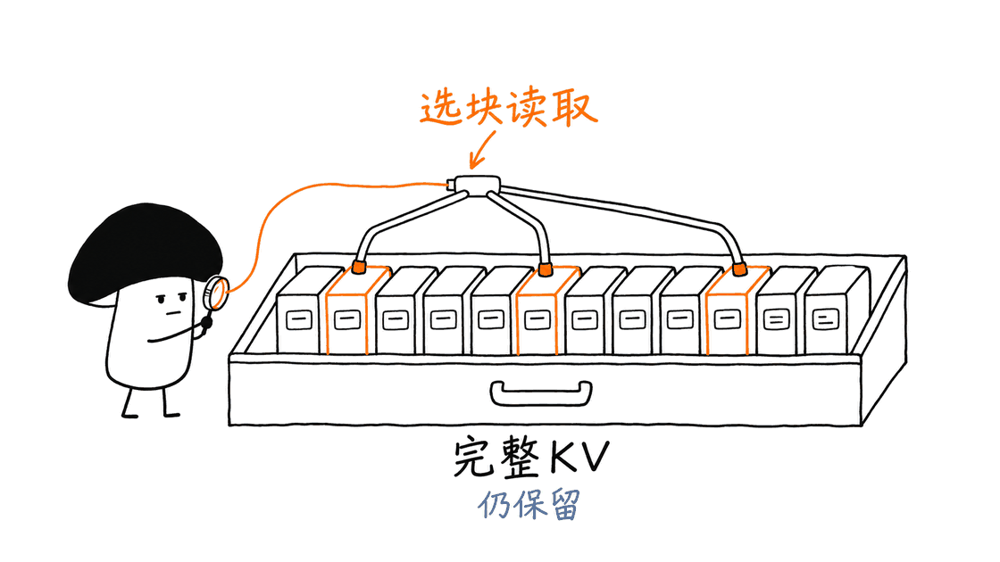

Qwen3.8-27B QSA 是一套社区改造的长上下文模型与配套推理引擎：通过筛选注意力要读取的历史片段，降低长输入时的计算负担。它值得研究，但“24GB 单卡、262K 上下文、视觉、MTP、前缀缓存”来自不同分支和配置，不能合并成一张无条件兑现的功能清单。

截至 2026 年 11 月 5 日，higa2515 提供 BF16 与 GGUF 权重，kuraneko1 维护自定义 llama.cpp 引擎，pentaCoxian 的另一条分支探索 24GB 显卡部署。**最值得关注的是一套可审阅的工程取舍，而非“27B 模型从此随便跑满长上下文”。**

## 先把三个项目的位置摆清楚

| 来源 | 主要内容 | 阅读时应注意 |
| --- | --- | --- |
| higa2515 BF16 / GGUF | 社区 QSA 适配权重、量化文件及模型说明 | 不是 Qwen 官方另发的 27B QSA 型号 |
| kuraneko1 自定义引擎 | QSA 执行路径、视觉、MTP、运行说明及验证记录 | 标准 GGUF 容器不代表普通引擎支持新增算子 |
| pentaCoxian 24GB 分支 | 更激进的量化、索引环形缓冲与 DFlash 草稿配置 | 内存节省伴随缓存功能和运行条件的变化 |

BF16 模型卡标注 Apache-2.0。引擎来自 llama.cpp 生态，24GB 分支保留 MIT、Apache-2.0 及补丁许可证文件；部署和再分发时应同时检查代码、目标权重、草稿权重及视觉投影器的条款。

相关 QSA 论文《On the Design of Qwen3.8-Next Architecture: Evaluation, Efficiency, and Training Stability》讨论的是 Qwen3.8-Next 架构。把其中的架构思想迁移到社区 27B 权重，不等于继承论文里全部性能、稳定性与训练结论。

论文：https://arxiv.org/abs/2608.30320

## QSA 究竟省下了什么？

这款 27B 模型的 64 层解码器包含 16 层完整注意力和 48 层 GatedDeltaNet。社区方案给前者增加 QSA 索引器，后者保持不变；因此，对照中的 dense 指恢复那 16 层完整注意力，并非把 64 层全部改成完整注意力。

索引器把历史组织为四个 token 一组的块，选择预算为 2,048 个 token，再加入当前块。这样可以少读取一部分 KV、少做注意力计算。但是基础实现仍保留完整 KV 条目，不能把“少参与本次计算”理解成“历史缓存已经被删除或压缩”。

新增索引器约 5,243 万个 FP32 参数，GGUF 中对应 80 个索引张量。模型卡记录的训练为 300 步、16,384 长度、50% 多模态混合数据，包含合成 OCR、表格和形状任务。原有主干、视觉和 MTP 权重保持不变的说法来自发布者的比对记录。这不是完全零训练，也不是重新训练整个 27B 模型。

这也解释了为什么短输入未必更快：索引器本身有开销，历史不长时，可省掉的注意力计算有限。模型服务不能只用一条短问答判断这个优化是否有效。

## 24GB 与 262K，分别用了哪些条件？

先看基础引擎的 GPU 指南。作者记录的 RTX 3090 24GB 配置是 UD-Q5_K_M、65,536 上下文容量、Q8_0 KV，GPU 总占用约 23,779 MiB。另一个 262,144 容量例子使用 V100 32GB、Q4 量化，输入嵌入留在 CPU，实际试验输入最高约 16,064 token。配置容量不是实际输入长度；成功加载视觉投影器，也不等于完成了视觉问答验证。

真正把“24GB + 接近 262K 实际输入 + 视觉”放到同一实验里的，是 pentaCoxian 的部署分支。其默认脚本采用：

- GSQ-RCO IQ3_S 目标模型，另配 DFlash2 IQ4_XS 草稿模型，默认起草 4 个 token。
- 目标模型 K/V 使用 Q8_0；草稿模型 KV 使用 F16，并加载独立视觉投影器。
- 上下文 262,144、单个并行槽位、Flash Attention 和 GPU 层卸载；不是多个用户同时各占一份超长上下文。
- `LLAMA_QSA_RAW_RING=8192`，只保留近期原始索引键的环形缓冲；作者称这一项约节省 2 GiB。
- `--cache-ram 0`；这个 raw-ring 路径不支持完整状态的保存与恢复，因此不能同时宣传基础分支的全部提示缓存能力。

该分支还提供可选 MTP 路径及其 8,192 窗口设置，但默认使用 DFlash。基础引擎验证过的 MTP 最多起草两个 token，与这里的 DFlash 配置属于两套实验条件。

| 文件 | 十进制文件大小，约值 |
| --- | --- |
| 主仓库 Q8_0 | 29.26 GB |
| 主仓库 UD-Q4_K_M / Q5_K_M / Q6_K | 16.67 / 19.98 / 22.19 GB |
| 24GB 分支 IQ3_S 目标模型 | 12.33 GB |
| DFlash2 IQ4_XS 草稿模型 | 1.04 GB |
| 视觉投影器 | 0.93 GB |

后三项合计约 14.30 GB 是下载文件体积，不是最终显存占用。KV、计算图、工作区、分配器和显示桌面仍要占内存。GB 与 GiB 也不能混用。

## 作者公布的速度，能怎样解读？

基础引擎公布了 Q8 权重、F16 KV、MTP draft 2、两张 sm70 32GB GPU 的对照。在 261,120 token 深度，QSA 冷预填充为 1,071.53 token/s，dense 为 366.84；解码为 41.07 对 22.91 token/s。约 2.92 倍与 1.79 倍是这些特定条件下的作者记录，不是 24GB 分支成绩。QSA 的部分深度点沿用此前匹配运行，双方不是交错重复的 A/B 实验，也没有给出置信区间。

24GB 分支则报告，RTX 4090 在约 255K 输入时，采样解码 113.0 token/s、预填充约 2,375 token/s、峰值 22.81 GiB；约 108 秒的预填充等待说明，高解码吞吐并不等于长文档首字瞬间出现。结果来自四类实际任务的调和平均，采样参数与种子数也有明确规定。

它与 stock 引擎对比时，后者没有加载视觉、上下文按测试深度分配，采样种子数量也不同。因此，3.1 倍解码等数字可以作为工程线索，不能当成所有条件完全一致的普适倍率。分支迭代还更换过草稿量化和起草长度，综合收益也不能归功于某一个内核。

代码任务与散文任务的草稿接受率不同，作者给出的解码速度也明显不同。真实收益取决于任务分布、输入深度和采样设置，而不只是显卡型号。

## 质量和前缀缓存，哪些证据还不够？

模型卡提供困惑度、少量视觉探针及固定窗口验证。BF16 对照中的困惑度是 7.072960 与 7.071384，构造的 50 道四选一文档视觉题两边均为 50/50。这些结果只能说明指定测试中的表现；四选一题不等于标准开放式 DocVQA，也不能据此宣称保留了全部原模型能力。

在 24GB 分支的 255K 测试里，单事实检索为 24/24，双跳问题为 11/16，dense 对照为 12/16，视觉探针为 14/14。数量适合做冒烟验证，不足以覆盖多页文档推理、复杂表格、视频理解、Agent 工具调用或任意长上下文位置。作者还记录过 60K 代码场景约 7% 提前停止，尚不能单独归因于 QSA、量化或基础模型。

缓存需要分三件事理解：正在运行的槽位可以继续保留会话状态；提示缓存可以让不同请求复用状态；磁盘持久化还能跨重启恢复。基础分支描述的是单槽位中的实时前缀复用，不是跨进程持久化。24GB raw-ring 分支关闭完整状态缓存，也不表示每轮聊天必定全部重算：作者记录的连续视觉对话只重算约 18—20 个 token，但修改图片后的问题可能触发完整提示重算，255K 时等待约 110 秒。

## 本次实际核验到了哪一层？

本次拉取并审阅两个源码仓库、模型卡、文件元数据、部署脚本和作者验证记录，修正了素材里断开的 BF16 链接及社区分支名称。三个主来源通过 Jina Reader 抓取成功，相关官方架构图与吞吐图已保存。

本机没有对应 NVIDIA GPU，未下载 27B 权重。隔离安装 CMake/Ninja 后，在 Apple Silicon 上禁用 CUDA、Metal 与 Accelerate，完成自定义引擎 CPU 构建，并通过现有 `test-gguf` 的 144/144 项测试。最初失败原因是本机缺少构建工具，不能记成项目缺陷。

这一结果验证了当前快照的 CPU 构建与 GGUF 基础读写测试，不验证 QSA CUDA 内核、真实模型推理、MTP 接受率、视觉效果或 24GB 显存峰值。没有任何上述吞吐数字是本次实测。

复核快照：基础引擎 `864934c78136ad75274f202b8eb1e7c751d81fb1`，24GB 分支 `fe08b167477a8eb651dc71ded753542d72c46cd0`；BF16 权重 `8316665d09bf3ddcf7b36673ef9d2590efe6d082`，GGUF `e4c378e709c29a72997f56b5f97f9cd282fede83`。

## 如何安排一次有价值的部署实验？

先在独立目录固定引擎提交、权重与投影器校验值，读清对应部署脚本，再从 8K 或 16K 开始。不要一开始就把上下文设到 262K，并把启动成功当成验收完成。

随后用相同量化、相同采样和相同设备建立 dense 对照，逐步测试 32K、64K、128K、255K。每个深度至少记录首字延迟、预填充、解码、进程与设备峰值内存，并分别跑单事实、多跳、图文及代表性代码任务。把图像放在开头和靠近结尾分别测试，避免只证明一种位置可用。

最后加入服务行为：连续对话、编辑历史、替换图片、并行请求、重启与中断恢复。单槽位实验若要扩展到团队使用，需要重新做内存预算；长上下文能力也应与检索方案比较端到端成本，而不只比较 token/s。

这套方案的价值在于让长上下文的瓶颈与代价变得可检查。需要 24GB 本地视觉长文档服务的开发者可以把它作为实验起点；需要稳定多用户服务的团队，则还需要自己的质量集、缓存策略和故障恢复验证。

## FAQ

### 普通 llama.cpp 或 Ollama 能直接加载这些 GGUF 吗？
不能只凭 GGUF 扩展名判断。这里依赖自定义 QSA 执行路径，需要检查对应引擎版本与支持说明。

### 24GB 显卡都能复现 262K 加视觉吗？
不能这样保证。作者测过特定 RTX 4090 与 RTX 5090 配置，其他显卡、驱动、桌面占用、量化和并发需要独立验证。

### Apple Silicon 可以照抄这套 CUDA 性能吗？
不能。本次 CPU 构建通过不代表 Metal QSA 路径已可用，更不能外推其吞吐和内存数据。

## 一手来源

基础引擎：https://github.com/kuraneko1/Qwen3.8-27B-QSA-llama.cpp

BF16：https://huggingface.co/higa2515/Qwen3.8-27B-QSA-BF16

GGUF：https://huggingface.co/higa2515/Qwen3.8-27B-QSA-GGUF

24GB 分支：https://github.com/pentaCoxian/Qwen-QSA-llama.cpp

24GB 权重：https://huggingface.co/pentacoxian-dev/Qwen3.8-27B-QSA-GSQ-RCO-GGUF

---

> © 2026 Author: Mycelium Protocol. 本文采用 [CC BY 4.0](https://creativecommons.org/licenses/by/4.0/deed.zh) 授权——欢迎转载和引用，须注明作者姓名及原文链接，不得去除署名后以原创发布。

<!--EN-->

Qwen3.8-27B QSA is a community model adaptation and custom runtime that selects historical attention blocks to reduce long-context computation. Its most interesting result is conditional: 24GB deployment, near-262K inputs, vision, speculative decoding and prefix reuse do not all describe the same branch or configuration.

## What changes, and what stays allocated?

The adaptation adds QSA indexers to 16 full-attention layers, leaving 48 GatedDeltaNet layers unchanged. The dense comparison restores those 16 attention layers; it does not replace all 64 layers with full attention.

The indexer selects four-token blocks with a 2,048-token budget plus the current block. In the base implementation, all KV entries remain allocated. Reducing attention reads and computation is different from compressing the KV cache. Short prompts may gain little because indexing has its own overhead.

The BF16 card declares Apache-2.0. Engine and patch notices must be checked separately, including the MIT and Apache-2.0 files retained by the 24GB fork; target, drafter and projector licenses should also be reviewed before redistribution.

The model card reports approximately 52.43 million added FP32 indexer parameters and 80 GGUF indexer tensors, trained for 300 steps at length 16,384 with a 50% multimodal mixture. It reports unchanged original backbone, vision and MTP weights. This is neither zero training nor a retraining of the whole model. The Qwen3.8-Next architecture paper motivates QSA but does not independently validate this community 27B adaptation.

## Which configuration actually targets 24GB?

The base GPU guide records a 24GB RTX 3090 using UD-Q5_K_M, a 65,536-token capacity and Q8_0 KV. Its separate 262,144-capacity V100 example uses 32GB, Q4 weights and CPU input embeddings; the reported test input reached only about 16K. Allocated capacity is not a tested input length, and loading a projector does not prove successful visual answers.

The pentaCoxian fork combines a GSQ-RCO IQ3_S target, a DFlash2 IQ4_XS drafter, Q8_0 target KV, F16 draft KV and a vision projector. Its default configuration uses four draft tokens, one parallel slot and a 262,144 context. The raw-indexer-key ring is limited to 8,192 entries, reportedly saving roughly 2 GiB.

This comes with a tradeoff: full state save/restore is unsupported on that raw-ring path, and the launcher sets `--cache-ram 0`. An optional MTP path has separate window settings; it must not be conflated with the default DFlash configuration or the base engine’s two-token MTP tests.

The three download files total approximately 14.30 decimal GB: 12.33 GB for target weights, 1.04 GB for the drafter and 0.93 GB for the projector. Actual VRAM must also accommodate KV, computation graphs, workspace, allocation overhead and any display workload. Download size is not runtime memory.

## How strong is the performance evidence?

The base engine reports Q8 weights, F16 KV and two-token MTP on two 32GB sm70 GPUs. At depth 261,120, QSA prefill is 1,071.53 versus 366.84 tokens/s, and decode is 41.07 versus 22.91. These are author measurements under those conditions, not results for the 24GB fork. Some QSA depth points were retained from earlier matched runs rather than interleaved A/B trials, and no confidence intervals are provided.

The 24GB fork reports approximately 255K input tokens on an RTX 4090, sampled decode of 113.0 tokens/s, prefill around 2,375 tokens/s and peak usage of 22.81 GiB. Prefill still takes approximately 108 seconds. High subsequent decoding throughput does not imply an immediate first token.

Its stock comparison excludes vision, sizes context by depth and uses fewer sampling seeds. Reported gains are useful engineering evidence, but not fully identical-allocation comparisons. Other revisions changed both draft quantization and draft length, so aggregate gains cannot be assigned to a single kernel. Task-dependent acceptance rates also make a universal “100+ tokens/s” promise inappropriate.

## Quality and caching need separate checks

The base card’s similar perplexities and constructed 50-question multiple-choice document test are narrow checks, not proof of unchanged general capability or standard open-ended DocVQA performance.

At 255K, the fork reports single-fact retrieval of 24/24, two-hop results of 11/16 versus 12/16 for dense, and visual probes of 14/14. These are smoke tests. They do not cover arbitrary document positions, complex tables, video, tool use or reliable multi-user service. Reported early stopping in roughly 7% of one 60K code setting remains an unresolved observation, not an established QSA-specific failure.

Live conversation state, reusable prompt state and persistence across restarts are three distinct capabilities. The base implementation describes live prefix reuse within a slot. The raw-ring fork disables full-state caching, yet sequential visual turns can still reuse live state: the author reports reprocessing only 18–20 tokens. Editing a question after an image can instead trigger full recomputation, reportedly taking about 110 seconds at 255K.

## What was independently checked here?

Both source repositories, model cards, file metadata, launch scripts and published validation records were inspected. The broken BF16 URL was repaired. Three main sources were fetched through Jina Reader, and official architecture and throughput graphics were saved.

No 27B weights were downloaded, and no matching NVIDIA GPU was available. After installing CMake and Ninja in an isolated environment, the custom engine built on Apple Silicon with CUDA, Metal and Accelerate disabled. Its existing `test-gguf` suite passed 144/144 checks. The initial failure was missing local build tools, not a demonstrated upstream defect.

That verifies the CPU build and basic GGUF tests at the inspected snapshot. It does not validate QSA CUDA kernels, inference quality, vision, speculative acceptance, 24GB peak memory or any throughput quoted above.

Pinned engine commits: `864934c78136ad75274f202b8eb1e7c751d81fb1` and `fe08b167477a8eb651dc71ded753542d72c46cd0`. BF16 revision: `8316665d09bf3ddcf7b36673ef9d2590efe6d082`; GGUF revision: `e4c378e709c29a72997f56b5f97f9cd282fede83`.

## A practical evaluation plan

Pin code, weight checksums and the projector. Start at 8K or 16K, then increase to 32K, 64K, 128K and near 255K. Keep quantization, sampling and hardware constant against the dense baseline. Record time to first token, prefill, decode and both process and device memory.

Test fact retrieval, multi-hop reasoning, images at different positions and representative coding tasks. Then test edited history, image replacement, concurrent requests, restart and interrupted-session recovery. Compare end-to-end cost against retrieval, rather than using token throughput alone.

This is a useful experimental starting point for long-document vision on constrained GPUs. Stable team deployment still requires workload-specific quality evidence, a concurrency budget and explicit recovery behavior.

## FAQ

### Does a GGUF file guarantee compatibility with stock llama.cpp or Ollama?
No. The custom QSA execution path requires explicit runtime support.

### Will any 24GB card reproduce the result?
No such guarantee follows from the author’s specific RTX 4090 and RTX 5090 configurations.

### Does the local CPU build establish Apple Metal support?
No. It proves neither Metal QSA execution nor CUDA-equivalent performance.

## Primary sources

Engine: https://github.com/kuraneko1/Qwen3.8-27B-QSA-llama.cpp

BF16: https://huggingface.co/higa2515/Qwen3.8-27B-QSA-BF16

GGUF: https://huggingface.co/higa2515/Qwen3.8-27B-QSA-GGUF

24GB fork: https://github.com/pentaCoxian/Qwen-QSA-llama.cpp

Quantized fork weights: https://huggingface.co/pentacoxian-dev/Qwen3.8-27B-QSA-GSQ-RCO-GGUF

Architecture paper: https://arxiv.org/abs/2608.30320

---

> © 2026 Author: Mycelium Protocol. Licensed under [CC BY 4.0](https://creativecommons.org/licenses/by/4.0/) — free to share and adapt with attribution. You must credit the author and link to the original; removing attribution and republishing as original is not permitted.
