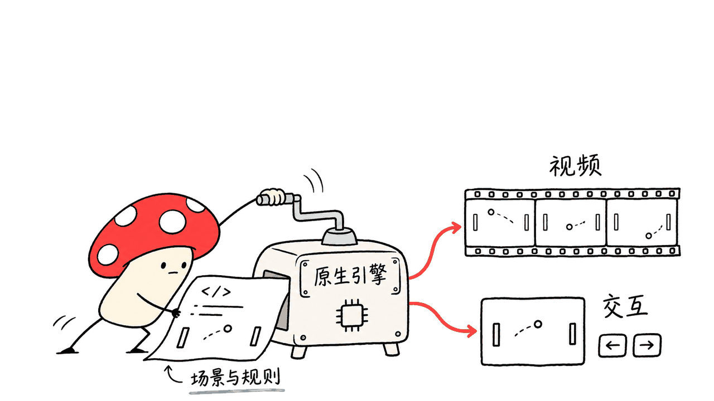

raea 是一个让 React 和 TypeScript 场景直接在本地 GPU 上绘制、导出视频或交互播放的引擎。它值得关注的是共享场景代码与可检查的输出，而不是“任何视频一秒生成”的承诺。

项目位于 `shinyobjectz/raea`，作者为 Shane Murphy。当前引擎采用 FSL-1.1-ALv2，含竞品用途限制；每个版本发布两年后才转为 Apache-2.0。源码公开与当下无使用领域限制的开源许可，需要分开理解。

官方仓库：https://github.com/shinyobjectz/raea

官方文档：https://raea.io/docs/

本文检查源码快照与官方 v0.1.8 发行包。README 当时仍将 v0.1.6 写作最新版本，但 GitHub 发布接口已提供 v0.1.8，因此运行验证以实际发行包为准。封面为本地生成的场景示意，不是官方测试照片。

## 原生渲染，究竟省掉了哪一层？

常见 React 视频方案把组件交给浏览器布局和绘制，再逐帧获取画面。raea 保留 React、TSX、按帧求值这些编写习惯，但不把 Chromium 截图作为视频导出的中心环节。

它的代码分层包含 Rust 引擎、Bevy、共享 GPU 设备、布局与合成、编解码及自有 JavaScript 运行时。README 将 macOS 的运行时描述为 JavaScriptCore，其他平台为 QuickJS；图形经原生 GPU 后端处理，而不是必须开启一个浏览器窗口。

这不等于普通网页无损迁移。熟悉的 `div`、样式、flex、grid 或部分 three.js/R3F 接口，会进入它提供的兼容路径。浏览器专用 API、第三方插件、字体与 CSS 行为仍需逐项验证，不能因为语法是 React 就假定所有 React 网页都能直接运行。

## “90帧1080p约一秒”能推广到所有视频吗？

官方 README 的例子很具体：1920×1080、30fps、90 帧，用 `useCurrentFrame` 和 `interpolate` 做 Hello 文字淡入。官方称这段示例在 Apple Silicon Mac 上约一秒完成。90 帧对应三秒片长，这个成绩不包括让 AI 想出内容、写对代码和反复修改的时间。

它不是复杂三维场景、任意素材、任意硬件的速度保证。几何复杂度、透明层、阴影、素材解码、字体、图像传输与最终编码都可能改变耗时。官方文档还说明，相同输入的完整视频可以命中导出缓存；对比速度时必须辨认究竟重新绘制了画面，还是复制了旧结果。

我们在核对的 README、安装与渲染说明里，没有找到“必须或只需12GB独立显存”的通用门槛。Mac 使用统一内存，更不应直接套用一张 NVIDIA 显卡的显存数字。文章因此保留原生 GPU 的架构判断，不转述未经确认的硬件门槛，也不声称它已经全面快于 Remotion。

## 同一份代码，为什么能导出视频也能玩？

关键是把画面定义为时间和状态的函数。视频导出按指定帧推进，交互播放则把键盘等输入送进状态演化；同一套绘制逻辑可以复用。官方 Pong 示例本身就包含球、球拍、计分和输入处理，不是先做一个动画，再自动猜出玩法。

因此，“一键变小游戏”需要一个前提：作品已经写好了交互与规则。一个只会文字淡入的组件，运行 `play` 不会自动获得目标、胜负、碰撞和关卡设计。可交互的原型也不等于完成发行、兼容性和游戏体验验收。

当前 `export-game` 文档列出 `mac-app` 与 `mac-cli` 打包目标。Mac 导出程序可先作 ad hoc 签名；交给其他用户还涉及 Developer ID 签名与公证。不要把引擎支持多个系统，扩写成当前每个打包目标都已经跨平台验证。

## Agent“抽帧查错”，离自动修好作品还有多远？

raea 提供了实用的反馈接口：导出指定单帧或一组帧，写出包含布局信息的 render manifest，再运行 `check`。快速检查会抽取三个时间点，检查文字裁切、拥挤、尺寸和安全区等；完整检查还可利用视频、manifest、转写和其他输入，覆盖更多问题。

这里最有价值的是错误能落到具体帧与元素。Agent 可以拿到证据后改代码、重新渲染，再判断原问题是否消失。比起只返回“渲染成功”，这更接近可验收的制作流程。

但抽帧会漏掉未采到的瞬间，规则通过也不代表审美、叙事、事实与人物动作正确。引擎提供的是检查与迭代的工具；是否真的调用视觉模型、是否修好、循环何时停止，仍取决于外部 Agent 和验收条件。

## 本地运行，我们实际验证到了什么？

我们下载了官方 macOS ARM64 v0.1.8 包，在隔离目录解压，SHA-256 与官方校验文件一致。没有运行安装脚本，也没有把 raea 的技能加入现有 Agent。环境为 Apple M4、16GB 统一内存、macOS 26.6.2，测试启用 `RAEA_OFFLINE=1`，不配置云端服务。

| 实际检查 | 结果 |
| --- | --- |
| 自写文字淡入与圆点移动场景 | 单帧成功；完整 H.264 视频经 ffprobe 解码计数为 1920×1080、30fps、90 帧、3 秒。 |
| 故意将文字移到画面右侧之外 | `check --quick` 退出码 1，指出第 22 帧文字越界，并报告抽查 22、45、89 帧。 |
| 正常布局的同一场景 | 退出码 0、无错误，但保留三条暗画面警告。 |
| 自写按键控制方块，脚本按 ArrowRight | 无窗口播放成功，快照中方块左缘从初始 100 移到 175。修正输入 JSON 格式后，同一逻辑也成功离线抽帧。 |
| 尝试 `export-game --target mac-cli` | 失败：该发行包内没有 `raea-game` 播放器，命令要求先构建对应 player。未声称独立游戏打包成功。 |

还遇到了输入格式差异：`play` 使用的稀疏帧号到按键数组，直接交给 `render --input` 会在第 30 帧抛异常，且不输出图片。按该版本源码改成逐帧 `{keys:[...]}` 对象后成功；这也说明“同一个场景”不代表每个 CLI 入口的 JSON 可以直接互换。我们只改了自己的测试输入，没有修补引擎。

这是功能验证，不是速度基准。当时还有配图工作并行，且没有做隔离、重复计时和 Remotion 对照，因此不拿单次日志的帧耗时宣传性能。也没有验证复杂三维资产、完整 AI 自动修复或独立游戏的签名分发。

测试说明“检查→改代码→再检查”能够提供有效信号，但本次是我们主动修正样例，不是证明某个 AI 能自主修好所有画面问题。

## 该把 raea 放进哪一类制作流程？

Mycelium Protocol 更看好它用于有结构、可重复修订的作品：产品功能演示、图表动效、交互原型，以及需要批量改文案和布局的短片。代码让时间、样式和状态有了可追踪的来源，原生渲染与检查记录则让交付多了一层证据。

接入前先做三个验收：自己的字体、素材和依赖能否渲染；一个实际片段能否从源文件稳定重现；检查器能否发现你最在意的错误。再谈批量生产和性能优化，避免只拿 Hello 示例预测复杂项目。

本地引擎免费且无需账户，并不等于整个创作链路免费或离线。外部 AI Agent 的服务费用、可选素材生成、模型首次下载与托管能力需要另算。设置文档提供 `RAEA_OFFLINE=1`，同时也列出可选云端判断模型和付费计划路径；应按实际启用的功能理解数据流。

## 常见问题

### raea 是一个视频生成模型吗？

不是。核心是执行场景代码、绘制并导出画面的引擎。AI 可以负责写代码，也可以通过额外模型生成声音或素材，但这些能力与引擎本身是不同层。

### 它完全兼容浏览器和 Remotion 项目吗？

不能这样承诺。相似的 React 视频 API 可以降低上手成本，但自有运行时、布局、渲染和媒体链路有自己的支持范围。应把现有作品迁移当作兼容性验证，而非只改一个 import。

### 可以用它做竞品渲染服务吗？

不能把当前许可当作 Apache-2.0 的无竞品限制授权。FSL 文本限制 Competing Use；是否构成竞争取决于实际产品和条款，每个版本的两年后转许可也不是今天立即生效。

相关流程分析：https://blog.mushroom.cv/blog/cinecode-code-rendered-video-production-guide/

核验版本：源码 `2fd0c7f14a0cd0db1ee73a9481b90b940d6c5980`；发行版 v0.1.8 标签 `a9ecc06820a22f8175ff837a1dde244389b9b3e6`。性能宣传与本地运行验证分别标注，未对 Remotion 做同机比较。

---

> © 2026 Author: Mycelium Protocol. 本文采用 [CC BY 4.0](https://creativecommons.org/licenses/by/4.0/deed.zh) 授权——欢迎转载和引用，须注明作者姓名及原文链接，不得去除署名后以原创发布。

<!--EN-->

raea renders React and TypeScript scenes on a local GPU and can export video or play authored interactions. Its useful proposition is shared scene code and inspectable output, rather than a promise that every video takes one second.

The repository is `shinyobjectz/raea`, by Shane Murphy. The engine currently uses FSL-1.1-ALv2, including a competing-use restriction. Each version becomes Apache-2.0 two years after its release. Public source should not be confused with an unrestricted current Apache license.

Repository: https://github.com/shinyobjectz/raea

Documentation: https://raea.io/docs/

We examined the pinned source and the official v0.1.8 distribution. The README still called v0.1.6 the latest release, while GitHub already supplied v0.1.8. Local checks use the actual release artifact. The cover is a locally generated explanatory scene, not an official test photograph.

## Which layer does native rendering remove?

A browser-based React video pipeline lays out and draws components in a browser before capturing successive frames. raea retains TSX and frame-driven composition while replacing the Chromium capture path with its own runtime and native rendering stack.

Its layers include Rust, Bevy, a shared GPU device, layout, compositing and media I/O. The README names JavaScriptCore on macOS and QuickJS elsewhere. Rendering does not require a browser window to be the center of the export process.

That does not imply universal web compatibility. Familiar elements, CSS, flex/grid and supported three.js/R3F interfaces pass through raea's implementations. Browser-only APIs, plugins, fonts and layout details still need testing. React syntax alone is not evidence that an arbitrary web application will run unchanged.

## What does the one-second example actually establish?

The README uses a concrete example: a Hello text fade at 1920×1080, 30fps and 90 frames. The author reports roughly one second on an Apple Silicon Mac. Ninety frames represent three seconds of playback, and the claim excludes asking an AI to design, write and repair the composition.

Complex geometry, shadows, transparency, footage decoding, fonts, readback and encoding can change the cost. The documentation also says identical whole-video exports may be copied from an export cache. A timing comparison must distinguish new rendering from reusing an earlier result.

We found no general 12GB discrete-VRAM requirement in the audited README and installation/rendering guidance. Macs use unified memory, making a generic NVIDIA VRAM threshold especially misleading. We therefore explain the native architecture without asserting that it universally outperforms Remotion or that 12GB is a verified minimum.

## How can one scene become video and an interactive program?

The reusable part is a scene evaluated from time and state. Offline rendering advances frames; live playback supplies input to the authored simulation. The official Pong example already contains paddle controls, ball motion and scoring. Its gameplay is written, not inferred automatically from a movie.

A fading title does not gain objectives, collisions, levels or winning conditions merely by running `play`. Shared rendering can reduce duplicate implementation, but interactive behavior and game design still need to exist.

The current `export-game` documentation lists `mac-app` and `mac-cli` targets. An exported Mac program can use ad hoc signing locally; distribution to other users additionally involves Developer ID signing and notarization. Multi-platform engine support does not prove every packaging target works everywhere.

## What does an agent's visual repair loop really contain?

raea can render selected frames, record layout in a render manifest and run checks. A quick check samples three points and examines text clipping, spacing, size and safe areas. Full checks use additional evidence such as the encoded video, manifest, transcript and perception data.

The useful change is that findings can name a frame and an element. An external agent can inspect evidence, edit the composition and rerender to determine whether a particular problem disappeared. Successful encoding alone provides much less information.

Sampling can miss a transient defect. Passing mechanical rules does not establish good storytelling, factual accuracy, natural motion or visual taste. The engine supplies feedback tools; the external agent and acceptance criteria determine whether inspection happens, repairs work and iteration stops.

## What did we actually run locally?

We downloaded the official macOS ARM64 v0.1.8 archive, matched its SHA-256 to the published checksum and extracted it in an isolated directory. We did not run the installer or add its agent skills. The machine was an Apple M4 with 16GB unified memory and macOS 26.6.2. Tests enabled `RAEA_OFFLINE=1` with no cloud service configured.

| Functional check | Actual result |
| --- | --- |
| Our text fade and moving-dot scene | A still rendered; ffprobe decoded the H.264 export as 1920×1080, 30fps, 90 frames and 3 seconds. |
| Intentionally offscreen text | `check --quick` exited 1 and identified clipping at frame 22; samples were 22, 45 and 89. |
| Correctly positioned text | Exit 0 with no errors, but three dark-exposure warnings remained. |
| Our ArrowRight-controlled square | Headless playback succeeded; its snapshot moved the left edge from initial x100 to x175. After correcting the input JSON schema, the same state logic also rendered a selected frame. |
| `export-game --target mac-cli` | Failed because this release archive lacked the `raea-game` player. The command requested building it first; standalone packaging is not a passed check. |

We also found an input-format mismatch. Passing the sparse frame-to-key-array timeline from `play` directly to `render --input` threw at frame 30 and wrote no frame. Dense per-frame `{keys:[...]}` objects, following this version's source schema, succeeded. Shared scene code does not establish interchangeable JSON at every CLI entry. We changed our fixture, not the engine.

These are functional checks, not speed measurements. Illustration work was concurrent, and we did not isolate load, repeat timings or compare Remotion. Complex 3D assets, a complete autonomous AI repair loop and signed standalone distribution were not tested.

The deliberate layout correction demonstrates actionable inspect/edit/recheck feedback. We made the correction ourselves; this does not prove that an AI automatically repairs every visual defect.

## Where does raea fit in production?

Mycelium Protocol sees a useful fit for structured, revisable work: product demonstrations, animated charts, interactive prototypes and short pieces requiring repeated text or layout changes. Code gives state and timing a traceable source; rendered evidence and checks make delivery more reviewable.

Before scaling up, verify your fonts and dependencies, reproduce one representative scene from its source and deliberately trigger an error that matters to you. A minimal Hello composition is not a substitute for a representative project.

A free local engine does not make the whole creative pipeline free or offline. Agent subscriptions, optional generation, first-use model downloads and hosted services remain separate costs and data paths. Settings document `RAEA_OFFLINE=1`, alongside optional cloud judging and paid-plan routes. Evaluate the actual enabled features rather than the interface name.

## FAQ

### Is raea a video generation model?

No. Its core executes scene code and renders output. An AI can write the code or supply media through additional models, but those are separate parts of the production pipeline.

### Does it fully support browser or Remotion projects?

That is not established. Familiar React video APIs reduce the learning curve, while the runtime, layout and media pipeline have their own compatibility limits. Migration needs real rendering checks, not just an import replacement.

### Can it power a competing rendering service?

The current FSL text restricts Competing Use. Do not treat its future Apache-2.0 grant as already effective today. Applicability depends on the actual product and license terms; check them before building a service around it.

Related workflow analysis: https://blog.mushroom.cv/blog/cinecode-code-rendered-video-production-guide/

Audited source: `2fd0c7f14a0cd0db1ee73a9481b90b940d6c5980`; v0.1.8 tag: `a9ecc06820a22f8175ff837a1dde244389b9b3e6`. Author performance claims and our local functional checks are separate. We did not run a same-machine Remotion comparison.

---

> © 2026 Author: Mycelium Protocol. Licensed under [CC BY 4.0](https://creativecommons.org/licenses/by/4.0/) — free to share and adapt with attribution. You must credit the author and link to the original; removing attribution and republishing as original is not permitted.
