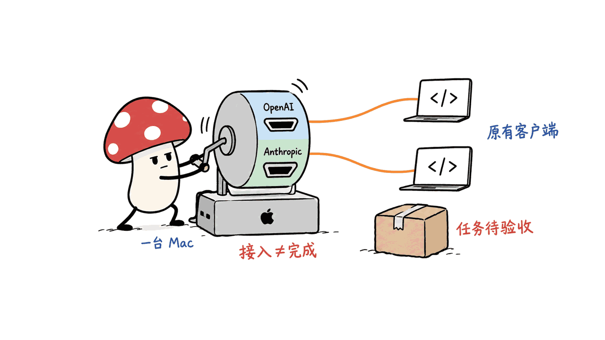
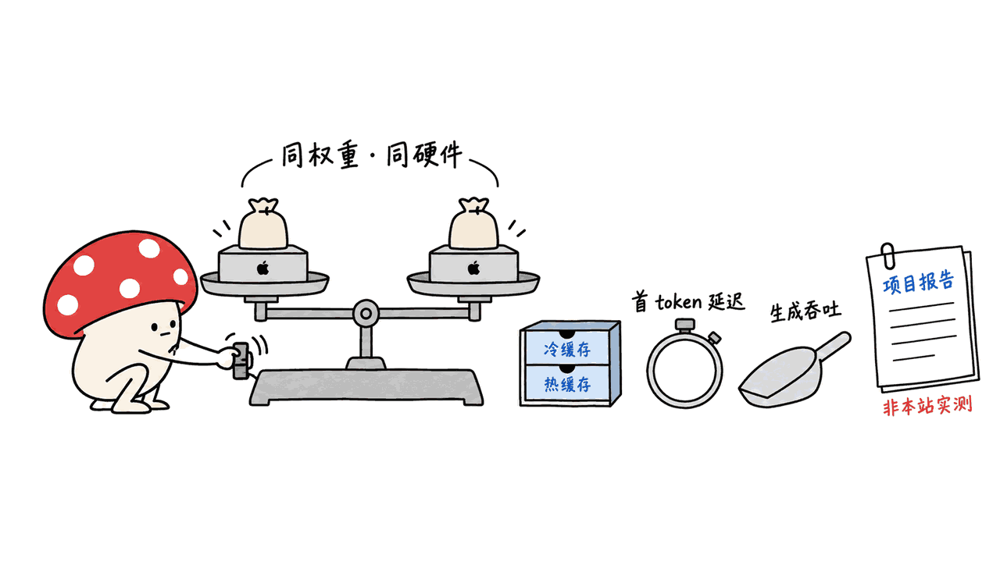

Rapid-MLX 把 Mac 上的本地模型接到编码 Agent，重点在工具调用链路。它采用 MLX，同时提供 OpenAI 和 Anthropic 兼容接口；已有客户端允许配置本地端点时，通常可以保留客户端代码，但仍需验证具体模型与任务。

本文最初发布于 2026 年 6 月 2 日，2026 年 10 月 13 日在同一地址修订，因此不能把它当作本周刚出现的新项目。Mycelium Protocol 复核官方仓库和接入文档，纠正旧稿的性能归因、Claude Code 配置和过时的固定数量描述。

项目采用 Apache 2.0 许可。本次材料固定在提交 8f076c1971ac9a645c3a2ef13365cf32ae037a58，没有运行本机推理、客户端端到端任务或速度对照实验。

官方仓库：
https://github.com/raullenchai/Rapid-MLX

## 两种 API 兼容，具体省了什么？

编码客户端负责规划和执行，本地服务器负责推理及协议输出。兼容接口的价值，是让现有客户端有机会保留自己的工具循环，把模型请求切换到 Mac 上的服务。

官方文档列出 OpenAI 风格的 /v1/chat/completions、/v1/responses，以及 Anthropic Messages 的 /v1/messages。它们可以共用服务器，但客户端如何拼接地址并不相同。

| 客户端协议 | 基础地址示例 | 配置区别 |
|---|---|---|
| OpenAI 兼容客户端 | http://localhost:8000/v1 | 按客户端配置使用相应路径 |
| Anthropic SDK / Claude Code | http://localhost:8000 | 官方指南要求不附带 /v1 |

“只换 endpoint”仍有前提：客户端允许自定义本地地址，服务器支持所需字段和流式事件，模型能处理客户端使用的工具协议。接得上接口与完成编码任务，需要分别验证。



## 怎样接入 Claude Code？

旧稿为 Claude Code 使用 OPENAI_BASE_URL，这是错误的。Rapid-MLX 官方指南使用 Anthropic Messages 路线，配置项是 ANTHROPIC_BASE_URL。

以下示例来自对应文档，没有在本机执行：

```bash
rapid-mlx serve qwen3.5-4b-4bit --port 8000
```

在另一个终端启动客户端：

```bash
ANTHROPIC_BASE_URL=http://localhost:8000 \
ANTHROPIC_API_KEY=not-needed claude
```

官方指南说明 Anthropic SDK 会追加 /v1/messages；把 base URL 写成 http://localhost:8000/v1 可能形成重复路径。如果服务器启用了真实 API key，应使用对应密钥，不能照搬占位字符串。

显式指定端口，也能避免服务器自动选用其他空闲端口后，客户端仍指向旧地址。首次运行需要下载权重，模型尺寸、上下文长度和可用统一内存应单独核对。

固定版本指南：
https://github.com/raullenchai/Rapid-MLX/blob/8f076c1971ac9a645c3a2ef13365cf32ae037a58/docs/agents/claude-code.md

## 工具解析器能保证任务成功吗？

不能。解析器把模型输出整理成工具名称和参数，解决格式问题；模型是否选对工具、参数是否符合任务、执行失败后能否纠正，则属于另外几层能力。

有效的测试不能停在“收到了 tool call”。例如让 Agent 查询文件、读取函数、提出补丁并运行测试，需要检查工具名和参数、结果是否回传、下一轮是否利用结果，以及最终修改是否通过验收。

我会记录四类失败：调用变成普通文字、参数无法解析、重复调用却不前进、任务结束但测试仍失败。它们对编码体验的影响，往往比短回答的 token/s 更直接。

README 报告了客户端集成矩阵和部分真实权重测试，这属于项目自己的验证材料。本次没有运行这些测试，也不能把一个样本集的成功率推广成所有工具、模型和客户端都能达到 100%。


## 性能数字应该怎样看？

旧稿把项目性能材料写成“本站实测”，并使用缺少条件的“最快”“100%”标题。本次移除了错误归因和无法从保存证据复核的旧数值表格。

当前 README 提供指定模型、硬件和服务模式下的比较，并注明部分结果是单次运行。缓存命中、输入长度、推测解码、量化、并发和默认配置都会改变结果，不能把最大加速比当作所有 Mac 上的固定收益。

比较引擎时，应尽量使用相同权重和量化，分别测首次与缓存请求、首 token 延迟、生成吞吐及多轮任务成本。token 不等于一个完整词；只看 tok/s，也容易误判工作完成速度。



我的选型判断是：本地编码先验证工具循环和修复成功率，再比较速度。一个略慢但能稳定处理失败、回传结果和完成任务的服务，可能比某个短文本测试里的高吞吐更有用。

官方性能材料：
https://github.com/raullenchai/Rapid-MLX/blob/8f076c1971ac9a645c3a2ef13365cf32ae037a58/README.md

## 本地推理，是否等于整个任务都在本地？

模型可以在 Mac 上运行，客户端仍可能使用远程搜索、MCP、云端工具或外部模型路由。运行位置与完整任务的数据流向是两个问题。

需要严格本地运行时，检查实际启用的模型、工具和网络目的地；混合使用时，确认哪些步骤会发送到外部服务。本次没有验证完全离线的任务链，这些属于接入验收建议。

一个合适的起步任务是小范围仓库修复：先保存基线，限定可编辑目录，给出一个失败测试，再检查修改差异和工具日志。把失败重试、上下文与等待时间纳入记录，才能比较不同本地服务的实用性。

## 本文核验边界与常见问题

我们核对了官方仓库、固定版本 README 和 Claude Code 指南。上述部署命令与测试建议不是已执行成功的本机轨迹，没有本地速度、内存或完整工具任务结果。

### 所有客户端只改地址就能用吗？

只对允许自定义兼容端点、且服务器支持所需协议行为的客户端成立。模型工具能力与客户端版本仍需要实际测试。

### OpenAI 与 Anthropic 的基础地址相同吗？

可以共用服务器，但官方配置路径不同：OpenAI 兼容端点包含 /v1，Claude Code 使用不包含 /v1 的主机地址。

### 本文验证了性能或 100% 工具调用吗？

没有。本文复核来源和配置说明，未运行推理或对照测试；项目测试结果不能作为本站实测，也不能推广成普遍保证。

相关的 Mac 推理与编码 Agent 选型：
https://blog.mushroom.cv/blog/krill-mac-mlx-llm-runtime-coding-agent/

> © 2026 Author: Mycelium Protocol. 本文采用 [CC BY 4.0](https://creativecommons.org/licenses/by/4.0/deed.zh) 授权——欢迎转载和引用，须注明作者姓名及原文链接，不得去除署名后以原创发布。

<!--EN-->

Rapid-MLX connects coding agents to local Mac models, with particular attention to tool calling. Built on MLX, it offers OpenAI and Anthropic-compatible APIs. Clients supporting a configurable local endpoint can often retain their existing code, while model and task behavior still need validation.

This article first appeared on June 2, 2026 and was revised at the same URL on October 13. It is not a project newly appearing this week. Mycelium Protocol corrected benchmark attribution, Claude Code setup, and outdated fixed counts using primary documentation.

The project uses Apache 2.0. Sources are pinned to 8f076c1971ac9a645c3a2ef13365cf32ae037a58. We did not run model inference, an end-to-end client task, or a speed comparison.

Repository:
https://github.com/raullenchai/Rapid-MLX

## What does API compatibility save?

The agent client plans and executes work; the local server performs inference and returns protocol-compatible output. Compatibility can preserve an existing tool loop while moving model requests onto a Mac.

Documented routes include /v1/chat/completions, /v1/responses, and Anthropic /v1/messages. The server can be shared, but URL construction differs.

| Protocol | Example base URL | Configuration distinction |
|---|---|---|
| OpenAI-compatible | http://localhost:8000/v1 | Follow the client endpoint configuration |
| Anthropic SDK / Claude Code | http://localhost:8000 | The official guide excludes /v1 |

Changing an endpoint assumes configurable addresses, supported request fields and streaming events, and a model competent in the tool protocol. Connection and successful coding work require separate checks.


## How should Claude Code connect?

The earlier article incorrectly used OPENAI_BASE_URL for Claude Code. The official guide uses Anthropic Messages and ANTHROPIC_BASE_URL instead.

These are documentation examples, not commands executed in this verification:

```bash
rapid-mlx serve qwen3.5-4b-4bit --port 8000
```

In a separate terminal:

```bash
ANTHROPIC_BASE_URL=http://localhost:8000 \
ANTHROPIC_API_KEY=not-needed claude
```

The guide explains that the Anthropic SDK appends /v1/messages, so including /v1 in the base can produce a duplicated path. When server authentication is enabled, use its configured key instead of the placeholder.

An explicit port avoids pointing a client at an assumed address after automatic port selection. Initial weight downloading, model size, context length, and available unified memory require their own checks.

Pinned client guide:
https://github.com/raullenchai/Rapid-MLX/blob/8f076c1971ac9a645c3a2ef13365cf32ae037a58/docs/agents/claude-code.md

## Do tool parsers guarantee successful work?

No. A parser structures output into tool names and arguments. Choosing the appropriate tool, producing useful arguments, and recovering after execution failure require additional capabilities.

A meaningful test continues beyond receiving a call: inspect a file, locate a function, propose a patch, and run tests. Check arguments, result delivery, use of that result on the next turn, and final acceptance.

Our initial failure categories would be plain-text calls, invalid arguments, repeated calls without progress, and completion claims despite failing tests. These often affect coding usefulness more directly than short-answer throughput.

The README reports integration matrices and real-weight tests. We did not execute them. A perfect score on a sample does not establish universal success across tools, models, and client versions.


## How should performance claims be interpreted?

The original article mislabeled project material as our measurement and used unconditional fastest/perfect-success framing. This revision removes that attribution and old numeric tables that cannot be verified from preserved evidence.

Current comparisons specify models, hardware, and serving conditions, with some described as single runs. Cache state, input length, speculative decoding, quantization, concurrency, and defaults affect results. A maximum ratio is not a constant benefit on every Mac.

Use identical weights and quantization where possible. Separate cold and cached latency, decoding throughput, and multi-turn task cost. Tokens are not necessarily complete words, and tokens per second do not measure completed work.


For local coding, our priority is tool-loop correctness and successful repairs, followed by speed. Reliable error handling and result consumption can matter more than leading a short-prompt throughput comparison.

Pinned performance documentation:
https://github.com/raullenchai/Rapid-MLX/blob/8f076c1971ac9a645c3a2ef13365cf32ae037a58/README.md

## Does local inference make the whole workflow local?

A model can run on a Mac while its agent uses remote search, MCP services, hosted tools, or external model routing. Execution location and end-to-end data flow differ.

For strict local operation, inspect enabled models, tools, and network destinations. For hybrid workflows, identify external steps. We did not verify a fully offline task chain; these are proposed acceptance checks.

A bounded repository repair is a useful starting experiment: preserve the baseline, constrain writable paths, provide a failing test, then inspect diffs and tool logs. Include retries, context, and waiting time when comparing practical usefulness.

## Verification scope and frequently asked questions

We checked the repository, pinned README, and Claude Code guide. Commands and acceptance suggestions are not an executed local trace. We have no local throughput, memory, or complete tool-task results.

### Can every client work after only an address change?

Only clients with configurable compatible endpoints and supported protocol behavior can be expected to connect. Model competence and client-version behavior require practical testing.

### Do the two protocols use the same base URL?

They may share a server, but official configuration differs: OpenAI-style clients include /v1, while Claude Code uses the bare host without it.

### Did this article verify speed or perfect tool calling?

No. We checked sources and setup guidance without running inference or comparisons. Vendor reports remain distinct from our measurements and do not provide a universal guarantee.

Related Mac runtime and coding-agent comparison:
https://blog.mushroom.cv/blog/krill-mac-mlx-llm-runtime-coding-agent/

> © 2026 Author: Mycelium Protocol. Licensed under [CC BY 4.0](https://creativecommons.org/licenses/by/4.0/) — free to share and adapt with attribution. You must credit the author and link to the original; removing attribution and republishing as original is not permitted.
