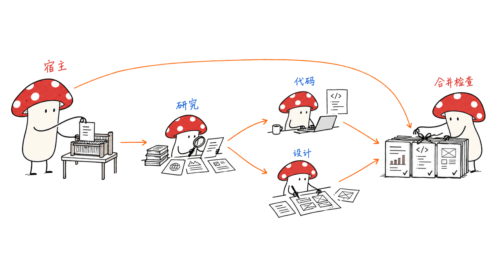
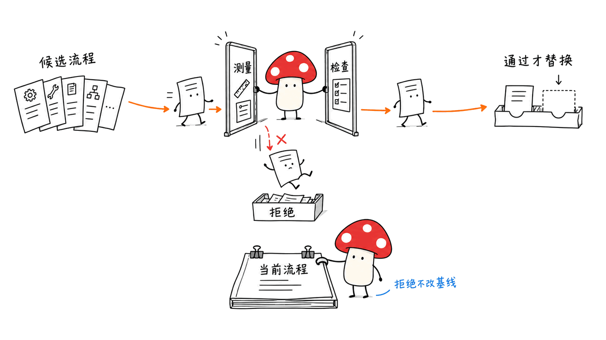
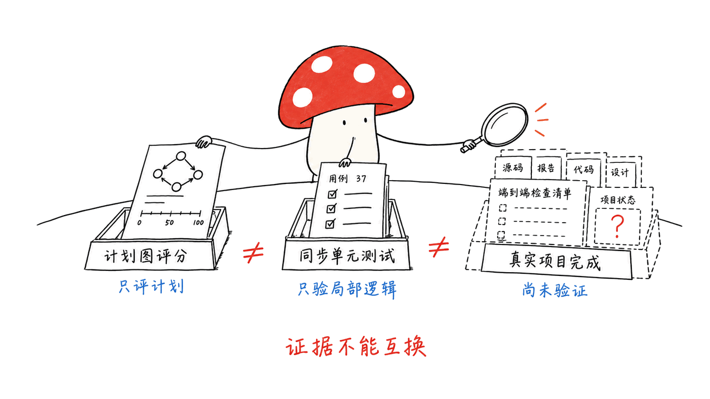

Raven 把研究、编码、设计等专长 agent 放进同一套协作流程，负责分工、安排依赖和汇总结果。它进一步尝试改进 agent 的工作方法，让更有用的规划、工具使用和检查步骤被保留下来。

项目来自 EverMind-AI，核心采用 Apache 2.0，当前 README 明确标为 pre-alpha。本文核对仓库提交 `6b938a4267cb1f3bf1453a39ccc7d580e0eea9fd`、2026-09-27 的技术报告 v1 与当前操作文档；论文结果和我们的小范围代码测试分开陈述。

仓库：https://github.com/EverMind-AI/Raven
论文 Raven: The Harness of Harnesses for Composable Agentic Intelligence：https://arxiv.org/abs/2609.33439
文档：https://evermind-ai.github.io/Raven/

## Raven 协调的到底是什么？

一个 agent 的表现，既取决于模型，也取决于它怎样获得上下文、怎样规划、能调用什么工具、何时检查结果。这些围绕模型的执行规则与组件，通常称为 harness。

Raven 把“模型＋harness”当作可组合的工作单元。Host Agent 接收目标，再将工作交给内置或外部 agent；内置的四种角色分别面向研究、代码、视觉设计和持续执行。

| 角色 | 官方定位 | 需要关注的交付物 |
|---|---|---|
| Raven-Research | 检索、阅读与分析 | 带来源的结论与报告 |
| Raven-Code | 开发、调试与数据处理 | 代码、结果及验证记录 |
| Raven-Design | 演示、图表和界面设计 | 可检查的设计产物 |
| Raven-Oncall | 长时间实验与工作流推进 | 运行状态、阶段结果与待处理问题 |

当前 README 还列出 13 种第三方 agent 的连接预设，使用 ACP、CLI 或 OpenAI-compatible API 等方式。预设能简化连接，但 agent 的工具权限、文件访问和状态能力仍不同，不能把“连上了”直接理解为行为完全一致。

## 为什么要把任务画成 DAG？

假设目标是制作一份产品研究报告和演示：先调查资料，再让数据分析与视觉设计并行，最后合并、检查与交付。DAG 是表达这些先后依赖的有向无环图。

Raven 的编排文档区分单轮工作、单 agent 委派和多节点依赖图。真正重要的是每个节点拿到什么输入、完成后输出什么、失败时后续节点怎么办；多开几个聊天窗口并不会自动解决这些问题。

文档还明确，这里的 DAG 是 Raven 宿主内部的编排，不应理解为持久化分布式工作流服务。需要恢复和追踪长流程时，要核对具体运行方式，而不能仅凭界面中的连线推断服务级保证。

可选的动态 Worker Table 会给当前任务划分职责，同一个底层 agent 可以承担不同角色。它增加的是任务级分工，并非安装出两个新的模型；生成失败时也有回退路径。

编排说明：https://evermind-ai.github.io/Raven/orchestration/

## “自我进化”具体改哪一层？

当前设计把循环拆成四类策略：Memory 决定给当前轮看什么，Planning 决定怎样组织工作，Capability 决定暴露哪些工具，Action 决定下一步行动及执行前判断。

这让改进可以更有针对性。比如一个研究 agent 总是搜索却不读原文，干预点可能是阅读检查；一个编码 agent 过早结束，干预点可能是验证步骤。这些调整改变模型周围的执行方式，不要求重新训练底层模型。

不过，仓库里有几条不同的实现路线，不能合并成一个已经稳定交付的功能：

| 路线 | 当前文档描述的边界 |
|---|---|
| 独立 Evolver | 对候选 harness 做基准评估、比较和保留，不在普通聊天中自行改写生产 agent |
| 实验性 Curator | 组装并调整 agent 的角色与策略；位于源码实验目录，不随已安装包提供 |
| EverOS 与 SkillForge | 保存、检索经验及可复用流程，作用与修改执行代码不同 |

Evolver 文档还标明现有目录有待确认的退役计划；统一 launcher 当前只注册 AppWorld。仓库里有其他评测目录，不代表 launcher 已经支持一键运行所有基准。

这些状态信息会影响如何试用：研究者可以阅读与实验，准备接入长期系统的人则要先确认维护路线、发布版本和所需模块。

Evolver：https://evermind-ai.github.io/Raven/evolver/
实验目录：https://github.com/EverMind-AI/Raven/tree/main/experimental

## 论文成绩说明了什么？

论文的多 agent 编排测试使用相同请求和底座比较 Raven、Claude Code 与 Hermes，**只评分提交的计划图，不派发 worker 执行**。在 Qwen3.8-27B 上，Raven 的图 Exact Match 为 0.711，最强基线为 0.607；这不是完整项目成功率。

报告也转引 HarnessBank v2 的独立流程进化实验：冻结 Qwen3.6-27B，以训练集选择候选，再做留出测试。AppWorld Pass@1 从 41.3% 到 56.7%；SWE-bench Verified 的 26 题测试子集虽有提升，未通过原报告的配对判据，不能当成完整 500 题的成绩。

这两类证据各有用途：一个检查分工计划，另一个检查固定模型外部流程的改进。将它们拼成“Raven 能完成所有复杂项目”的结论，会超出实验支持的范围。

论文结果与协议：https://arxiv.org/html/2609.33439v1#S7
HarnessBank v2：https://arxiv.org/abs/2607.13683v2

## 我们本地验证了哪一小部分？

我们在临时 Python 虚拟环境中，对原始源码运行了 `test_evolver_gates.py` 和 `test_evolver_scoring.py`，共 **37 项通过**。它们检查配对增益、Fisher 检验、固定分母、缺失成绩处理和候选晋级等基础逻辑，没有调用模型服务。

这有助于核对“如何判断候选更好”的代码，但没有运行完整 agent、AppWorld 或真实自我进化实验。测试环境未安装项目的异步测试插件，出现一个配置警告；本次选取的是同步单元测试。

实现中有一个值得保留的限制：没有提供代码激活观测时，Gate-b 不会据此拒绝候选；提供空激活集合则是另一种情况。因此，“存在门控”还需要结合观测数据是否接入来判断。

操作文档也明确，封存测试集和修改路径白名单不等于物理沙盒隔离。我们的判断是，要验证一项改进，至少要分开回答：改动是否运行、得分是否提升、提升是否能迁移。这三件事不会因为叫作 RSI 就自动成立。

本地对应测试源码：https://github.com/EverMind-AI/Raven/blob/main/tests/test_evolver_gates.py
实现与证据边界：https://evermind-ai.github.io/Raven/self-evolution-map/

## 记忆和权限，为什么仍是实际部署的重点？

EverOS 为跨会话经验提供持久化与检索，SkillForge 帮助寻找和复用任务流程。保存一次操作轨迹，并不表示其中每条结论已经核实；复用时仍需知道来源、适用条件和过期风险。

任务级 Charter 可以收窄支持该机制的 worker 的工具与期限，不应扩大已有权限。官方编排文档也提醒，任意第三方 ACP agent 不一定解释这些元数据，连接协议本身不能替代权限执行。

Mycelium 更看重 Raven 是否能保留清晰的任务输入、输出、失败原因与检查记录。真正可积累的经验，是下次遇到同类问题时能复用、还能重新验证的做法。

## 怎样开始试用比较合适？

官方提供 Linux、macOS、WSL2、原生 Windows 和 Docker 路线。源码要求 Python 3.12 及以上；模型、工具和各专长 agent 的配置需要按所选方式准备。开源的是运行框架，调用外部模型仍有费用。

先选一个边界明确的任务，例如整理几份公开资料并产出报告；检查来源和中间文件，再尝试依赖图。需要研究流程改进时，再单独准备可重复评分的数据、预算和隔离环境。

入门文档：https://evermind-ai.github.io/Raven/quick-start/

此前讨论的 RSI-Anything 也围绕候选、评估和保留组织改进，但两者对象和实验不同，不能将结果直接合并比较：https://blog.mushroom.cv/blog/rsi-anything-world-model-retention/

## 常见问题

### Raven 是新的大模型吗？

它是宿主与执行框架，组合模型、工具和 agent 工作流程。不同底座与配置会影响结果，仓库名称本身不对应一套固定模型权重。

### 安装后就能自动越用越强吗？

不能据此保证。经验检索、离线 Evolver 和实验性 Curator 是不同路线；改进需要配置、评估和验证，当前文档还标有生命周期与交付范围限制。

### 37 项测试证明自我进化有效了吗？

没有。它们验证的是评分和门控的部分算术与边界处理，不是完整模型表现、真实任务收益或长时间运行稳定性。

---

> © 2026 Author: Mycelium Protocol. 本文采用 [CC BY 4.0](https://creativecommons.org/licenses/by/4.0/deed.zh) 授权——欢迎转载和引用，须注明作者姓名及原文链接，不得去除署名后以原创发布。

<!--EN-->

Raven coordinates specialist agents for research, coding and design, manages their dependencies and combines their outputs. It also explores improving the procedures around agents so useful changes can be evaluated and retained.

EverMind-AI publishes the core under Apache 2.0. The README labels Raven pre-alpha. We reviewed commit `6b938a4267cb1f3bf1453a39ccc7d580e0eea9fd`, the September 27, 2026 technical report v1 and current operational documentation. Published evaluations and our narrow code tests are separate evidence.

Repository: https://github.com/EverMind-AI/Raven
Report: https://arxiv.org/abs/2609.33439
Documentation: https://evermind-ai.github.io/Raven/

## What does Raven coordinate?

An agent's behavior depends on its model and on context selection, planning, tools and checks. The execution components surrounding the model form its harness. Raven treats a model plus its harness as a composable worker managed by a Host Agent.

| Built-in specialist | Documented purpose | Output to inspect |
|---|---|---|
| Raven-Research | Evidence gathering and analysis | Reports with sources |
| Raven-Code | Development, debugging and data work | Code, results and validation records |
| Raven-Design | Presentations, charts and interfaces | Reviewable design artifacts |
| Raven-Oncall | Sustained experiments and workflows | Progress, intermediate results and exceptions |

The README lists 13 third-party connection presets over ACP, CLI and OpenAI-compatible interfaces. A working connection does not make file access, state or permission behavior identical across agents.

## Why express work as a DAG?

A report-and-presentation task may require research first, analysis and visual work in parallel, and integration afterwards. A directed acyclic graph makes those dependencies explicit.

Raven distinguishes direct turns, focused delegation and multi-node graphs. The important contracts are each node's inputs, outputs and failure behavior. Its documentation describes orchestration within a host, rather than a durable distributed workflow service.

Optional dynamic Worker Tables assign task-specific responsibilities. Two roles may use the same underlying agent; they are not two newly installed models. This mode adds planning work and has a fallback on generation failure.

Orchestration: https://evermind-ai.github.io/Raven/orchestration/

## What can self-improvement change?

Four strategy areas expose context selection through Memory, organization through Planning, tools through Capability and action decisions through Action. A targeted change might require reading after repeated searches or checking results before ending a coding task, without retraining the backbone.

| Route | Current documented boundary |
|---|---|
| Standalone Evolver | Benchmark-driven candidate assessment and retention, separate from normal production chat |
| Experimental Curator | Role and strategy assembly/modification in the source tree, excluded from the installed package |
| EverOS and SkillForge | Persistent experience and reusable procedures; distinct from changing execution code |

Current Evolver documentation records a planned retirement pending sign-off. Its unified launcher registers AppWorld only; the presence of other benchmark directories does not make them supported launcher targets. Confirm release and maintenance scope before depending on these modules.

Evolver: https://evermind-ai.github.io/Raven/evolver/
Experimental tree: https://github.com/EverMind-AI/Raven/tree/main/experimental

## What does the paper establish?

The orchestration benchmark scores plans without executing workers. Under Qwen3.8-27B, Raven's graph Exact Match is 0.711 versus 0.607 for the strongest baseline. It is not project completion rate.

The report separately reuses HarnessBank v2 results: frozen Qwen3.6-27B, training-based selection and held-out evaluation. AppWorld Pass@1 rises from 41.3% to 56.7%. The improved SWE-bench Verified 26-task subset does not pass the source's paired criterion and is not the full 500-task benchmark.

These assess different behaviors and do not establish universal autonomous project success.

Protocol/results: https://arxiv.org/html/2609.33439v1#S7
HarnessBank v2: https://arxiv.org/abs/2607.13683v2

## What did we test locally?

We ran the unchanged `test_evolver_gates.py` and `test_evolver_scoring.py` in a temporary Python virtual environment: 37 tests passed. They cover paired gains, Fisher arithmetic, fixed denominators, missing scores and candidate promotion, with no model-service calls.

We did not run the full agent, AppWorld or a real evolution experiment. One configuration warning arose because the environment lacked the project's asynchronous-test plug-in; the selected tests are synchronous.

An important boundary survives these tests: Gate-b does not reject candidates merely because activation instrumentation is absent; an explicitly empty activation set is a different case. Having a gate is not evidence that its observation channel is connected.

The implementation guide also states that sealed test sets and path whitelists do not physically sandbox candidates. Mycelium therefore separates three questions: did the change execute, did measured performance improve, and does the gain transfer? The RSI label does not answer them.

Test source: https://github.com/EverMind-AI/Raven/blob/main/tests/test_evolver_gates.py
Implementation boundaries: https://evermind-ai.github.io/Raven/self-evolution-map/

## Why do memory and permissions still matter?

EverOS supports persistent retrieval, while SkillForge helps reuse procedures. A stored trace does not make every statement in it verified. Sources, applicability and freshness still affect reuse.

A task Charter can narrow tools and deadlines for workers that support it. Arbitrary external ACP agents may not interpret the metadata, so protocol connectivity cannot replace enforcement.

Mycelium's practical focus is whether Raven preserves clear inputs, outputs, failures and verification records. Experience becomes useful when the next similar task can reuse a procedure and check it again.

## How should a first trial be scoped?

Official routes cover Linux, macOS, WSL2, native Windows and Docker. Source requires Python 3.12 or newer. Model and tool setup depends on the chosen specialists, and external inference still costs money.

Begin with a bounded public-information task, inspect sources and artifacts, then add dependencies. Harness research needs a separate scoring protocol, budget and isolated execution environment.

Quick start: https://evermind-ai.github.io/Raven/quick-start/
Related discussion, with different objects and experiments: https://blog.mushroom.cv/blog/rsi-anything-world-model-retention/

## Frequently asked questions

### Is Raven a new foundation model?

It is a host and execution framework combining models, tools and specialist workflows. Different backbones and configurations change the resulting system.

### Does installation guarantee automatic improvement?

No. Retrieval, the standalone Evolver and experimental Curator are separate routes with configuration, evaluation and lifecycle requirements.

### Do 37 tests establish effective self-improvement?

No. They check selected scoring and gate behavior, not model quality, real-task gains or long-running stability.

---

> © 2026 Author: Mycelium Protocol. Licensed under [CC BY 4.0](https://creativecommons.org/licenses/by/4.0/) — free to share and adapt with attribution. You must credit the author and link to the original; removing attribution and republishing as original is not permitted.
