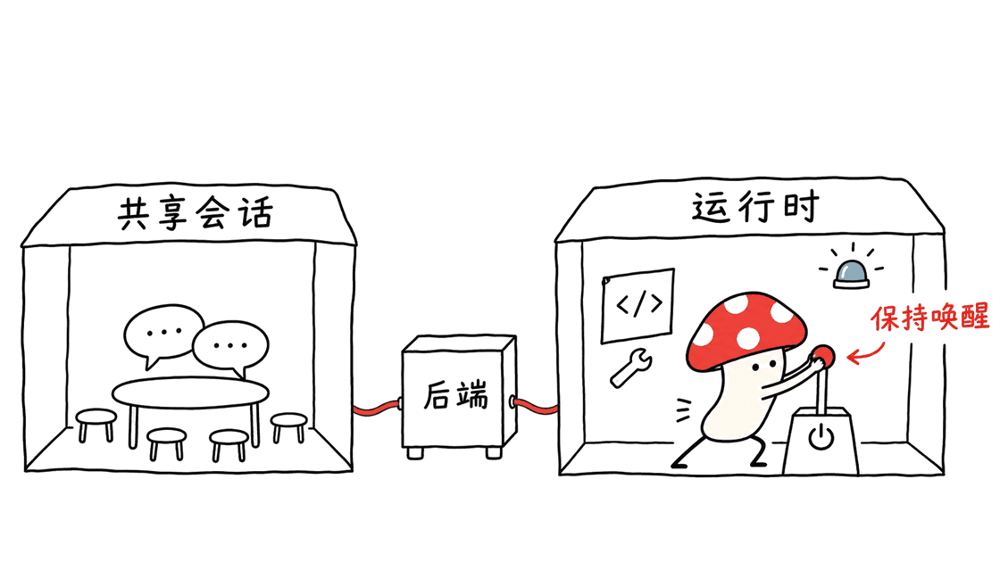
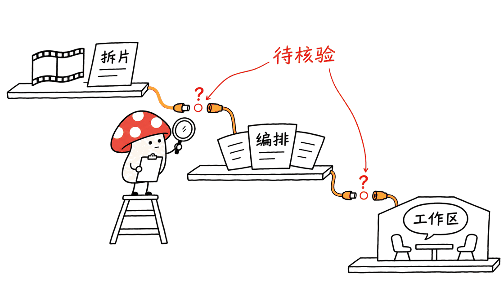

rea-video帮助创作者弄清参考视频怎样制作，Nuphos帮助团队管理编码智能体的会话与运行环境。两者处在不同层：前者输出分析与制作计划，后者提供多人协作入口，不能把它们当成互相替代的“全能Agent”。

官方仓库：
https://github.com/JuneYaooo/rea-video
https://github.com/nuphos/nuphos

原消息中的nuphos地址需要补成两段路径。本文分别固定分析提交 `d904b1e8328515dc95d9772cd2e65fb8acde996d` 与 `40dba16a991fd603439aaf170f70bf6823c9c114`。两个主仓库都声明Apache-2.0，外部模型、服务和视频素材仍需分别确认使用条件。

## rea-video：把“看着不错”变成制作清单

它是一套给AI助手使用的Skill与Python CLI。输入视频后，工具切镜头、提取图像和音频线索、分析叠加文字与剪辑，再把结果整理为逐镜报告和复刻路线。

制作方式不仅是“真人还是AI”。一个成片可能同时包含实拍、生成画面、三维渲染、代码动效、录屏和静态图推拉。它把底层画面与字幕、花字、贴纸、画中画分开，也尝试分析人声、配乐、BPM和音效位置。

这种分解对制作团队有实际意义：实拍镜头应先列机位、布光与素材要求；代码界面可能更适合Remotion；需要新生成的部分才交给视频模型。把整条片子直接归为“AI视频”，容易高估生成需求，也忽略必须重新拍摄或录制的部分。

输出包括 `breakdown.json`、`report.md`、`report.html` 和分镜图。它还提供review任务与答案文件，让能看图的Agent复核不确定镜头，再并回报告。制作规划与真正出片是两个步骤，后续生成和拼接依赖另外的工具及素材。


## 它是在识别制作方法，还是证明视频真伪？

更准确的定位是辅助判断和生产分析。压缩会破坏噪点，转帧率会改变重复帧规律，拍摄真实手机屏幕又可能看起来像渲染画面；这些都影响统计线索。

README展示了很高的作者自评数字，但不是对所有视频的准确率保证。详细评测记录说明，一部分样本参与过规则调整，不能继续视为完全独立留出集；不同子任务也有不同证据基础，音乐来源与音效清单尤其不能直接套用画面分类的高分。

一个更有用的反例是，作者报告某些拍屏带货样本只用工具时效果明显下降，需要看图复核才能纠正。没有AIGC元数据，也不能反推出“确定没有AI加工”。推测使用了某个模型，更不能等同于拿到了制作工程或平台生成记录。

对创作者，它适合形成拍摄、录屏、素材与生成任务清单。若问题涉及侵权争议、真假认定或公开指控，不能只凭报告中的分类概率下结论。

## 本机对rea-video验证了什么？

在Apple Silicon Mac的隔离Python 3.12.14环境中安装CLI后，选择四个测试文件：pipeline、review、fusion_groups与vlm_mock，24项全部通过。

测试实际用ffmpeg生成合成媒体，包含静帧、推拉和代码动效，验证切点、报告结构、复核并入与重复执行等行为。VLM路径连接的是本机假服务器，还检查了服务失败时不伪装成已使用模型的情况。

这些结果证明所选处理链和错误路径能在本机执行，不证明真实视频准确率。没有使用真实Gemini或豆包，没有运行完整评测集，也没有付费生成新视频；所选流水线关闭了OCR和人声分离，相关能力不算本次验证范围。

```bash
# 已在隔离环境安装rea-video后，可查看命令与可选处理项
rea-video --help
rea-video decompose --help
```

第一次启用人声分离可能下载模型；启用外部看图或视频模型会产生相应请求和费用。所谓离线工具路径，不应被扩大为完整制作流程永久免费、永不联网。

## Nuphos：让团队围绕同一个Agent会话工作

Nuphos的核心是共享工作区：成员加入同一个会话，看到工具调用并共同引导任务；运行时可以放在本机、另一台机器或托管环境。桌面界面把对话与仓库、工单、浏览器、云资源等入口放在一起。

工程结构也体现这种分工：Bun/Hono后端管理账户、团队、会话和运行时；Electron/React桌面端负责工作区；独立runtime容器通过ACP承接编码Agent。后端自身并不等于执行编码任务的模型或CLI。

主README重点介绍Claude Code和Codex，runtime文档还列出其他入口。这说明接入清单与组件版本需要一起核对，不能只看某一个列表就推定所有客户端已具备同等功能。

模型账户并未因为自托管而消失。运行时使用自己的Agent账户或登录流程，订阅限制仍然存在；不额外叠加模型收费的产品表述，也不意味着服务器、存储、网络和运维没有成本。



## 自托管和移动端，哪些条件最容易遗漏？

官方Compose路径包含MongoDB、S3兼容对象存储、后端和一个Agent runtime。它是一个可部署的服务组合，需要初始化密钥、等待健康检查，并完成Agent登录与运行时配对。

| 条件 | 当前文档说明 | 对使用者的影响 |
|---|---|---|
| 团队范围 | 自托管每部署一个团队 | 不能直接按云端多团队模式规划 |
| 桌面与iOS | 可配置自托管API地址 | 仍要部署和保护自己的后端 |
| Android | 当前只支持Nuphos Cloud登录 | 不能默认连接自托管服务 |
| Apple Silicon | Compose runtime镜像为amd64 | 需容器仿真，不能假定原生ARM性能 |
| 托管能力 | 不包含托管运行时供应、托管备份等 | 运维责任仍在自托管方 |

“合上笔记本任务继续”必须落实到执行位置：只有远程或托管runtime仍在线，才有继续执行的基础。本地runtime跟着机器休眠，并不会因为会话记录存在就自动跑起来。

README还描述本地、远程与云端切换会话的能力；本文没有实测迁移，不能据此推导项目文件、凭据和所有工具连接都会无缝迁走。团队共享权限也应与实际云账户授权一起检查，不能只因入口集中就默认每个成员都可执行全部操作。

## 本机对Nuphos验证了什么？

Node.js 26.10.0下，选择开发参数、本地后端环境、Compose环境映射和managed环境约束四个测试文件，17项全部通过，未改源码。

测试包括配置覆盖顺序、本地服务地址、缺失密钥时拒绝形成可用配置，以及限制本地集群上下文等逻辑。它们属于开发配置行为，不是完整后台权限测试或隔离认证。

没有启动Docker堆栈、Electron桌面或手机App，没有登录Claude Code/Codex、连接真实云账户，也没有验证多人同时编辑、跨机器恢复及持续记忆。因此，本文把这些列为官方产品功能，而非本机实测成功项。

## 与Raven是什么关系，能不能接起来？

这次列出的第三个项目应为EverMind-AI/Raven。Raven侧重多Agent编排、记忆与工作流程改进，已有独立分析可直接阅读：
https://blog.mushroom.cv/blog/raven-multi-agent-harness/

三个名字对应三个不同问题：rea-video回答“这条内容怎样制作”，Raven讨论“多个Agent如何组织任务”，Nuphos处理“团队怎样进入和管理会话及运行时”。这是一种职责比较，不是三者已经提供官方一键集成的证明。

可行的试点是先让一名成员用rea-video分析有权使用的短片，人工审核不确定项，再把拍摄、代码动效和生成任务写成可交接的计划；团队是否通过Nuphos执行这些任务，则需要另行安装技能、确认环境和权限。本文未运行这条跨项目链路。



## 常见问题

### rea-video会直接免费生成整条新片吗？

不能这样概括。它主要负责拆解和规划，后续生成需要外部模型、执行器及素材，可能收费；实拍与真实录屏往往仍需自行准备。

### Nuphos自托管等于不用模型账户吗？

不是。它提供工作区与运行环境，实际编码Agent仍需自己的账户和登录，服务器等基础设施也有成本。

### 24项加17项通过，是否证明整套链路已经跑通？

不是。两组测试独立执行，覆盖范围不同；没有验证rea-video、Raven和Nuphos之间的端到端集成。

主要部署资料：
https://github.com/nuphos/nuphos/tree/main/deploy/compose
https://github.com/JuneYaooo/rea-video/blob/main/eval/RESULTS.md

---

> © 2026 Author: Mycelium Protocol. 本文采用 [CC BY 4.0](https://creativecommons.org/licenses/by/4.0/deed.zh) 授权——欢迎转载和引用，须注明作者姓名及原文链接，不得去除署名后以原创发布。

<!--EN-->

rea-video helps creators understand how a reference video was produced. Nuphos helps teams manage coding-agent conversations and execution environments. They address different layers: production analysis versus a shared workspace, rather than interchangeable general-purpose agents.

Official repositories:
https://github.com/JuneYaooo/rea-video
https://github.com/nuphos/nuphos

The supplied Nuphos address needed its repository path completed. This review fixes rea-video at `d904b1e8328515dc95d9772cd2e65fb8acde996d` and Nuphos at `40dba16a991fd603439aaf170f70bf6823c9c114`. Both main repositories declare Apache-2.0. External models, services and media remain separate considerations.

## What does rea-video produce?

The skill and Python CLI divide a video into shots, examine visual and audio clues, distinguish base footage from overlays, and produce a report and remake plan. A single clip may mix photography, generated scenes, 3D, code animation, screen capture and moving stills.

That distinction changes the production budget. A live-action segment calls for a shooting plan; UI motion may be better rebuilt in code; only suitable segments should be sent to a generation model. The outputs include breakdown JSON, Markdown, HTML and a storyboard, with a review round trip for uncertain shots.


## Does classification establish provenance?

No. Compression removes noise clues, frame conversion changes duplicate-frame patterns and filming a real screen can resemble synthetic graphics. Missing generation metadata does not prove that no AI editing occurred. Guessing a generator does not recover its actual project or generation log.

The README reports high self-evaluated accuracy. Detailed results qualify sample sizes, rule tuning and holdout independence. Visual classification scores should not be applied to music-origin detection or exhaustive sound-effect recognition. Some screen-recorded or recompressed examples require visual review. These are production hypotheses, not conclusive authenticity evidence.

## What was tested for rea-video?

In an isolated Python 3.12.14 environment on an Apple Silicon Mac, 24 tests passed across pipeline, review, fusion_groups and vlm_mock. Tests actually generated synthetic media with ffmpeg and checked shot boundaries, report structure, review merging and repeated execution behavior.

The VLM path used a local fake server, including a failure path that must not claim a model was successfully used. No real Gemini or other paid model was called, no complete accuracy benchmark ran, and no replacement video was generated. OCR and stem separation were disabled in the selected pipeline paths; neither is established by these results.

The tool requires Python 3.10 or newer and ffmpeg. Optional processing can download a separation model or contact an external model. An offline analysis path does not make an entire production workflow free or offline.

## What does Nuphos add?

Nuphos places multiple people around a shared coding-agent session. Participants can follow tool calls and steer work together, with execution on a local, remote or managed runtime. The desktop combines conversations with repository, issue, browser and infrastructure views.

Its Bun/Hono backend manages accounts, teams, sessions and runtime registration; Electron/React provides the desktop workspace; a separate runtime speaks ACP to an agent. The backend is not itself the model or coding CLI. The main README emphasizes Claude Code and Codex, while runtime documentation lists additional entry points, so component versions matter when assessing availability.

Existing subscriptions still have limits. Supplying a runtime with an agent account is distinct from having no model cost; self-hosting also brings storage, networking and operating costs.


## Which deployment conditions matter?

The Compose stack contains MongoDB, S3-compatible storage, the backend and an agent runtime. It requires secrets, health checks, login and pairing rather than only installing a desktop client.

| Condition | Documented boundary |
|---|---|
| Self-hosted team scope | One team per deployment |
| Desktop and iOS | Configurable self-hosted API endpoint |
| Android | Currently Nuphos Cloud sign-in only |
| Apple Silicon Compose | amd64 runtime image runs under emulation |
| Managed operations | Hosted provisioning and managed backups are not included |

Continuing after a laptop closes requires the executing runtime to remain online elsewhere. A sleeping local runtime does not keep working merely because its conversation is persistent. Session movement is a documented feature, but this review did not verify migration of project files, credentials or tool connections. Shared interfaces also do not establish that every participant should receive every connected cloud permission.

## What was tested for Nuphos?

Seventeen tests passed under Node.js 26.10.0 across four development-configuration files: options, backend environment overrides, local-stack mappings and managed-environment constraints. These cover such behavior as local service addresses, required secrets and restrictions on local cluster contexts.

No Docker stack, Electron client or mobile app was started. No coding-agent or cloud account was connected, and team concurrency, machine handover and persistent memory were not exercised. These configuration tests are not a complete authorization or isolation audit.

## Where does Raven fit?

The third supplied name resolves to EverMind-AI/Raven, a project focused on multi-agent orchestration, memory and workflow improvement. Its existing detailed analysis remains available:
https://blog.mushroom.cv/blog/raven-multi-agent-harness/

The comparison is by responsibility: rea-video analyzes production methods, Raven organizes agent work, and Nuphos provides a team workspace and runtimes. It does not establish an official integration among them.

A cautious pilot could analyze a rights-cleared short clip, review uncertain claims, and turn the result into separate shooting, code and generation tasks. Running those tasks inside Nuphos would require separate skill installation, environment setup and permission checks. No cross-project end-to-end workflow was tested here.


## FAQ

### Does rea-video generate an entire new video for free?

Its main role is analysis and planning. Generation uses additional models or executors and may cost money; photography and real screen captures may still need to be created.

### Does self-hosting Nuphos remove model-account requirements?

No. The workspace and runtime still rely on the selected coding agent's account, login and service terms, plus the infrastructure you operate.

### Do the two passing test sets demonstrate integrated operation?

No. The 24 and 17 tests ran independently with different scopes. They do not prove an integration with each other or Raven.

Primary deployment and evaluation documents:
https://github.com/nuphos/nuphos/tree/main/deploy/compose
https://github.com/JuneYaooo/rea-video/blob/main/eval/RESULTS.md

---

> © 2026 Author: Mycelium Protocol. Licensed under [CC BY 4.0](https://creativecommons.org/licenses/by/4.0/) — free to share and adapt with attribution. You must credit the author and link to the original; removing attribution and republishing as original is not permitted.
