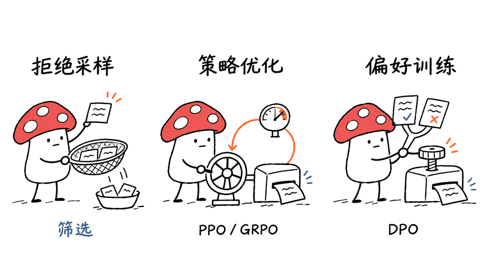

RLHF 中文手册把大模型后训练里的数据、奖励、优化和评测连成一条学习路径，适合已经会用模型、希望弄清训练原理的读者。它是 Nathan Lambert 原著的中文翻译项目，由 Junwei He 维护，仓库包含19章以及可验证的教学代码。

## 这份中文手册究竟提供什么？

它的价值首先是解释概念之间的关系：SFT教模型模仿示例，偏好数据表达回答之间的取舍，奖励模型学习评分，策略优化再利用反馈改变生成分布。只背PPO、DPO、GRPO缩写，很容易忽略这些方法在数据来源、训练信号和计算结构上的区别。

项目提供在线全书、分章网页、PDF、Markdown源码及构建脚本。HTML、EPUB、PDF、DOCX都有本地构建入口，但“可以构建”与“已有可下载的最新产物”应分开看。README建议优先使用当前修订版阅读入口，历史Release v1.0保留的是旧版PDF。


内容许可标为CC BY-NC-SA 4.0，代码许可标为MIT；不能只看到GitHub识别出的MIT标签，就把书中文字和配图也统称为MIT。本文提供独立的阅读评介与验证记录，原著、译文和原始插图仍保留各自的署名与许可。

核对版本为`af321f73f469019b9d481a4fd96403c9b6a871f1`。仓库说明2026年9月修订了概念、公式、示例与排版，但尚未完成与英文出版版的逐句对照；原译稿约2025年4月的行业语境仍需注意。学习数学定义可以借助此书，判断今天的模型和训练框架则应再查当前论文与官方代码。

## 19章应该按什么顺序读？

按需求组织会比逐页读更容易形成完整认识。下面的顺序以README推荐路径为基础，再加上独立的工程阅读建议。

| 阶段 | 章节 | 阅读时应回答的问题 |
| --- | --- | --- |
| 建立全局 | 1、3、4 | 后训练在优化什么，状态、动作和奖励分别指什么？ |
| 理解信号 | 9、6、7、8 | 示例从哪里来，偏好怎样变成分数，为什么限制策略偏移？ |
| 比较算法 | 10、11、12 | 筛选、在线策略梯度和直接偏好优化各自改变什么？ |
| 检查目标 | 13–17 | AI反馈、推理、合成数据和评测可能引入哪些偏差？ |
| 连接产品 | 18、19 | 回答风格、信息质量和用户体验怎样影响目标设计？ |

这里不必先读完所有算法再开始实践。更有效的方式是：先选一个小任务，明确什么叫好回答，再回到相关章节解释自己的数据和评测。若数据本身无法稳定区分优劣，切换优化器通常不能修复这个根本问题。

## PPO、DPO、GRPO，最容易混淆在哪里？

PPO属于策略梯度方法，训练时需要把新旧策略的概率比、优势、有效token和价值目标对应起来。裁剪代理目标不等于给实际KL散度设置了必然满足的硬上限。实现是否屏蔽padding、是否正确处理终止和截断，往往比缩写本身更影响结果。

DPO用偏好对构造训练目标，避免经典管线中显式奖励模型训练和在线RL循环的组合，但它仍然会更新策略参数。它不是“无需训练就让模型对齐”，调一个β也不等于直接指定最终实际KL。

GRPO借助同题多条回答的组内比较构造优势。如果一组奖励完全相同，就没有相对区分信号；全对或全错不意味着优势更大。组内标准差、稳定项、分组顺序和token聚合的约定都值得核对，不能只抄一行公式。



这些正是中文版勘误记录重点解释的内容。它让读者看见修改依据，也提醒读者：教材代码可以帮助理解局部运算，完整训练系统还需要数据加载、采样服务、检查点、分布式执行和独立评测。

## 本次实际运行了哪些检查？

在临时克隆的固定版本上，运行了仓库自带的两组检查，未修改上游源代码：

```bash
# 在已具备torch、numpy、jinja2的Python环境中运行
python scripts/check_examples.py
python3 -m unittest discover -s tests -v
```

第一组8项数值测试全部通过。它直接从章节Markdown提取实际代码块，检查KL方向和掩码、PPO张量形状及回报目标、GRPO等值奖励与学习方向、RLOO分组、DPO梯度与参考模型detach、独立梯度聚合、Top-K索引以及聊天角色。

第二组3项构建辅助测试全部通过，覆盖章节合并时移除导航元数据、转换书内链接、拒绝缺失结束标记的frontmatter，以及发现缺图和空正文的检查器。这里验证的是辅助函数的行为，不是全书已经成功重建。

当前环境没有Pandoc与pandoc-crossref，因此没有执行完整HTML、EPUB、PDF或DOCX构建，也没有运行`make check`对完整构建站点的检查。没有进行模型训练、论文分数复现或逐句翻译准确率评测。8项数值检查与3项辅助检查通过，能证明局部样例符合所测试的约定，不能证明全书无误。


这个区别适合带入日常AI开发：张量形状正确，不代表奖励定义合理；训练loss下降，不代表独立测试变好；偏好模型得分提高，也可能是更会利用代理指标。第16章评测和第17章过度优化，应与算法章节一起读。

## 怎样把阅读变成一个小实验？

可以用客服回答排序作为练习：固定一批问题，给每题准备两个候选回答，并写清排序理由，例如事实正确、解决问题、语气适当。先人工复查标注分歧，再决定需要SFT示例、偏好训练，还是仅需修正提示词或检索资料。

随后冻结一份不参与调参的留出集，同时记录事实错误、格式失败、输出长度和调用费用。若试验偏好优化，除了观察偏好胜率，还要检查是否牺牲了正确性或泛化。以上是本文建议的练习流程，不是仓库附带的客服训练成品，也不是本次已运行的实验。

已经在看训练代码的读者，可以将此书与Datawhale的agentic-rl-lab配合使用：一本帮助解释训练目标，一套实验帮助追踪数据、reward、rollout和更新。这是学习上的互补建议，不代表两个项目已经集成。相关实验边界评介：https://blog.mushroom.cv/blog/agentic-rl-lab-grpo-vision-post-training-low-cost-geometry/

## 怎样开始阅读或在本地生成？

最快方式是直接打开中文阅读站，不需要GPU。需要修改内容时，再克隆仓库，按照`docs/BUILDING.md`准备Python 3、Make、Pandoc与兼容的pandoc-crossref。PDF还需要额外的TeX工具链与字体，不能把HTML依赖齐全等同于PDF环境也齐全。

```bash
git clone https://github.com/jweihe/RLHF-book-Chinese.git
cd RLHF-book-Chinese
make html
make check
```

`make check`应在生成HTML之后运行。HTML公式默认依赖网络加载MathJax；想离线阅读时，优先选择PDF，或自行处理网页公式资源。仓库里的历史`.deb`不应当作通用安装入口，具体依赖按系统架构和构建指南选择。

## 常见问题

### 它适合完全没有机器学习基础的人吗？

更适合已有概率、梯度优化和Transformer基础的读者。初学者可先看第1、3、4章建立词汇，再补基础；直接从策略梯度推导开始，容易把符号背下来而没有理解数据流。

### 这是英文原著最新出版版的完整同步翻译吗？

不能这样认定。维护者明确表示尚未完成逐句对照；2026年9月的中文修订不等于所有行业讨论都已更新到当前时间。

### 跑通教学检查就能训练生产模型吗？

不能。测试覆盖局部实现，完整训练与上线还需要算力、数据治理、评测和运行工程。它更适合作为读懂训练代码的教材，而非开箱即用的生产训练框架。

## 原始资料

中文仓库：https://github.com/jweihe/RLHF-book-Chinese
中文阅读站：https://jweihe.github.io/RLHF-book-Chinese/
英文原著仓库：https://github.com/natolambert/rlhf-book
中文版勘误：https://github.com/jweihe/RLHF-book-Chinese/blob/main/docs/ERRATA.md
构建与验证：https://github.com/jweihe/RLHF-book-Chinese/blob/main/docs/BUILDING.md

---

> © 2026 Author: Mycelium Protocol. 本文采用 [CC BY 4.0](https://creativecommons.org/licenses/by/4.0/deed.zh) 授权——欢迎转载和引用，须注明作者姓名及原文链接，不得去除署名后以原创发布。

<!--EN-->

RLHF Book Chinese connects the data, rewards, optimization and evaluation behind language-model post-training. It is a nineteen-chapter Chinese translation of Nathan Lambert’s book, maintained by Junwei He, with teaching snippets and tools for publishing the book in several formats.

## What does this repository provide?

Its main contribution is a structured explanation of how the pieces fit together. Supervised fine-tuning teaches imitation of examples. Preference data records choices between responses. A reward model learns a scoring signal, and policy optimization uses feedback to change the generation distribution. Memorizing PPO, DPO and GRPO is much less useful without understanding these different data and computation paths.

The project offers a combined reading site, separate chapter pages, a PDF, Markdown sources and build scripts. HTML, EPUB, PDF and DOCX have local build targets. A build target is different from a verified, currently downloadable artifact. The README recommends the revised reading entry points and identifies Release v1.0 as a historical PDF.


Content is labeled CC BY-NC-SA 4.0, while code is labeled MIT. The MIT badge does not describe all prose and illustrations. This article is an independent review and verification report; the original book, translation and source artwork retain their own attribution and licenses.

This review pins commit `af321f73f469019b9d481a4fd96403c9b6a871f1`. The maintainers describe September 2026 corrections to concepts, formulas, examples and layout, but explicitly say that sentence-by-sentence alignment with the English publication edition is unfinished. Historical industry discussion around April 2025 should not be treated as a current survey. Use the book for foundations, then consult current papers and official implementations for present-day systems.

## In what order should the nineteen chapters be read?

A question-driven route makes the subject easier to navigate. The following builds on the README’s reading suggestions, with additional engineering advice.

| Stage | Chapters | Questions to answer |
| --- | --- | --- |
| Establish the map | 1, 3, 4 | What objective is optimized, and what are states, actions and rewards? |
| Understand feedback | 9, 6, 7, 8 | Where do examples come from, how are preferences scored, and why limit drift? |
| Compare algorithms | 10, 11, 12 | How do filtering, policy gradients and direct preference optimization differ? |
| Check the objective | 13–17 | What biases enter through AI feedback, reasoning, synthesis and evaluation? |
| Connect to products | 18, 19 | How do style, information quality and user experience shape the goal? |

Readers need not finish every algorithm before trying a small task. Define what a good answer means, inspect the data, and use the relevant chapters to explain the experiment. If annotation cannot consistently distinguish better responses, changing optimizers is unlikely to repair the central problem.

## Where do PPO, DPO and GRPO get confused?

PPO requires consistent conventions for new-to-old policy probability ratios, advantages, valid tokens and value targets. Its clipped surrogate objective does not guarantee a hard bound on actual KL divergence. Padding masks, terminal states and truncation handling can matter more than the algorithm’s name.

DPO constructs an objective from preference pairs, avoiding the classic combination of explicit reward-model fitting and an online RL loop. It still trains the policy parameters. It is not alignment without parameter updates, and its beta coefficient does not directly specify the realized KL divergence.

GRPO derives a relative signal from multiple responses to the same prompt. When all rewards within a group are identical, the group offers no relative discrimination. An all-correct or all-incorrect group does not create a larger advantage. Standard-deviation conventions, stabilizing terms, group layout and token aggregation must match the intended implementation.


These issues feature prominently in the Chinese edition’s errata. Public correction records make changes easier to inspect. They also help separate a small teaching calculation from a complete system, which still needs data handling, sampling, checkpoints, distributed execution and independent evaluation.

## What was actually verified?

Two existing upstream test groups were run on the pinned temporary clone, without changing its source:

```bash
# Use a Python environment containing torch, numpy and jinja2.
python scripts/check_examples.py
python3 -m unittest discover -s tests -v
```

All eight numerical tests passed. They extract real code blocks from chapter Markdown rather than testing a separately rewritten explanation. Coverage includes KL direction and masks; PPO shapes and return targets; equal-reward GRPO groups and learning direction; RLOO grouping; DPO gradients and reference detachment; independent gradient aggregation; Top-K indices; and chat-role validation.

All three build-helper tests also passed. They check removal of navigation metadata during chapter merging, rewriting book links, rejecting unterminated frontmatter, and detection of missing assets and empty content. These are tests of helper behavior, not evidence that every book format was rebuilt successfully.

Pandoc and pandoc-crossref were unavailable in this environment. No complete HTML, EPUB, PDF or DOCX build was performed, and `make check` was not run against a generated full site. No model training, paper benchmark reproduction or sentence-level translation-accuracy evaluation was attempted. Eight numerical checks and three helper checks provide useful local evidence; they do not establish that the entire book is error-free.


The same distinction matters in everyday AI engineering. Correct tensor shapes do not make a reward sensible. Falling training loss does not establish a holdout improvement. A higher reward-model score can reflect exploitation of the proxy. Evaluation and over-optimization chapters should therefore accompany algorithm study.

## How can reading become a small experiment?

Consider ranking customer-support responses. Freeze a set of questions, prepare two candidate answers per question, and record why one is preferred: factual correctness, problem resolution or suitable tone. Review annotation disagreement before deciding whether the task needs supervised examples, preference optimization, better prompting or improved retrieval.

Keep an independent holdout excluded from tuning, and track factual errors, format failures, response length and actual cost. If preference training improves win rate, check whether correctness or generalization deteriorated. This is a suggested learning exercise, not a customer-support trainer supplied by the repository or an experiment completed during this review.

For readers already inspecting training code, the book can complement Datawhale’s agentic-rl-lab: one explains objectives, while the other makes data, rewards, rollouts and updates easier to trace. This is a proposed learning combination, not an existing integration. Related experiment review: https://blog.mushroom.cv/blog/agentic-rl-lab-grpo-vision-post-training-low-cost-geometry/

## How should readers start or build locally?

Open the Chinese reading site first; no GPU is required to read it. For editing, clone the repository and follow `docs/BUILDING.md` to install Python 3, Make, Pandoc and a compatible pandoc-crossref. PDF generation additionally needs a TeX toolchain and fonts. Having HTML dependencies does not establish that PDF compilation is ready.

```bash
git clone https://github.com/jweihe/RLHF-book-Chinese.git
cd RLHF-book-Chinese
make html
make check
```

Run `make check` after generating HTML. Web formulas use MathJax with a network dependency by default. For offline reading, choose the PDF or arrange local formula resources. The historical Debian package in the repository is not a universal installer; choose dependencies for the target architecture using the build guide.

## FAQ

### Is it suitable for someone with no machine-learning background?

It is best suited to readers familiar with probability, gradient optimization and Transformers. Start with chapters 1, 3 and 4 to establish terminology, then fill foundational gaps before tackling policy-gradient derivations.

### Is it fully synchronized with the latest English publication edition?

That has not been established. The maintainers explicitly state that line-by-line comparison is unfinished. September 2026 maintenance does not make every historical industry claim current.

### Do passing the snippets make this a production trainer?

No. The checks cover local implementation conventions. Training and deployment still require compute, governed data, evaluation and operational engineering. Treat it as a textbook for understanding training code.

## Primary sources

Chinese repository: https://github.com/jweihe/RLHF-book-Chinese
Chinese reading site: https://jweihe.github.io/RLHF-book-Chinese/
English source repository: https://github.com/natolambert/rlhf-book
Errata: https://github.com/jweihe/RLHF-book-Chinese/blob/main/docs/ERRATA.md
Build and verification guide: https://github.com/jweihe/RLHF-book-Chinese/blob/main/docs/BUILDING.md

---

> © 2026 Author: Mycelium Protocol. Licensed under [CC BY 4.0](https://creativecommons.org/licenses/by/4.0/) — free to share and adapt with attribution. You must credit the author and link to the original; removing attribution and republishing as original is not permitted.
