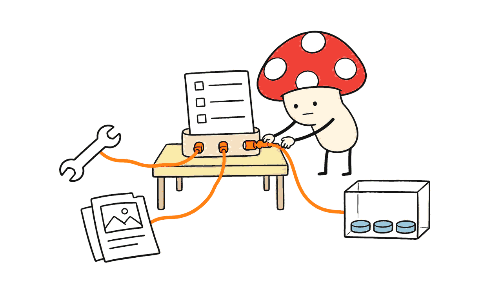

rnskill 把内容创作中的选题、改写、分镜和交付检查，整理成 AI 可以读取的技能说明。它适合拿来研究和拆用自己的工作流程，使用前要核对所选目录的许可、工具与费用。

仓库由雪踏乌云维护，地址为 https://github.com/Pluviobyte/rnskill 。本次核对固定在提交 `83d1783b892bbaa29a137895ff8338264b6872fa`，日期为 2026 年 11 月 15 日。默认许可为 CC BY-NC 4.0，部分子目录保留独立许可；不能直接把整库理解为允许任意商业使用的宽松开源工具包。

## rnskill 收录了什么？

README 将内容分为内容创作与编码开发，实际目录中，创作链条占了很大篇幅。从选题卡、钩子和标题，到转录、脚本编辑、配音、数字人、字幕、图文与动效，再到制作调度和复盘，都有可参考的流程。

我在固定提交上数到了 61 个顶层目录，其中 60 个直接有 SKILL.md；递归共有 65 份 SKILL.md。目录中存在兼容别名和嵌套集合，所以这组数字只说明文件组织，不能当成 65 项独立能力，更不能代表每项都已实测可用。

值得先读的三个例子各有分工。ra-人话约束中文改写，要保留事实、判断和不确定性；novel-distill 从用户提供的章节中比较事件，区分 F 原文事实、P 视听建议和 A 新增改编；jev-office-gate 则把报告中的结论与来源摘句整理成引用审查请求。

这些说明对输入、产出与缺失信息作了约束。比如小说选段只拿到梗概，就应注明基于梗概；缺少章节文本时，不能编出原著引句。给创作团队参考时，这类边界和交接条件往往比一句“帮我写得精彩”更容易检查。


## 没有 GitHub，直接给 AI 读文本行吗？

可以先把所选技能的完整说明与自己的材料交给 AI，要求它按照输入边界、步骤和输出格式处理。例如，让它依据 novel-distill 的规则比较最多三个事件，附出处、人物目标、冲突与结果，并把新增改编单独标出。这条路径可以体验规划、文本编辑和结构化输出。

但单独粘贴一份 SKILL.md 可能漏掉被引用的示例、规范或脚本。模型也可能把文件中的路径当成已经存在的资源。使用时应说明哪些附件实际可读，遇到缺失材料先标记，不要让它假装已运行检查。

涉及媒体生产时，还要准备执行条件。配音需要可用模型与参考音频，视频验收依赖 FFmpeg/ffprobe，数字人和外部生成平台需要账号或额度。Skill 提供的流程不能替代这些服务，也不会给一个纯聊天窗口增加本地文件与命令执行权限。

## 工程上怎样按需接入？

README 给出单技能安装命令，例如：

```bash
npx -y skills add Pluviobyte/rnskill --skill novel-distill
```

也支持手动复制项目级技能目录。复制时应包含该技能依赖的 references、scripts 和 assets，并遵循所用 Agent 的目录约定。安装单个技能比整库全局加载容易追踪依赖、调用范围与更新变化。上述命令来自仓库文档，本次没有把这套第三方技能安装进博客生产工作区。

我建议先选一个反复发生的小任务，保存原始材料、输入要求和验收结果。下一轮换材料时，对照事实遗漏、人工修改量和交付完整性，再决定是否扩展到配音或视频。涉及上传素材、调用付费接口或发布内容，应在自己的工作流中明确授权范围。



## 本次实际验证到哪一步？

我在临时目录审阅了仓库，并用 Python 标准库运行 jev-office-gate 附带脚本的离线请求预览。一个自造的引用样本成功生成支持度、来源处置和风险三类问题；缺少证据摘句的输入被本地校验拒绝。脚本和输入输出保存在本文研究记录中。

这次检查覆盖请求构造与输入校验，没有调用 Jev 模型，没有使用密钥，也没有制作配音、数字人或视频。它不能证明模型的事实判断准确率，更不能证明整套流水线的稳定性。即使审查返回通过，链接是否可访问、引句是否来自原文、数字日期与文档公式是否正确，仍需另行检查。

README 提到作者用一组 Skill 和其他工具，在一个月内投入不到十小时、获得约两千粉丝及首个商单。这是作者的自述，包含其他软件与具体运营条件；我们没有复测，不能据此预测普通用户的产出、成本或收入。

## 商用前需要看哪些许可？

根目录默认 CC BY-NC 4.0，包含署名与非商业限制。novel-distill 单独保留 MIT；部分第三方技能分别使用 MIT、Apache-2.0、AGPL-3.0 等许可。仓库的统一入口没有抹平这些差异，依赖软件、模型、素材和生成服务还可能有自己的条款。

如果准备为客户制作内容或嵌入收费产品，应逐项确认实际使用、复制、修改和分发的部分，以及相应许可的适用条件；存在疑问时向权利人确认授权。不能用“代码公开”替代授权核对，也不能把本文原创文字的 CC BY 许可套到第三方内容上。


## 常见问题

### 能在任意 AI 对话框里使用吗？

文本规划和改写可以通过提供说明与材料来尝试。脚本执行、文件读取和媒体生成取决于宿主 Agent 的能力；相关依赖不可用时，应保留为计划或明确标注未执行。

### 安装完就能免费出视频吗？

不能作此保证。生成模型、配音、数字人、平台接口、设备算力与素材均需单独准备。仓库文档也明确说明，Skill 本身不提供图片或视频生成服务。

### 应该先试哪一个技能？

已有文字材料，可从选段或改写流程开始，选择许可满足自身用途的目录。先比较输出中的事实保留与人工修改，再增加脚本和媒体环节；这样能看清每一步具体带来的帮助。

我对 rnskill 的判断是，它提供了一套可以逐条审阅的创作流程样本。对工程师有参考价值的部分，是把材料边界、输出契约和人工验收写明，再将需要执行的动作交给实际可用的工具。生产使用仍需由自己的样例、授权与运行记录来支撑。

## 来源与延伸阅读

仓库与 README：https://github.com/Pluviobyte/rnskill

默认许可：https://github.com/Pluviobyte/rnskill/blob/main/LICENSE

小说选段及独立 MIT 许可：https://github.com/Pluviobyte/rnskill/tree/main/skills/novel-distill

办公引用审查脚本：https://github.com/Pluviobyte/rnskill/tree/main/skills/jev-office-gate

相关工程评估文章：https://blog.mushroom.cv/blog/nvidia-skillevaluator-agent-skill-quality-impact-evaluation/

---

> © 2026 Author: Mycelium Protocol. 本文采用 [CC BY 4.0](https://creativecommons.org/licenses/by/4.0/deed.zh) 授权——欢迎转载和引用，须注明作者姓名及原文链接，不得去除署名后以原创发布。

<!--EN-->

rnskill packages content planning, editing, storyboarding and delivery checks into instructions that an AI agent can read. It is useful for studying and adapting a creative workflow, provided you check each selected directory’s license, dependencies and operating costs.

The repository is maintained by Pluviobyte, also known as 雪踏乌云: https://github.com/Pluviobyte/rnskill . This review is pinned to commit `83d1783b892bbaa29a137895ff8338264b6872fa`, checked on November 15, 2026. The default license is CC BY-NC 4.0, with independently licensed components. Public availability does not establish unrestricted commercial permission for the entire collection.

## What does rnskill contain?

The README groups the collection into content creation and coding. Creative tasks occupy much of its catalog: topic cards, hooks, titles, transcription, script editing, voice production, avatars, subtitles, illustrated posts, motion work, production coordination and retrospective analysis.

At the pinned revision, I counted 61 top-level directories, 60 containing a direct SKILL.md, and 65 SKILL.md files recursively. Aliases and nested collections are included. These numbers describe organization, not 65 distinct capabilities or 65 successfully tested tools.

Three examples illustrate the design. ra-人话 constrains Chinese editing while preserving facts, judgments and uncertainty. novel-distill compares events in supplied fiction and separates F, source facts; P, audiovisual presentation choices; and A, additions or adaptations. jev-office-gate structures claims and excerpts for a citation review request.

Their value lies in explicit input boundaries and deliverables. When only a synopsis is supplied, a novel selection should be labeled as based on that synopsis. Without chapter text, it must not invent quotations. Such requirements give a team something concrete to inspect during handoff.


## Can you use the text without GitHub?

You can provide the selected instructions and your own source material directly to an AI. For instance, ask it to compare up to three events under novel-distill’s rules, preserving provenance, goals, conflict and outcome while labeling invented changes. This supports a first experiment in planning, editing and structured output.

A single pasted SKILL.md may omit referenced examples, schemas or scripts. A model may also assume that a mentioned file path exists. State which attachments are actually available and require missing evidence to remain marked as missing. Reading an instruction is not evidence that its checks have executed.

Media production needs additional infrastructure. Voice generation requires models and reference audio, video verification depends on FFmpeg and ffprobe, and avatar or hosted generation platforms require accounts or quota. Instructions cannot supply those services or grant a chat interface permission to read local files and run commands.

## How should an engineer integrate it?

The README documents selective installation:

```bash
npx -y skills add Pluviobyte/rnskill --skill novel-distill
```

Manual project-level copying is also supported. Preserve the selected skill’s required references, scripts and assets, and follow your host agent’s directory conventions. Selective installation makes dependencies, scope and later changes easier to trace than loading the entire collection globally. The command above is documented upstream; I did not install these third-party skills into this production blog workspace.

Start with one repeated task and retain its source material, requirements and accepted output. With a second input, compare factual omissions, editing effort and delivery completeness before adding audio or video stages. Define authorization for uploads, paid calls and publishing in your own workflow.


## What did this review actually test?

I inspected a temporary clone and ran the bundled jev-office-gate script’s offline request preview using Python’s standard library. One synthetic citation item produced three question types: support, source disposition and risk. An input missing an evidence excerpt was rejected locally. Inputs, outputs and the reproduction script are retained with the article’s research records.

This checks request construction and input validation. It involved no Jev model call, API key, voice generation, avatar generation or video production. It establishes neither factual judgment accuracy nor end-to-end workflow reliability. A passing review would still leave URL availability, quotation provenance, dates, numbers and document formulas to separate verification.

The README reports the author spending fewer than ten hours over a month, gaining roughly 2,000 followers and obtaining a first sponsorship using these skills together with other tools. This is an author report with additional software and operating conditions. We did not reproduce it and cannot predict another user’s output, spending or revenue from it.

## Which licenses matter for commercial work?

The root defaults to CC BY-NC 4.0, including attribution and noncommercial restrictions. novel-distill retains a separate MIT license. Other components retain licenses such as MIT, Apache-2.0 and AGPL-3.0. A common repository entry point does not remove those differences; dependent software, models, source assets and hosted services may impose additional terms.

Before client work or integration into a paid product, identify what you actually use, copy, modify and distribute, and check the applicable terms. Resolve uncertain permissions with the relevant rights holder. The CC BY license on this original article does not relicense third-party repository material.


## FAQ

### Does every chat interface support it?

You can try text planning and editing by supplying instructions and material. Script execution, file access and media generation depend on the host. Unavailable steps should remain proposals or be explicitly marked unexecuted.

### Does installation make video generation free?

No such guarantee follows. Models, voice synthesis, avatars, APIs, compute and source assets require their own setup. The README explicitly states that a skill does not itself provide image or video generation services.

### Where should a beginner start?

Start with a text selection or editing task using a directory licensed for your intended use. Check factual preservation and manual edits before adding executable or media stages, so you can identify the contribution of each step.

My assessment is that rnskill offers inspectable examples of creative work instructions. Engineers can learn from its material boundaries, output contracts and review requirements, then connect executable actions to tools they actually have. Production decisions still need their own samples, permissions and execution records.

## Sources and further reading

Repository and README: https://github.com/Pluviobyte/rnskill

Default license: https://github.com/Pluviobyte/rnskill/blob/main/LICENSE

Novel selection and its separate MIT license: https://github.com/Pluviobyte/rnskill/tree/main/skills/novel-distill

Citation review helper: https://github.com/Pluviobyte/rnskill/tree/main/skills/jev-office-gate

Related evaluation guide: https://blog.mushroom.cv/blog/nvidia-skillevaluator-agent-skill-quality-impact-evaluation/

---

> © 2026 Author: Mycelium Protocol. Licensed under [CC BY 4.0](https://creativecommons.org/licenses/by/4.0/) — free to share and adapt with attribution. You must credit the author and link to the original; removing attribution and republishing as original is not permitted.
