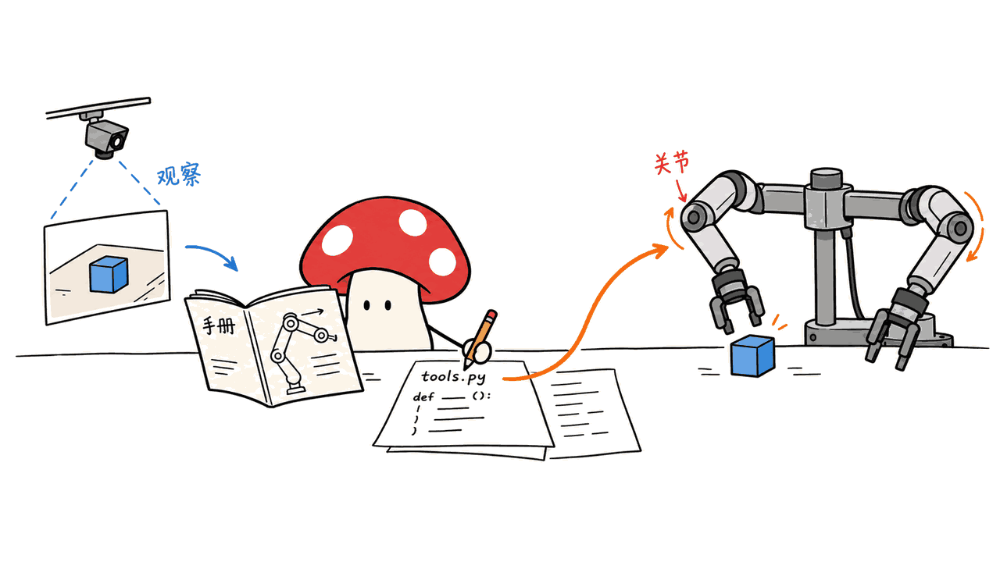
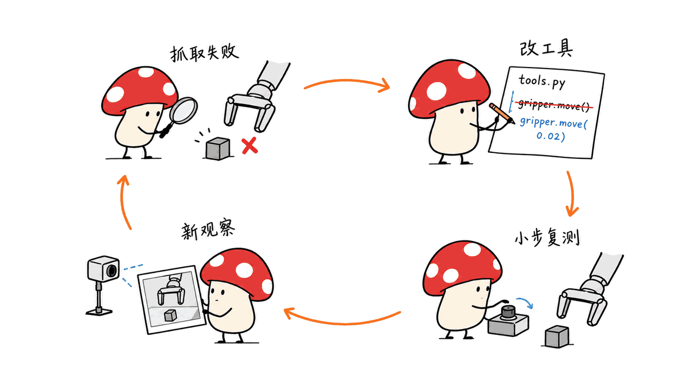
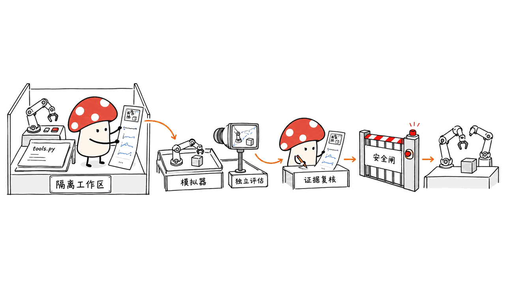

RoboHarness V2 是让编程智能体通过工作目录操作机器人的开源工具栈。它把身体说明、相机观测、动作代码和任务技能放在一起，让 Agent 既能调用动作，也能查看、修改动作实现。

项目由 Bince Qu 等研究者开发，仓库代码采用 MIT 许可。官方记录 V2 于 2026 年 10 月 25 日开放；本文核对到的源码版本为 `a0936867e0db7d0ef3eabe10688468edaea190d8`。需要先划清一条证据边界：**V2 官网是一份设计说明，明确表示结果将另行发布；V1 论文的领先成绩不能直接当成 V2 成绩。**

本文原文：https://blog.mushroom.cv/blog/roboharness-v2-workspace/

## RoboHarness V2 改变了什么？

常见机器人 Agent 集成会给模型一份固定工具清单：抓取、移动、开门。模型可以选择调用，但碰上工具覆盖不到的姿态，通常只能重试或者等待工程师修改。RoboHarness V2 将这些动作做成 Agent 能读取和修改的 Python 文件，同时保留通向底层关节指令的入口。

这意味着，抓取失败时，Agent 可以沿着实现追查：选中的像素属于哪张图？深度是否有效？末端位姿是否合适？轨迹在哪一步停住？它可以修改某一层，再用实际返回的观测检查变化，而不是把一个宏观“抓取失败”当成没有内部结构的结果。

这里的“改进”首先发生在代码和操作知识中：调整工具、添加辅助脚本、记录经验。读取一个 Markdown 技能或重写 Python 函数，均不等于模型权重发生训练，更不构成已经验证的递归自我进化。



## 工作目录里具体装了什么？

官方提供两个机器人模板：`R1_pro` 面向 BEHAVIOR 中的移动双臂机器人，`ARX_X5` 面向 RoboDojo 中的固定双臂机器人。机器人与评测环境的对应关系不能随意互换。

| 工作空间内容 | Agent 用它做什么 | 需要注意的约束 |
|---|---|---|
| `AGENTS.md` / `CLAUDE.md` | 读取操作顺序、坐标定义与观测要求 | 先读基线技能、工具说明、关节手册 |
| `robot_config/` | 查 URDF、网格、关节限位和控制索引 | 不同机器人有不同指令单位与布局 |
| `tools/`、`tools/util/` | 调用、检查和修改动作算法 | 高层工具最终仍下发关节指令 |
| `perception/` | 按需读取 RGB、深度、追踪点和实测关节 | 用 `latest.json` 绑定观测序号 |
| `skills/` | 读取任务流程及退出条件 | 激活技能改变指令，不直接改变物理状态 |
| `tool_call_history/` | 核对输入、结果和返回图像 | 失败可能已经造成位移，要检查实际状态 |

R1 Pro 的底层契约是一个 27 值控制指令；X5 是 14 个标量，每条手臂六个关节加一个夹爪。27 值不是“27 个相同单位的关节角”：R1 操作说明区分绝对弧度、夹爪力与底盘速度，并要求锁定槽保持零。

工作空间以普通 shell 和文件为主要接口，不要求先搭 MCP 宏工具服务器。官方说明已在 Claude Code、Codex 和 Pi 下运行同类目录；但图像打开方式仍随宿主不同，Claude 的图片钩子也不是所有 Agent 天然具备的能力。返回一个图片路径，不代表模型已经看到了像素。

## 为什么感知要落盘，而不是不停塞进上下文？

摄像头持续出图，模型不必持续读图。把最新信息写到文件，Agent 可以在决策时读取需要的观测，避免把所有帧都放入对话。官方用 ROS topic 作类比；这不意味着目录自动提供 ROS 的消息传递、实时性和服务质量保障。

R1 的点击坐标使用原始头部图像的 720×720 像素，左上角为原点，`u` 为列、`v` 为行，并绑定准确的 `image_id`。移动后必须重新看最新图，不能把旧画面中的位置平移一下继续操作。手腕相机主要用于检查，不是同一套点击输入。

还有一个容易忽略的细节：身体姿态渲染图按需生成，普通工具更新关节状态，却不会每次都重渲染三视图。看到磁盘上有 `robot_three_views.png`，不能据此判断它反映当前姿态，更不能把只显示机器人身体的渲染图当成真实场景。

## 一个失败动作应该怎样被修正？

可以把完整循环拆成六步：读取操作规则与身体信息；获取最新图像和状态；调用现有工具或检查其算法；根据回执定位偏差；只修改必要代码；重新观察并验证结果。

R1 的回执设计尤其值得借鉴。底盘动作会保留目标位移、实际位移、`linear_target_reached` 和 `obstacle_limited`。停止了、没有异常了，均不能证明已经到达目标。工具报错也不能证明没有运动，恢复前要看已发送的指令数量及当前观测。



这对普通 Agent 工程也有启发：只返回 `success: true` 会压扁关键证据。像编程工具的退出码不能替代产物检查，机器人的“调用完成”也不能替代位置、接触和任务状态检查。关于编程 Agent 的工具执行边界，可参看本站 pi-rust 分析：https://blog.mushroom.cv/blog/pi-rust-agent-runtime/

## 怎样部署？Mac 能直接跑吗？

先区分三个环境：Agent 与模型服务、机器人工作空间、仿真与评测器。模型服务不是仓库安装脚本自动送上的；数据集、模型权重和仿真软件也有各自的下载与许可条件。

主 README 的 BEHAVIOR 复现路线面向 Linux x86-64、NVIDIA RTX、Python 3.11 与 CUDA 12.4。作者验证环境中出现的 48GB 显存不能直接写成最低门槛。V2 的机器人目录另外使用自身的 Python 3.10 环境；R1 配置 PyTorch 2.6 / CUDA 12.4，ARX X5 的工作空间安装路线为 CPU。后者并不等于整个 RoboDojo 评测流程无需其他环境。

在符合官方环境的主机上，可以从下面的顺序开始。大型场景、网格和依赖需要额外准备，先阅读 `docs/setup.md`，不要把 clone 成功当成部署完成。

```bash
git clone --recurse-submodules https://github.com/BinceQu/RoboHarness.git
cd RoboHarness
./scripts/setup.sh
cp configs/example.json configs/local.json
bash harness/v2/R1_pro/setup.sh

# 配置模型端点、数据与工作空间解释器后，先检查启动计划
./run.sh --harness v2 --task task01 --gpu 0 --dry-run
# 确认环境后再启动实际评测
./run.sh --harness v2 --task task01 --gpu 0
```

模型接口也要核实：主路线要求兼容 Anthropic `/v1/messages` 的图像、工具调用和流式能力，仅有 OpenAI Chat Completions 接口并不等价。Codex 有另外的接口配置。文本探测能返回 OK，只证明端点可达，不证明图片和工具链可用。

Mac 可以用于阅读、修改工作空间代码及执行部分 CPU 测试，也可充当远程 NVIDIA 仿真主机的客户端。本文没有验证 macOS 上的 BEHAVIOR 仿真或真实机器人执行，因此不提供“Apple Silicon 一键完成整套部署”的承诺。

## 本次核验覆盖什么，没覆盖什么？

Mycelium Protocol 抓取了完整 V2 页面、仓库 README、工作空间说明与固定提交源码，并保存官方架构配图。项目页明确写着结果另发，这比从 V1 论文标题推断 V2 成绩更可靠。

本机使用 Apple M4 / 16GB、独立 Python 环境，对上游的 IPC 数组传输、动作回执及会话 GPU 配置测试进行核验，合计 16 项通过：IPC 数组往返 4 项、回执证据 3 项、GPU 会话配置 9 项。GPU 配置测试只检查环境变量与非法配置拒绝，并未调用 GPU。这些检查关注传输和状态证据，未连接模型服务、BEHAVIOR、RoboDojo 或真实机器人，也没有测量成功率、推理速度或控制延迟。

V1 的复现协议使用五个固定实例，按官方 `q_score.final` 聚合；只跑一个实例或 smoke check 不能替代完整任务分数。即使 V2 复用了任务、预算和评分器，也要重新评估，尤其是 V2 顺序实例有明确的任务对象恢复逻辑。接口相同不自动保证实验条件与结果相同。

## 真正值得迁移的工程思路是什么？

把可编辑的工作区与独立 evaluator 分开，是这个项目比“让模型写机器人代码”更有价值的部分。Agent 的权限边界应限制在任务工作区；评分、场景与物理状态不能由它随意修改，否则评测会变成改答案。

走向真机时，直接关节入口需要额外的独立约束。官方操作说明已经提醒：直接控制不带碰撞规划。我们的工程建议是把限位、速度和力限制、急停、工作区域及人工授权放在 Agent 不能改掉的控制层；先在仿真中回放工具差异，确认小范围动作，再扩大执行范围。这是部署建议，不是声称仓库已经提供整套真机安全认证。



多机器人迁移也有成本。换目录能复用 Agent 的读文件、跑脚本和看图方式，但新机器人的驱动、标定、动力学、控制索引和动作工具仍需实现。可迁移的是工作方式，不能由此推导出零适配接入任意真机。

## 常见问题

### 这是新的机器人基础模型吗？

不是。RoboHarness 是连接 coding agent 与机器人执行环境的开源工具栈。V2 的重点是工作空间结构、可编辑动作工具和观测文件，模型服务单独配置。

### V2 已经证明超过 VLA 吗？

当前 V2 页面没有给出新的完整成绩，明确表示结果另行发布。V1 论文在其 BEHAVIOR 任务和协议下报告优势，不能扩大为 V2 对所有机器人任务的结论。

### MIT 是否覆盖仿真数据和全部依赖？

不能这样理解。仓库代码使用 MIT，仍须核对第三方声明、BEHAVIOR 场景数据、机器人资源以及所选模型的各自许可。

## 来源与复核路径

- 项目与源码：https://github.com/BinceQu/RoboHarness
- V2 完整设计说明：https://bincequ.github.io/RoboHarness/v2/
- V2 工作空间与安装：https://github.com/BinceQu/RoboHarness/tree/main/harness/v2
- V1 论文：https://arxiv.org/abs/2610.14018
- 外置资源与视频：https://huggingface.co/datasets/BinceQu/RoboHarness-assets
- 本文复核版本：`a0936867e0db7d0ef3eabe10688468edaea190d8`。测试为 CPU 工程边界核验，不是机器人效果复现。封面为主题示意，正文手绘图为流程解读，不是执行截图。

---

> © 2026 Author: Mycelium Protocol. 本文采用 [CC BY 4.0](https://creativecommons.org/licenses/by/4.0/deed.zh) 授权——欢迎转载和引用，须注明作者姓名及原文链接，不得去除署名后以原创发布。

<!--EN-->

RoboHarness V2 lets a coding agent operate a robot through an editable workspace containing body descriptions, observations, action code and task skills. The agent can inspect an action's implementation, modify it and check new observations instead of relying exclusively on a fixed tool menu.

The repository uses the MIT license, subject to third-party notices and separate asset terms. This review pins commit `a0936867e0db7d0ef3eabe10688468edaea190d8`. The official V2 page is a design note and explicitly says results will follow separately. V1 paper results are not evidence of V2 performance.

Original article: https://blog.mushroom.cv/blog/roboharness-v2-workspace/

## What changes when the workspace becomes the harness?

A fixed grasp function can be convenient until its assumptions fail. V2 makes such functions ordinary Python files that an agent can read, execute and change. When a grasp misses, the agent can investigate image identity, depth, target pose, trajectory execution and the resulting observation.

This primarily improves code and procedural knowledge. Editing a helper or writing a skill does not update model weights, and does not establish autonomous recursive learning.


The project supplies `R1_pro` for a mobile bimanual robot in BEHAVIOR and `ARX_X5` for a fixed dual-arm robot in RoboDojo. Each template includes agent instructions, robot configuration, Python tools and skills. Runtime observations and call histories provide evidence for subsequent decisions.

The R1 controller takes 27 values; X5 takes 14 scalars, representing six joints and a gripper per arm. These are robot-specific contracts, not interchangeable arrays. R1 inputs mix absolute joint angles, gripper forces and base velocities, with locked slots that must remain zero.

The agent-facing interface uses a shell and files without a macro-tool MCP server. The authors report using the directories with Claude Code, Codex and Pi. Image delivery still depends on the host: returning an image path does not mean the model has actually inspected its pixels.

## Why store perception as files?

Continuous camera streams need not consume continuous model context. V2 writes observations to disk for selective access. The ROS-topic analogy explains this access pattern; it does not imply that ordinary directories provide ROS timing or quality-of-service guarantees.

R1 clicks use native 720×720 head-camera coordinates and an exact current `image_id`. After motion, the agent must inspect the newest observation rather than reuse an imagined transformation of an old image. Wrist images serve inspection purposes.

Measured joint state and rendered body posture are also different artifacts. Ordinary tools update joint data, while a three-view body render is produced on request. An existing PNG may be stale and does not depict the surrounding scene.

## How does correction remain grounded?

A useful loop is: read operating rules, inspect current state, invoke or inspect a tool, locate the discrepancy, change the necessary code, then observe again. Motion receipts preserve requested and actual displacement, target completion and obstacle limitations.

A settled stop does not prove arrival. An error does not prove that no movement occurred. Recovery must account for sent commands and current perception, rather than trusting a single success flag.


This evidence-preserving design also applies to software agents. Our pi-rust analysis examines related tool-execution boundaries: https://blog.mushroom.cv/blog/pi-rust-agent-runtime/

## What does deployment require?

Separate the model service, robot workspace and simulator/evaluator. The repository does not automatically supply a model server or grant access to every dataset.

The main BEHAVIOR reproduction path targets Linux x86-64, an NVIDIA RTX GPU, Python 3.11 and CUDA 12.4. A 48GB validation GPU is not a documented minimum requirement. V2 workspaces have separate Python 3.10 environments: R1 uses PyTorch 2.6 with CUDA 12.4, while the X5 workspace has a CPU setup path. That CPU path does not remove the surrounding RoboDojo prerequisites.

```bash
git clone --recurse-submodules https://github.com/BinceQu/RoboHarness.git
cd RoboHarness
./scripts/setup.sh
cp configs/example.json configs/local.json
bash harness/v2/R1_pro/setup.sh
# Configure datasets, model service and workspace interpreter first.
./run.sh --harness v2 --task task01 --gpu 0 --dry-run
./run.sh --harness v2 --task task01 --gpu 0
```

Read `docs/setup.md` and `configs/v2.example.json` before executing a run. A dry run checks the launch plan; it does not validate physical execution or model capabilities. The default model route needs Anthropic Messages compatibility with images, tools and streaming. A text-only OK response is insufficient, and an OpenAI Chat Completions endpoint is not automatically compatible. Codex uses its own interface configuration.

A Mac can inspect code, execute selected CPU checks and act as a client for a remote NVIDIA host. This review does not establish native macOS BEHAVIOR simulation or real-robot support.

## What did we verify?

Mycelium Protocol retrieved the complete V2 design note, README, workspace instructions and pinned source, and saved official diagrams. On an Apple M4 with 16GB memory, we checked selected upstream CPU tests for IPC arrays, evidence-preserving receipts and session GPU configuration in a separate environment. All 16 selected cases passed: four IPC array round trips, three receipt cases and nine GPU configuration cases. The last group checks environment configuration and invalid assignments; it does not execute GPU operations.

We did not connect a model, simulator or physical robot, and measured no task success rate or control latency. V1 task scoring averages official final Q scores across five fixed instances. A smoke check or a single instance cannot replace that protocol. V2 also documents an opt-in restoration path for task objects across sequential instances, so sharing a scoring interface does not itself establish identical experimental conditions.

## What should an engineering team reuse?

Keep editable agent files separate from the independent evaluator. The agent should not be able to change scene state, scoring rules or evaluator answers to satisfy a task.

For physical deployment, place limits, emergency stops and authorization in a control layer the agent cannot rewrite. The official instructions explicitly state that direct joint control has no collision planner. Review changes, replay them in simulation, then authorize small bounded motions before broader execution. These are deployment recommendations, not claims of an existing certified safety system.


Switching directories reuses the read-run-observe workflow. It does not eliminate robot-specific driver, calibration, dynamics or tool development.

## FAQ

### Is RoboHarness V2 a new foundation model?

No. It is an agent-facing robot execution harness. The model is configured separately; V2 focuses on editable tools, body descriptions and observation files.

### Has V2 demonstrated that it beats VLA systems?

The V2 design note says results will follow separately. The V1 paper reports results under its own BEHAVIOR protocol; those results cannot establish V2 performance across robot tasks.

### Does MIT cover all resources?

The code license does not override third-party notices, simulator data terms, robot asset licenses or the selected model's license.

## Primary sources

Repository: https://github.com/BinceQu/RoboHarness

V2 design note: https://bincequ.github.io/RoboHarness/v2/

Workspace instructions: https://github.com/BinceQu/RoboHarness/tree/main/harness/v2

V1 paper: https://arxiv.org/abs/2610.14018

External assets: https://huggingface.co/datasets/BinceQu/RoboHarness-assets

Pinned source: `a0936867e0db7d0ef3eabe10688468edaea190d8`. The cover is a thematic illustration; body drawings explain the workflow and are not execution evidence.

---

> © 2026 Author: Mycelium Protocol. Licensed under [CC BY 4.0](https://creativecommons.org/licenses/by/4.0/) — free to share and adapt with attribution. You must credit the author and link to the original; removing attribution and republishing as original is not permitted.
