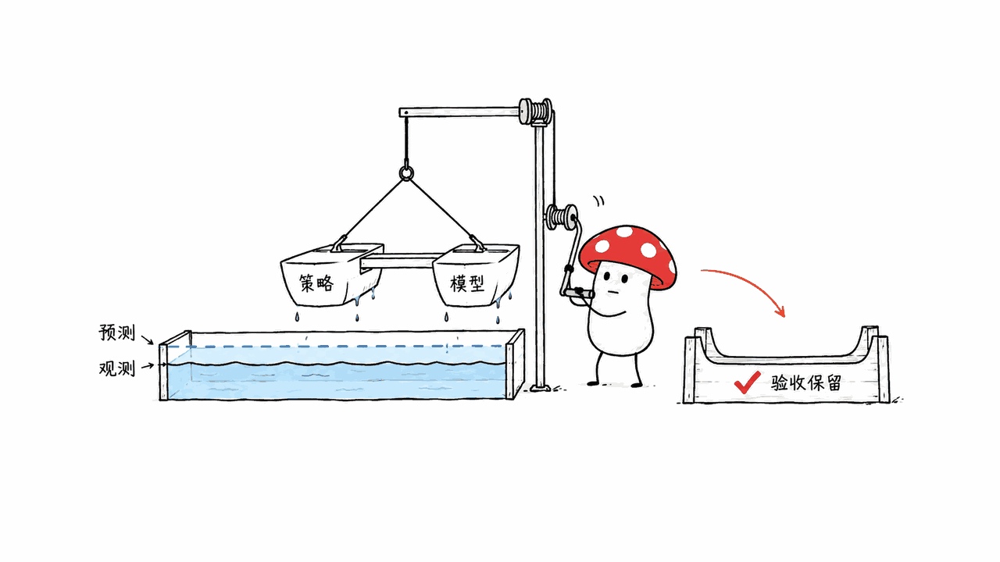

RSI-Anything 是让 AI 用预测筛选行动、用反馈保留改进的研究框架；多个领域共享流程，各自仍需模型和环境。


PhAI Labs / Gen-Verse 的项目自有代码采用 Apache-2.0。本文核对 2026 年 10 月 13 日仓库快照与论文 v1，并在 Apple Silicon Mac 上运行轻量检查。它值得关注，但“一个模型通吃代码、桌面和化学”会让读者误解实际交付。

官方仓库：https://github.com/Gen-Verse/RSI-Anything
论文：https://arxiv.org/abs/2610.13912
核对版本：2582a0f11495af595d41bab3babec57d2c3fb80e

## RSI-Anything 的循环为什么值得关注？

昂贵的部分通常是验证：运行候选代码、操作桌面、评估实验计划或测量反应产率。RSI-Anything 先让策略提出候选，再让世界模型预测结果，挑值得花预算的候选执行，把预测与观测配对保存。

反馈随后可以用于更新策略、修改工作流，或在预测不可靠且数据、预算充足时更新世界模型。候选版本经过组件检查与组合检查，合格才进入下一轮；不合格就保留当前版本。策略和预测器可以异步更新，不必每一轮同时训练。

这里最有价值的设计是验收对象。更好的预测器可能误判新策略提出的动作，更好的策略也可能把预测器带到未覆盖的区域。因此不仅要看两个组件分别得了多少分，还要看组合后的系统是否真的改善后续决策。



JEPA-Anything 提供预测表征的设计基础：将潜在状态拆成互补预测因素，再重组用于下游读出。共享的是学习原则和接口。论文的代码预测器、GUI 模型、实验规划模型和化学预测器有不同输入、骨干与参数，不能称为同一个通用权重模型。

JEPA-Anything 一手说明：https://github.com/Gen-Verse/JEPA-Anything

## 五个领域的成绩分别证明了什么？

下表是作者报告，全部不是我们的模型复现结果。跨领域指标没有共同量纲，不能相加为“通用能力分”。

| 领域 | 官方结果与设置 | 应保留的解释边界 |
| --- | --- | --- |
| 代码修复 | CodeContests 200 题、3 个种子：静态验证器 26.3%，预测选择 29.2%，预测器适配后 31.2% | 编码策略固定，展示的是选择与预测器更新的收益，不是编码大模型自己变聪明 |
| 扩展代码测试 | APPS Introductory 1,000 题为 46.37%；LiveCodeBench v6 1,055 题为 33.05% | 每轮 4 个候选，最多 3 轮；公共测试指导修复，完整官方测试用于最终成功判定 |
| GUI | MiniWoB++ 勾选框任务，同一组 100 个实例：51%→79%→99%；平均动作 5.30→3.21 | 99% 是这个任务的完成率；OSWorld 的 18.4% 是相对初始代理的增幅，不是 18.4 个百分点 |
| 实验规划 | LabHorizon F200 Level 2，200 个任务；5 个策略版本从 21.80% 到 46.01% | 是规划评分，不能读成已执行实验、得到新材料或湿实验成功率 |
| 化学优化 | 固定 Suzuki 条件池，40 次观测预算下，平均最佳观测产率 96.15%，贝叶斯优化为 82.16% | 是已测筛选数据的离线顺序回放；产率不是预测准确率，也不代表任意反应泛化 |

代码任务使用固定 ReasonFlux-Coder-7B 生成修复，预测器 W1 从 Qwen2.5-Coder-3B-Instruct 适配；实验规划使用 4B 策略。实验覆盖不同任务，但更新对象并不一样。

GUI 还有一层值得拆开：仓库结果说明，99% 对应在开发集选择的控制器，最终采用 `alpha=0`，跟随策略排序；纯世界模型排序模式为 98%。世界模型参与了训练与版本选择流程，不能把 99% 全归因于每次点击都由预测器选出。平均动作减少 39.4%，也不是运行时间降低 39.4%。

官方协议与详细结果：
https://github.com/Gen-Verse/RSI-Anything/blob/2582a0f11495af595d41bab3babec57d2c3fb80e/docs/benchmarks.md
https://github.com/Gen-Verse/RSI-Anything/blob/2582a0f11495af595d41bab3babec57d2c3fb80e/tasks/gui/docs/RESULTS.md

## 化学优化为何不能简写成“AI 自动做实验”？

发布的 Suzuki 适配器覆盖一个固定反应背景和 321 个配体、碱、溶剂组合。评估从 8 个已测条件起步，包含初始数据在内总预算为 40 次观测；100 次运行均在第 10 次观测前找到池中最优条件。这里“最优”只针对这个候选池。

可直接运行的版本使用冻结、已校准的预测表。输入已观测条件和产率，推荐器根据期望改进选一个未观测条件；新反馈改变当前最佳产率，并排除已经测过的条件。预测表本身在这个推理循环里不更新。

因此要区分三件事：离线构建或适配世界模型、使用冻结预测器搜索条件、在线重新训练预测器。开源轻量入口明确实现了第二件；往历史列表里追加一条产率，不能自动称为模型递归训练。


免疫科学部分提出包括 SIRPα 抑制与 IL-36γ 轴调节的前瞻假设，等待实验检验。假设生成、实验规划、治疗有效性之间，仍有完整的验证距离。

化学资源与评估记录：
https://github.com/Gen-Verse/RSI-Anything/tree/2582a0f11495af595d41bab3babec57d2c3fb80e/tasks/reaction_optimization
https://huggingface.co/datasets/Gen-Verse/RSI-Anything

## 我们在 Mac 上实际验证了哪些组件？

Mycelium Protocol 在独立临时环境运行仓库代码，没有下载大模型权重、训练模型、执行湿实验或复现论文分数。轻量验证结果如下，范围限定在所列入口。

| 本地检查 | 结果 | 实际意义 |
| --- | --- | --- |
| 共享工作流单元测试 | 22 项通过 | 检查阶段执行、恢复、产物检查、配置变化与运行锁等约定 |
| 化学推荐器测试 | 9 项通过 | 检查输入、未观测候选选择、平分处理等逻辑 |
| 化学发布资产检查 | 321 个候选，预测表校验通过 | 确认打包表与声明校验和一致，不验证其预测质量 |
| 化学 CLI 示例 | 成功产生推荐 JSON | 使用官方合成产率输入，只证明接口可运行 |
| 真实 Chromium 浏览器 smoke | 4 个实例全部完成，分别 3、3、1、1 个动作 | 使用规则控制器勾选和提交，未加载模型，也没有学习或自我改进 |

浏览器版本为 140.0.7339.16；实例种子为 190000–190003。仓库的 smoke 输出也明确记录 `model_or_training_result: false`。把这种环境测试写成“本地实测 RSI 成功率 100%”是不成立的。

共享 CLI 当前版本为 0.2.0，安装本体不带大型推理依赖；完整代码与 GUI 实验要按任务指南准备额外环境、资产及 GPU 配置。实验规划的候选选择可用 CPU，但生成候选仍涉及骨干和适配器。Apache-2.0 适用于项目自有代码，第三方模型与数据条款另查 notices。

想先检查可运行性，可以从这些轻量命令开始：

```bash
git clone https://github.com/Gen-Verse/RSI-Anything.git
cd RSI-Anything
git checkout 2582a0f11495af595d41bab3babec57d2c3fb80e
python3 -m venv .venv
source .venv/bin/activate
python -m pip install -e .
rsi tasks
python -m unittest discover -s tests -v
python -m pip install -r tasks/reaction_optimization/requirements.txt
python tasks/reaction_optimization/scripts/verify_assets.py
python tasks/reaction_optimization/infer.py \
  --observations tasks/reaction_optimization/examples/observations.json
```

## 如果要做自己的自我改进系统，应先设计什么？

先固定一个能便宜验证的任务，定义动作、反馈、预算和独立评估集。建立“随机选候选”“静态验证器”“可更新预测器”三个对照，让它们使用同一候选生成器和外部反馈额度，再比较成功率与总成本。

版本记录应同时保存策略、预测器、预测时点和观测来源。模型预测与真实观测必须分开，失败更新也要留下记录。最终验收不仅看训练损失，更看新组合在未参与更新的任务上是否退步。

我们认为 RSI-Anything 最值得迁移的是这套实验纪律：用预测减少昂贵验证的浪费，把可检验的改进保留下来。它为构建跨域改进流程提供参考，但有限轮次、特定任务的收益，还不足以证明无上限自我进化。

相关工程阅读：https://blog.mushroom.cv/blog/e2e-natural-language-testing/

## 常见问题

### RSI-Anything 是一个通吃所有领域的模型吗？

不是。它是共享改进协议的框架，不同领域有不同状态、动作、世界模型及反馈接口。论文覆盖多个领域，不代表一套权重无需适配就能迁移到全部任务。

### 每轮反馈都会训练模型吗？

不会。更新路径由领域实现及条件决定，策略或预测器可保持不变。发布的化学推理入口使用冻结预测表，反馈用于条件选择，不执行在线参数更新。

### 开源代码能否直接证明论文成绩？

不能。源代码、资产和测试让结果更容易检查，但完整复现仍需要相同数据、模型、训练与评估协议。本文只运行轻量软件检查和规则浏览器 smoke，没有复现模型成绩。

---

> © 2026 Author: Mycelium Protocol. 本文采用 [CC BY 4.0](https://creativecommons.org/licenses/by/4.0/deed.zh) 授权——欢迎转载和引用，须注明作者姓名及原文链接，不得去除署名后以原创发布。

<!--EN-->

RSI-Anything is a research framework that screens actions with predictions and retains improvements using feedback. Domains share a process while keeping their own models and environments.


PhAI Labs / Gen-Verse releases project-owned code under Apache-2.0. We examined the October 13, 2026 repository snapshot and paper v1, then ran lightweight checks on an Apple Silicon Mac. Calling it one model that handles coding, desktops and chemistry obscures what is actually released.

Repository: https://github.com/Gen-Verse/RSI-Anything
Paper: https://arxiv.org/abs/2610.13912
Reviewed commit: 2582a0f11495af595d41bab3babec57d2c3fb80e

## Why put a world model inside the improvement loop?

External evaluation can be expensive: executing candidate programs, operating interfaces, assessing plans or measuring reaction yields. RSI-Anything proposes candidates, predicts their outcomes, evaluates selected candidates, and stores linked prediction–observation records.

Feedback can update a policy, revise a workflow, or adapt an unreliable predictor when sufficient data and budget are available. Component checks and policy–model compatibility checks determine what survives into the next round. The two components can update asynchronously; either may remain unchanged.

The acceptance target matters. An improved predictor can still misjudge actions generated by a new policy. A better policy can enter regions the predictor does not cover. Separate component scores therefore do not establish that the assembled system makes better decisions.


JEPA-Anything supplies a predictive representation design that factors latent targets into complementary pathways and recombines them for downstream readout. The shared objects are principles and interfaces, rather than one encoder or universal set of weights. Code, GUI, laboratory and chemistry predictors use different inputs and model components.

JEPA-Anything: https://github.com/Gen-Verse/JEPA-Anything

## What do the five-domain results establish?

These are author-reported results, not our model reproductions. The metrics have different meanings and cannot be combined into a general intelligence score.

| Domain | Reported setting and result | Interpretation boundary |
| --- | --- | --- |
| Code repair | 200 CodeContests tasks, three seeds: static verifier 26.3%, predictive selection 29.2%, adapted predictor 31.2% | The coder stays fixed; gains concern candidate selection and predictor adaptation |
| Additional code tasks | APPS Introductory: 46.37% on 1,000 problems; LiveCodeBench v6: 33.05% on 1,055 | Four candidates per round, up to three rounds; public feedback guides repair and full official tests determine final success |
| GUI | 100 paired MiniWoB++ checkbox instances: 51%→79%→99%; mean actions 5.30→3.21 | This is a checkbox task; OSWorld's 18.4% is relative improvement over the initial agent, not percentage points |
| Laboratory planning | LabHorizon F200 Level 2, 200 tasks: 21.80%→46.01% over five policy versions | A planning score, not completed wet-lab experiments or discovery success |
| Chemistry | With a 40-observation budget, best observed yield averages 96.15%, versus Bayesian optimization's 82.16% | Offline sequential replay of measured yields in one fixed pool; yield is not prediction accuracy |

Code repair uses a fixed ReasonFlux-Coder-7B policy with a W1 predictor adapted from Qwen2.5-Coder-3B-Instruct. Laboratory planning uses a 4B policy. The updated object differs across applications.

The GUI result also needs careful attribution. The 99% endpoint is the controller selected on development instances; its reported `alpha=0` follows policy ranking. Pure world-based control scores 98%. World models participate in training and retention, but this does not mean every click in the 99% run is selected by a predictor. A 39.4% reduction in actions is not a 39.4% reduction in wall time.

Protocols and detailed results:
https://github.com/Gen-Verse/RSI-Anything/blob/2582a0f11495af595d41bab3babec57d2c3fb80e/docs/benchmarks.md
https://github.com/Gen-Verse/RSI-Anything/blob/2582a0f11495af595d41bab3babec57d2c3fb80e/tasks/gui/docs/RESULTS.md

## Does chemical optimization mean autonomous experiments?

The released Suzuki adapter covers one reaction context and 321 ligand/base/solvent combinations. Each evaluation starts with eight measured conditions and permits 40 total observations, including those eight. All 100 runs find the pool optimum by observation ten. The optimum is specific to that pool.

The portable release uses a frozen, calibrated prediction table. Given observed condition IDs and yields, expected improvement recommends an unobserved condition. New feedback changes the incumbent and excludes measured conditions; it does not update the prediction table during this inference loop.

Distinguish constructing or adapting a world model, searching with a frozen predictor, and retraining it online. The lightweight chemistry entry point explicitly performs frozen-predictor search. Appending a yield observation to history does not by itself constitute recursive parameter learning.


The immune-science application nominates prospective hypotheses including SIRPα inhibition and IL-36γ-axis modulation for experimental testing. Hypothesis generation, planning and demonstrated therapeutic efficacy remain separate evidence stages.

Chemistry implementation and released resources:
https://github.com/Gen-Verse/RSI-Anything/tree/2582a0f11495af595d41bab3babec57d2c3fb80e/tasks/reaction_optimization
https://huggingface.co/datasets/Gen-Verse/RSI-Anything

## What did we actually test on a Mac?

Mycelium Protocol used an isolated temporary environment. We did not download the large backbones, train models, conduct chemistry experiments or reproduce paper scores.

| Local check | Result | What it checks |
| --- | --- | --- |
| Shared workflow tests | 22 passed | Execution, resuming, output checks, changed configuration and run locking |
| Chemistry inference tests | 9 passed | Input handling, candidate exclusion and tie handling |
| Chemistry asset verification | 321 candidates; prediction checksum passed | Packaged table integrity, not prediction quality |
| Chemistry CLI example | Recommendation JSON produced | Interface execution using officially supplied synthetic yields |
| Real Chromium browser smoke | Four episodes completed in 3, 3, 1 and 1 actions | Rule-based checkbox selection and submission, without models or learning |

Chromium was version 140.0.7339.16 and episode seeds were 190000–190003. The smoke report explicitly marks `model_or_training_result: false`. Describing these four rule-controlled episodes as a measured 100% RSI model success rate would be incorrect.

The shared CLI is version 0.2.0 with no large runtime dependencies in its base package. Full code and GUI experiments require task-specific environments, assets and GPU assignments. Laboratory candidate selection can run on CPU, while candidate generation needs a backbone and adapter. Apache-2.0 covers project-owned code; third-party models and datasets retain separate terms.

A lightweight starting point:

```bash
git clone https://github.com/Gen-Verse/RSI-Anything.git
cd RSI-Anything
git checkout 2582a0f11495af595d41bab3babec57d2c3fb80e
python3 -m venv .venv
source .venv/bin/activate
python -m pip install -e .
rsi tasks
python -m unittest discover -s tests -v
python -m pip install -r tasks/reaction_optimization/requirements.txt
python tasks/reaction_optimization/scripts/verify_assets.py
python tasks/reaction_optimization/infer.py \
  --observations tasks/reaction_optimization/examples/observations.json
```

## What should builders define before adding self-improvement?

Start with a task that has affordable external evaluation. Fix its action space, feedback, budget and independent evaluation set. Compare random candidate selection, a static verifier and an adaptable predictor using the same candidate generator and feedback allowance. Measure both success and total cost.

Record policy and predictor versions, prediction timestamps and observation provenance. Keep forecasts separate from measurements, and preserve rejected updates. Acceptance should evaluate the new pair on tasks withheld from updating, rather than relying only on training loss.

Our assessment is that the most reusable contribution is this experimental discipline: use predictions to ration costly evaluation, then retain improvements that survive checks. Finite gains on specific tasks offer a useful framework reference, but do not establish unlimited self-evolution.

Related engineering reading: https://blog.mushroom.cv/blog/e2e-natural-language-testing/

## FAQ

### Is RSI-Anything one universal model?

No. It is a framework with a shared improvement protocol. Different domains use different states, actions, predictors and feedback interfaces. Multi-domain experiments do not demonstrate one weight set transferring without adaptation.

### Does every feedback round train a model?

No. Enabled updates depend on the application and its conditions. Components may remain fixed; the released chemistry inference loop updates condition selection using a frozen prediction table rather than updating parameters online.

### Does released code prove the benchmark scores?

No. Code, assets and tests make inspection easier, but full reproduction requires matching data, models, training and evaluation protocols. This article reports only lightweight software checks and a rule-based browser smoke.

---

> © 2026 Author: Mycelium Protocol. Licensed under [CC BY 4.0](https://creativecommons.org/licenses/by/4.0/) — free to share and adapt with attribution. You must credit the author and link to the original; removing attribution and republishing as original is not permitted.
