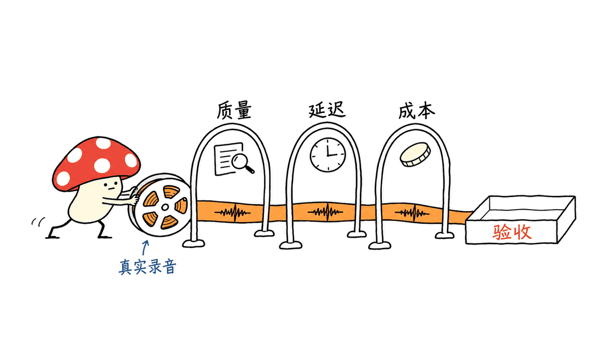

Rumble-2-Flash 把音频转成文字，值得关注的是小模型能否降低转写成本，以及电话录音上的质量能否保住。Reson8 于 2026 年 11 月 18 日在 Hugging Face 发布这款 Apache 2.0、约 0.5B 参数的开放权重模型；它不是语音生成器，也不是完整的电话智能体。

Mycelium Protocol 的判断：适合进入客服录音与多语言转写的候选名单，但“接近 30B”只成立于指定测试，“半秒一小时”描述批处理吞吐。本文核对了权重仓库、模型配置、提示模板和发布说明；没有复现真实音频识别或官方性能。

## 开源仓库在哪里，开放到了哪一层？

正式模型仓库：https://huggingface.co/Reson8/Rumble-2-Flash

发布说明：https://huggingface.co/blog/rumble-2-flash

仓库提供权重、处理器配置、分词器、聊天模板和 Apache 2.0 许可证。配置声明 `Qwen3ASRForConditionalGeneration`，意味着采用已有架构接入。我们的精确 GitHub 仓库搜索没有找到可确认归属的专用官方仓库，不把同名第三方项目当成官方入口。

开放权重不等于训练全流程可重现：当前已核对的文件不足以证明完整训练数据、教师权重和训练流水线全部公开。Apache 2.0 提供宽松的复用许可，商用集成仍需按许可证履行通知等义务。

## 电话识别真的追平 30B 了吗？

官方发布说明引用 AppTek 的客服热线测试：302 小时音频、14 种英语口音，用 AppTek 自己的评分脚本。以下均为发布方报告，未由我们独立重跑。

| 模型 | 报告的 WER |
| --- | --- |
| Rumble-2-Flash，约 0.5B | 7.86% |
| NVIDIA Nemotron 3.5 Transcribe，发布文称 30B | 7.78% |
| Qwen3-ASR 0.6B | 8.70% |
| Qwen3-ASR 1.7B | 7.40% |

前两者相差 0.08 个百分点，数值接近，但小模型仍略高；没有置信区间或配对显著性分析，不能把它写成统计等效，更不能推广成所有场景全面追平。与 Qwen3-ASR 0.6B 相比，7.86% 对 8.70% 的相对 WER 降幅约 9.7%，这是按报告值做的算术，不是新增实验。

官方另报多语言平均错误率 6.96%、英文平均 WER 6.60%。需要纠正素材中的术语：模型卡明确中文用 CER，其他列是 WER，6.96% 不宜统称“平均字错误率”。它也不意味着 45 种语言全测过、每种都一样好。

对业务而言，漏一个否定词、金额或姓名，可能比若干普通词错误更严重。因此还应单独统计实体准确率和关键字段错误率；总体 WER 只能决定是否值得进一步验证。


## 7000 倍实时率，能保证通话响应快吗？

不能。模型卡记录的 Open ASR Leaderboard v1.16.1 测试采用 H200 和 vLLM，英文整体 RTFx 为 6338，SPGISpeech 分项为 7308。官方强调满批条件；不是每个数据集、每个请求都超过 7000。

RTFx 是被处理的音频时长除以处理墙钟时间。3600 秒音频除以 7000，约为 0.514 秒，能解释“半秒处理一小时”的吞吐折算，但不能证明单个一小时文件端到端只需半秒，也不包含任意线上上传、排队与切片成本。

离线转写可以攒批提高设备利用率；电话交互却要控制等人说完、音频分块、队列等待与解码的总延迟。大批次可能让总体处理量增加，同时让个别请求等待更久。这是部署取舍，不能只看模型大小或宣传速度。


## 小模型怎样学到大模型的识别能力？

发布方采用 Qwen3-ASR 架构，以生产模型 Rumble-2 做教师进行 on-policy 蒸馏。学生先生成自己的转写，再获得教师逐 token 的概率反馈；训练关注学生实际走到的输出路径，而不只是模仿预先写好的答案。

教师和学生分词器不同，发布说明介绍用 GOLD 处理文本分段与词表对齐。可以借鉴的是训练问题的选择：把纠错信号放在学生会犯错的位置，并让学生架构沿用成熟生态。不过，本文没有核验完整训练代码，不能据此承诺照着配置即可复现这些成绩。

## 我们实际核验了什么？

本次将模型仓库固定到提交 `a0c34287229103b706c670d70791683e34379732`，保存配置与原始模板，做轻量、无权重的模板检查。模型卡列出 45 个语言代码，`config.json` 的 `support_languages` 只有 30 项。这只能证明元数据不一致，不能直接判断剩余语言不可用；上线前应逐个验证所需语种及自动检测路径。

处理器配置记录 16kHz 采样、128 维音频特征及 30 秒 `chunk_length`。这些是配置事实，不应据此断言可无损处理任意时长输入。长录音仍需验证切片边界、上下文丢失、重复与遗漏。

模板检查覆盖三组布尔输出选项的 8 种组合、自动/指定语言以及三类音频消息写法。它证明控制标记按模板生成，不证明模型一定服从。默认 `digits=true`、`filler=false`、`verbatim=true`，意味着数字形式、语气词与重复词策略并不等于完全保留原话。审计录音尤其要固定并记录这些设置。

没有下载权重，没有真实音频推理，也没有在 Mac、CPU 或 GPU 上测量速度、识别率和峰值内存；不能把上述静态检查当成端侧运行成功。

## 工程师怎样开始，怎样验收？

官方 Transformers 示例使用以下入口；这是接入说明，本文未执行模型加载：

```python
from transformers import AutoProcessor, AutoModelForMultimodalLM
model_id = "Reson8/Rumble-2-Flash"
processor = AutoProcessor.from_pretrained(model_id)
model = AutoModelForMultimodalLM.from_pretrained(model_id, device_map="auto")
inputs = processor.apply_transcription_request(
    audio="sample.wav", language="English"
).to(model.device, dtype=model.dtype)
out = model.generate(**inputs, max_new_tokens=512)
tokens = out[:, inputs["input_ids"].shape[-1]:]
print(processor.decode(tokens, return_format="transcription_only")[0])
```

模型配置标注 `transformers_version=5.21.0.dev0`；这是保存配置时的版本，不等于已证实的最低版本。先确认所用发行版具有相关 AutoModel 和处理器 API，再锁定依赖及模型 revision。vLLM 官方入口是 `vllm serve Reson8/Rumble-2-Flash --max-model-len 4096`，该长度是服务配置示例，不是音频秒数。

建议先拿经过授权的真实业务录音，按语言、口音、噪声、采样率、多人重叠分组，人工建立参考文本。固定文本归一化与输出控制，再与当前方案跑同样的数据。中文用 CER，其他语种根据任务选 WER，同时保留原始转写检查金额、否定词、专名和重复。

性能另开一张验收表：批次 1 与目标并发分别测端到端 p50/p95、峰值显存、失败重试和吞吐。离线任务再测试满批；在线任务优先看等待时间。只有业务质量和成本同时过线，才扩大流量。0.5B 让试用成本更有希望下降，无法替你省掉这一步。



## FAQ

### 它是完整的语音 Agent 吗？
不是，当前讨论的是 ASR 音频转文字。说话人区分、话术决策、工具执行、语音合成与通话控制，需要按各自能力另行集成和验证。

### 45 种语言是否都达到了电话测试的水平？
没有这个证据。电话测试是英语口音集合，公开多语言表也只覆盖其中一部分语言，且配置语言清单存在差异。

### 可以直接替换线上 Whisper 吗？
可作为候选模型，用相同录音和评分规则对比后再决定。不能根据跨数据集宣传数字推断你的业务收益，也不能假设提示模板检查等于识别质量验证。

来源：模型卡及文件 https://huggingface.co/Reson8/Rumble-2-Flash/tree/main ；发布说明 https://huggingface.co/blog/rumble-2-flash ；榜单 https://huggingface.co/spaces/hf-audio/open_asr_leaderboard?version=1.16.1 。接口参考 https://github.com/huggingface/transformers 。

---

> © 2026 Author: Mycelium Protocol. 本文采用 [CC BY 4.0](https://creativecommons.org/licenses/by/4.0/deed.zh) 授权——欢迎转载和引用，须注明作者姓名及原文链接，不得去除署名后以原创发布。

<!--EN-->

Rumble-2-Flash transcribes speech into text. Its attraction is the possibility of retaining useful call-recording accuracy in a small, cheaper-to-serve model. Reson8 published the approximately 0.5B-parameter weights under Apache 2.0 on November 18, 2026. This is ASR, rather than a voice generator or a complete phone agent.

Mycelium Protocol would shortlist it for call recordings and multilingual transcription. The 30B comparison applies to a particular benchmark; the “half a second per hour” claim concerns batched throughput. We audited repository metadata and templates without reproducing recognition accuracy or inference performance.

## Where are the official artifacts?

Weights: https://huggingface.co/Reson8/Rumble-2-Flash

Announcement: https://huggingface.co/blog/rumble-2-flash

The repository includes weights, processor and tokenizer configurations, a chat template and a license. Its architecture is `Qwen3ASRForConditionalGeneration`, allowing integration with an existing runtime ecosystem. An exact GitHub search did not identify an attributable, dedicated official project; third-party matches should not replace the primary Hub entry.

Open weights do not establish full training reproducibility. The audited files do not establish that the complete training data, teacher weights and pipeline are public. Apache 2.0 permits broad reuse subject to its terms, including applicable notice obligations.

## Does a 0.5B model really match 30B on calls?

The announcement reports the following AppTek results on 302 hours of helpline audio, covering 14 English accents and scored with AppTek's script. These are reported results, not our measurements.

| Model | Reported WER |
| --- | --- |
| Rumble-2-Flash, approximately 0.5B | 7.86% |
| NVIDIA Nemotron 3.5 Transcribe, described as 30B | 7.78% |
| Qwen3-ASR 0.6B | 8.70% |
| Qwen3-ASR 1.7B | 7.40% |

The first pair differs by 0.08 percentage points. That is numerically close, with the smaller model still slightly worse. Without confidence intervals or paired significance tests, statistical equivalence is unproven. Relative to Qwen3-ASR 0.6B, the reported WER reduction is approximately 9.7%, a calculation from supplied scores rather than another experiment.

The announcement also reports a 6.96% multilingual average and 6.60% English WER. Chinese uses character error rate in the model card, while other languages use WER. Describing the multilingual figure as an average character error rate is inaccurate; it does not establish equal performance across every supported language.

Business acceptance should additionally measure names, amounts and negations. A small number of critical errors can matter more than a larger number of harmless substitutions. Overall WER is a screening metric, not a complete business outcome.


## Is 7000 RTFx a low-latency call guarantee?

No. The model card identifies H200 and vLLM for Open ASR Leaderboard v1.16.1. It lists English overall RTFx of 6338 and 7308 for SPGISpeech. The announcement explicitly ties higher throughput to full batches.

RTFx divides processed audio duration by wall time. At 7000 RTFx, 3600 audio seconds correspond to roughly 0.514 processing seconds. That conversion does not establish end-to-end latency for a single hour-long file or account for arbitrary upload, queueing and segmentation overhead.

Batching can help offline transcription use hardware efficiently. Interactive calls must budget speech segmentation, waiting, queueing and decoding. Larger batches can improve aggregate throughput while increasing an individual's wait. Measure both objectives separately.


## What is the useful training idea?

Reson8 describes on-policy distillation from its larger production model, Rumble-2, into a Qwen3-ASR architecture. The student produces its own transcription and receives teacher feedback at token level. This targets states the student actually visits, rather than only imitating prewritten teacher answers.

The announcement describes GOLD as handling tokenizer differences through text alignment and vocabulary comparisons. The transferable idea is to correct the student's own errors while keeping deployment on a familiar architecture. We did not verify a complete training implementation and cannot promise reproducibility from configuration alone.

## What did we actually check?

We pinned the model repository to `a0c34287229103b706c670d70791683e34379732`, archived its configuration and template, and performed lightweight checks without weights. The card declares 45 language codes, whereas `config.json` contains 30 `support_languages` entries. This is a metadata inconsistency, rather than proof that the remaining languages fail. Validate every required language and automatic detection path.

Processor configuration specifies a 16kHz sample rate, 128 audio features and a 30-second `chunk_length`. These values do not establish flawless arbitrary-duration handling. Long recordings need checks for boundary omissions, duplicated words and lost context.

Template checks cover all eight combinations of the three Boolean output options, automatic and forced language, and three audio message shapes. These checks establish prompt-marker construction, not model obedience. Defaults are `digits=true`, `filler=false`, and `verbatim=true`; an audit transcript must deliberately choose and record normalization behavior.

We downloaded no weights and ran no audio inference. We measured no Mac/CPU/GPU throughput, recognition quality or peak memory. Static checks must not be represented as successful on-device inference.

## How should engineers integrate and accept it?

The official Transformers path uses the following entry points. This example is guidance; we did not execute model loading.

```python
from transformers import AutoProcessor, AutoModelForMultimodalLM
model_id = "Reson8/Rumble-2-Flash"
processor = AutoProcessor.from_pretrained(model_id)
model = AutoModelForMultimodalLM.from_pretrained(model_id, device_map="auto")
inputs = processor.apply_transcription_request(
    audio="sample.wav", language="English"
).to(model.device, dtype=model.dtype)
out = model.generate(**inputs, max_new_tokens=512)
tokens = out[:, inputs["input_ids"].shape[-1]:]
print(processor.decode(tokens, return_format="transcription_only")[0])
```

The saved config records `transformers_version=5.21.0.dev0`; this is not a verified minimum version. Check API availability before pinning dependencies and the model revision. The documented vLLM entry point is `vllm serve Reson8/Rumble-2-Flash --max-model-len 4096`. That context setting does not mean 4096 audio seconds.

Start with authorized recordings representative of language, accent, noise, sampling rate and overlapping speech. Create human references and fix the same normalization and scoring policy for baseline and candidate. Use appropriate CER/WER metrics, retaining raw outputs to audit entities and negations.

Keep performance acceptance separate: benchmark batch size one and target concurrency for end-to-end p50/p95 latency, peak memory, failures and throughput. Test saturated batches for offline work; prioritize waiting time for interaction. Expand traffic only after both quality and cost meet the actual business requirement.


## FAQ

### Is this a complete speech agent?
No. ASR supplies text. Speaker handling, decisions, tools, speech synthesis and telephony control require separate integrations and validation.

### Do all 45 languages match the phone benchmark?
There is no such evidence. The call benchmark covers English accents; the public multilingual table covers only a subset, and language metadata is inconsistent.

### Can it replace production Whisper immediately?
Evaluate both on the same representative audio and scoring rules first. Cross-dataset promotional scores cannot establish your business improvement, and template tests do not establish recognition accuracy.

Sources: model files https://huggingface.co/Reson8/Rumble-2-Flash/tree/main ; announcement https://huggingface.co/blog/rumble-2-flash ; leaderboard https://huggingface.co/spaces/hf-audio/open_asr_leaderboard?version=1.16.1 ; interface project https://github.com/huggingface/transformers .

---

> © 2026 Author: Mycelium Protocol. Licensed under [CC BY 4.0](https://creativecommons.org/licenses/by/4.0/) — free to share and adapt with attribution. You must credit the author and link to the original; removing attribution and republishing as original is not permitted.
