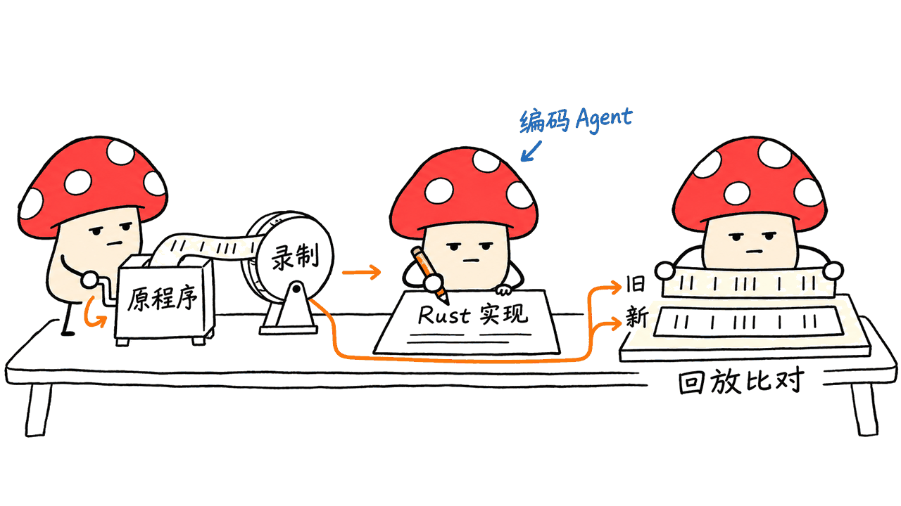
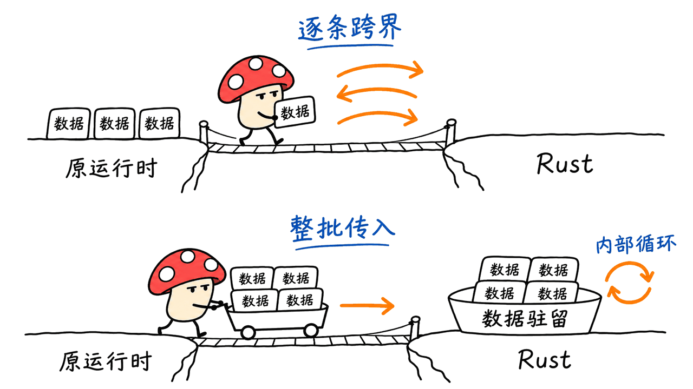
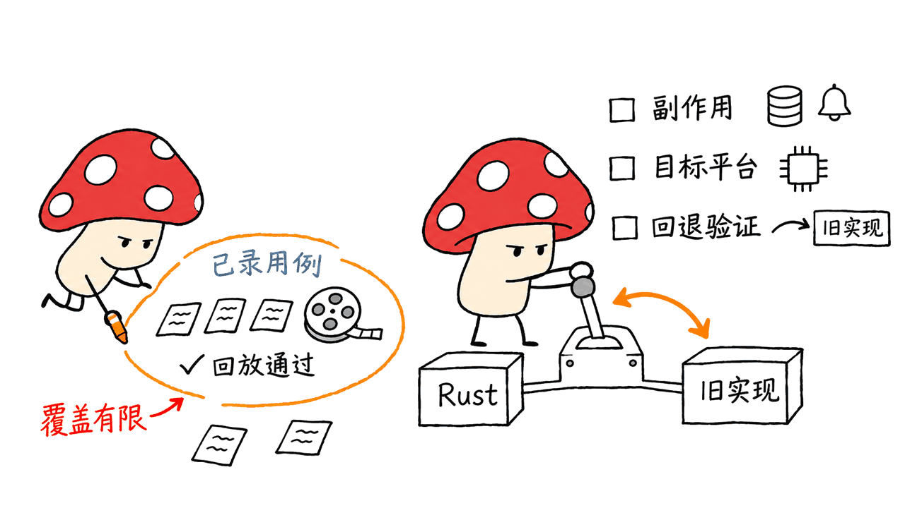

rust-anything 是一套渐进式 Rust 迁移工具：先录下旧程序的行为，再检查新实现是否复现这些行为。它解决的是“怎么验收重写”，而不是替你自动翻译整个代码库。

项目地址：https://github.com/erkamyaman/rust-anything

本文核对版本为 1.4.0，代码采用 MIT 许可证，源码提交为 `94a9f2d012c68cd1ad8067f21037357cdd6bcf5f`。README 支持 TypeScript/JavaScript、Python、C、Go、Ruby、Java；PHP 和 C# 标为预览，不能把“可录制整应用”理解为这两种语言的单元桥接已经完备。

## 它为什么不是“把项目一键翻译成 Rust”？

工具可以分析依赖、找热点、生成桥接骨架，录制旧程序，再比较新旧输出。真正的 Rust 业务逻辑仍由工程师或编码 Agent 写入 `port.rs`。模型写得像原代码，不等于跨语言语义一致。

官方的例子很具体：JavaScript 的字符串位置按 UTF-16 代码单元计算，Rust 若直接按 `char` 计数，遇到 emoji 就可能偏一位。类似问题还有负数除法、溢出、正则表达式、集合顺序、异常类型与浮点数格式。工具给这些陷阱生成输入，但覆盖范围仍是有限的。

我的判断是：它更像迁移工程的验收台。让 Agent 写代码之前，先把“做对了”的证据定义出来，比不断补充提示词更有价值。



## 工程链路：录制、桥接、回放，再决定是否切换

| 环节 | 解决的问题 | 不能据此推断什么 |
| --- | --- | --- |
| profile / analyze | 热点、依赖、迁移顺序与风险 | 推荐顺序不是收益承诺 |
| bridge / record | 生成绑定与接口骨架，保存旧实现的返回或异常 | 不是已经写好Rust实现 |
| build / diff | 构建新实现，逐条重放已记录输入 | 不代表所有可能输入都等价 |
| bench / shadow | 比较带桥接的调用成本；并行比对新旧结果 | 影子运行也有资源及副作用成本 |
| gate | 格式、clippy、测试、未实现项与行为等检查 | 不是安全审计或形式化证明 |

桥接方式随语言不同：Node 侧可用 napi-rs 或 wasm-bindgen，Python 用 PyO3，C 用 C ABI，Go 用 cgo，Ruby 用 magnus，Java 用 JNI。保留调用接口，可以降低业务代码一次性改动的范围，但并不消除打包、平台与运行时依赖。

`gate` 中有 `unsafe` 与错误路径检查，不能因此认定整个业务、依赖链和部署配置都已安全。它通过的含义必须放回具体用例、目标平台和检查范围里理解。

## 为什么已经迁移到 Rust，反而可能更慢？

官方报告里，x18n 的 29 个可迁移函数通过了 7,925 条记录用例，但从 JavaScript 逐函数调用这些 Rust 实现，多数函数的速度反而下降。原因是跨语言边界的成本，比那些小函数本身的工作还大。这里的用例数采用根 README 和示例表格；示例说明开头另写了6,925，仓库内部文字存在不一致，不能视为本文独立核验过的统计。

README 另一组搜索示例宣称最高约 20 倍提速，采用的是批量路径：把数据一次送进 Rust、保留在那里，再在 Rust 内部执行循环。这不是“换个语言就快20倍”，而是调用粒度、数据驻留和并行执行共同改变了成本结构。

一个实用模型是：总成本包含数据转换、边界调用、实际计算，以及结果传回。计算越短、跨界越频繁，迁移越容易亏。把整个热点循环搬过去，才有机会摊薄固定成本。



这些倍率均为作者在特定负载和机器上的结果，本文没有复现其性能基准，也没有测量自己业务的速度、内存或吞吐。选型时要用真实请求分布，测端到端延迟及尾延迟，同时记录数据规模和线程数。

## 如何从一个小型 CLI 开始？

先在可丢弃分支或副本中运行。录制会执行原程序；如果 CLI 会付款、发通知或写数据库，先换成隔离服务和脱敏数据，而不是直接录生产命令。

安装与核对入口：

```bash
cargo install rust-anything --version 1.4.0 --locked
rust-anything --help
```

该版本 `Cargo.toml` 指定 Rust 1.97 起。使用的原语言运行时、编译器，以及桥接目标所需工具，也要准备好。预编译 release 和 npm 分发属于另外的安装路径，本文没有验证它们。

以下命令假设 `path/to/my-cli` 是你的测试副本，入口为 `cli.py`：

```bash
rust-anything analyze path/to/my-cli --whole-app
rust-anything app record path/to/my-cli -- python3 cli.py
rust-anything app replay path/to/my-cli
```

先让旧程序回放通过，再为候选 Rust 可执行文件指定 `app replay --build`。不要先重写一半，才发现没有保留原程序的异常消息、退出码或输出文件行为。单模块迁移则走 `bridge → record → 编写port.rs → build → diff → bench → gate`；应按项目实际单元路径生成骨架，不照抄不存在的函数名。

如果希望 Agent 调用这些步骤，可以把 `rust-anything mcp` 注册为 stdio MCP 服务。`rust-anything setup` 会修改所检测到的编码工具配置并保存备份；不要把它当成只读分析命令。本次研究没有运行 setup，也没有修改本机编码 Agent 的配置。

## 本地核验做了什么？

在隔离克隆中，用 Rust 1.98.1 执行了 `cargo test --locked --lib`，116 项库测试全部通过；单独运行的 Python CLI 录制/回放测试也通过，包含故意改变除零错误文本并检查能否发现差异。CLI 构建成功，版本输出为 1.4.0，`analyze --whole-app` 也生成了 Python 夹具的迁移计划。

另跑 `tests/loop.rs` 的19项集成测试，首次17项通过、2项失败：Node 26.10.0 不接受其使用的 `--experimental-transform-types`，改用本机已有的 Node 22.23.3 后，该类桥接测试单独重跑通过；Ruby 测试则在本机系统 Ruby 2.6.10 的 rb-sys stable API 构建环节失败，尚未解决。没有改上游代码，也没有把这次结果写成“全套测试通过”。这说明原语言运行时的实际兼容性仍需要逐一验证。

这验证的是工具在测试夹具里的行为，不是某个真实应用已经完成 Rust 重写。尤其要区分：部分桥接回放测试使用 JavaScript 替身检查测试框架，而非实际编译出来的 Rust 扩展。不能把这类通过数写成跨语言迁移成功数。

## 录制通过了，还会漏掉什么？

录制两次时，时间戳、随机 ID 等变化值可能被替换成通配符；行序变化和行数变化也有相应的归一化规则。这有助于去掉噪声，但也会放宽验收条件。每条自动忽略的差异都应该人工检查，避免把真实回归当作随机性。

HTTP 响应、终端输出、退出码和文件输出之外，数据库副作用、外部网络调用、负载下的并发、时序与内存，不能指望由一次回放全部覆盖。匹配旧实现也会保留旧实现的错误；如果目标是改行为，需要另外写新规格，不能让旧录制一票否决。

影子模式可以同时运行新旧实现并返回旧结果，官方也提供切换与回退方式。对纯计算函数很有用；对有副作用的逻辑，工程上应把真正提交动作与计算分开，避免双写、重复扣费或重复通知。这里是部署建议，不是本文验证过的生产保障。



## 工程师该借鉴的是什么？

先选边界清楚、输入可记录、收益可测量的一小块；保留原实现作参照。把历史故障、中文及 emoji、极值、异常路径和真实脱敏样本放入验收，再检查是否值得将整个循环与数据一起移走。

当回放通过、性能确有收益、目标平台验证完成后，再灰度切换。若最终目标是纯 Rust，整应用的 `front-door / wire / lift` 路线还会检查回退率；“所有请求都成功”可能只是100%仍在回退旧程序，必须同时看谁真正处理了请求。

它最值得借鉴的不是“Rewrite Everything”，而是把重写变成一串可验证、可撤回的工程步骤。语言只是实现选项，保住行为与获得可解释的收益才是交付标准。

## FAQ

### 能直接拿 APK 或 exe 生成 Rust 源码吗？

不能。它分析源代码，并调用原语言运行时录制行为，不是二进制反编译工具。

### 通过 gate 就能立即上线吗？

不能。还要检查录制盲区、归一化规则、外部副作用、目标平台、真实负载与回退方案。

### 适合把所有 C 代码重写吗？

不适合一概而论。硬件寄存器、内联汇编和依赖内存布局的代码尤其需要目标平台证据；稳定底层代码的重写成本也可能高于收益。

## 一手资料

仓库与 README：https://github.com/erkamyaman/rust-anything

x18n 逐函数迁移记录：https://github.com/erkamyaman/rust-anything/tree/main/demo/x18n-core

批量搜索示例：https://github.com/erkamyaman/rust-anything/tree/main/demo/x18n-search

许可证：https://github.com/erkamyaman/rust-anything/blob/main/LICENSE

---

> © 2026 Author: Mycelium Protocol. 本文采用 [CC BY 4.0](https://creativecommons.org/licenses/by/4.0/deed.zh) 授权——欢迎转载和引用，须注明作者姓名及原文链接，不得去除署名后以原创发布。

<!--EN-->

rust-anything is a toolkit for migrating software to Rust incrementally. It records the original program, scaffolds bridges, and compares the replacement with recorded behavior. It helps define acceptance criteria; it does not automatically translate a codebase.

Repository: https://github.com/erkamyaman/rust-anything

This review examines version 1.4.0 at commit `94a9f2d012c68cd1ad8067f21037357cdd6bcf5f`, licensed under MIT. The README covers TypeScript/JavaScript, Python, C, Go, Ruby, and Java. PHP and C# are previews: whole-application recording support does not mean their unit-level bridges are complete.

## What does the tool actually write?

It analyzes dependencies and hotspots, generates bridge scaffolding, records the original, and checks replacement outputs. An engineer or coding agent still writes the Rust business logic in `port.rs`.

Cross-language semantics are the hard part. JavaScript string offsets use UTF-16 code units; counting Rust `char` values can shift an emoji-containing match. Integer division, overflow, regular expressions, collection order, exceptions, and floating-point formatting introduce other differences. Generated trap inputs help, but remain a finite sample.

My assessment: this is a migration acceptance workbench. Defining evidence before asking an agent to rewrite code is more useful than relying on a convincing translation.


## The engineering loop

| Stage | Purpose | Limit |
| --- | --- | --- |
| profile / analyze | Find workloads, dependencies, risks and migration order | Recommendations do not guarantee a return |
| bridge / record | Scaffold interfaces and save original returns or errors | Business logic is not implemented for you |
| build / diff | Build and replay recorded inputs | Passing cases do not prove universal equivalence |
| bench / shadow | Measure bridge-inclusive calls and compare implementations | Shadow execution consumes resources and may repeat side effects |
| gate | Check formatting, clippy, tests, unfinished work and behavior | It is not a complete security audit or formal proof |

Bridges depend on the runtime: napi-rs or wasm-bindgen for JavaScript, PyO3 for Python, C ABI for C, cgo for Go, magnus for Ruby, and JNI for Java. Keeping the caller API reduces simultaneous changes, but packaging, platform support, and runtime dependencies still matter.

An `unsafe` check or an error-path check inside `gate` does not certify the entire application, dependency tree, or deployment. A passing result must be interpreted within its actual coverage.

## Why can a Rust rewrite be slower?

The author's x18n report is a useful counterexample. Twenty-nine migrated functions matched 7,925 recorded cases, yet calling most of them individually from JavaScript was slower. Crossing the language boundary cost more than the small functions saved. The root README and example table state 7,925 cases, while the example introduction says 6,925. That internal inconsistency is another reason to treat the count as author-reported, not independently verified.

The README's separate search workload claims a speedup of about 20 times through batching: send data once, retain it in Rust, and run the loop there. That changes call granularity, data residency, and parallel execution. It is not evidence that changing languages alone produces a 20-fold improvement.

Think of total cost as conversion, boundary crossing, computation, and returning results. When computation is tiny and crossings are frequent, migration can lose. Moving a whole hot loop may amortize the fixed costs.


Those speedups are author-reported workload-specific measurements. I did not reproduce the performance benchmarks or measure application latency, memory, or throughput. A deployment decision needs representative requests, tail latency, data sizes, and documented thread counts.

## How should you start with a small CLI?

Use a disposable branch or copy. Recording executes the original application. Replace payment, notification, and database integrations with isolated services and sanitized fixtures before recording commands.

```bash
cargo install rust-anything --version 1.4.0 --locked
rust-anything --help
```

The pinned manifest requires Rust 1.97 or newer. The source-language runtime and any compiler or bridge-specific tooling are additional requirements. Prebuilt releases and npm are alternative distribution paths; I did not validate those packages.

For a test copy at `path/to/my-cli`, with `cli.py` as its entry point:

```bash
rust-anything analyze path/to/my-cli --whole-app
rust-anything app record path/to/my-cli -- python3 cli.py
rust-anything app replay path/to/my-cli
```

Make the original replay pass first. Then use `app replay --build` with a candidate Rust executable. Preserve error messages, exit codes, and written-file behavior before rewriting half the project.

For a unit, follow `bridge → record → implement port.rs → build → diff → bench → gate`. Generate the scaffold for real source paths rather than copying an example function that does not exist in your application.

Agents can access these operations through the `rust-anything mcp` stdio server. The convenience `setup` command modifies detected agent configuration and creates backups; it is not read-only analysis. I did not run setup or change local agent configuration during this research.

## What was verified locally?

In an isolated clone using Rust 1.98.1, `cargo test --locked --lib` passed all 116 library tests. A separately selected Python CLI recording/replay test passed, including detection of a deliberately changed division-by-zero error message. The CLI built successfully, reported version 1.4.0, and produced a whole-app migration plan for the Python fixture.

The 19 tests in `tests/loop.rs` initially yielded 17 passes and two failures. Node 26.10.0 rejected `--experimental-transform-types`; rerunning that class-bridge test with the already installed Node 22.23.3 passed. The Ruby integration failed while building rb-sys stable API against the system Ruby 2.6.10 and remains unresolved. I made no upstream changes and do not claim that the entire suite passed. Source-runtime compatibility needs explicit verification.

These checks exercise the toolkit on fixtures, not a completed migration of a real application. Some bridge replay tests use a JavaScript stand-in for the Rust module to test the harness without compiling native bindings. Their counts must not be presented as successful native migrations.

## What can recorded replay miss?

Two runs may differ in timestamps or random IDs. Recording can turn varying values into wildcards, normalize line order, or allow broader differences when line counts change. Inspect every automatically relaxed comparison. A regression can hide inside a field treated as noise.

Replay does not cover all database effects, network calls, concurrency under load, timing, or memory. Matching the original also preserves its bugs. If a deliberate behavior change is part of the migration, define a new specification rather than treating every old recording as mandatory.

Shadow mode can run both implementations and return the original's result. It is useful for pure calculations. For operations with effects, separate calculation from committing the action so comparison does not double-charge, double-write, or send duplicate notifications. That is deployment advice, not a production guarantee tested here.


## What should engineers borrow?

Choose one bounded unit with recordable inputs and measurable benefit. Keep the original as a reference. Add historical failures, multilingual text, emoji, extremes, error paths, and sanitized production samples to acceptance coverage. Then determine whether moving the loop and its data together is worthwhile.

Switch gradually after behavioral replay, representative performance measurements, and target-platform checks. The whole-application `front-door / wire / lift` workflow also tracks fallback: a successful response can still be produced entirely by the old program. Check which implementation did the work.

The useful lesson is to turn a rewrite into verifiable, reversible steps. Preserved behavior and an explained benefit are stronger delivery criteria than the choice of language.

## FAQ

### Can it turn an APK or executable into Rust source?

No. It parses source and records the running original; it is not a binary decompiler.

### Is a passing gate enough for production?

No. Review input coverage, normalization, external effects, target platforms, real workloads, and rollback.

### Should all C code be rewritten?

No general rule applies. Hardware registers, inline assembly, and memory-layout assumptions require target-specific evidence, while mature low-level code may cost more to replace than it saves.

## Primary sources

Repository and README: https://github.com/erkamyaman/rust-anything

Per-function x18n migration: https://github.com/erkamyaman/rust-anything/tree/main/demo/x18n-core

Batch search demo: https://github.com/erkamyaman/rust-anything/tree/main/demo/x18n-search

License: https://github.com/erkamyaman/rust-anything/blob/main/LICENSE

---

> © 2026 Author: Mycelium Protocol. Licensed under [CC BY 4.0](https://creativecommons.org/licenses/by/4.0/) — free to share and adapt with attribution. You must credit the author and link to the original; removing attribution and republishing as original is not permitted.
