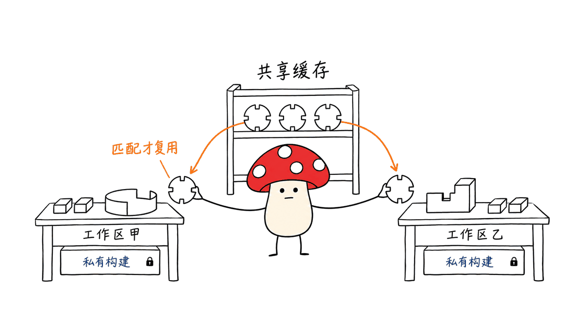

磁盘优化不只是删除大文件。对Rust与苹果开发者，更有效的顺序是：看清空间增长，把可复用的构建工作共享起来，为长期资源划定边界，最后回收明确不再需要的产物。Mole负责观察和整理，MBX负责减少重复编译；两者可以配合，但不能互相代替。

本文从这份开发分支指南出发，核对文档、源码，并在临时目录做定向验证：
https://github.com/jhfnetboy/Mole/blob/jhfnetboy/dev-cache/docs/MOLE_AND_MBX_GUIDE.md

这里讨论Mole CLI，主项目为tw93/Mole，采用GPL-3.0；用户提供的是jhfnetboy的开发分支，固定提交`25ef07a70e287136d476689997d9cfd4ed46f750`。MBX是jdx的mr-boxington项目，采用MIT许可；文档固定提交`599e5b6e105d4006373ef2240c676026c6dab74f`，本次功能实验使用发行版`mbx 1.29.2`。Mole的原生桌面产品与开源CLI不是同一个安装物。

## 先把磁盘里的东西分成四类

| 类型 | 常见例子 | 处理依据 |
| --- | --- | --- |
| 可重建产物 | Rust target、某个项目的DerivedData、dist | 确认没有活动构建、需要的产物已保留，再预览回收 |
| 可复用缓存 | Cargo编译缓存、pnpm store、uv下载缓存 | 交给所属工具管理预算，不因“大”就全部清空 |
| 长期资源 | 模型权重、数据集、原始视频、训练结果 | 明确用途、唯一副本和备份，再决定迁移或删除 |
| 发布与诊断档案 | Xcode Archives、匹配版本的dSYM、签名资料 | 按发布版本保留，不能当临时构建目录处理 |

“能重新下载”也有成本：网络、访问权限、旧版本可得性和恢复时间。模型目录很大并不意味着无用，缓存很老也不自动意味着可删。


## Mole怎样用：先分析，再看预览

官方CLI入口：
https://github.com/tw93/Mole

通过Homebrew安装CLI后，从观察开始：

```bash
brew install mole
mo analyze "$HOME/Dev"
mo status
mo clean --dry-run
mo purge --dry-run
```

`analyze`回答哪里大，`status`观察当前状态，`clean`与`purge`的预览用来审查候选。上面两条预览不是删除命令，也不代表所有列出的目录都应该清理。`purge`面向项目构建产物，`clean`覆盖范围更广；不要把“只想整理Dev目录”理解成通用清理也只会扫描Dev。

需要卸载应用时，先用`mo uninstall --dry-run`核对应用与残留，避免把配置、登录状态和业务数据一起当作垃圾。真正执行删除，应在确认列表、停止相关构建后单独进行。

### 趋势分析不是安装后就能回看过去

指南里的命令是：

```bash
mo analyze --trend
mo analyze --trend --days 14
```

这对应所给开发分支的实现，不能承诺官方安装版本已经支持。该分支保存目录大小快照，再寻找可比较的历史基线；首次运行没有过去14天的数据，就只能建立基线。分类和建议来自路径与增长量规则，不是模型理解了所有业务文件。

若要试分支，应明确检出`jhfnetboy/dev-cache`并按其构建说明运行本地版本，不能只克隆默认分支就假定功能一致。当前Makefile构建的是磁盘分析、状态和dev-cache等辅助程序，`./mole`仍是调度入口。

## MBX怎样用：共享编译结果，管理target生命周期

MBX不是把所有Rust项目的`target/`粗暴指向同一个目录。它为符合条件的编译工作建立缓存，同时管理各工作区的输出与私有增量状态。工具链、编译条件或输入变化会影响复用；首次构建仍要真正编译。

先使用显式入口试一个项目，比立即接管所有Cargo调用更容易核验：

```bash
cargo install mbx --locked
mbx --version
mbx build
mbx stats
mbx explain --last
mbx doctor
mbx gc --dry-run
```

安装会编译工具，`build`会运行项目构建；它们不是只读检查。`gc --dry-run`才是回收预览。要纳管已有产物，先看：

```bash
mbx adopt --recursive --dry-run "$HOME/Dev"
```

确认具体项目后再执行`mbx adopt`。它会移动合适的target目录并留下链接，不能把它当作什么都不改变的统计命令；活动Cargo占用、跨文件系统和目录冲突也会影响接管。

需要自动代理时再用`mbx setup`，按实际输出接入shell或mise，然后从编辑器和Agent自身的终端检查`command -v cargo`。GUI启动的工具可能继承另一份PATH，终端配置正确不代表所有Agent都在走缓存。指南里的macOS路径仅是默认配置示例，不能覆盖工具的实际输出。

关于缓存键、工作区与CI的详细原理，可以接着阅读已有专文：
https://blog.mushroom.cv/blog/mr-boxington-rust-cargo-shared-cache/



## 一个真实遇到的坑：缓存刚写完，就被磁盘压力回收

本次在macOS ARM64下载官方`mbx 1.29.2`，核对发行包SHA-256，并用独立临时缓存、两个源码副本和三个输出目录运行一个无外部依赖的小Rust程序。没有执行全局setup，也没有接管真实项目。

第一次冷构建后，日志报告因磁盘低于`gc.min_free_size`，回收了8个共享缓存对象和1条动作结果。因此第二个源码副本是**0命中、2未命中**。`mbx explain --last`明确指出，键没有变，但对应缓存结果不可用。

这不是“工具不能跨目录共享”的充分证据。保持另一个全新临时缓存，仅对该实验进程设置`MBX_GC_MIN_FREE_SIZE=none`后重跑，第二个副本得到**2命中、0未命中**。程序输出42，修改源码后重建输出43，回收预览也正常返回。

这同样不是建议在日常环境关闭剩余空间保护。它说明：**共享缓存需要有存活空间。** 磁盘已很紧张时，安装缓存工具不会凭空创造余量；先检查淘汰原因、预算和保留阈值，再谈命中率。本次没有做速度基准，也没有测出节省多少物理磁盘。

源码与配置依据：
https://github.com/jdx/mr-boxington/blob/main/docs/managed-targets.md
https://github.com/jdx/mr-boxington/blob/main/docs/configuration.md

## 苹果开发者该整理哪些目录？

DerivedData里有大量可重建内容，但应按项目检查、关闭构建和索引，再通过工具或Xcode管理。清空后要付出重新索引和编译的代价，因此“每天全清”通常会让开发变慢。

模拟器设备和运行时也应区分：先运行只读的`xcrun simctl list devices`与`xcrun simctl list runtimes`，核对当前调试与兼容性测试需求，再在Xcode里移除不用的项目。不要按路径名字批量删除整个Developer目录。

**Archives与dSYM另算。** 它们可能是线上版本崩溃符号化所需的资料，不能和DerivedData用同一条保留规则。Apple要求保留分发版本对应的Xcode archive；若迁往外置盘或备份，应验证还能找到匹配版本的符号文件。
https://developer.apple.com/documentation/xcode/building-your-app-to-include-debugging-information

## 指南里的220GB案例，哪些经验可以迁移？

原指南记载可用空间约从275GB升至495GB，涉及重复模型、视频实验、虚拟环境和前端依赖。这是原文的个人会话记录，本文没有取得其清理前后快照，也没有独立复核220GB净释放，不能把它当作每台Mac的预期收益。

能迁移的是审查方法，而不是具体删除名单：

1. **模型按运行需求保留。** GGUF与MLX服务不同推理后端，不能仅因名称相同就认定重复；量化档位也会影响质量、内存和吞吐。确认各服务能加载目标格式后，再考虑统一模型池或只读软链接。软链接不是备份，删除源目录会同时影响所有引用。
2. **依赖与环境分开。** pnpm store、node_modules、uv下载缓存和虚拟环境的生命周期不同。锁文件、安装脚本、离线需要与私有包可得性都要检查，不能假定任何环境随时都能无损恢复。
3. **代码快照不等于Git备份。** “已经push就能删.git”过于宽泛。未推分支、stash、reflog、LFS对象、子模块与本地配置仍可能只在本地。确实只要代码快照时，单独导出源码；仍需开发的仓库保留Git元数据。
4. **容器构建缓存与数据库卷分开。** 先用`docker system df -v`观察，回收构建缓存前评估重建成本。当前Docker文档里`system prune --volumes`涉及未使用的匿名卷，不是“所有具名数据库卷都会删除”；但这仍不能成为批量清理数据卷的理由。数据库需要独立备份与恢复验证。

Docker参数依据：
https://docs.docker.com/reference/cli/docker/system/prune/


## 开发分支的dev-cache，解决另一层问题

同一分支还提供资源注册表：登记pnpm、uv、Go缓存、Rust输出和模型目录，让清理端知道哪些资源需要保护。它并不是另一个MBX：第一阶段的`rust-target`按checkout隔离输出，**尚不提供跨仓库编译复用**；模型登记也不负责下载、迁移或自动去重。

`guard`的0表示注册表没有阻止该路径，不表示路径可删；3表示受保护，2表示状态错误。未登记不等于无主资源。文档也明确说第一阶段不改变通用`mo clean`的扫描范围。是否让MBX与该注册表接管同一类Rust输出，需要先核对实际路径和所有权，不能同时套两层后就假定自动兼容。

设计说明：
https://github.com/jhfnetboy/Mole/blob/jhfnetboy/dev-cache/docs/DEV_CACHE_DESIGN.md

本次运行Go 1.27.1，**6个趋势测试和14个dev-cache/CLI测试全部通过**，覆盖临时快照、基线选择、注册保护、并发登记、工作区隔离和环境传递。它们不构成完整清理安全审计；没有在真实HOME执行`mo clean`、删除Xcode文件、模型或容器数据。

## 一套可以坚持的维护顺序

先用`df -h`记录卷的可用空间，用Mole分析明确目录；再列出“保留、共享、可回收”三张清单。给MBX等缓存设置现实预算，先跑一个仓库，检查命中与淘汰原因。最后才预览并回收已确认的产物，复查编译、应用启动、模型加载与备份恢复路径。

记录物理可用空间时，还要区分`du`统计与APFS共享块、硬链接、快照的影响；把几份逻辑目录大小相加，不一定等于真正能释放的容量。

## 常见问题

### 只安装Mole，就能获得趋势监测和dev-cache吗？
不能保证。本文的这两项来自指定fork开发分支，使用前应核对版本和帮助输出。

### MBX能让所有项目共用一个target目录吗？
不要这样理解。共享可缓存的编译结果与共享一个可变输出目录是两件事，独立构建仍需考虑Cargo目录锁与私有增量状态。

### 是否应该先清空所有缓存？
先识别增长来源。清空活跃缓存可能让下一轮构建更慢，发布归档和模型数据更不能按缓存规则处理。

---

> © 2026 Author: Mycelium Protocol. 本文采用 [CC BY 4.0](https://creativecommons.org/licenses/by/4.0/deed.zh) 授权——欢迎转载和引用，须注明作者姓名及原文链接，不得去除署名后以原创发布。

<!--EN-->

For Rust and Apple developers, disk optimization starts with ownership and lifecycle, not blanket deletion. Mole observes and reviews candidates; MBX reuses eligible compilation work and manages target lifetimes. Keep reusable caches, long-lived models and release archives separate from disposable outputs.

This review follows the supplied Mole fork guide:
https://github.com/jhfnetboy/Mole/blob/jhfnetboy/dev-cache/docs/MOLE_AND_MBX_GUIDE.md

The Mole fork is pinned to `25ef07a70e287136d476689997d9cfd4ed46f750` under GPL-3.0. MBX documentation is pinned to `599e5b6e105d4006373ef2240c676026c6dab74f`, under MIT; the functional check used the official `mbx 1.29.2` macOS ARM64 release. Mole CLI and its separately distributed native applications are different products.

## What should be retained, shared or reclaimed?

| Class | Examples | Decision |
| --- | --- | --- |
| Rebuildable outputs | target, project DerivedData, dist | Review activity and required artifacts before collection |
| Reusable caches | compiler results, package download stores | Let the owning tool enforce a realistic budget |
| Long-lived resources | models, datasets, source media, training outputs | Verify ownership, consumers and backups |
| Release records | Xcode archives, matching dSYMs, signing material | Retain according to released versions and recovery needs |

Re-downloadability does not establish disposability. Access credentials, unavailable package versions and recovery time matter.


## Use Mole for observation and review

The upstream CLI is:
https://github.com/tw93/Mole

```bash
brew install mole
mo analyze "$HOME/Dev"
mo status
mo clean --dry-run
mo purge --dry-run
```

The previews support decisions; they are not instructions to delete every candidate. A general clean has a wider scope than a project-artifact purge. Reviewing a single development directory does not automatically constrain every other cleaning command to that directory.

The supplied fork adds `mo analyze --trend` and `--days 14`. These flags are not guaranteed by installing the upstream package. Historical comparisons require historical snapshots: a first run creates a baseline, not retrospective measurements. Path and growth rules generate its categories and advice; it does not understand every file's business value. Check out the named development branch explicitly if evaluating these additions.

## Use MBX without immediately taking over every build

```bash
cargo install mbx --locked
mbx --version
mbx build
mbx stats
mbx explain --last
mbx doctor
mbx gc --dry-run
mbx adopt --recursive --dry-run "$HOME/Dev"
```

Installation and builds have side effects; GC and adoption previews are explicitly read-only with respect to collection or migration. Actual adoption moves suitable target directories and leaves links. Active builds, filesystem boundaries and collisions can prevent it.

Only after checking one repository should automatic wrapping through `mbx setup` or mise be considered. Follow the shim path actually printed, and check `command -v cargo` inside the editor or agent process too. A GUI may inherit a different environment from the interactive shell.

MBX shares eligible results; it does not mean every concurrent Cargo process should write into one mutable target directory. Toolchain and compilation inputs still affect cacheability, and changing crates retain private incremental state.

The existing detailed MBX review covers those mechanics:
https://blog.mushroom.cv/blog/mr-boxington-rust-cargo-shared-cache/


## A practical failure: disk pressure evicted a freshly populated cache

The isolated check used the official MBX archive, verified against its SHA-256 release digest. A dependency-free Rust package was built in two source copies, with three distinct output directories and a private temporary cache. No global setup or real-project adoption occurred.

The first cold build triggered low-free-space collection: eight shared objects and one action result were evicted. The second checkout consequently recorded **zero hits and two misses**. `mbx explain --last` attributed the miss to an unchanged key whose cached result was unavailable.

A second fresh experiment set `MBX_GC_MIN_FREE_SIZE=none` only for its subprocesses. The second source copy then recorded **two hits and zero misses**. The binary returned 42; after editing the source and rebuilding, it returned 43. GC preview also completed successfully.

This is a functional check, not a speed benchmark or measurement of physical storage saved. Disabling the threshold in the temporary experiment is not a recommendation for everyday use. A useful cache needs space to survive: inspect collection reasons and budgets before concluding that reuse is broken.

https://github.com/jdx/mr-boxington/blob/main/docs/managed-targets.md
https://github.com/jdx/mr-boxington/blob/main/docs/configuration.md

## Apple development has important retention boundaries

DerivedData contains rebuildable material, but deleting it forces later indexing and compilation. Review by project and stop active work first. Use `xcrun simctl list devices` and `xcrun simctl list runtimes` to inventory simulator requirements, then remove obsolete items through the appropriate Xcode controls.

Archives and dSYMs have a different lifecycle. Apple instructs developers to retain an archive for each distributed build because matching symbols are needed to interpret crash reports. Moving archives to other storage should preserve a tested recovery path.
https://developer.apple.com/documentation/xcode/building-your-app-to-include-debugging-information

## What transfers from the guide's 220 GB example?

The guide reports free space increasing from roughly 275 GB to 495 GB. This is its author's session record, not a result independently reproduced here. The transferable part is the review process:

- GGUF and MLX serve different backends. Match format and quantization to actual consumers before removing a supposed duplicate. Symlinks share a source; they are not backups.
- Package stores, installed dependencies and virtual environments have distinct roles. Retain lockfiles and check offline requirements, private packages and installation steps before assuming recovery is easy.
- Pushing to a remote does not prove every branch, stash, reflog, LFS object or local configuration is backed up. Export a separate source snapshot when that is the goal; preserve Git metadata in working repositories.
- Container build caches and database volumes require different handling. Inspect `docker system df -v` first. Current Docker documentation describes unused anonymous volumes for `system prune --volumes`; it does not mean all named database volumes are deleted. Nevertheless, volume removal needs its own backup and recovery decision.

https://docs.docker.com/reference/cli/docker/system/prune/


## The fork's dev-cache registry is a separate layer

Its first phase registers package caches, isolated Rust targets and existing model paths for protection. It does not implement MBX-style cross-repository compilation reuse. Model registration does not download, move or deduplicate weights.

A guard exit of zero only means the registry does not block a path; it is not deletion authorization. Exit three means protected, and two means an error. Unregistered resources are not automatically disposable. The design also explicitly leaves the general `mo clean` scan scope unchanged. Do not assume two tools managing Rust output paths will integrate correctly without checking ownership.

https://github.com/jhfnetboy/Mole/blob/jhfnetboy/dev-cache/docs/DEV_CACHE_DESIGN.md

With Go 1.27.1, **six trend tests and fourteen registry/CLI tests passed**. They cover temporary snapshots, baseline selection, registration protection, concurrent updates, workspace isolation and environment passing. This is not a complete cleaning-security audit. No real home-directory cleanup, Xcode-file deletion, model removal or container-data deletion was performed.

## A repeatable maintenance routine

Record volume free space, analyze a known directory, and maintain retain/share/reclaim lists. Give caches realistic budgets, verify one repository, inspect misses and collection reasons, and only then preview disposal. Check builds, application startup, model loading and backup recovery afterward. Logical directory sizes do not necessarily equal reclaimable APFS physical blocks.

## FAQ

### Does upstream Mole include every feature in the linked guide?
No guarantee. Trend analysis and dev-cache here belong to the specified development branch. Check the installed version and help output.

### Should all Rust projects share one target directory?
Shared compilation results and a shared mutable output directory are different things. Cargo locking and private incremental state still matter.

### Should every cache be emptied first?
Identify the growth source first. Removing active caches can slow the next build, while release archives and model data require separate retention decisions.

---

> © 2026 Author: Mycelium Protocol. Licensed under [CC BY 4.0](https://creativecommons.org/licenses/by/4.0/). Reuse and quotation are welcome with author attribution and the original URL; do not remove attribution or republish as original work.
