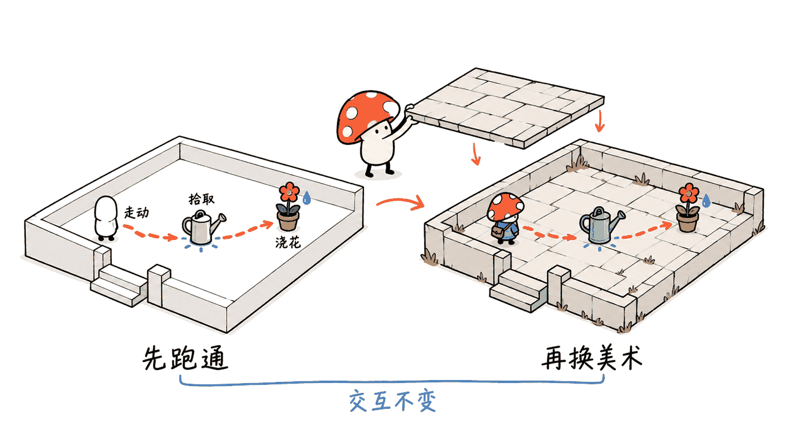
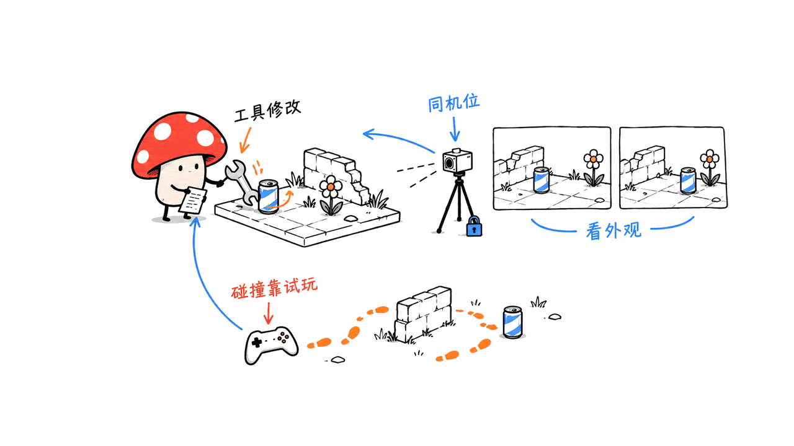
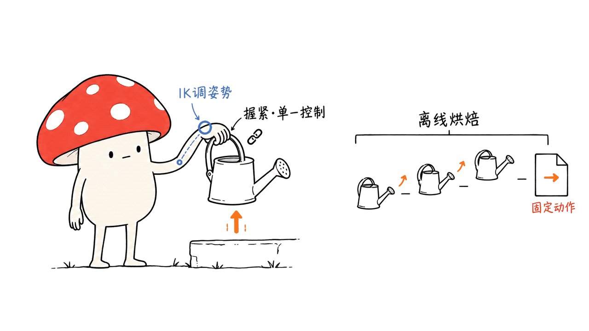

Sac 的《小王子》案例展示了一条可复用的 AI 3D 游戏制作链：先把故事缩成可玩的场景，再分别解决视觉参考、资产、骨骼、交互与发布。原始教程和在线体验已找到；截至2026年10月19日本次核查，尚未定位到可确认属于这款游戏的官方源码仓库。下文把作者做法与我们补充的工程步骤分开，目标是做出一个能走、能拿水壶、能浇花的小场景。

## 原帖、视频和开源仓库，到底找到了哪些？

| 入口 | 核查结果 |
|---|---|
| Sac 首发帖 | 发布者为 `@Saccc_c`，帖中附游戏地址和约63秒演示视频 |
| Sac 教程帖 | 指向完整 X Article，主题为 Opus 5.5／Astra、Tripo、Blender 与 Unity |
| 在线作品 | `littleprince.dev`，页面标题为“小王子：星辰之旅” |
| 官方工程仓库 | 本次未找到可确认的对应仓库；不能把同名项目或作品合集当成源码 |

首发与视频：https://x.com/Saccc_c/status/2109962425512734739

教程分享帖：https://x.com/Saccc_c/status/2110694725640474759

实际文章地址：https://x.com/i/article/2110601994578866176

在线体验：https://littleprince.dev/

X 直连抓取受限，我们通过 FxTwitter 公共代理取回作者原始文章数据；该数据记录文章创建于10月15日、修改于10月17日。可复核抓取入口：https://api.fxtwitter.com/Saccc_c/status/2110694725640474759

原文末尾说下周会在 GitHub 发布完整代码和更详细流程。这是一个计划，不是已发布证明。我们检查了原文链接、游戏首页、与作者相关的候选账号 `Sac-Y` 的8个公开仓库，并补做精确搜索，没有确认游戏工程。这个结果也不能证明作者没有在其他账号或后续时间发布。

作者称制作花了16天、累计接近300万浏览；本文没有独立核实耗时或全网流量，也不把这个案例推导成新手的工期承诺。教程含 Tripo 推广链接，模型生成与付费插件的支出需要另算，不能因“流程公开”就称整套免费。

## 先看分工：哪些是作者做法，哪些需要补齐？

作者把需求梳理交给 Fable 5.1，图像参考交给 Image 2.5，3D资产交给 Tripo，代码和场景组装由 Opus 5.5推进，Astra参与迭代。这里保留的是作者的工具标签，不代表本文核验了每个模型的具体API、订阅权限或可用版本；迁移工作流时应按能力替换，并记录实际使用的模型标识。

| 工作 | 作者方案 | 每步真正应交付的东西 |
|---|---|---|
| 产品拆分 | 语言模型写 PRD | 场景、玩家动作、完成条件及排除项 |
| 美术参考 | 图像模型，多视角 | 固定风格的一组图和尺寸／比例约束 |
| 独特道具 | Tripo H3.1 | 可导入网格、材质与资产来源记录 |
| 人物基础网格 | Tripo Smart Mesh P2.0 | 可编辑、可变形的模型，不只是漂亮渲染图 |
| 骨骼与动作 | Blender、Auto-Rig Pro、Mixamo | 骨架映射、蒙皮检查、可导出的动作 |
| 可玩体验 | Unity及编码Agent | 控制、碰撞、状态、存档与目标平台构建 |

本文新增的是验收条件、资产记录、版本核对和排错顺序。没有运行作者工程，也没有进行模型生成、绑骨、Unity打包或游戏性能测试。实际做过的检查是原文追溯、官方文档交叉核对，以及在线页面和构建入口的HTTP检查。

## 第一步：把一本书缩成一个垂直切片

先做一个小院落：玩家从椅子旁出发，走到水壶前拿起它，给花浇水，出现完成反馈。暂不做星际地图、多章节剧情、战斗、多人和复杂背包。这是本文建议的练习范围，不是原游戏的关卡规格。

给规划Agent的提示可以这样写：

```text
把“院落里照顾一朵花”拆成一个可试玩原型。
输出：玩家动作、场景物体、状态转换、失败情况、验收步骤。
先用方块与胶囊实现走动、碰撞、拾取、浇水和完成反馈。
列出不做的功能；美术替换不得改变这些交互接口。
```

验收时不用看宣传片：角色能绕场一周，靠近道具才出现提示，连续按交互键不会重复生成水壶，浇水只能在目标范围触发，重进场景时状态符合约定。先把这条循环跑通，再花钱生成精美资产。

Mycelium Protocol 的判断是，这条流程最有价值的产物是可检查的中间文件。PRD、资产清单、骨骼映射和截图记录能跟着项目迁移；只存在于对话里的“帮我做得更好”很难复现。



## 第二步：先锁定参考，再拆资产

作者建议先挑满意的主参考图，再补俯视和斜侧角度。工程上还要补一张布局草图：入口、行走区、花的位置、地面高度与镜头方向。不同视角若把门、井或道路画到不同位置，先修参考，别让建模Agent在互相矛盾的图里猜。

可以把统一约束写成一小段：暖色黄昏、柔和手绘材质、固定一套色板；院落直径以角色身高为标尺；水壶把手必须容纳手掌；人物正侧背面的围巾长度和服装接缝一致。世界单位和目标尺寸由项目自己定义，不从透视图中假装读出精确米数。

资产拆分以复用和交互为依据：地形、道路、墙体、简单椅子先由 Blender 或 Unity 基础几何搭建；独特的树、雕塑、花、带辨识度的水壶再单独生成。不要让一整个院落变成一个无法拆开的网格，否则碰撞、遮挡、替换和交互都会变麻烦。

H3.1适合优先追求几何细节的资产；官方开发文档列出了图像／多视图输入、PBR与多种拓扑选项。Smart Mesh P2.0则强调可控面数和可编辑拓扑。两条路线是选型关系，不是所有资产都必须先高模再P2.0；人物也要实际检查关节区域，不能因为输出四边形就视为蒙皮合格。

官方资料：https://developers.tripo3d.ai/en/models/v3-1

Smart Mesh：https://www.tripo3d.ai/features/smart-mesh

## 第三步：用资产清单约束生成，而不是把精度拉满

给每个资产一个稳定ID，保存参考图、原始下载、清理版本和引擎导入版本。下面是本文设计的记录模板，数值只是起步预算示例，需要按目标设备调整，不是作者测得的最优配置。

```json
{
  "id": "watering_can_01",
  "role": "interactive_prop",
  "generator": "record_actual_model_id",
  "target_height_m": 0.3,
  "max_triangles": 6000,
  "texture_edge_px": 1024,
  "pivot": "handle_grip",
  "collider": "simple_proxy",
  "source_file": "Assets/Art/Props/watering_can.fbx",
  "reference": "References/watering_can_front.png",
  "review": "pending"
}
```

这里的预算以三角面计数，四边面通常会被三角化，不能直接拿界面中的四边面数当运行时三角数。贴图还会占用内存：未经压缩且不计mipmap，一张1024×1024 RGBA贴图约4MiB，2048×2048约16MiB；实际导入格式、mipmap和运行时副本会改变占用。

在 Blender 清理时依次检查：尺寸与朝向、原点、法线、UV、材质、隐藏重复网格；为反复出现的物体准备复用实例，需要时做LOD。碰撞用简化代理先跑通，别默认用视觉高模承担所有动态碰撞。

推荐目录是 `References/`、`SourceAssets/`、`Blender/`、`Assets/Art/`、`Assets/Prefabs/`、`Assets/Scenes/`、`Assets/Scripts/` 和 `Evidence/`。原文件保留，失败时能回到清理前，而不是反复从图片重生成。

## 第四步：怎样让Agent真正操作Blender和Unity？

Blender 自带命令行与Python接口，“Blender CLI”不意味着必须安装一个名字相似的第三方包。先确定本机可执行文件和版本，用自己审阅过的脚本完成导入、布局和截图：

```bash
blender --version
blender --background --python scripts/assemble_scene.py
```

这只是调用形式，`assemble_scene.py`需要你或Agent为当前工程实现，本文没有附带一个假装能复刻原游戏的脚本。macOS若没有PATH命令，可使用安装包内实际的Blender可执行路径。脚本要明确输入目录、单位、输出 `.blend` 和预览图位置。

Unity的当前官方入口要分清：Unity CLI管理编辑器与项目；Pipeline包连接正在运行的Editor；CLI还能提供MCP。官方已弃用 `com.unity.ai.assistant` 中旧的内置MCP服务器，CLI的 `unity mcp` 没有被弃用。第三方GitHub MCP也不自动等于这套官方组件。

安装官方CLI并打开Unity 6.0或更新的兼容项目后，在项目目录按文档执行：

```bash
unity auth login
unity pipeline install
unity pipeline list
unity command
```

`pipeline list`应看到安装状态，Editor需等待包编译完成。`unity command`用于发现当前支持的命令；多个项目同时打开时，用官方文档支持的 `--project-path` 明确目标。不要把旧版命令名写死在提示词里，CLI和Pipeline仍有版本变化。

如果客户端只支持MCP，再按当前官方文档配置，例如 `unity mcp configure claude`。先完成列对象、读变换和截屏这类可观察的小操作，再尝试建场景。把编辑器版本、CLI版本、`Packages/manifest.json` 和锁文件一并保存。

Pipeline安装：https://docs.unity.com/en-us/unity-cli/unity-pipeline/unity-pipeline-package

MCP迁移说明：https://docs.unity.com/en-us/unity-cli/replace-mcp-server-unity-cli



## 第五步：组场景时，一次只改一种问题

先导入地面和角色占位，确认尺度与碰撞，再替换道具。每个可交互物体做成Prefab，把视觉网格、碰撞体、交互点和脚本分开。这样换一只水壶时，不必重写拾取逻辑。

固定三组检查视角：布局俯视图、正常玩家视角、关键交互近景。第一轮只看位置与比例；第二轮检查可走区域和遮挡；第三轮才调光照、材质和装饰。相同机位、时间和分辨率能减少“只是换角度看起来更好”的误判。

给复核Agent的任务也要具体：

```text
比较本轮与上轮的三组同机位截图。
只列可以指出位置的问题：漂浮、穿地、通道阻塞、比例和遮挡。
每条给出对象ID、证据文件、修改建议与优先级。
本轮只修改前三项；保存新场景并重拍相同机位。
截图不能证明碰撞与状态机正确，另列需要试玩的项目。
```

这是一种可选的复核分工，不是增加几个Agent就自动可靠。最终检查必须回到实际运行；一个角度里漂亮的场景，可能在背面缺面、在门口卡住，或在拾取后状态失效。

## 第六步：人物不是“四视图转3D”就结束了

作者采用T-pose四视图，再用P2.0生成角色。视图需要逐张对应前、侧、背等明确方向；不要上传一张带文字与多格拼版的整页就假设系统会正确拆开。先确认手臂张开、手指可辨、关节无遮挡，围巾与身体之间有合理间隙。

先检查白模，再做纹理。重点看肩、肘、髋、膝的拓扑与厚度，以及手指是否粘连；影响变形的问题应在绑骨前修，不要靠纹理把它遮住。T-pose是参考姿态，不能代替骨骼映射或最终引擎Avatar配置。

Auto-Rig Pro是付费Blender插件。自动绑定后必须做抬臂、弯肘、下蹲和转身，观察腋下塌陷、肩部拉扯、裙摆或围巾穿透。插件控制骨架与给引擎的变形骨架是不同层；导出时按其Unity目标设置，烘焙需要的动画，不要假设Blender里的约束会原样出现在Unity。

ARP官方导出：https://lucky3d.fr/auto-rig-pro/doc/ge_export_doc.html

## 第七步：Mixamo动作如何接到自己的骨架？

先列最小动作集：站立、走路、转向、拿起、携带、浇水。下载FBX后保存动作名称、帧率、范围和来源；源骨架与目标骨架分别命名，别一导入就覆盖已绑定人物。

在Blender中走Auto-Rig Pro Remap路径时，核对源骨、目标控制骨、根骨和参考姿态，先用走路检查脚底滑动与身体高度，再批量转动作。官方预设面向特定源／目标组合，名称相似不代表映射正确；不匹配时要改映射，不能只改文件名。

进入Unity后，若使用Humanoid，分别验证各模型的Avatar与骨骼映射。Unity的Humanoid重定向可以在有效Avatar之间复用动作，但不能把任意不兼容骨架都勾成“Copy From Other Avatar”；只有布局满足要求时才复用同一个Avatar。非人形或特定控制需求可选Generic，需另处理动画与根节点。

根运动也只保留一个控制来源：若用脚本驱动角色位移，应核对动画是否原地播放；若用root motion，则验证转弯、碰撞和停止。否则看起来像“AI动作有问题”，实际可能是脚本与动画各移动了一遍。

ARP重定向：https://lucky3d.fr/auto-rig-pro/doc/remap_doc.html

Unity重定向：https://docs.unity3d.com/6000.0/Documentation/Manual/Retargeting.html

## 第八步：提水壶为什么最容易露馅？

“人物播放拿起动画”和“手真的拿稳把手”是两个问题。可以先选接近的Mixamo动作，再按原作者思路用手臂IK调整。但还要明确定义手与物体在什么时刻建立关系。

| 阶段 | 推荐检查 |
|---|---|
| 接近 | 手到达握持点前，水壶仍在桌面，不跟着手飞 |
| 握持 | 对齐掌心与把手，记录局部偏移，检查手指和IK肘方向 |
| 提起与携带 | 同一时刻只由一个系统控制水壶；切换父级或约束时保持世界位置连续 |
| 浇水 | 手、把手和壶嘴协调，水效果在正确阶段触发 |
| 放下 | 水壶接触支撑面后才解除握持，恢复物理时检查碰撞状态 |

这是本文补充的交互契约，不是已获取的原游戏代码。离线动画可在Blender中烘焙；运行时拿取则需要Unity状态机、动画事件／时间线或运行时IK。两条实现路线要选清楚，不能只做离线姿势却宣称运行时任意道具都能自适应。

验收时逐帧查看接触前、接触瞬间、提起、倾倒、放下五个阶段。反复触发、中途离开范围、重载场景也要检查。若每一帧都在手动挪水壶，先检查父级、坐标空间和状态切换，再继续改动画。



## 第九步：从Editor能玩到浏览器能玩

先打出目标平台构建，再谈更多关卡。浏览器版至少检查HTTPS、图形后端支持、首屏下载、压缩响应头、运行内存、音频解锁和存档。不要从一段演示视频推导“所有手机流畅运行”。

我们实际读取了在线作品首页，并对页面引用的四个 `Build/` 文件做HEAD检查：`.data.br`、`.framework.js.br`、`.wasm.br` 和 `.loader.js` 均返回200，首页包含WebGPU兼容提示。这只说明入口和构建资源可访问；没有下载完整数据、启动游戏、测试控制或测量帧率。

部署自己的Unity构建时，按导出配置设置MIME与压缩响应头。若使用服务器原生Brotli解压路径，需要匹配 `Content-Encoding: br`；如果采用Unity解压回退，则按该模式部署。仅有 `.br` 后缀不能证明响应头正确，也不能据此判断别人的自定义加载器一定失败。

Unity部署资料：https://docs.unity3d.com/6000.0/Documentation/Manual/webgl-deploying.html

建议保留一份验收记录：设备、浏览器、构建版本、冷／热缓存、进入可交互画面的耗时、代表性场景帧率、内存和失败截图。这里没有给通用“合格帧率”或固定成本，因为资产复杂度与目标设备尚未确定。

## 出问题时，先查哪一层？

| 现象 | 优先检查 |
|---|---|
| 导入后人物巨大／倒地 | 单位、轴向、缩放及导出预设 |
| 走路滑脚／走得过快 | 动作速度、root motion、脚本位移是否重复 |
| Blender正常，Unity扭曲 | 导出骨架、烘焙、Avatar、权重与约束支持 |
| 水壶跳位／悬空 | 世界与局部坐标、父级切换、动画与物理同时驱动 |
| 一个角度很美，进游戏很乱 | 玩家视角、遮挡、碰撞和布局，而不只是灯光 |
| 浏览器卡在加载 | 控制台、构建文件路径、压缩／MIME和图形兼容性 |

最适合起步的目标是一份可重复打开、能完成最小交互循环的工程。等官方源码有明确链接和许可证，再把本文方法与实际工程结构逐项对照；当前不要把社区整理页包装成原仓库。

## 常见问题

### 现在可以直接克隆Sac这款游戏吗？

本次没有找到可确认的官方工程仓库。原教程公开了方法并预告后续发布代码，在线作品和宣传视频都不能替代源码与许可证。

### 必须购买作者列出的每个AI模型吗？

不必照抄品牌组合。按规划、视觉参考、资产、编码与复核分别选工具，保留输入输出和验收约束。Auto-Rig Pro及模型生成服务的费用单独核对。

### 本文是不是实测复刻成功的教程？

不是。本文是基于原始教程和官方工具文档整理的工程指南；完成了来源与在线构建入口核查，没有执行完整资产生成、绑骨、打包或游戏性能测试。

## 资料与延伸阅读

首发演示：https://x.com/Saccc_c/status/2109962425512734739

原始教程：https://x.com/i/article/2110601994578866176

Blender命令行：https://docs.blender.org/manual/en/latest/advanced/command_line/arguments.html

Tripo角色流程：https://www.tripo3d.ai/blog/mesh-game-character-p-2

Unity Avatar配置：https://docs.unity3d.com/6000.0/Documentation/Manual/ConfiguringtheAvatar.html

Adobe Mixamo FAQ：https://helpx.adobe.com/creative-cloud/faq/mixamo-faq.html

相关工具研究：https://blog.mushroom.cv/blog/scenario-blender-generation-mcp/

封面为Sac原教程场景参考图的裁剪，来源：https://pbs.twimg.com/media/HUpgX9Jb0AAZWIv.jpg 。它是概念参考，不是本次复刻或实测的游戏画面。

---

> © 2026 Author: Mycelium Protocol. 本文采用 [CC BY 4.0](https://creativecommons.org/licenses/by/4.0/deed.zh) 授权——欢迎转载和引用，须注明作者姓名及原文链接，不得去除署名后以原创发布。

<!--EN-->

Sac’s Little Prince project demonstrates a reusable AI-assisted 3D game pipeline: reduce a story to a playable scene, then solve references, assets, rigging, interaction and deployment separately. We located the original tutorial and playable-site entry. As of our October 19, 2026 check, we had not located a confirmed official repository for this specific game. This guide separates the creator’s reported workflow from our implementation advice, targeting a small scene where a player can walk, pick up a watering can and water a flower.

## Where are the original post, video and source code?

| Resource | What we verified |
|---|---|
| Launch post by Sac, @Saccc_c | Links the game and an approximately 63-second demonstration video |
| Tutorial post | Links a full X Article describing the production process |
| Online work | littleprince.dev, titled 小王子：星辰之旅 |
| Official game repository | No confirmed matching repository located in this check |

Launch and video: https://x.com/Saccc_c/status/2109962425512734739

Tutorial post: https://x.com/Saccc_c/status/2110694725640474759

Actual article: https://x.com/i/article/2110601994578866176

Game: https://littleprince.dev/

Direct X access was restricted. We retrieved the original article data through the public FxTwitter proxy, which records creation on October 15 and modification on October 17. Reproducible retrieval entry: https://api.fxtwitter.com/Saccc_c/status/2110694725640474759

The article says complete code and more detailed production material will be published on GitHub the following week. That is a plan, not evidence of release. We inspected the article, game homepage, eight public repositories under the candidate creator account Sac-Y, and exact web searches without confirming the game project. This does not establish that no repository exists elsewhere or appeared later.

Sixteen development days and nearly three million aggregate views are creator claims, not independently verified measurements. The tutorial includes a Tripo promotional link. Public instructions do not make generation services, plugins or the entire production process free.

## Understand the handoffs before choosing models

The creator assigns planning to Fable 5.1, visual references to Image 2.5, assets to Tripo, implementation to Opus 5.5, and iteration to Astra. These are labels reported in the source, not our independent verification of API identifiers, subscription access or current model availability. Substitute capabilities where necessary and record the actual versions used.

| Stage | Reported tool | Required deliverable |
|---|---|---|
| Product planning | Planning model | Scene scope, actions, completion conditions and exclusions |
| Visual design | Image model | Consistent references plus layout and scale constraints |
| Distinctive props | Tripo H3.1 | Importable meshes, materials and provenance |
| Character mesh | Smart Mesh P2.0 | Editable geometry that can deform |
| Rig and motion | Blender, Auto-Rig Pro, Mixamo | Bone mapping, skinning checks and exportable animation |
| Playable product | Unity and coding agents | Controls, collisions, state, persistence and a target build |

The following acceptance checks, asset records and troubleshooting order are our additions. We did not run the creator’s project, generate models, rig characters, build Unity output or benchmark gameplay. Our actual work covered source tracing, official documentation and HTTP inspection of the live page and build entries.

## Step 1: make a playable vertical slice

Choose one courtyard. The player starts near a chair, approaches a watering can, picks it up, waters a flower and receives completion feedback. Exclude interplanetary maps, chapters, combat, multiplayer and elaborate inventories. This is our proposed exercise, not a specification of Sac’s game.

```text
Turn “care for a flower in a courtyard” into one playable prototype.
List player actions, objects, state transitions, failures and acceptance steps.
Use cubes and a capsule first: movement, collision, pickup, watering, completion.
List excluded features. Replacing artwork must preserve interaction interfaces.
```

Accept the blockout only when the player can traverse the scene, prompts require proximity, repeated input cannot duplicate the prop, watering checks the target area, and reloading follows the agreed state rules. Validate this loop before paying for detailed assets.

Mycelium Protocol’s conclusion is that inspectable intermediate artifacts make the pipeline reusable. A PRD, asset list, bone map and evidence folder travel with the project; vague requests to improve the result do not.


## Step 2: lock references, then separate assets

The creator recommends approving a main image before generating overhead and oblique views. Add a layout sketch with an entrance, traversable space, object locations, ground height and camera direction. Resolve contradictions between reference views before asking a modeling agent to reconstruct them.

Write stable constraints: a warm sunset palette, consistent materials, scale relative to character height, a handle large enough for a hand, and matching clothing seams across character views. Define world units in the project rather than pretending a perspective illustration contains precise measurements.

Build simple terrain, paths, walls and placeholder furniture with primitives. Generate distinctive trees, sculptures, flowers and props separately. A single fused courtyard mesh is difficult to replace, collide with or interact with.

H3.1 prioritizes detailed geometry and supports image or multiview inputs with PBR and topology options. Smart Mesh P2.0 emphasizes controllable, editable topology. These are alternative routes, not mandatory consecutive stages. Quad output still requires inspection around deforming joints.

H3.1: https://developers.tripo3d.ai/en/models/v3-1

Smart Mesh: https://www.tripo3d.ai/features/smart-mesh

## Step 3: set an asset contract instead of maximizing detail

Assign stable asset IDs and retain references, raw exports, cleaned versions and engine imports. This example is our starting budget, not an optimized or measured configuration:

```json
{
  "id": "watering_can_01",
  "role": "interactive_prop",
  "generator": "record_actual_model_id",
  "target_height_m": 0.3,
  "max_triangles": 6000,
  "texture_edge_px": 1024,
  "pivot": "handle_grip",
  "collider": "simple_proxy",
  "source_file": "Assets/Art/Props/watering_can.fbx",
  "reference": "References/watering_can_front.png",
  "review": "pending"
}
```

Count runtime triangles, not just authoring quads. Before compression and excluding mipmaps, a 1024×1024 RGBA texture occupies approximately 4 MiB; 2048×2048 occupies 16 MiB. Import compression, mipmaps and runtime copies change the actual footprint.

Clean units, orientation, pivots, normals, UVs, materials and duplicated geometry in Blender. Reuse repeated assets and add LODs where necessary. Start with simple collision proxies rather than assigning every visual high-poly mesh to dynamic collision.

Suggested folders are References, SourceAssets, Blender, Assets/Art, Assets/Prefabs, Assets/Scenes, Assets/Scripts and Evidence. Preserve originals so a failed cleanup does not force another generation.

## Step 4: give agents a working tool connection

Blender includes command-line and Python interfaces; a separately named third-party “Blender CLI” package is not inherently required. Locate the executable, confirm its version and use a reviewed project script:

```bash
blender --version
blender --background --python scripts/assemble_scene.py
```

This is an invocation pattern. The assembly script must be implemented for your project; we are not supplying a script that claims to reproduce the original game. On macOS, use the actual executable inside the installed app if it is not on PATH. Specify input paths, units, output blend file and preview locations.

Unity’s current official architecture separates the standalone CLI, the Pipeline package inside a running Editor, and the CLI’s optional MCP mode. Unity has deprecated the old MCP server embedded in com.unity.ai.assistant, but not unity mcp. Third-party MCP projects are separate implementations.

After installing the official CLI and opening a compatible Unity 6.0-or-later project, follow the official setup from the project directory:

```bash
unity auth login
unity pipeline install
unity pipeline list
unity command
```

Wait for package compilation and verify the installed state. Discover commands supported by the installed version instead of hardcoding older names. For multiple open projects, specify the documented --project-path option. If the client requires MCP, configure its current CLI endpoint, for example unity mcp configure claude.

Start by listing objects, reading transforms and taking a screenshot. Then allow scene changes. Preserve Editor and CLI versions, Packages/manifest.json and the package lock file.

Setup: https://docs.unity.com/en-us/unity-cli/unity-pipeline/unity-pipeline-package

MCP migration: https://docs.unity.com/en-us/unity-cli/replace-mcp-server-unity-cli


## Step 5: assemble the scene in reviewable passes

Import the floor and player placeholder, confirm scale and collision, then replace props. Make interactive objects prefabs with separate visual geometry, collision, interaction anchors and behavior. A replacement watering-can mesh should not require rewriting pickup logic.

Fix three review cameras: overhead layout, normal player view and interaction close-up. First correct position and scale, then navigation and occlusion, then lighting and materials. Stable camera, time and resolution prevent a better angle from masquerading as a better scene.

```text
Compare this iteration with the previous one from the same three cameras.
Report observable floating, ground penetration, blocked paths, scale and occlusion.
For each: object ID, evidence file, proposed fix and priority.
Change only the top three issues; save and recapture identical views.
Separately list collision and state checks that require playing the scene.
```

An independent reviewer is an optional role, not a reliability guarantee. Screenshots alone cannot establish collision or state correctness. Always return to runtime behavior.

## Step 6: validate character deformation before texturing

The creator uses a four-view T-pose reference and P2.0 character geometry. Supply distinct, correctly oriented views rather than assuming a model will split a text-heavy contact sheet. Check separated fingers, visible joints, extended arms and clothing clearance.

Inspect the untextured mesh first: shoulders, elbows, hips and knees need useful geometry and thickness. Fix merged fingers or deformation problems before binding. A T-pose reference does not establish a valid rig or engine Avatar.

Auto-Rig Pro is a paid Blender add-on. After binding, test arm raises, elbow bends, squats and turns. Look for collapsed joints, stretched shoulders and clothing intersections. The control rig and exported deforming skeleton are different layers; use the engine export settings and bake required motion instead of assuming Blender constraints survive unchanged.

Export documentation: https://lucky3d.fr/auto-rig-pro/doc/ge_export_doc.html

## Step 7: retarget animation deliberately

Start with idle, walk, turn, pickup, carry and watering. Save FBX source names, frame rates and ranges. Keep source and destination skeletons separately named.

For Auto-Rig Pro Remap, verify source bones, target controls, root and reference poses. Test walking and foot sliding before processing every clip. Presets are designed for particular source/target combinations; similar names are not proof of a valid map.

In Unity Humanoid workflows, validate each Avatar and bone mapping. Humanoid retargeting can reuse motion between valid Avatars, but Copy From Other Avatar is not a universal conversion for incompatible skeletons. Use it only where layouts meet its requirements. Generic workflows need their own animation and root setup.

Choose one movement authority. Script-driven movement needs compatible in-place clips; root-motion movement needs tested turning, collision and stopping. Double movement often comes from scripts and animation both applying displacement.

Remap: https://lucky3d.fr/auto-rig-pro/doc/remap_doc.html

Unity retargeting: https://docs.unity3d.com/6000.0/Documentation/Manual/Retargeting.html

## Step 8: make the hand actually hold the can

Playing a pickup clip and maintaining hand/handle contact are different problems. Follow the creator’s idea of adapting a close Mixamo action with arm IK, then define exactly when object ownership changes.

| Stage | Acceptance condition |
|---|---|
| Approach | The prop remains on its support before the hand reaches it |
| Grip | Palm, handle, local offset and elbow pole align |
| Lift and carry | One system drives the prop; parenting or constraint changes preserve continuity |
| Water | Hand, handle and spout agree; the effect triggers at the intended phase |
| Release | Support contact precedes detachment; physics and collision resume coherently |

This is our proposed interaction contract, not recovered original code. Offline sequences can bake motion in Blender. Runtime pickup needs an engine state machine, animation events/timeline or runtime IK. Choose deliberately; a baked pose does not establish adaptive interaction with arbitrary props.

Inspect approach, contact, lift, tilt and release frame by frame. Test repeated input, leaving range mid-action and scene reload. If the can needs constant manual repositioning, inspect coordinate spaces, parents and transitions before editing more keyframes.


## Step 9: build and verify the actual target

Produce a target-platform build before adding more chapters. For a browser build, check HTTPS, graphics-backend support, first download, compression headers, runtime memory, audio unlock and persistence. A trailer does not establish performance on every phone.

We actually read the live homepage and issued HEAD requests to its four referenced Build files: data.br, framework.js.br, wasm.br and loader.js all returned 200. The page includes a WebGPU compatibility message. We did not download the complete game data, launch gameplay, test controls or measure frame rate.

For your build, align MIME and compression headers with the export mode. Native Brotli delivery needs Content-Encoding: br; Unity decompression fallback requires its own deployment configuration. A .br suffix alone does not prove correct headers or establish that a custom loader is broken.

Deployment: https://docs.unity3d.com/6000.0/Documentation/Manual/webgl-deploying.html

Record device, browser, build version, cold/warm cache, time to interaction, representative frame rate, memory and failure evidence. No universal frame target or fixed production cost is claimed here because scene complexity and target hardware are unspecified.

## Troubleshoot the right layer

| Symptom | First checks |
|---|---|
| Huge or sideways character | Units, axes, transforms and export preset |
| Sliding feet or excessive speed | Clip speed, root motion and duplicate movement |
| Good in Blender, distorted in Unity | Export skeleton, baking, Avatar, weights and constraints |
| Jumping or floating can | Coordinate spaces, parent switching and competing physics/animation |
| Attractive still image, poor play | Player camera, occlusion, collision and layout |
| Browser stuck loading | Console, file paths, compression/MIME and graphics support |

Aim for a reproducible project that completes one interaction loop. When the creator releases a confirmed repository and license, compare these methods with the actual project. Until then, a community collection is not the original source tree.

## FAQ

### Can I clone the original game today?

We did not locate a confirmed official repository in this check. The tutorial explains the method and promises a later code release. A playable site and trailer do not replace source files or a license.

### Must I buy every model listed by the creator?

No exact brand combination is required by this guide. Assign planning, references, assets, implementation and review to suitable tools, and preserve their contracts. Generation services and Auto-Rig Pro have separate access and cost conditions.

### Did this article reproduce the whole game?

No. This is a production guide grounded in the original tutorial and official tool documentation. We verified sources and online build entries, but did not generate assets, rig, build or benchmark the game.

## Sources and further reading

Original video: https://x.com/Saccc_c/status/2109962425512734739

Original tutorial: https://x.com/i/article/2110601994578866176

Blender CLI: https://docs.blender.org/manual/en/latest/advanced/command_line/arguments.html

Tripo character workflow: https://www.tripo3d.ai/blog/mesh-game-character-p-2

Avatar configuration: https://docs.unity3d.com/6000.0/Documentation/Manual/ConfiguringtheAvatar.html

Adobe Mixamo FAQ: https://helpx.adobe.com/creative-cloud/faq/mixamo-faq.html

Related tool research: https://blog.mushroom.cv/blog/scenario-blender-generation-mcp/

Cover: cropped from the scene-reference image in Sac’s original tutorial, https://pbs.twimg.com/media/HUpgX9Jb0AAZWIv.jpg . It is concept art, not an image of our own reconstruction or a gameplay test.

---

> © 2026 Author: Mycelium Protocol. Licensed under [CC BY 4.0](https://creativecommons.org/licenses/by/4.0/) — free to share and adapt with attribution. You must credit the author and link to the original; removing attribution and republishing as original is not permitted.
