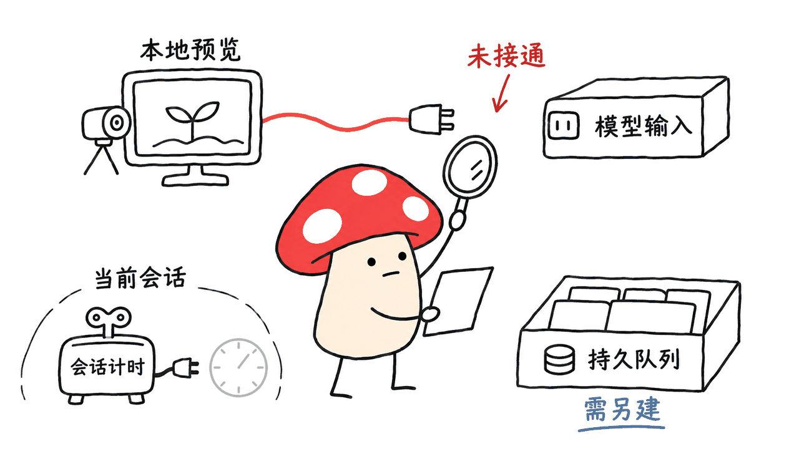

Sage-Interaction 让语音助手在等待后台结果时继续交流；真正值得关注的是交互调度，以及这套调度距离可交付产品还有多远。

上海人工智能实验室通过 InternLM 发布了这个基于 MiniCPM-o 4.5 的 9B 全模态交互模型。2026 年 11 月 23 日公开的仓库声明代码和模型权重采用 Apache-2.0；本文核对了官方仓库、模型卡和演示代码，评测分数均为作者报告，本次没有运行模型权重。

官方仓库：https://github.com/InternLM/Sage-Interaction
模型卡：https://huggingface.co/internlm/Sage-Interaction
项目页：https://internlm.github.io/Sage-Interaction/

## Sage-Interaction 如何边聊天，边委派任务？

普通语音流水线往往等一句话结束，再做识别、推理和合成。Sage 把持续交互放到前台：判断此刻该听、该说，还是把任务交出去。后台结果回来后，再送回前台上下文，由前台选择如何继续对话。

这让“帮我分析这个问题，我先问另一个问题”成为一个系统目标。前台不必为每件长任务阻塞，但它仍要处理结果是否过时、用户是否改口，以及现在说话是否合适。模型学到的交互策略与运行时的队列、音频播放控制共同决定体验。

代码使用 listen、speak、delegate 三类动作；委派载荷只接受一个 query 字段，结果附带 task_id 包装成 tool 消息。演示通过异步任务发起后台请求，默认最多保留 4 个待处理委派，断开会话时取消待处理任务。它提供了并行交互骨架，但没有因此得到持久任务交付保证。

## 这些评测数字分别说明什么？

下表来自官方 README、模型卡与评测图，采用各自定义的任务和单位，不能把它们合成一个“综合智能分”。

| 任务 | 官方报告 | 阅读边界 |
| --- | --- | --- |
| FD-Bench v1.5 | 平均 80.73；打断响应 83.00；附和后接续 96.94 | 交互行为分数，不是识别字错率 |
| FD-Bench v1 | 轮替延迟 1.29 秒；轮替 TOR 84.87 | 与 v1.5 不同版本，不能当作同一测试的质量与耗时 |
| Daily Delegation | F1 80.47；回复质量 4.13/5 | 委派识别与回复评价，不等于现实任务办成率 |
| Time Speak | F1 85.96；提醒延迟 1.019 秒 | 定时响应指标，不是整个语音系统通用首包延迟 |
| 视频与主动响应 | Charades 21.6 mIoU；ProactiveQA 42.3 PAUC | 度量含义不同，不能直接比较大小 |
| 视频问答 | OmniVideoBench 41.1；LVOmniBench 40.5 | 对应官方所列比较模型与设置 |

80.73 是官方对比表里的最高平均分，但不是每项都最高。例如“对别人说话后接续”只有 61.00，表中有其他模型更高；Time Speak 中也有闭源比较模型达到 90.61 F1、约 0.92 秒。更准确的结论是它在这组比较中具有竞争力，而非所有交互场景全面领先。

Mycelium Protocol 的判断是：这些指标把注意力从“回答对不对”扩展到了“什么时候回答”。对于会议助手、实验协作和持续陪伴，这种变化有价值；但真实验收还应覆盖误插话、错过提醒、结果延迟及任务失败，不能只挑最高的一列。

## 能本地运行吗？API 又负责什么？

官方语音 Demo 要求 Linux、支持 BF16 的 NVIDIA GPU、Python 3.12 和 CUDA 12.8，并安装指定版本 FlashAttention。加载器直接使用 cuda:0，本次所在的 Apple Silicon Mac 不属于这条官方运行路径，因此没有把代码检查写成模型实测。

本次 Hugging Face 元数据列出约 93.72 亿个 BF16 参数；按每参数 2 字节估算，单权重约 18.74GB，即约 17.46GiB。这是依据元数据的估算，不是下载后测量，也不是最低显存要求：音频组件、激活、KV Cache、临时缓冲与会话都会增加开销。不能据此承诺某张 16GB 或 24GB 卡必定跑通，也没有本次峰值显存数据。

前台权重可下载到本地。后台示例默认配置为云端 OpenAI-compatible 地址和 deepseek-v4.1-flash，地址与模型名可替换；代码没有把后端限定在某一家云服务上。符合接口的本地服务是可评估的部署方向，但不能只凭“兼容聊天接口”就宣布全离线开箱即用。

后台必须支持 /models、/chat/completions、严格 JSON Schema 输出，并处理示例中的思考参数。网关还会检查模型列表。请求需要一个有效形式的 API key；本地无认证服务是否接受占位值、特定推理框架是否完整支持这些字段，都需要集成验证。本次没有部署本地后端模型，也没有向默认云端发送请求。

更值得注意的是，普通委派路径实际发出一次结构化聊天请求，取得受长度限制的文本结果。演示没有在这里实现浏览器、支付或文件修改等通用工具执行循环。想让它真正办事，需要自己接上工具服务、授权和任务状态，不能把会回答复杂问题等同于已经执行外部操作。

## 摄像头和提醒，当前 Demo 接通到了哪里？

截至本次固定提交，网页 camera-preview.js 获取摄像头后只设置本地 video 元素。app.js 的通话采集设置为 video:false，语音推理接收循环也没有视频帧输入路径。因此“网页能打开摄像头”尚不能证明实时模型正在看画面。

这不否定官方的视频评测与模型设计，但说明复现视频交互还需要额外接线、采样和同步。做现场助手时，应先证明一帧图像从采集、传输到模型输入的完整链路，再讨论主动提醒质量。

定时器也有明确边界：演示用相对时间规则识别英文请求，再在当前进程 await asyncio.sleep，时间到直接生成 time_up 事件，不调用后台模型。默认提醒上限 840 秒、会话上限 900 秒；没有看到这条路径的持久化与重启恢复。

例如底层解析器能识别“in two minutes”，但直接传入“两分钟后提醒我”返回空。本次没有测试前台模型是否会把中文改写成解析器接受的英文，因此不能据此断言模型不懂中文提醒。它说明的是规则解析层的输入约束。

## 我们实际验证了什么？

在提交 d3bc2703e0e7f4ec357fc3c73153dd9e9332f9d3 上，直接导入上游 protocol.py，运行了 20 项自编 CPU 协议检查，全部通过。检查覆盖委派载荷、凭据边界、相对提醒解析、tool 消息回读、后端输出格式、超长回答和 token 用尽等情况。

其中本地地址检查使用内存假客户端，确认代码将请求发往给定的 loopback URL，并要求 json_schema；没有真实启动 HTTP 推理服务器。定时检查替换 sleep，验证事件和“不发 HTTP 请求”的分支，没有实际等待两秒，也没有测量提醒延迟。

这份验证能帮助复核演示的接口与失败路径，不能证明语音效果、全双工质量、视频理解能力或官方榜单。没有下载 9B 权重，没有麦克风、GPU 推理、端到端延迟和多人并发实测。测试脚本、输出与固定提交随研究记录保存，便于换到 Linux GPU 环境后继续验证。

## 做产品时，先补哪三件事？

先建立可观测的音视频时钟。分别记录输入采样、轮替决定、音频首包、用户听到输出的时间；打断后确认旧音频真正停止，而非只取消前端文字。

再把后台任务做成独立状态机。区分提交、运行、超时、取消、完成和结果已过期；重启恢复、重复执行和外部写操作确认都应在工具系统解决。会话退出时取消协程，不等于撤回已经提交的外部操作。

此外，当前演示会在会话目录保存输入、输出音频与 events.jsonl。接入真实用户前，应明确录音保留与删除策略；需要远程体验时，优先沿用官方 SSH 转发方案，再另行设计服务认证和访问控制。

最后，在目标用户真实语境中回归。先选一个窄场景，例如桌面研究问答，测试背景讲话、短促附和与突然改口，再扩展到视觉。Sage 值得研究的是把连续对话与异步结果重新接起来的方式；可用产品还要靠运行框架把这些边界补齐。

## 常见问题

### 它只能调用云端 API 吗？

不是。前台有可下载权重，后台地址可配置。官方演示默认使用云端兼容 API；本地后端要满足结构化输出等协议，本次没有完成整套本地模型部署。

### 能在 Mac 上直接跑官方 Demo 吗？

官方文档与加载器使用 Linux、NVIDIA BF16 和 CUDA 路径。本次只在 Mac 做 CPU 协议检查，不提供 MPS 或 MLX 兼容性结论。

### 1.29 秒是否等于所有回答的等待时间？

不是。它是官方 FD-Bench v1 的轮替延迟，不能替代视频处理、后台计算、网络、音频播放等组成的真实端到端耗时。

相关阅读：我们此前对全双工语音工程边界的分析，https://blog.mushroom.cv/blog/sophon-realtime-full-duplex-local-voice-guide/

---

> © 2026 Author: Mycelium Protocol. 本文采用 [CC BY 4.0](https://creativecommons.org/licenses/by/4.0/deed.zh) 授权——欢迎转载和引用，须注明作者姓名及原文链接，不得去除署名后以原创发布。

<!--EN-->

Sage-Interaction keeps a voice conversation responsive while a separate backend handles longer work. Its main contribution is interaction scheduling; delivering a dependable assistant still requires substantial runtime engineering.

Shanghai Artificial Intelligence Laboratory released this 9B model, based on MiniCPM-o 4.5, through InternLM on November 23, 2026. The official repository declares Apache-2.0 for both code and weights. We reviewed the repository, model card and demo implementation. Benchmark results below are author-reported; we did not run the model weights.

Repository: https://github.com/InternLM/Sage-Interaction
Model card: https://huggingface.co/internlm/Sage-Interaction
Project: https://internlm.github.io/Sage-Interaction/

## How does Sage keep talking while delegating work?

The frontend chooses among listening, speaking and delegating instead of blocking every interaction on a long answer. Returned backend results enter the frontend context, allowing it to continue an ongoing conversation. Runtime queues and audio playback controls matter alongside the learned interaction policy.

The demo represents actions as listen, speak and delegate. A delegation accepts exactly one query field; a returned tool message carries a task_id. Asynchronous requests can coexist with interaction, with four pending delegations allowed by default. Pending tasks are cancelled on session shutdown. This is a concurrent interaction scaffold, without a durable delivery guarantee.

## What do the benchmark numbers measure?

The official README, model card and figures report separate tasks and units. They should not be collapsed into one intelligence score.

| Benchmark | Author-reported result | Interpretation |
| --- | --- | --- |
| FD-Bench v1.5 | 80.73 average; interruption response 83.00; backchannel resumption 96.94 | Interaction behavior, not ASR error rate |
| FD-Bench v1 | 1.29-second turn-taking latency; TOR 84.87 | A different version from v1.5 |
| Daily Delegation | 80.47 F1; response quality 4.13/5 | Delegation recognition and answer evaluation, not real-world task completion |
| Time Speak | 85.96 F1; 1.019-second reminder latency | Timed response, not universal first-audio latency |
| Proactive video | Charades 21.6 mIoU; ProactiveQA 42.3 PAUC | Different metrics with different meanings |
| Video QA | OmniVideoBench 41.1; LVOmniBench 40.5 | Results within the published comparison |

Sage leads the displayed v1.5 average, but does not lead every component. Its talking-to-others resumption score is 61.00, below some competitors in the table. A closed-source comparison model also reaches 90.61 F1 and about 0.92 seconds on Time Speak. These are competitive results within a particular comparison, rather than proof of universal superiority.

Mycelium Protocol's assessment is that this evaluation usefully expands attention from answer correctness to the timing of an answer. A production acceptance suite should also include inappropriate interruptions, missed reminders, stale results and failed tasks. Reporting only the strongest metric hides these tradeoffs.

## Can Sage run locally, and what does the API do?

The supported voice demo requires Linux, a BF16-capable NVIDIA GPU, Python 3.12 and CUDA 12.8, including a specified FlashAttention version. Its loader directly selects cuda:0. Our Apple Silicon Mac is outside that documented path; protocol checks on it are not model inference tests.

Hugging Face metadata lists approximately 9.372 billion BF16 parameters. At two bytes each, weights alone are roughly 18.74GB, or 17.46GiB. This is a metadata-based estimate, without downloading the weights, and is not a minimum VRAM claim. Audio components, activations, KV cache, temporary buffers and sessions add overhead. We did not measure peak memory or establish that a particular 16GB or 24GB GPU can run the full demo.

Frontend weights are downloadable. The example delegated backend uses a cloud OpenAI-compatible URL and deepseek-v4.1-flash, but both address and model are configurable. A compatible local backend is therefore an integration option, rather than an already verified fully offline setup.

The backend must expose /models and /chat/completions, support strict JSON Schema output and handle the example thinking parameters. The gateway checks the listed model. A syntactically valid API key is required by the demo; whether a local server accepts a placeholder and all request fields needs verification. We neither deployed local backend weights nor contacted the default cloud provider.

For ordinary delegations, the implementation sends one structured chat request and receives a length-limited answer. This path does not implement a general browser, payment or file-editing tool loop. Actually carrying out work requires an executor, authorization and task-state integration. Generating an answer does not establish that an external operation happened.

## What are the camera and reminder limitations?

At the pinned revision, camera-preview.js connects a browser camera stream only to a local video element. app.js starts conversation capture with video:false, and the voice inference receive loop has no video-frame input path. A working preview does not demonstrate that the model sees those frames.

This does not invalidate the published video evaluations or model design. It means reproducing interactive video needs additional transport, sampling and synchronization. A field assistant should first prove its full capture-to-model path before measuring proactive response quality.

The reminder implementation is also bounded. It recognizes explicit relative-delay English expressions, waits in the current process with asyncio.sleep and creates a time_up event directly, without calling the backend model. Defaults allow reminders up to 840 seconds and sessions up to 900 seconds. This path does not provide persistence or restart recovery.

The parser recognizes “in two minutes” but returns no delay for a Chinese two-minute reminder fixture. We did not test whether the frontend model rewrites Chinese requests into accepted English, so this result cannot establish that the model fails Chinese reminders. It establishes the parser's input constraint.

## What did we actually test?

We imported upstream protocol.py at commit d3bc2703e0e7f4ec357fc3c73153dd9e9332f9d3 and ran 20 original CPU protocol checks, all passing. They cover delegation payloads, credentials, relative timers, tool envelopes, backend schemas, oversized answers and exhausted completion budgets.

The loopback endpoint check uses an in-memory fake HTTP client. It verifies the configured local URL and json_schema request contract, without starting an inference server. Timer checks replace sleep, exercise event construction and confirm the no-HTTP branch. They neither wait for a real deadline nor measure reminder latency.

These checks establish limited interface behavior and failure handling. We downloaded no 9B weights and performed no microphone, GPU inference, video-quality, concurrency or end-to-end latency test. Scripts, output and source revision are preserved for follow-up on a Linux GPU host.

## What should a product team build next?

First, instrument a shared audio-video clock: capture time, turn decision, first audio packet and audible playback. Verify that interruptions stop previously queued audio, not merely an on-screen transcript.

Second, give backend tasks explicit states for submission, running, timeout, cancellation, completion and stale results. Persistence, duplicate execution and confirmation of external writes belong in the executor. Cancelling a session coroutine does not reverse an external operation already submitted.

The demo also writes input/output audio and events.jsonl into each session directory. Establish recording retention and deletion rules before using real user conversations. The documented SSH forwarding path is a starting point for remote access; hosted authentication and access control need a separate design.

Third, begin with a narrow deployment such as desktop research assistance. Regress background speech, brief acknowledgments and changed instructions before adding vision. Sage offers a useful interaction architecture; a dependable product still needs a runtime that makes those boundaries explicit.

## FAQ

### Is Sage cloud-only?

No. Frontend weights are downloadable and the backend URL is configurable. The demo defaults to a cloud API. Local backends must satisfy its structured-output contract; we did not verify a complete local model deployment.

### Does the official demo run directly on a Mac?

Its documented path uses Linux, NVIDIA BF16 and CUDA. Our Mac checks exercise CPU protocol functions only and establish no MPS or MLX compatibility.

### Does 1.29 seconds describe every response?

No. It is the author's FD-Bench v1 turn-taking latency, not total video processing, delegated computation, network and audio playback time.

Related: https://blog.mushroom.cv/blog/sophon-realtime-full-duplex-local-voice-guide/

---

> © 2026 Author: Mycelium Protocol. Licensed under [CC BY 4.0](https://creativecommons.org/licenses/by/4.0/) — free to share and adapt with attribution. You must credit the author and link to the original; removing attribution and republishing as original is not permitted.
