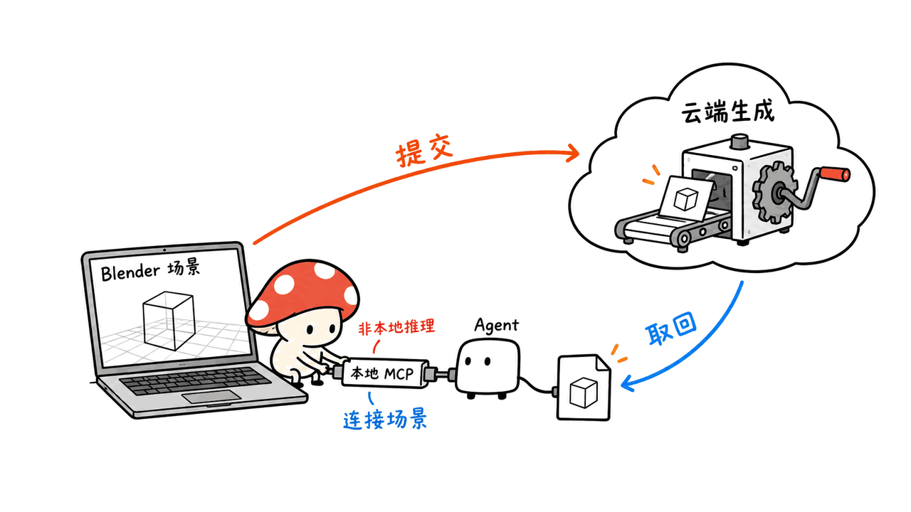
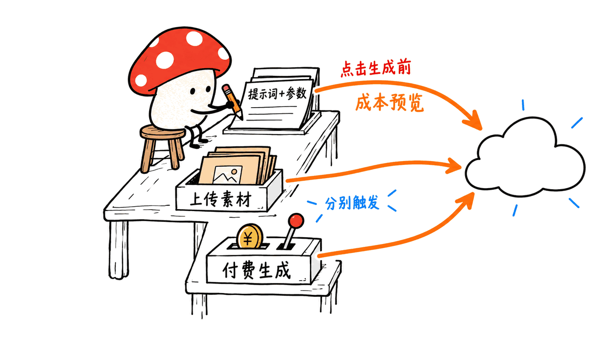
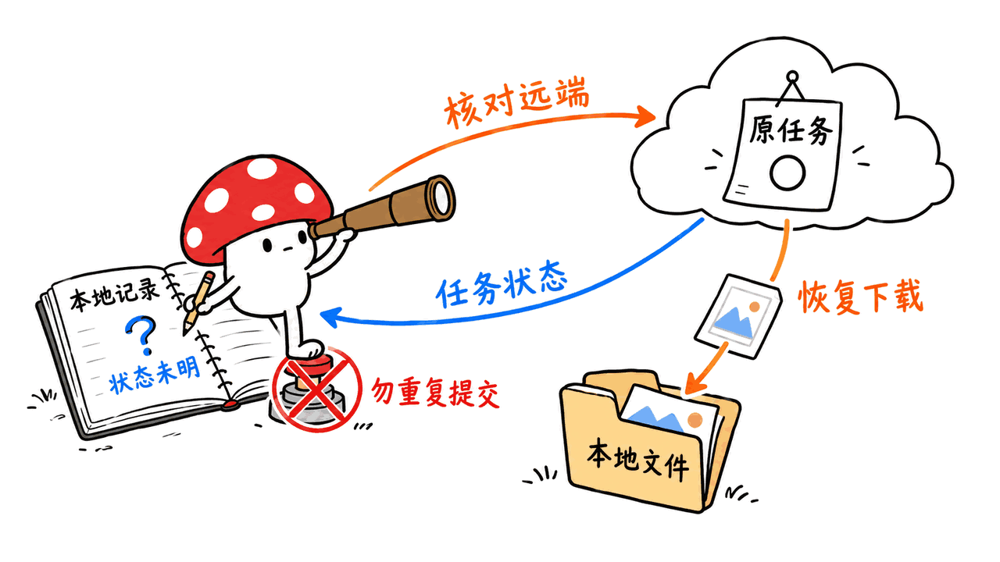

Scenario for Blender 把云端生成接进三维工作场景：在 Blender 内准备参考、发起任务，再查看或应用结果。它适合减少跨网页搬运素材的步骤，生成费用与制作验收仍需单独管理。

项目由 Scenario Inc. 开源，第一方插件代码采用 GPL-3.0-or-later。本文检查于 2026-10-17，固定提交 `ca4fcf397e2e3e88ee1899964cf14600c7499ddd`；源码 manifest 与最新正式 Release 均为 0.11.0，发布日期为 2026-10-14。

## Scenario for Blender 能做哪些工作？

| 工作入口 | 主要输入与输出 | 落地时要核对什么 |
|---|---|---|
| Image / Video | 文字、参考图或场景片段生成媒体 | 模型所需输入、结果下载与导入 |
| 3D / Materials | 生成或编辑网格，制作 PBR 纹理组 | 目标网格、材质槽、几何与贴图质量 |
| Render Image / Video | 用场景捕获和风格参考再生成 | 捕获、上传、报价及相互排斥的输入 |
| Blockout | 用场景描述建立灰盒布局 | 灰盒用于构图和空间草案，不是最终资产 |
| Environment / Audio | 全景环境，以及语音、音乐、音效 | World 应用位置、媒体与时间线匹配 |
| Studio / Film | 工作流、素材库、镜头及审阅时间线 | 各阶段审批、保存媒体与最终播放检查 |

侧边栏之外，还有浮动 composer 和展开的 Studio。多种入口共用任务会话，并不意味着每种媒体都能自动变成可用场景资产。当前文档说明，本地 MCP 的模型生成通道共用报价和下载链路，只有 Image 会自动导入结果；其他结果需按对应流程处理。



第一步建议选单张图片：先用公开或自有测试素材，把“参数准备→报价→提交→结果保存”走通。确认文件能找回，再尝试绑定材质、编辑网格或拼装镜头，比第一次就要求生成整部影片更容易判断问题在哪里。

## 如何安装，为什么需要独立扩展源？

最低要求是 Blender 5.0，联网操作需要启用 Allow Online Access。官方文档推荐在 Preferences → Get Extensions → Repositories 中添加以下地址，再安装 Scenario：

```text
https://blender.scenario.com/repo/index.json
```

随后在 Scenario 组织设置中创建 API key 与 secret，填到插件偏好设置，执行 Test connection，并选择生成文件的 Output Folder。源码声明四类桌面平台，但 manifest 声明不能代替每个系统版本的运行验证。

也可从 GitHub Releases 下载 `scenario-0.11.0.zip`，保持压缩包形式，用 Install from Disk 安装。最新发布提供 ZIP、HTML 手册与 SHA256SUMS，可按官方说明校验；旧历史版本不一定具备同样的校验和来源证明。

扩展源安装可通过 Blender 管理更新；ZIP 安装不会自己更新。切换安装方式前，应先备份需要的任务记录和媒体，再按上游迁移说明操作。卸载 ZIP 副本会清除其存储，可能影响已引用媒体的时间线。不要同时保留两份副本。

## 插件开源，为什么生成还要额度？

GPL 许可允许按其条款使用、修改和分发插件代码；它不把远端模型计算、账号或素材使用权变成免费服务。实际生成和部分提示词助手消耗 Creative Units，价格由模型、参数和参考输入决定。

更容易忽略的一点是：报价也是联网请求。官方隐私文档写明，在凭证和联网条件就绪时，编辑表单期间的成本预览就会发送提示词及可用参数，早于点击 Generate。参考文件、场景截图和导出的网格则有单独上传步骤。



因此，这套工具的合理描述是“本地场景编辑＋云端生成服务”。如果需求是项目内容始终不离开设备，需要另找本地推理方案，不能因为 Blender 和 MCP 服务都在本机，就推断生成计算也在本机。

## 本地 MCP 能让 Agent 控制到什么程度？

默认端点为 `http://127.0.0.1:9876/mcp`，以插件显示的实际地址为准；默认端口被占用时会尝试后续端口。文档提供多种编程 Agent 客户端的接入方式，使用 bearer token 认证。

这个服务连接的是当前打开的 Blender 场景。托管的 `mcp.scenario.com` 则负责平台范围的素材集、训练、工作流和用量等操作，两者的认证和能力分别配置。需要操作场景时用本地入口，不应把两个服务的工具混为一谈。

连接后的 Agent 可以读取场景并申请使用账号额度。任意 Python 执行是另一个默认关闭的显式选项；开启它意味着扩大可执行操作范围。保存的 API 凭证位于 Blender 偏好设置，而非系统钥匙串，复制的 MCP 客户端配置和 token 也应按凭证保管。

实际集成可以分为两段：先完成只读场景检查，确认 Agent 读到了预期对象；再对一个明确目标，审核准确报价与操作内容后提交。不要用一个宽泛的“随便帮我优化”覆盖上传、生成和场景改动三种不同决定。

## 断线后为什么不能直接再点一次？

0.11.0 的更新中，包括拒绝重复提交尚未确认的付费请求、保留音频 WAV 原文件和 MCP 请求处理修复。它们解决的是制作流水线中很实际的问题：请求超时不代表服务端没有收到，重新提交可能变成第二笔任务。

本地持久记录只表明保存过什么，不能自动证明远端任务此刻的状态。先检查 Jobs 与明确的恢复操作；对不确定提交先核对，而不是通过再点 Generate 猜测。恢复下载也不等于自动允许把旧结果应用到当前场景。



团队还应把三类文件分开管理：`.blend` 场景、生成原始媒体、任务与报价记录。上线验收不能只看漂亮预览，还应检查导出媒体能否独立播放、贴图路径是否完整、场景重开后引用是否有效，以及当前目标是否仍然是原先审批的对象。

## 我们实际验证了什么？

我们在 Apple Silicon Mac 上检查源码、manifest、发布信息和使用文档，并在独立 Python 3.12.14 环境运行三个上游测试文件：`test_mcp_protocol.py`、`test_mcp_rejection.py`、`test_film_export_policy.py`，共 100 项通过。

另外，我们下载官方扩展源的 18,894,810 字节 ZIP，核对 SHA256 与源清单一致，并通过 ZIP CRC 完整性检查；没有安装或执行这个包。

这些测试包含协议行为、对异常请求的拒绝及导出路径约束，其中本地网络测试使用回环地址和模拟处理器。上游要求的 uv 0.9.26 在当前包源未能解析，因此这不是锁定开发环境的完整复现，也不是全套测试通过。

我们没有安装插件到 Blender、登录 Scenario、上传项目或执行付费生成，没有评估生成质量、响应速度、节省额度或跨系统兼容性。官方将项目标为 Experimental，文档也区分了实现、模拟验证和实际服务验收，使用时应保留这个边界。

Mycelium Protocol 的判断是：这类插件的工程价值，在于把场景上下文、报价、任务状态和媒体应用串起来。是否值得接入，应该看你的制作流程能否少搬运、少丢结果、少误投目标，而不只看它列出了多少生成模型。

## 常见问题

### 它能完全离线使用吗？

生成依赖 Scenario 云端服务、账号及联网权限。本地 MCP 负责 Agent 与场景的连接，不是本地模型引擎。

### 开源就意味着生成免费吗？

不是。插件代码许可、模型调用额度及生成素材权利是不同问题；提交前按实际参数检查 CU 报价和服务条款。

### 100 项通过说明 Blender 已跑通吗？

不说明。它们是选定的离线协议和路径测试，未覆盖 Blender 原生交互、实际服务生成与最终素材质量。

## 一手资料与关联阅读

源码：https://github.com/scenario-labs/blender-plugin

正式版本：https://github.com/scenario-labs/blender-plugin/releases/tag/blender-plugin-v0.11.0

使用指南：https://github.com/scenario-labs/blender-plugin/blob/main/docs/USER_GUIDE.md

MCP 接口：https://github.com/scenario-labs/blender-plugin/blob/main/docs/MCP.md

数据处理：https://github.com/scenario-labs/blender-plugin/blob/main/docs/PRIVACY.md

已知限制：https://github.com/scenario-labs/blender-plugin/blob/main/docs/KNOWN_LIMITATIONS.md

相关 Agent 操作框架：https://blog.mushroom.cv/blog/opengcua-generalist-computer-use-stack/

封面和正文插图均为原创概念图，不是本次实机或生成服务的运行证据。

---

> © 2026 Author: Mycelium Protocol. 本文采用 [CC BY 4.0](https://creativecommons.org/licenses/by/4.0/deed.zh) 授权——欢迎转载和引用，须注明作者姓名及原文链接，不得去除署名后以原创发布。

<!--EN-->

Scenario for Blender brings cloud generation into a working 3D scene: prepare references, submit a task, then inspect or apply its output without moving everything through separate browser sessions. Service costs and production acceptance remain separate responsibilities.

Scenario Inc. publishes the first-party extension under GPL-3.0-or-later. We inspected commit `ca4fcf397e2e3e88ee1899964cf14600c7499ddd` on October 17, 2026. Both the manifest and latest stable release identify version 0.11.0, released October 14.

## What workflows does Scenario for Blender cover?

| Entry point | Workflow | Acceptance boundary |
|---|---|---|
| Image / Video | Generate from text, references or scene clips | Inputs, saved results and import behavior |
| 3D / Materials | Create or edit meshes and PBR texture sets | Target object, material slot and output quality |
| Render Image / Video | Transform scene captures using look references | Capture, upload, quote and input compatibility |
| Blockout | Create a greybox from a scene description | Spatial draft, rather than finished production assets |
| Environment / Audio | Panoramas, speech, music and effects | World application and timeline integration |
| Studio / Film | Workflows, library assets, shots and reviews | Separate approvals, saved media and playback review |

A sidebar, floating composer and expanded Studio expose these workflows. Shared job infrastructure does not establish identical application behavior across every lane. The current limitations document says MCP generation lanes share quotes and downloads, but only Image automatically imports results.


For a first trial, use one image and public or owned test material. Verify parameter preparation, pricing, submission and file recovery before applying materials, editing meshes or attempting a complete film. A smaller acceptance loop makes failures easier to diagnose.

## How do you install and update it?

The declared minimum is Blender 5.0. Enable Allow Online Access and add this official extension repository through Preferences → Get Extensions → Repositories:

```text
https://blender.scenario.com/repo/index.json
```

Install Scenario, create an API key and secret through your organization settings, enter the pair in the extension preferences, test the connection and choose an Output Folder. The manifest lists four desktop platform targets; those declarations are not our runtime compatibility measurements.

Alternatively, install the zipped `scenario-0.11.0.zip` from GitHub Releases using Install from Disk. The latest release includes the ZIP, HTML handbook and SHA256SUMS; follow the upstream checksum and attestation instructions. Historical releases may lack that evidence.

Repository installations can use Blender's update manager; ZIP installations do not update themselves. Back up required records and media before switching methods. Uninstalling a ZIP copy deletes its extension storage and may break timeline references to that media. Follow the migration guide and avoid keeping both copies installed.

## Why does an open-source extension still consume credits?

The GPL governs the extension code. It does not provide free remote compute, accounts or unrestricted rights to generated assets. Generation and some prompt helpers consume Creative Units, with estimates depending on model, parameters and references.

Pricing previews themselves contact the service. The privacy guide states that, when credentials and online access are enabled, editing a visible form can send prompts and parameters for a quote before Generate is pressed. Reference files, captures and exported meshes have separate upload actions.


The practical architecture is local scene editing with cloud generation. A local Blender application and a local MCP endpoint do not imply that model inference stays on the device. Teams requiring entirely local processing need a different inference arrangement.

## What can the local MCP connection do?

The default endpoint is `http://127.0.0.1:9876/mcp`; copy the actual address shown by the extension because occupied ports trigger alternatives. Clients authenticate with a bearer token.

The local service connects an agent to the open scene. The separately hosted `mcp.scenario.com` handles platform-wide collections, training, workflows and usage, with its own authentication and capabilities. Configure each according to the task instead of treating their tool sets as interchangeable.

An authorized local agent can inspect the scene and request paid work using the selected account. Arbitrary Python execution is a separate opt-in permission, disabled by default. Saved API credentials reside in Blender preferences rather than an operating-system keychain; copied client configurations and tokens also contain secrets.

Start with read-only inspection to confirm the agent sees the intended objects. For a subsequent generation task, approve a concrete target, exact quote and requested change. Uploading references, spending credits and modifying a scene are distinct decisions even when one agent performs all three.

## Why should an uncertain request not be submitted again?

Version 0.11.0 includes refusal of duplicate unconfirmed paid requests, preservation of original WAV audio and MCP request-handling fixes. A lost connection does not establish that the service rejected a task. Repeating the request can create another job.

A durable local record describes saved knowledge, not necessarily the current remote state. Inspect Jobs and use explicit recovery before submitting again. Download recovery also does not automatically authorize applying an old result to a different scene or target.


Manage the blend file, original generated media and job/quote records separately. Production acceptance should check independent media playback, complete texture paths, references after reopening the scene and whether the selected target still matches the approved operation. An attractive preview alone does not cover these conditions.

## What did we verify locally?

We inspected source, manifest, release metadata and documentation. On an Apple Silicon Mac, 100 tests passed from three upstream files: `test_mcp_protocol.py`, `test_mcp_rejection.py` and `test_film_export_policy.py`.

We also downloaded the official repository ZIP (18,894,810 bytes), matched its SHA256 against the repository index and checked ZIP CRC integrity. We did not install or execute the archive.

The checks cover protocol behavior, rejected requests and export-path rules, using loopback networking and mocked handlers where applicable. The required uv 0.9.26 could not be resolved from the available package registry, so we used an existing isolated Python 3.12.14 environment. This is not a reproduction of the full locked development environment or the complete suite.

We did not install the extension in Blender, authenticate to Scenario, upload a project or run paid generation. We measured no generation quality, latency, credit savings or cross-platform behavior. The project's Experimental label and documented separation of implementation, synthetic checks and live acceptance remain relevant.

Our independent conclusion is that the useful integration work concerns scene context, pricing, job state and controlled media application. Evaluate whether these connections reduce copying, lost results and incorrect targets in your pipeline, rather than counting the available models.

## FAQ

### Is generation fully offline?

No. Generation uses Scenario's service, account and network access. Local MCP is a scene connection, not a local inference engine.

### Does open source mean free generation?

No. Code licensing, service credits and output rights require separate consideration. Check the exact quote and applicable service terms.

### Do 100 passing tests prove Blender operation?

No. These selected offline checks do not establish native Blender interaction, live generation or asset quality.

## Primary sources and related reading

Source: https://github.com/scenario-labs/blender-plugin

Stable release: https://github.com/scenario-labs/blender-plugin/releases/tag/blender-plugin-v0.11.0

User guide: https://github.com/scenario-labs/blender-plugin/blob/main/docs/USER_GUIDE.md

Local MCP: https://github.com/scenario-labs/blender-plugin/blob/main/docs/MCP.md

Privacy: https://github.com/scenario-labs/blender-plugin/blob/main/docs/PRIVACY.md

Known limitations: https://github.com/scenario-labs/blender-plugin/blob/main/docs/KNOWN_LIMITATIONS.md

Related agent framework: https://blog.mushroom.cv/blog/opengcua-generalist-computer-use-stack/

The cover and body figures are original conceptual illustrations, not evidence of a Blender or live-service run.

---

> © 2026 Author: Mycelium Protocol. Licensed under [CC BY 4.0](https://creativecommons.org/licenses/by/4.0/) — free to share and adapt with attribution. You must credit the author and link to the original; removing attribution and republishing as original is not permitted.
