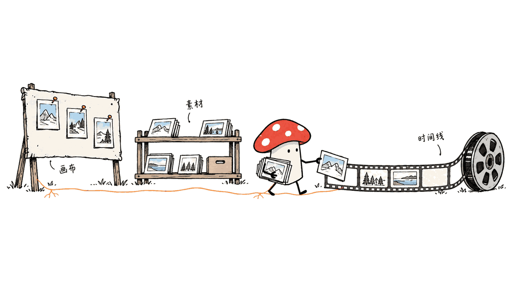
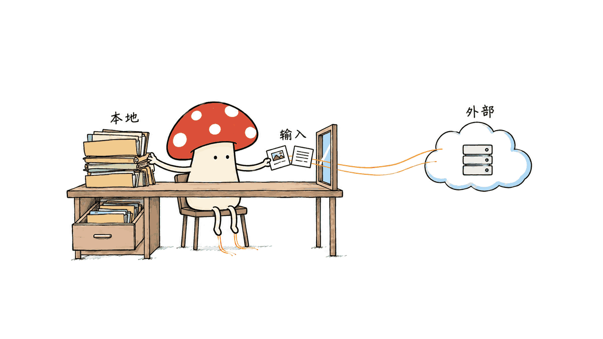

Seal 是把素材创作、视频剪辑和 AI 助手放进同一界面的本地视频工作台，主要解决素材和操作散落在多个工具里的问题。

项目由 wenlei-xu 维护，仓库代码采用 MIT 许可证。本文按 2026 年 10 月 13 日的一手资料核对：已有 v1.7.8 Windows amd64 完整发行包；macOS 完整剪辑与 ASR 运行包尚未完成发行验收。我们复跑了两组宿主逻辑测试，未实测桌面创作和成片效果。

官方仓库：https://github.com/wenlei-xu/Seal

## Seal 怎样把想法接到成片？

做视频常常先在聊天窗口写方案，再到生图、生视频工具生成素材，最后下载文件、重新命名、导入剪辑软件。每一次切换都要重新交代上下文：这一张图属于哪个镜头，刚才选中的片段要如何修改？

Seal 的设计把职责分成三处：画布负责参考图、文字、图片和视频的探索与组织；资产库集中保存素材；独立剪辑工程用时间线安排片段、音频和出场顺序。画布里的基础编辑与独立剪辑工程分开，资产库连接两者，导出的视频也可以回存资产库。



| 环节 | 官方描述的能力 | 读者应确认的边界 |
| --- | --- | --- |
| 画布 | 节点、连线、参考素材、生成与修改 | 生成质量依赖所选模型和渠道 |
| 资产库 | 集中管理素材、供剪辑工程导入 | 本地项目与资源需要一起备份 |
| 时间线 | 导入、调整、切割、预览和导出 | 本次没有实测实际导出或音画同步 |
| 创作助手 | 读取工程、调用工具、显示进度与记录 | 理解需求和工具执行都需要实际验收 |
| Skill Hub | 导入、查看、启停与热加载技能 | 技能包含方法，也可能包含本地执行能力 |
| 模型配置 | 分别配置文字、图片、视频、语音与 ASR | 各渠道的支持范围和费用分别核对 |

这条链路的价值在于工程上下文可以连续传递。对一段已有视频说“切成两个镜头”，和在空白聊天窗口要求模型写剪辑建议，前者需要能找到真实片段并把修改留在工程里。Seal 正在做这种连接，是否稳定则需要真实项目验证。

## 创作助手和 Skill Hub 各自负责什么？

官方说明，助手可以读取工程、编辑片段、制作动效候选、检查场景和提交导出任务，工具状态实时展示，对话和任务记录可继续查看。付费素材生成先确认方案，再调用配置的渠道。这些属于项目说明，本次没有验证付费调用的完整确认流程。

技能承担可重复的方法：广告分镜、口播剪辑、视频分析、动效制作等。Skill Hub 支持本地导入和热加载，新的技能在后续回合生效；通过 `/` 或技能按钮可以指定本轮方法。仓库包含 HyperFrames、Video Use 和 Skill Creator 等入口。

我们查看的 HyperFrames 入口把动效工作拆为候选、检查、截图、加入时间线和导出几个步骤。文档明确要求查看截图，检查器变绿不代表画面符合要求；版本冲突也不应悄悄覆盖人工修改。这是值得保留的产品判断：创作者需要检查具体镜头，流程通过只是其中一个条件。

技能执行也有边界：该入口说明本地脚本使用当前系统用户权限，工作目录不是操作系统沙箱。导入技能前应阅读其实际文件和脚本，不能把“放在 Skill Hub 里”理解成权限隔离。

## 本地优先，哪些内容仍会出网？

官方说明项目、素材、模型配置和用户技能存放在本机，Windows 默认工作区为 `%AppData%\Seal`，兼容旧工作区时实际路径可能不同。桌面架构使用 React / TypeScript、Wails / Go；本地 Go API 监听 loopback，数据使用本地数据库和资源文件。

但文字、图片、视频、语音和 ASR 可以分别接外部供应商。调用外部模型时，会按服务需要发送相关输入，费用由供应商计收。官方提供本地 Whisper Base 转写，也不能据此推断生图、生视频和全部助手功能都能离线运行。



备份应先保存工程并退出应用，再完整复制工作区，包括数据库、素材和配置。密钥也存在本地配置里，不应随备份或问题报告公开。这是按文档提出的使用建议，本文没有做网络流量审计或密钥存储安全审计。

## 现在应该下载哪个包？Mac 能直接用吗？

我们查询官方 Releases，确认 v1.7.8 于 2026 年 10 月 11 日公开，完整包名为 `Seal-v1.7.8-windows-amd64.zip`，资产标注大小为 **651,043,409 字节，约 651 MB**。这是发行接口返回的体积，本次没有下载并检验该 ZIP。

下载页另有 `runtime-v1`，其中媒体运行端约 370 MB，它是构建依赖，不能当作应用安装包。完整发行包解压后保留整个目录，启动 `Seal.exe`；旁边的宿主、CLI、插件和许可证文件都是运行所需内容。

仓库有 macOS 源码构建说明，但快速开始明确写出：macOS 完整剪辑和 ASR 运行包尚未完成发行验收，也不要把原项目的 Mac 包当作 Seal 版本。原项目的运行记录同样不能自动转成当前 Seal 的验收结论。

下载与版本记录：https://github.com/wenlei-xu/Seal/releases

快速开始：https://github.com/wenlei-xu/Seal/blob/main/QUICKSTART.md

## 我们实际验证到了哪一层？

Mycelium Protocol 拉取源码并固定在提交 `643b6367a37a3c6d16fb54fd92378aadbe4303ec`，使用本机 Bun 复跑了上游两份测试：

```bash
bun test agent-host/selected-skill.test.mjs agent-host/request-budget.test.mjs
```

结果为 **12 项通过、0 项失败、204 次断言**。技能选择测试验证显式指定的技能读取完整冻结内容、记录实际版本，对不可用技能拒绝处理；请求预算测试验证单轮上限、轮次之间的隔离、工具步骤计数和显式总预算。

这些都是局部逻辑与源码接线测试。它们没有启动 Wails 桌面，没有调用模型、生成付费素材、操作真实视频或渲染导出，也没有验证整个 pi 会话和 Skill Hub 热加载。因此不能把这一结果写成“Seal 全功能通过”或“自动成片已经稳定”。


技术上，Seal 的桌面外壳、创作助手和媒体运行端分别使用不同组件；文档写明助手接官方 pi SDK，剪辑复用 HyperFrames Studio。把这些组件装进完整工作流，是工程集成问题，不能仅凭一个聊天演示或一份测试结果判断成熟度。

## 现在最值得提哪些建议？

作者欢迎提建议。我们认为，反馈最好围绕能复现的工程，而不是笼统要求“更智能”。

1. 用一份短素材测试修改是否留在正确片段上，手动编辑后再让助手修改，检查是否覆盖了人的调整。
2. 对生成和导出失败，检查是否显示准确原因、是否保留已完成素材、重新打开后能否继续工作。
3. 对导入技能，确认本轮用了哪个版本、启停何时生效、涉及本地脚本时能否看清执行内容。
4. 对备份与迁移，检查数据库、媒体和配置是否一同恢复，缺失资源有没有明确提示。

这些是建议的验收场景，本次并未实测其结果。提交 Issues 时附上版本、系统、最小素材、操作步骤和预期结果，移除密钥及私人素材，才更容易帮助项目持续打磨。

Seal 适合先做小规模流程验证：先确认完整包和运行环境，再用短素材检查生成、剪辑、保存、重开和导出。如果关心单一动效环节，也可阅读本站关于 OneTake 的来源与运行边界分析：https://blog.mushroom.cv/blog/onetake-envmanage-source-check/

## 常见问题

### Seal 是一个视频模型吗？

Seal 是工作台。文字、图片、视频、语音和 ASR 按用途配置模型渠道，它本身不会替代这些模型，也不保证不同渠道输出同等质量。

### 开源意味着生成视频免费吗？

仓库代码采用 MIT 许可证；第三方组件、素材、技能和运行端分别遵循自己的许可。外部模型调用仍可能产生供应商费用，本地运行也需要计算资源。

### 可以完全离线使用吗？

本地项目和素材存储、本地 Whisper Base 转写有离线基础；外部模型生成需要网络。本文没有验证全部离线流程，不给出全面离线可用的结论。

### 能否把这次测试当作剪辑效果测评？

不能。12 项测试针对技能选择和请求预算，未验证生成质量、剪辑体验、渲染稳定性或导出性能。

## 一手来源与核对范围

- README 与源码：https://github.com/wenlei-xu/Seal/tree/643b6367a37a3c6d16fb54fd92378aadbe4303ec
- 发行记录：https://github.com/wenlei-xu/Seal/releases/tag/v1.7.8
- 桌面开发：https://github.com/wenlei-xu/Seal/blob/643b6367a37a3c6d16fb54fd92378aadbe4303ec/docs/desktop-local-development.md
- HyperFrames 技能入口：https://github.com/wenlei-xu/Seal/blob/643b6367a37a3c6d16fb54fd92378aadbe4303ec/agent-host/skills/hyperframes/SKILL.md
- 来源与第三方许可：https://github.com/wenlei-xu/Seal/blob/main/NOTICE

---

> © 2026 Author: Mycelium Protocol. 本文采用 [CC BY 4.0](https://creativecommons.org/licenses/by/4.0/deed.zh) 授权——欢迎转载和引用，须注明作者姓名及原文链接，不得去除署名后以原创发布。

<!--EN-->

Seal is a local video workspace that puts asset creation, timeline editing and an AI assistant in one interface, reducing the handoffs between separate creative tools.

Maintained by wenlei-xu, the repository uses the MIT license. Our October 13, 2026 source check found a complete v1.7.8 Windows amd64 release. Full macOS editing and ASR distribution has not completed release acceptance. We ran two focused host test files; we did not evaluate the desktop workflow or finished videos.

Official repository: https://github.com/wenlei-xu/Seal

## How does Seal connect an idea to an edited video?

A typical AI video workflow moves from chat to image generation, video generation and an editor. Every handoff requires finding files and explaining which reference belongs to which shot.

Seal assigns distinct roles to a canvas, an asset library and an editing project. The canvas organizes references, text, images and videos. The library holds assets. An independent timeline project arranges clips, sound and timing. Basic canvas editing remains separate from the full editing workspace; the library connects them, and exports can return to it.


| Stage | Documented capability | What still needs verification |
| --- | --- | --- |
| Canvas | Nodes, connections, references and generation | Output quality depends on the chosen provider |
| Library | Local asset storage and imports into editing projects | Backup and recovery must include the assets |
| Timeline | Import, arrange, cut, preview and export | We did not test rendering or audio/video sync |
| Assistant | Read projects, call tools, show progress and history | Real project edits need acceptance tests |
| Skill Hub | Import, inspect, enable, disable and hot reload skills | Skills can carry local execution privileges |
| Model settings | Separate text, image, video, voice and ASR channels | Compatibility and pricing vary by provider |

The potential benefit is continuity of project context. Asking an assistant to split an existing clip requires locating the actual clip and retaining the change in the project. Seal is building that connection; reliability must be tested with real footage.

## What do the assistant and skills each contribute?

The README describes an assistant that reads projects, edits clips, proposes motion scenes, checks scenes and submits exports. It shows tool progress and retains conversations and task records. Paid asset generation is documented as requiring a confirmed plan before provider calls. We did not test that entire approval flow.

Skills package repeatable methods such as storyboarding, talking-head editing, video analysis and motion design. The hub supports local imports and hot reload; new skills take effect in subsequent turns. Users can choose a method through `/` or the skill button. HyperFrames, Video Use and Skill Creator are included.

The HyperFrames entry separates scene candidates, checks, snapshots, timeline insertion and export. It explicitly states that a green checker does not prove the requested appearance and that revision conflicts must not silently overwrite manual edits. That is a useful product principle: creators need to inspect the actual shot as well as the process status.

The same entry says local scripts run with the current operating-system user's access. A project directory is a working location, not an OS sandbox. A skill appearing in the hub should therefore not be treated as proof of permission isolation.

## Which parts are local, and which call external services?

The documented local workspace stores projects, assets, model configuration and user skills. Its Windows default is `%AppData%\Seal`, with compatibility behavior for older workspaces. React and TypeScript run inside Wails; a Go API listens on loopback, backed by local data and resources.

Text, image, video, voice and ASR channels may use external providers. Those calls send the relevant input required by the service, and providers charge their own fees. Local Whisper Base transcription does not make every generation or assistant feature offline.


The documented backup procedure is to save work, exit the application and copy the entire workspace, including the database, assets and configuration. Local credentials should not be exposed in backups or issue reports. We did not audit network traffic or credential storage security.

## Which package should you download? Is there a Mac release?

The GitHub Releases API lists v1.7.8, published on October 11, 2026, with `Seal-v1.7.8-windows-amd64.zip` at **651,043,409 bytes, approximately 651 MB**. That is the listed asset size; we did not download and inspect the ZIP.

The separate `runtime-v1` media package is roughly 370 MB and is a build dependency, not the application. Keep the full extracted application directory and launch `Seal.exe`; the adjacent hosts, CLI, plugins and license files are required.

There are macOS source-build instructions, but QUICKSTART explicitly says the full editing and ASR runtime package has not completed macOS release acceptance. Neither an upstream Mac installer nor its testing history should be presented as a validated Seal release.

Releases: https://github.com/wenlei-xu/Seal/releases

Quick start: https://github.com/wenlei-xu/Seal/blob/main/QUICKSTART.md

## What did our local tests actually establish?

Mycelium Protocol pinned the source to commit `643b6367a37a3c6d16fb54fd92378aadbe4303ec` and ran:

```bash
bun test agent-host/selected-skill.test.mjs agent-host/request-budget.test.mjs
```

The result was **12 passes, zero failures and 204 expectations**. The selection test checks that an explicitly chosen skill loads its complete frozen content, records its actual version and rejects unavailable selections. Budget tests cover per-turn limits, isolation between turns, tool-step accounting and explicit lifetime limits.

These are narrow logic and source-wiring tests. They did not launch Wails, call providers, generate paid assets, edit real footage or render exports. They also do not validate the complete pi session and Skill Hub reload integration. The result is not an all-features pass or a video-quality benchmark.


The documented architecture combines React/TypeScript and Wails/Go with the official pi SDK for the assistant and HyperFrames Studio for editing. Integrating these components into a dependable creative workflow requires evidence beyond a chat demonstration or an isolated test suite.

## What feedback would help Seal improve?

Useful feedback should describe a reproducible project and observable behavior:

1. Check that an assistant edit targets the right clip and preserves a preceding manual adjustment.
2. For failed generation or export, check the error message, retained assets and recovery after reopening.
3. For imported skills, inspect the selected version, activation timing and any local script execution.
4. Test whether restoring a workspace restores its database, media and settings together, and clearly reports missing resources.

These are proposed acceptance scenarios, not outcomes we measured. An issue with the version, system, minimal non-sensitive footage, steps and expected result is more actionable than a broad request for a smarter assistant.

Start with a short project and inspect generation, editing, save/reopen and export. For a narrower motion-design tool, see our source and runtime analysis of OneTake: https://blog.mushroom.cv/blog/onetake-envmanage-source-check/

## FAQ

### Is Seal a video-generation model?

It is a workspace. Different channels supply text, images, video, speech and ASR. Seal does not replace those models or guarantee equivalent output quality across providers.

### Does open source mean free generation?

Repository code uses MIT; third-party components, assets, skills and runtimes keep their own licenses. External providers can still charge fees, and local execution requires compute.

### Can every feature run offline?

Local storage and Whisper Base transcription provide an offline foundation. External model generation needs network access. We did not validate a complete offline workflow.

### Are these tests an editing-quality review?

No. The 12 tests cover skill selection and request budgets, not output quality, editing usability, rendering reliability or export performance.

## Primary sources and verification scope

- Pinned source and README: https://github.com/wenlei-xu/Seal/tree/643b6367a37a3c6d16fb54fd92378aadbe4303ec
- Release: https://github.com/wenlei-xu/Seal/releases/tag/v1.7.8
- Desktop development: https://github.com/wenlei-xu/Seal/blob/643b6367a37a3c6d16fb54fd92378aadbe4303ec/docs/desktop-local-development.md
- HyperFrames entry: https://github.com/wenlei-xu/Seal/blob/643b6367a37a3c6d16fb54fd92378aadbe4303ec/agent-host/skills/hyperframes/SKILL.md
- Attribution and third-party scope: https://github.com/wenlei-xu/Seal/blob/main/NOTICE

---

> © 2026 Author: Mycelium Protocol. Licensed under [CC BY 4.0](https://creativecommons.org/licenses/by/4.0/) — free to share and adapt with attribution. You must credit the author and link to the original; removing attribution and republishing as original is not permitted.
