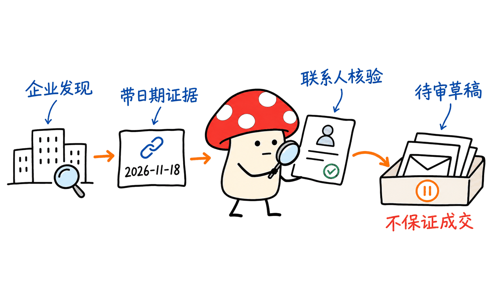
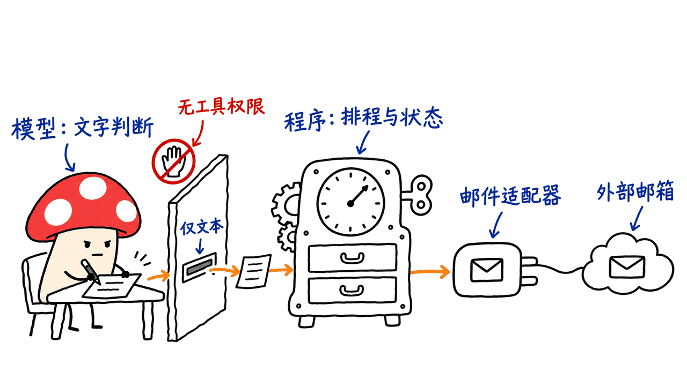
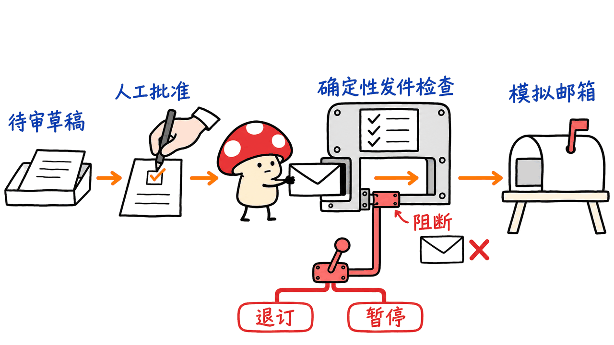

Sellbird 把找客户、查线索、写邮件和处理回复串成一条可审批的销售外联流水线。它的价值不只是“让AI代写”，而是把线索证据、发件条件和人工接管放进同一套可追踪流程。

官方仓库：https://github.com/ethanplusai/sellbird

本文核对版本为0.4.0，提交为 `964a3a73ba51eef22a621715b0aabfea8d788db7`。项目原名 Harvey，与法律科技公司 Harvey AI 不是同一个产品；当前代码采用 AGPL-3.0-only，0.3.x及更早版本的MIT通知保留在NOTICE中，不能据此把当前版写成MIT。

## 它适合解决什么问题？

一个小型团队可能已经有产品和邮箱，却缺少稳定的线索处理流程：企业名单散在表格里，联系人的来源不明，邮件中的“个性化观察”无法核实，客户回复后又忘了停止后续邮件。

Sellbird 尝试把这些步骤集中到本机。企业发现可以使用默认的 OpenStreetMap 来源，也可以选择付费搜索服务；随后读取企业网站、收集已确认的信号、寻找决策者、核验邮箱，再生成邮件序列。只需要线索名单时，也可以停在核验之后，导出 CSV，不必启用发信。

它支持 Gmail、Microsoft 365 和 SMTP 等发送路径。接入邮箱、验证服务或搜索服务，仍需要各自的配置与账户，不能把“开源”理解为所有数据源都免费可用。



## 技术上，它怎样把任务串起来？

主体是 Python 3.11+ 应用，包含 FastAPI 本地控制台、SQLite 状态库、采集器、发件适配层和模型运行时。前端是直接服务的 HTML、CSS、JavaScript，不需要单独的前端构建；这不意味着整个销售流程无需网络。

核心是定时 heartbeat。默认约每15分钟醒来一次，根据状态、预算和安静时段安排工作。任务优先级主要由代码决定：处理回复、发送序列、生成新稿、继续找线索。模型负责起草和回复判断等任务，邮件和采集操作由程序执行，不把整台电脑随意交给模型操纵。

| 层 | 主要职责 | 工程上的意义 |
| --- | --- | --- |
| 采集与信号 | 发现企业，读取官网，保存观察 | 提取证据，不只保存一个分数 |
| 状态与排程 | 维护联系人、对话、发件箱和预算 | 让中断、重试、暂停有明确状态 |
| 模型运行时 | 选择Claude或Codex，加载销售提示与技能 | 把语言判断与执行权限分开 |
| 发件控制 | 审批、内容检查、退订与限额 | 在真正发出之前再次检查 |
| 本地控制台 | 审阅证据、修改草稿、批准或拒绝 | 人工接管是流程的一部分 |

值得借鉴的是观察数据的设计。`observations` 用一行记录一条事实，同时保存信号类别、来源URL、时间和置信度，而不是把企业压成几个随时覆盖的字段。同一条信号以后可以重新观察，形成历史。数据库记录得再详细，也不能证明采集结论正确，证据仍需要被审阅。

## 为什么不能直接说“订阅内免费、随便跑”？

README强调调用已有Claude或ChatGPT订阅对应的CLI，而不是每次使用单独的模型API密钥。这是项目的接入路径，不是无限额度或零成本承诺。模型套餐有自身限制，邮箱、域名、预热、核验及付费搜索也可能收费；托管版还应单独看当时的报价。

项目默认选择Claude，使用Codex需要显式配置。本文所核对版本的Codex路径只接受CLI **0.159.3**，要求macOS或Linux，文档还明确不支持在其现成Docker镜像中使用Codex；不是“装最新版就一定能跑”。这是Sellbird该提交的兼容性要求，不是建议修改你已有的编码环境。

模型调用有隔离设计：临时工作目录、禁用模型工具、检查运行时配置等。遇到无法确认的配置会停止调用；配置了哪一家，就不会偷偷切到另一家。这些是减少权限和状态污染的工程措施，不能据此宣称提示注入风险已经消失。



## 默认审批与自动模式，差在哪里？

默认情况下，首封邮件、跟进和回复都进入 Outbox，等待人批准。待审界面同时给出企业信息、邮箱核验结果及草稿依据。程序还会在发出之前检查收件人与联系人记录是否一致、地址状态、未展开的模板字段、内容格式和长度等。

它也提供 Autopilot，可以在设置中明确开启，或把 `channels.email.require_approval` 设为 `false`。因此“默认先审批”不等于“永远不会自动发送”。自动模式下，陌生域名链接、非授权号码、索款内容、泄露指令等仍可能使邮件被标为 Held，等待人工处理；批准一封被拦住的邮件，意味着人工仍能放行它。

发送窗口、日限额、退订、退信和暂停开关继续参与控制。跟进与首次外联的时段规则和即时回复并不完全相同，不能简单承诺所有邮件都会在同一种窗口里发送。Legacy Instantly 适配还存在独立发送边界：已经在那里运行的活动，需要在那里暂停。



## 本地实际验证了哪些部分？

在隔离克隆与独立Python3.12虚拟环境中安装了0.4.0，选取6个测试文件运行，共483项通过、无失败。范围包括原生发件队列、Outbox审阅、禁止联系名单、发送窗口、并发领取与控制台鉴权。邮件路径使用 `FakeProvider`，状态数据写入临时SQLite，控制台测试使用测试客户端及本地测试服务；模型入口由测试替身隔离。`sellbird --help` 也已执行成功。

尤其检查了取消、收件人回复与领取发送任务之间的竞争条件，以及卡在sending状态的邮件如何被标记失败而不是盲目再次发送。它们是测试夹具上的结果，不构成真实邮件服务“恰好一次投递”的证明。没有运行完整测试库、真实Claude/Codex调用、网页采集、邮箱OAuth、邮件投递或完整销售活动。

这些测试可以帮助判断队列与拦截逻辑是否按预期工作，不能证明真实邮件一定送达收件箱、网站线索全部准确，或销售转化率提高。本文没有联系真实潜在客户，没有配置真实邮箱，也没有消耗模型订阅去自动写外联。

## 工程师应该借鉴什么？

第一，把“看到了什么”与“决定做什么”分开。官网没发现预约按钮，可能只是脚本加载、分页或语言问题；它不是“这家公司没有在线预约”的可靠结论。文章或邮件中若使用这种判断，应能追到具体证据并接受人工纠正。

第二，把发送建模为状态转换，而不是一次LLM工具调用。草稿、批准、暂缓、已发送、退订和发送结果不明，应该有各自的处理路径。重试前先核对服务端结果，避免把网络超时直接理解为“没有发出”。这是部署审查要点，不是本文对所有邮件服务提供过恰好一次交付的保证。

第三，先用合成联系人和模拟邮箱走通“批准前不发、退订后不跟、暂停后不继续、失败不丢状态”，再接真实服务。评估顺序应是证据质量、可控性、交付可靠性，最后才是节省多少起草时间。

第四，自托管要分清数据存放与数据流向。状态库在本机，但提示仍会提交给选定模型服务，网站访问、邮箱和核验也会产生外部请求。不要把“本地控制台”写成“所有数据离线”。

## 如何开始，而不急着接入真实外联？

先准备独立目录和Python虚拟环境，阅读配置样例与审批文档，再决定使用哪条模型和邮箱路径：

```bash
git clone https://github.com/ethanplusai/sellbird.git
cd sellbird
python3.12 -m venv .venv
source .venv/bin/activate
pip install -e .
sellbird --help
```

这里用Python3.12举例，项目要求是3.11或更新。完整部署涉及账户配置、产品训练、信号确认、邮箱连接与发送控制，不能把上面几条安装命令当成生产验收。本次研究没有替用户执行setup、train、discover或run。

0.4.0的AGPL许可也是部署决策的一部分。对修改后的网络服务，应阅读许可证中的对应源码提供要求；商业使用与免除许可证义务不是同一件事。托管Sellbird与自托管版在运行方式和能力上也有差别，不把官网早期接入页当成当前开源版功能清单。

## FAQ

### 它是Harvey法律AI吗？

不是。这里是ethanplusai维护的销售外联项目，Harvey是它的旧名称。

### 不开电脑也能继续发送吗？

自托管进程必须运行。可以按自己的部署方式常驻，但托管服务的持续运行承诺不能直接套到一台已经关机的本机。

### 默认人工审批是否足以保证每封内容都准确？

不能。审批只是控制环节，事实核验与人工判断仍然需要完成，自动模式还会改变批准路径。

## 一手资料

仓库：https://github.com/ethanplusai/sellbird

流程与架构：https://github.com/ethanplusai/sellbird/blob/main/docs/how-it-works.md

审批与发送：https://github.com/ethanplusai/sellbird/blob/main/docs/approval-and-sending.md

数据与控制台：https://github.com/ethanplusai/sellbird/blob/main/docs/dashboard.md

Codex兼容要求：https://github.com/ethanplusai/sellbird/blob/main/docs/codex.md

许可证：https://github.com/ethanplusai/sellbird/blob/main/LICENSE

---

> © 2026 Author: Mycelium Protocol. 本文采用 [CC BY 4.0](https://creativecommons.org/licenses/by/4.0/deed.zh) 授权——欢迎转载和引用，须注明作者姓名及原文链接，不得去除署名后以原创发布。

<!--EN-->

Sellbird turns prospect discovery, evidence gathering, email drafting, sending, and reply handling into a reviewable sales workflow. Its useful engineering idea is to connect evidence, sending conditions, and human handoff rather than merely generate persuasive text.

Official repository: https://github.com/ethanplusai/sellbird

This review examines version0.4.0 at commit `964a3a73ba51eef22a621715b0aabfea8d788db7`. Formerly named Harvey, it is unrelated to the legal-AI product Harvey AI. The current package is AGPL-3.0-only; the retained MIT notice covers releases through0.3.x, not an MIT license for the current release.

## What problem does it address?

A small business may have a product and an inbox but no reliable outreach process. Company lists live in spreadsheets, contact sources are unclear, personalized claims cannot be checked, and follow-ups continue after someone replies.

Sellbird combines company discovery, confirmed buying signals, contact enrichment, address verification, drafting, and reply handling. OpenStreetMap is a default discovery source; paid search is optional. You can stop after verification and export a CSV without enabling sending.

Gmail, Microsoft365, and SMTP are supported paths. Mailboxes, verification providers, and paid search still need their own configuration and accounts. Open source does not make every external data source free.


## How is the system organized?

The Python3.11+ application combines a FastAPI dashboard, SQLite state, collectors, mail adapters, and model runtimes. Its HTML/CSS/JavaScript frontend needs no separate build. That does not make the entire workflow offline.

A heartbeat wakes roughly every15minutes by default and schedules work according to state, budget, and quiet hours. Code determines the principal priority: replies, campaign sending, drafting, then prospecting. Models supply language and intent judgments; program adapters perform collection and mail operations.

| Layer | Responsibility | Engineering benefit |
| --- | --- | --- |
| Collection and signals | Find companies, inspect websites, save observations | Preserve evidence rather than only a score |
| State and scheduling | Track contacts, conversations, queues and budgets | Make interruption, retry and pause explicit |
| Model runtime | Select Claude or Codex and load sales instructions | Separate language judgment from execution privileges |
| Sending controls | Approval, checks, limits, opt-outs and bounce handling | Check conditions again at the action boundary |
| Dashboard | Review evidence, edit drafts and approve or reject | Make human takeover part of the workflow |

The `observations` table records each fact separately with signal type, source URL, observation time, and confidence. Repeated observations can form history rather than overwrite a few company fields. Good provenance makes review possible; it does not prove the observation is true.

## Does subscription access make it free or unlimited?

The project uses the selected subscription-backed CLI rather than a separate model API key. This describes its integration, not unlimited usage or zero total cost. Subscription limits remain, and domains, mailboxes, warmup, verification, or search may add costs. Hosted-service pricing is separate.

Claude is the default. Codex is opt-in, and the reviewed commit accepts CLI version **0.159.3** exactly on macOS or Linux. Its documentation excludes Codex from the existing Docker image. Installing the latest CLI is therefore not a guaranteed setup path. This is the project's compatibility requirement, not a recommendation to alter an existing coding environment.

The model runtime uses temporary workspaces, disabled model tools, and configuration checks. Unverifiable settings stop a call, and the configured provider does not silently fall back to another. These reduce ambient privileges and configuration contamination; they do not eliminate prompt injection.


## What changes when autopilot is enabled?

By default, first emails, follow-ups, and replies wait in the Outbox for approval. The review pane provides company information, address status, and supporting observations. A deterministic pre-send gate checks recipient identity, address status, unresolved template fields, formatting, length, and other conditions.

Autopilot can be explicitly enabled in settings or with `channels.email.require_approval: false`. Default approval does not mean the application can never send automatically. Suspicious domains, unapproved phone numbers, payment requests, and leaked instructions may still hold a message for review. A human can approve a held message, so these checks do not replace judgment.

Sending windows, daily caps, opt-outs, bounces, and the pause switch still apply. Cold outreach and replies do not share identical time-window rules. Legacy Instantly campaigns also have a separate control boundary: an already running campaign must be paused there.


## What was verified locally?

I installed0.4.0 in an isolated clone and separate Python3.12 environment. Six selected test files passed all483 tests, with no failures. They cover the native outbox, review desk, do-not-contact rules, sending windows, concurrent claims, and dashboard authentication. Email uses `FakeProvider`, state uses temporary SQLite databases, and dashboard checks use test clients and a local test server. Model entry points are isolated by test doubles. `sellbird --help` also succeeded.

The selected tests include races involving cancellation, replies, and sending claims, plus handling of messages stuck in a sending state without blindly resending them. Fixture results are not proof of exactly-once delivery by a real mail provider. I did not run the full repository suite, live Claude/Codex calls, website collection, mailbox OAuth, actual delivery, or an end-to-end sales campaign.

These checks test queue and control behavior. They do not demonstrate inbox placement, accurate research on every website, or improved sales conversion. No real prospects were contacted, no live mailbox was configured, and no model subscription was consumed to produce outreach.

## What should engineers borrow?

Separate observations from conclusions. Failing to detect a booking button may reflect JavaScript loading, another page, or a language mismatch. Preserve the source and permit corrections before turning that absence into a sales claim.

Treat sending as a state transition rather than a single model tool call. Draft, approved, held, sent, opted-out, and uncertain outcomes need distinct handling. Before retrying a timeout, reconcile with the provider instead of assuming nothing happened. This is a deployment review point, not a claim that every adapter provides exactly-once delivery.

Start with synthetic contacts and a fake mailbox. Verify that unapproved messages stay queued, opt-outs stop follow-ups, pauses stop further actions, and failures retain usable state. Evaluate evidence quality and controllability before time saved on drafting.

Separate storage location from data flow. SQLite is local, while selected prompts reach a model service and website, email, and verification operations make external requests. A local dashboard is not an offline system.

## How can you begin without live outreach?

Use a separate directory and environment, then read configuration and approval documentation before connecting providers:

```bash
git clone https://github.com/ethanplusai/sellbird.git
cd sellbird
python3.12 -m venv .venv
source .venv/bin/activate
pip install -e .
sellbird --help
```

Python3.12 is an example; the minimum is3.11. Complete deployment still requires accounts, product training, signal confirmation, mail connection, and sending controls. Installation is not production acceptance. This research did not run setup, train, discover, or the operational heartbeat for the user.

AGPL obligations also matter. Read the corresponding-source requirements when operating a modified network service. Commercial use does not remove license obligations. Hosted Sellbird has different operation and capabilities; its early-access page is not a feature guarantee for the self-hosted release.

## FAQ

### Is this the legal-AI company Harvey?

No. This is ethanplusai's sales outreach project; Harvey was its former name.

### Will a local installation send while its computer is off?

No. The self-hosted process must be running. You may design an always-on deployment, but a hosted-service promise does not apply to a powered-off computer.

### Does manual approval guarantee accurate messages?

No. Evidence and content still need review, and autopilot changes the approval path.

## Primary sources

Repository: https://github.com/ethanplusai/sellbird

Architecture: https://github.com/ethanplusai/sellbird/blob/main/docs/how-it-works.md

Approval and sending: https://github.com/ethanplusai/sellbird/blob/main/docs/approval-and-sending.md

Dashboard and data: https://github.com/ethanplusai/sellbird/blob/main/docs/dashboard.md

Codex compatibility: https://github.com/ethanplusai/sellbird/blob/main/docs/codex.md

License: https://github.com/ethanplusai/sellbird/blob/main/LICENSE

---

> © 2026 Author: Mycelium Protocol. Licensed under [CC BY 4.0](https://creativecommons.org/licenses/by/4.0/) — free to share and adapt with attribution. You must credit the author and link to the original; removing attribution and republishing as original is not permitted.
