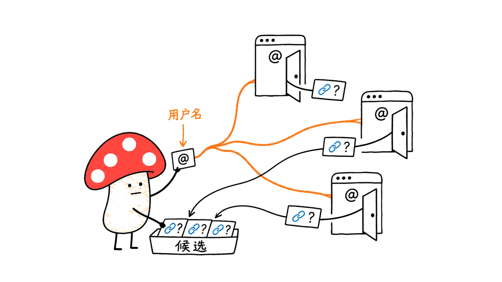

Sherlock 能把一个用户名变成跨网站的账号候选清单，省去逐站拼接链接的工作；真正需要人判断的，是页面是否有效，以及同名账号是否属于同一个人。

官方项目是 `sherlock-project/sherlock`，采用 MIT 许可。2026 年 11 月 11 日核对时，仓库页面显示约 10.98 万 stars，README 宣称覆盖 400 多个社交网络。这是关注度与规则覆盖范围，不是准确率承诺。素材里的“今日 +2,393、让出头名”缺少对应日期、时区和榜单快照，本文不把它当作已验证排名。

## Sherlock 到底在搜索什么？

它以 Python CLI 为入口：读取站点清单，把用户名填入各站的 URL 模板，再并发发送 HTTP 请求，根据站点配置给出结果。它不需要大模型，也没有在后台给不同账号做可靠的身份归并。

例如你在两个网站都用了 `my_public_handle`，它可能找到两个公开主页。换一个用户名，它通常不会凭头像自动知道那也是你；另一个陌生人恰好注册同名账号，也可能进入候选清单。

因此，适合它的任务是整理自己遗忘的公开账号、检查品牌用户名的公开占用线索、做经授权的公开资料研究。需要确认身份时，仍要看主页内容、个人主动提供的跨站链接等独立证据。



## 为什么状态码和错误文案会决定结果？

本次源码核对固定在研究记录中的 Git commit，包配置版本为 0.16.2。核心函数使用 `requests` 与 `requests-futures`，线程池上限为 20。这只是实现中的并发上限，并不意味着必然快 20 倍：网络延迟、站点限流和超时才决定实际等待时间。

站点清单描述主页模板、可选探测地址、请求方法、用户名正则、错误标记等。主要判断路径如下：

| 规则 | 检查方式 | 容易失效的地方 |
|---|---|---|
| `status_code` | 默认通常发 HEAD，根据 HTTP 状态判断 | 不存在页返回 200；403 或 429 并不说明账号不存在 |
| `message` | 读取正文，寻找配置的“不存在”文案 | 网站改版、语言变化、登录页替代正文 |
| `response_url` | 禁止自动跟随跳转，以初始响应状态判断 | 跳转可能来自登录或地区限制，而非账号不存在 |

代码还会识别若干已知 WAF 页面指纹，输出 WAF 状态；连接错误等可进入 Unknown。识别名单无法覆盖所有网站的新拦截页面，所以结果解释必须保留不确定性。

默认会获取线上站点数据，并使用排除列表避开已知误报来源。安装版本和站点规则是两个更新维度；二进制没升级，不代表规则没有变化。`--local` 选择本地站点清单，也不代表整个查询离线，更不保证其他辅助请求全部消失。

## 我们实际验证了哪些情况？

Mycelium Protocol 为本次文章搭建了一个只监听 `127.0.0.1` 的 HTTP 服务，让未经修改的 Sherlock 核心函数查询合成页面。测试使用虚构用户名 `demo`，没有枚举真实社交账号，也没有测量真实网站准确率或吞吐量。

九个断言全部通过，包含以下结果：

| 合成响应或规则 | Sherlock 输出 | 应如何理解 |
|---|---|---|
| 状态码规则收到 200 / 404 | Claimed / Available | 基础分支按配置工作 |
| 正文含配置的不存在文案 | Available | 能处理这类软错误页 |
| 登录页返回 200，且不含不存在文案 | Claimed | 产生候选误报，并未找到真实主页 |
| 重定向规则收到 302 | Available | 不跟随跳转；不能据此排除登录限制 |
| 正文匹配内置 WAF 指纹 | WAF | 可以识别这个已知拦截特征 |
| 普通 403 / 429，走状态码规则 | Available | 可能把拒绝访问或限流当成未发现 |
| 用户名不符合站点正则 | Illegal | 直接跳过站点请求 |

最有价值的是两个反例：登录页可能被算作“找到”，限流可能被算作“没有”。这不是对所有站点的统一结论，而是说明配置和响应语义不一致时，单一状态标签会掩盖问题。


## 如何安装并做一次可复核的查询？

官方推荐路径之一是用 pipx 隔离安装，包名是 `sherlock-project`：

```bash
pipx install sherlock-project
sherlock --version
sherlock --help
```

先选自己公开使用的用户名和少数站点，避免一上来查询全部目标。下面的用户名是占位符，执行前自行替换：

```bash
mkdir -p sherlock-results
sherlock my_public_handle \
  --site GitHub --site GitLab \
  --timeout 15 --csv \
  --folderoutput sherlock-results
```

站点名字必须与当前站点清单一致。`--timeout 15` 是请求超时参数，不是整个任务保证 15 秒结束。多个用户名可以作为位置参数传入；CSV、XLSX 和文本输出用于后续整理，具体行为以安装版本的帮助为准。

官方 README 同时提供 Docker 路径：

```bash
docker run -it --rm sherlock/sherlock --help
```

如果需要保存容器内导出文件，应另外按官方文档配置目录挂载；上面这条只查看帮助。官方还提示部分第三方发行版包存在问题，出现异常时先比较安装来源与版本，不要只凭一个发行版包判断项目是否可用。

## 已经装过，还需要做什么？

继续使用的前提是核对工具是否仍完成你的任务。记录运行日期、CLI 版本、使用的站点规则来源、超时和导出文件；规则可变时，仅保存命令还不足以重现结果。需要稳定复现，可归档当时的规则 JSON，并查看 `--json` 的具体用法。

对输出逐条复核：主页能否打开、是不是登录或错误页、个人公开的链接是否互相印证。把“候选链接”和“已确认关联”分开保存。对异常站点，保留响应上下文并检查上游 issues，别直接扩大搜索范围来弥补错误规则。

若交给 Agent 跑，可以把 CLI 包装成有限定站点、超时与结构化导出的工具；让模型总结候选，不让它把同名自动改写成“同一人”。Sherlock 提供检索线索，身份判断仍需要额外证据。


## 常见问题

### 找到同名主页，是否说明是同一人？

不能。用户名可以被不同的人分别注册，命中也可能是错误页。应结合当事人公开提供的跨站链接和其他独立信息复核。

### 没找到，是否说明账号不存在？

不能。网络错误、站点限制、规则过期都可能影响结果。本次本地测试就观察到普通 429 在状态码规则下输出 Available。

### 热榜下降，是否意味着工具不值得用了？

榜单衡量一段时间的关注，不等于功能退化。对已安装用户，更有用的指标是目标站点的规则是否有效、误报是否可控、安装版本是否仍受支持。

一手资料与复核范围：官方仓库 https://github.com/sherlock-project/sherlock ；安装文档 https://sherlockproject.xyz/installation ；使用文档 https://sherlockproject.xyz/usage 。本次只完成源码检查和九个本地 HTTP 场景验证，未进行全站扫描、真人身份识别或性能基准测试。

---

> © 2026 Author: Mycelium Protocol. 本文采用 [CC BY 4.0](https://creativecommons.org/licenses/by/4.0/deed.zh) 授权——欢迎转载和引用，须注明作者姓名及原文链接，不得去除署名后以原创发布。

<!--EN-->

Sherlock turns a username into a list of possible accounts across websites. It saves repetitive URL checks; interpreting a page and establishing whether two accounts belong to one person still require separate evidence.

The official MIT-licensed project is `sherlock-project/sherlock`. On November 11, 2026, its repository page displayed approximately 109.8K stars, while the README advertised more than 400 networks. Neither figure measures accuracy. We could not verify the supplied daily gain or ranking without a dated leaderboard snapshot.

## What does Sherlock actually search?

The Python CLI reads site definitions, interpolates a username into URL templates, and issues concurrent HTTP requests. It checks responses using site-specific rules. It does not require an LLM or reliably merge identities across accounts.

Useful tasks include inventorying your own public handles, checking public brand-name occupancy clues, and authorized research. A matching handle is a candidate, even when the profile is valid: unrelated people can independently register the same name.


## How do response rules determine the answer?

The inspected source reports package version 0.16.2. Its core uses requests and requests-futures, with a maximum of 20 workers. That is a concurrency limit, not a measured speedup or a promise about total runtime.

| Rule | Mechanism | Failure mode |
|---|---|---|
| status_code | Usually HEAD by default; classify response status | A soft error can return 200; denial or throttling can resemble absence |
| message | Check the body for configured missing-user text | Changed wording, localization, or login pages |
| response_url | Disable redirects and inspect initial status | Login restrictions can redirect independently of account existence |

Known WAF fingerprints receive a separate status. Connection failures can remain Unknown. A finite fingerprint list cannot recognize every access restriction.

By default the application fetches live site definitions and uses an exclusion list for known false-positive sources. Code version and rule version are separate moving parts. The local flag selects local site definitions; it does not turn website checks into offline work or guarantee the absence of auxiliary network requests.

## What did our local verification establish?

Mycelium Protocol ran the unmodified core against synthetic responses from a loopback HTTP server. The fictional username was demo. We did not enumerate real accounts, estimate field accuracy, or benchmark throughput.

All nine assertions passed. Status-rule 200 and 404 responses became Claimed and Available respectively. A configured missing-user message became Available. An initial 302 under the redirect rule became Available. A known WAF marker became WAF, and an invalid username became Illegal without a site request.

Two cases expose the limits: a generic 200 login page without the configured missing-user text became Claimed, while ordinary 403 and 429 responses under a status-code rule became Available. These are controlled counterexamples, not universal claims about every configured site. They show why output labels need response context.


## How should you install and start?

One officially documented isolated installation method is:

```bash
pipx install sherlock-project
sherlock --version
sherlock --help
```

Start with your own public handle and a small set of sites. Replace the placeholder before running:

```bash
mkdir -p sherlock-results
sherlock my_public_handle \
  --site GitHub --site GitLab \
  --timeout 15 --csv \
  --folderoutput sherlock-results
```

Site names must match the active manifest. The timeout controls requests, not a guaranteed total duration. Multiple usernames are positional arguments; consult the installed help for CSV, XLSX, and text export behavior.

The official README also provides Docker:

```bash
docker run -it --rm sherlock/sherlock --help
```

Configure a volume mount separately when retaining container-generated files. This command only shows help. The README warns about some third-party distribution packages; compare installation source and version before treating package breakage as failure of the project itself.

## What should existing users review?

Record the date, CLI version, rule source, parameters, and exported output. When reproducibility matters, archive the rule JSON and inspect the JSON-file option. The same command can produce different answers after a remote manifest changes.

Inspect candidate URLs for login pages, errors, and independently verifiable public cross-links. Keep candidates separate from confirmed associations. Investigate broken site rules instead of broadening the search to compensate for them.

An agent can invoke a wrapper with selected sites, bounded request timeouts, and structured exports. Its summary should preserve uncertainty instead of silently converting a shared username into a confirmed identity.


## FAQ

### Does a matching handle prove a shared identity?

No. Names can be reused by unrelated people, and a detected page can be a false positive. Seek independent, publicly provided account links and corroborating evidence.

### Does Available prove an account does not exist?

No. Restrictions, stale rules, and response semantics can affect classification. Our synthetic 429 case demonstrated one such failure mode.

### Does a lower trending position make Sherlock obsolete?

No ranking alone establishes that. For an installed tool, valid site rules, manageable false positives, and supported packaging are more practical criteria.

Sources: https://github.com/sherlock-project/sherlock ; https://sherlockproject.xyz/installation ; https://sherlockproject.xyz/usage . Our verification covered source inspection and nine loopback HTTP fixtures, with no full-network sweep, real-person identification, or performance benchmark.

---

> © 2026 Author: Mycelium Protocol. Licensed under [CC BY 4.0](https://creativecommons.org/licenses/by/4.0/) — free to share and adapt with attribution. You must credit the author and link to the original; removing attribution and republishing as original is not permitted.
