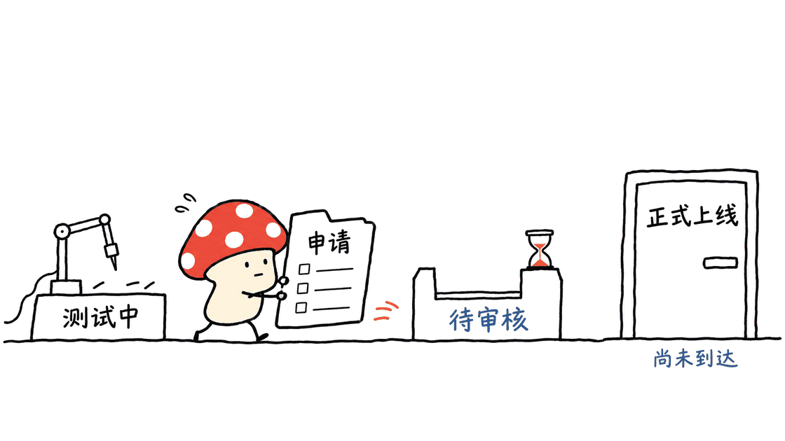

ShipMyGame 是一套帮助 AI Agent 准备和推进 Unity 游戏上架的开源技能。它把工程检查、打包、商店材料、后台操作和等待进度串起来，最有价值的是记录具体渠道里的操作经验，而非保证游戏自动获批。

官方仓库为 `BaronCyrus/ShipMyGame`，采用 MIT 许可证，插件元数据版本为 `0.1.0`。本文固定提交 `6b93a0ce97402c57d87750b2cc64d8a56ad6e38f`，检查技能、脚本及作者说明，并运行仅使用临时夹具的本地辅助工具检查。没有构建 Unity 游戏，也没有登录商店、上传包体或提交审核。

仓库：https://github.com/BaronCyrus/ShipMyGame

固定版本：https://github.com/BaronCyrus/ShipMyGame/tree/6b93a0ce97402c57d87750b2cc64d8a56ad6e38f

## 它到底是一种什么工具？

它不是游戏引擎，也不是输入一句话就生成游戏的编辑器。它更接近一本能让 Agent 执行的发布手册，加上一组处理实际操作问题的脚本。

入口技能 `ship-my-game` 先读取进度，再确认渠道、体检工程、准备浏览器，最后交给 Google Play、微信小游戏或 TapTap 对应技能。每个渠道还分出账号、构建、后台、素材、审核、故障排查等参考文件。

因此，安装仓库不会自动补齐 Unity、平台 SDK、浏览器控制能力或开发者账号。Agent 能否完成某一步，取决于这些工具和访问权限是否已经具备。Claude Code、Codex、Cursor 等是作者列出的使用入口，不代表本文逐个完成了兼容性测试。


## 能替开发者做哪些工作？

| 阶段 | 仓库安排的工作 | 需要核对的结果 |
|---|---|---|
| 工程体检 | 声音、中文字体、存档、屏幕遮挡、广告配置等检查 | 在实际设备和目标环境中验证 |
| 构建与素材 | 签名打包、小游戏导出、截图、视频和多语言说明 | 包名、版本、签名和素材必须匹配 |
| 平台后台 | 填写应用资料、上传文件、配置相关能力 | 页面反馈、上传结果和审核项 |
| 等待与恢复 | 记录审核、备案和测试等待状态 | 下次从已完成阶段继续 |
| 最终提审 | 汇总渠道、版本、包体和声明，交给用户确认 | 确认后读取后台的真实状态 |

作者从两款 Unity 6 小游戏的发布过程中整理经验，例如运行后无声、WebGL 字体问题、小游戏黑屏和网页大文件上传障碍。这些具体问题比“自动上架”四个字更能说明仓库的用途。

不过，工程检查清单不等于自动发现所有问题。编辑器运行正常，也不代表手机真机、渠道转换包、首次授权或离线恢复都正常。

## 三个渠道，作者实际推进到哪一步？

当前提交的 README 对阶段作了区分，以下均为作者记录，不是本文复现：

| 渠道 | 作者在固定版本中的进度说明 |
|---|---|
| Google Play | 两款游戏完成封闭测试上线与多次更新送审；其中一款已提交正式版访问申请，仍等待结果 |
| 微信小游戏 | 注册、快适配、Unity 6 真机运行与小游戏备案通过；小程序备案已提交，等待平台初审 |
| TapTap 小游戏 | 注册认证、命令行上传、Unity 6 包体准入测试通过，继续准备商店及前置材料 |

这些阶段都不等同于“三个平台已正式上线”。正式版访问申请、备案、包体准入和版本审核，是不同的状态，不能互相替代。

仓库用 `[实测]` 标记作者实际走过的步骤，用 `[官方]` 标记按文档整理但尚未实走的步骤。这个区分值得保留，同时也应理解：作者实测是特定游戏、账号、SDK 与时间条件下的经验，不能承诺当前每个账号都走同一条路径。

Steam 目录目前是草稿，注册相关阶段有作者经验，建应用之后尚未完成；App Store、其他小游戏渠道仍在路线图里。不能因为存在目录或规划，就把它们算成完整支持。



## 为什么进度文件比一段长提示词更有用？

上架需要跨越很多次会话。登录、测试、补材料和审核等待，不会随着一次聊天结束而自然完成。ShipMyGame 把状态写到用户游戏工程的 `publish/STATE.md`，记录渠道、当前阶段、版本、已完成事项、等待项、下一步和需要用户做的事。

这使它能从检查点继续，而不是重新注册、重新填表或重复上传。文档还要求记录“技能说明与后台实际不符”的情况，让之后的执行者知道哪里发生了变化。

这是一种文件化交接约定，不是事务数据库或自动防重系统。如果两个 Agent 同时操作同一个后台，或者进度文件漏写，它仍可能重复执行。实际使用时，应让同一渠道只有一个执行者，并用后台状态验证文件中的记录。

## 怎样使用，哪些步骤必须由本人完成？

可以在 Unity 工程目录中的 Agent 会话里直接提供仓库链接，让它先阅读说明；也可以按项目 README 安装成技能：

```bash
npx skills add BaronCyrus/ShipMyGame
```

这只是给希望使用它的读者展示入口。本文没有把这些技能安装进日常 Agent 环境，也没有授权它访问游戏商店。

项目要求工具仓库与游戏工程分开放置。游戏产物和进度留在工程中，签名与上传密钥放在工程外；证件、银行资料、密码、验证码、扫码与协议同意等本人事项，由用户自己完成。这里不展开具体收款或税务规则，相关要求应以平台和主管机构当前说明为准。

最终提交审核之前，技能要求列出渠道、版本、包体和商店声明，再等待用户明确确认。这个流程约定很有用，但它主要依赖 Agent 遵循文档，不能当作操作系统或平台层面强制执行的权限闸门。


## 本地辅助工具检查，发现了什么？

本次只对几个不需要 Unity 和平台账号的脚本进行夹具检查，所有材料均为临时生成的测试文件：

- 上传辅助服务能返回指定目录中的测试文本；目录列表和指向目录外文件的符号链接请求返回 404。
- 允许来源得到 CORS 响应头；不允许来源仍收到 HTTP 200 和文件正文，但没有允许读取的 CORS 响应头。
- 隐私页面生成器拒绝未填完的占位符；使用已填测试文本时能输出 HTML，并转义测试中的标签字符。
- 隐私扫描器能标出夹具中的合成邮箱字符串，返回表示有发现的退出状态。

第二项尤其值得解释：CORS 主要约束浏览器脚本能否读取响应，不是给这个服务加上账号认证。文档所说的“允许来源”不能扩大理解成“其他 HTTP 客户端无法拿到文件”。服务绑定在本机回环地址，使用时仍应只暴露专门的待上传目录，并在完成后关闭。

页面生成器解决的是文本与网页之间的转换，不能证明生成的政策准确反映 SDK 行为或符合审核要求。扫描器也不是全面防泄漏系统，图片、二进制以及未覆盖的数据格式仍需另查。

这些检查没有验证浏览器上传、平台接收、Unity 构建、签名、真机运行、隐私合规或审核通过率。不能把辅助脚本可运行写成“整套上架已实测成功”。

## 它怎样跟上不断变化的平台？

仓库提供每周一运行的 GitHub Actions，抓取官方文档和 SDK 信息、比较快照，发现变化后开 Issue。这能帮助维护者发现漂移，但不会自动证明每条技能仍然正确，也不会自动修复后台按钮或 SDK 兼容问题。

比较合理的使用方式是先固定仓库提交、Unity 和 SDK 版本，选择一个渠道；让 Agent 做工程体检，生成差距清单，再逐项构建和验证。在真实后台执行前重新核对该平台的最新要求。

对于已经做出 Unity 原型、却不熟悉发布链路的个人或小团队，这套经验库有实际参考价值。对于期望“没有账号、没有材料、无需真机和人工参与就正式上线”的人，它解决不了这些前置条件。

Mycelium Protocol 的判断是，ShipMyGame 更适合作为 Agent 的发布操作知识库。它把经验、阶段和责任写得可交接；最终能否上线，仍取决于游戏本身、平台要求和执行证据。

## 常见问题

### ShipMyGame能生成游戏吗？

它的主要用途是发布已有 Unity 游戏，不是游戏引擎或完整的内容生成编辑器。构建仍依赖用户自己的工程与工具链。

### 作者实测过，是否代表可以直接正式上线？

不能。不同渠道有不同前置条件，作者记录的封闭测试、申请、备案、包体准入和审核阶段也不相同。

### 要把账号密码和签名密钥交给Agent吗？

项目要求密码、验证码与本人身份操作由用户处理，密钥留在本地指定位置。能执行构建或浏览器操作的 Agent 实际拥有怎样的访问能力，还要看运行环境权限。

### Steam现在完整支持了吗？

当前仍是草稿路线，不能把部分注册经验写成完整的 Steam 发布能力。

## 一手资料

README与渠道进度：https://github.com/BaronCyrus/ShipMyGame/blob/6b93a0ce97402c57d87750b2cc64d8a56ad6e38f/README.md

总入口技能：https://github.com/BaronCyrus/ShipMyGame/blob/6b93a0ce97402c57d87750b2cc64d8a56ad6e38f/skills/ship-my-game/SKILL.md

维护说明：https://github.com/BaronCyrus/ShipMyGame/blob/6b93a0ce97402c57d87750b2cc64d8a56ad6e38f/MAINTAINING.md

文件化 Agent 工作流的相关阅读：https://blog.mushroom.cv/blog/namidsh-cordis-plugin-agent-architecture-review/

封面是游戏交付的示意场景，不是某款游戏已经上架的证明。

---

> © 2026 Author: Mycelium Protocol. 本文采用 [CC BY 4.0](https://creativecommons.org/licenses/by/4.0/deed.zh) 授权——欢迎转载和引用，须注明作者姓名及原文链接，不得去除署名后以原创发布。

<!--EN-->

ShipMyGame is an open-source skill collection that helps agents prepare and advance Unity game submissions. It connects project checks, builds, store assets, console operations and waiting states. Its value lies in concrete publishing experience rather than guaranteed approval.

The official repository is `BaronCyrus/ShipMyGame`, licensed under MIT, with plugin metadata version `0.1.0`. This review pins commit `6b93a0ce97402c57d87750b2cc64d8a56ad6e38f`, inspects its instructions and scripts, and checks local utilities with temporary fixtures. No Unity build, store login, package upload or submission was performed.

Repository: https://github.com/BaronCyrus/ShipMyGame

Pinned source: https://github.com/BaronCyrus/ShipMyGame/tree/6b93a0ce97402c57d87750b2cc64d8a56ad6e38f

## What kind of tool is it?

It is an executable publishing handbook for an agent, supported by scripts and reference files. It is not a game engine or an editor that generates a complete game from one prompt.

The entry skill reads progress, selects a channel, checks the project and prepares browser access before handing work to a channel-specific skill. Each channel provides references for accounts, builds, console operations, listing assets, review and troubleshooting.

Installing it does not supply Unity, platform SDKs, browser automation or developer accounts. Claude Code, Codex and Cursor are documented entry points; this review did not validate each environment.


## What can it help with?

| Stage | Documented work | Required evidence |
|---|---|---|
| Project checks | Audio, fonts, saves, safe areas and advertising settings | Actual target-device behavior |
| Builds and assets | Signed packages, mini-game exports, screenshots and descriptions | Matching identifiers, versions, signatures and materials |
| Developer consoles | Forms, uploads and platform capability settings | Real page feedback and successful receipt |
| Waiting and recovery | Record tests, filing and review states | Resume from a verified checkpoint |
| Final submission | Summarize package and declarations for user confirmation | Read the resulting console state |

The author compiled experience from two Unity6 games, including missing audio, WebGL font problems, mini-game black screens and large-file upload difficulties. These specific examples explain its purpose better than a blanket “automatic publishing” claim.

A checklist cannot discover every game defect. Editor success does not establish device compatibility, converted-package behavior or correct first-run permissions.

## How far has each channel actually progressed?

The following is the author's report in the pinned README, not this review's reproduction:

| Channel | Reported progress |
|---|---|
| Google Play | Closed testing and multiple updates for two games; one production-access application submitted and awaiting a result |
| WeChat Mini Games | Registration, adaptation, Unity6 device execution and game filing passed; mini-program filing submitted for initial review |
| TapTap Mini Games | Registration, command-line upload and a Unity6 package admission test passed, with listing and prerequisite material work continuing |

These are not equivalent to three completed public launches. Production access, filing, package admission and version review are separate states.

Steps marked as tested reflect the author's actual account experience; official-document steps may not have been exercised. Both remain dependent on the game, account, SDK and date. Steam is a draft with incomplete post-registration work. Other stores remain roadmap items.


## Why does the state file matter?

Publishing spans multiple sessions. `publish/STATE.md` in the user's game project records the channel, stage, version, completed steps, waiting items, next action and user responsibilities. It also records differences between the skill and the actual console.

That convention supports resumable work rather than repeating registration, forms or uploads. It is not a transactional database or automatic duplicate-prevention system. Use a single operator per channel and confirm the recorded state against the live console.

## How can it be used?

Readers can give the repository link to an agent in a Unity project, or install the skills using the documented command:

```bash
npx skills add BaronCyrus/ShipMyGame
```

This command is presented as an entry point, not executed during this review. No day-to-day agent configuration or store access was changed.

The repository keeps tools separate from the game project. Publishing artifacts and progress belong to the project, while keys remain outside it. Identity checks, passwords, verification codes, payment information and agreement acceptance stay with the user. Current platform and authority requirements govern those processes; this article does not provide settlement or tax advice.

Before final submission, the instructions require a summary and explicit user confirmation. This is an agent workflow convention, not an OS-enforced or platform-enforced permission gate.


## What did the local utility checks show?

All inputs were synthetic temporary files:

- The local upload helper returned a file within its configured root. Directory listing and an outward-pointing symlink returned404.
- An allowed origin received a CORS header. A disallowed origin still received HTTP200 and the body, without an allow-origin header.
- The privacy-page generator rejected unresolved placeholders, then rendered a filled fixture with HTML escaping.
- The privacy scanner detected a synthetic email-shaped string and returned its finding status.

CORS governs browser-script access; it does not authenticate every HTTP client. The helper binds to loopback, but only a dedicated upload directory should be exposed and the process should be closed afterward.

HTML generation does not validate a policy against real SDK behavior or review requirements. The scanner also excludes some binary and image formats and cannot provide comprehensive leak prevention.

These checks do not validate browser uploads, store acceptance, Unity builds, signing, devices, privacy compliance or approval rates.

## Can it stay current?

The repository schedules a Monday GitHub Action to compare official-source and SDK snapshots and open an issue when they change. This can identify documentation drift; it does not automatically repair skills or certify current console compatibility.

Pin the repository, Unity and SDK versions, choose one channel and begin with a project gap list. Validate builds and device behavior before operating a real console, and recheck the platform's current requirements.

ShipMyGame is most useful to individuals or small teams that already have a Unity prototype and need publishing experience. Accounts, real materials, target-device checks and human responsibilities remain prerequisites.

Mycelium Protocol's assessment is that it makes publishing knowledge and handoffs more explicit. Actual release still depends on the game, platform requirements and evidence from each execution step.

## FAQ

### Does ShipMyGame create the game?

Its main purpose is publishing an existing Unity project. It does not replace the engine or the user's build toolchain.

### Does the author's experience guarantee a public release?

No. Testing, access applications, filing, admission and review represent different milestones with channel-specific requirements.

### Should credentials be pasted into the agent conversation?

The project instructs users to keep keys locally and handle passwords, codes and identity actions personally. Actual agent access still depends on environment permissions.

### Is Steam fully supported?

Not in the pinned version. Its draft covers partial experience and should not be described as a complete Steam publishing path.

## Primary sources

README and milestones: https://github.com/BaronCyrus/ShipMyGame/blob/6b93a0ce97402c57d87750b2cc64d8a56ad6e38f/README.md

Entry skill: https://github.com/BaronCyrus/ShipMyGame/blob/6b93a0ce97402c57d87750b2cc64d8a56ad6e38f/skills/ship-my-game/SKILL.md

Maintenance: https://github.com/BaronCyrus/ShipMyGame/blob/6b93a0ce97402c57d87750b2cc64d8a56ad6e38f/MAINTAINING.md

Related plugin-runtime review: https://blog.mushroom.cv/blog/namidsh-cordis-plugin-agent-architecture-review/

The cover illustrates game delivery; it is not evidence of a particular game's release.

---

> © 2026 Author: Mycelium Protocol. Licensed under [CC BY 4.0](https://creativecommons.org/licenses/by/4.0/) — free to share and adapt with attribution. You must credit the author and link to the original; removing attribution and republishing as original is not permitted.
