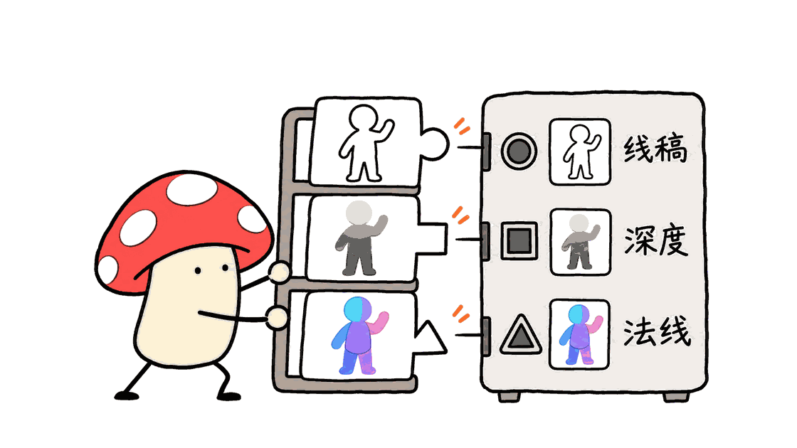

Shisei把人物动作整理成可下载的姿势参考图。创作者先选择姿势、机位和图像格式，再交给支持参考图的AI绘图工具，减少单靠文字描述身体姿态时的反复沟通。

官方仓库：https://github.com/wquguru/shisei

在线画廊：https://shisei.indaloop.app/en/

它适合插画、分镜和角色图的前期制作。文章以仓库提交 `8f61ceab10e45f8d3afd254900903733a0ba76ee` 为分析基线，并实际运行目录校验和本地静态构建；不把素材数量当作生成效果评测。

## Shisei解决了什么问题？

“侧身、上身稍后仰、一条腿弯曲、手撑在身后”包含多个相互关联的空间约束。文字模型理解了这些词，也可能在出图时改变重心、遮挡关系或镜头角度。

姿势参考图把这些要求集中在同一个画面里。创作者可以把动作与人物身份拆开：参考图负责身体布局，文字或其他参考负责服装、脸部、背景和风格。

Shisei提供的是这一步的输入材料，不负责训练或运行一个新的图像生成模型。它也没有给每张参考图附带一套可编辑的人体骨架、网格或动作动画。下载图片即可使用，不需要安装模型权重。


## “280套、五个机位”应该怎样理解？

仓库概述中仍能看到“250+”的早期介绍，但本次直接读取 `data/catalog.json`，得到288条姿势记录，其中280条至少有一个可用线稿视角，共1212个可用线稿视角。

| 系列 | 至少有一个可用视角的姿势 | 已通过项目质检的线稿视角 / 候选槽位 |
|---|---:|---:|
| 标准全身 std | 71 / 73 | 300 / 365 |
| 上半身 upper | 80 / 80 | 359 / 400 |
| 成人暗示性全身 sexy | 80 / 80 | 352 / 400 |
| 双人 duo | 49 / 55 | 201 / 275 |
| 合计 | 280 / 288 | 1212 / 1440 |

五个机位分别是正面、斜侧、侧面、俯视和仰视。它们是目录设计的候选视角，不能直接把280乘以5当成1400张已交付图片。部分视角没有生成成功或未通过质检，对应字段留空。

本次还统计到89张AI照片风格图，以及944个具有配套白模、深度、法线图的视角。后者代表944组，每组包含三类图，而不是所有1212个线稿视角都有配套图。

288条记录与280条可用姿势之间的差额也没有被悄悄补成占位图片。保留稳定ID和失败原因，能让下游明确区分“没有这个视角”和“加载失败”。

## 五种图像格式，各有什么用途？

| 格式 | 内容与来源 | 适合怎样使用 |
|---|---|---|
| 线稿 line art | 无脸素体的动作轮廓 | 作为通用参考图，或按所用工作流处理成线条条件 |
| 照片风格 photo | 项目生成的成年人物图像 | 参考身体姿态和视觉构图，不是实拍人物数据 |
| 白模 clay | 从线稿生成的灰色体积素体 | 观察体块、遮挡和明暗关系 |
| 深度 depth | 从白模估计的深度图 | 交给兼容的Depth条件模型 |
| 法线 normal | 从白模估计的法线图 | 交给兼容的Normal条件模型 |

官方生成记录写明，白模使用Qwen-Image-Edit-2511，深度使用Depth Anything V2 Small，法线使用Marigold Normals v1-1。这些结果来自图像生成或估计，不是通过真实3D扫描、相机标定或统一人体网格渲染得到的测量真值。

因此，画廊中的“对齐”应理解为项目对对应视图的图像对齐与质检目标，不能进一步推断五个机位在三维空间中严格一致，或适合直接当作精确的人体重建标注。

在ComfyUI中，文件格式本身也不会自动完成接线。深度图需要匹配的条件模型与基础模型；法线图同理。线稿不是OpenPose骨骼坐标文件，不能因为同属“姿势控制”就直接互换输入。

生成说明：https://github.com/wquguru/shisei/blob/main/docs/GENERATION.md



## 从选图到出图，可以怎样操作？

一个可复用的工作流程是：

1. 在画廊选系列和动作，先确认当前视角是否可用，再下载需要的图像。名称和分类支持中、日、英、韩四种语言。
2. 使用支持图像输入的绘图工具，上传姿势参考；明确告诉工具保留动作和镜头，把角色身份、服装及背景交给其他条件。
3. 若使用ComfyUI，选与基础模型和条件类型兼容的节点与权重，检查裁切、长宽比和参考强度。不要把深度图重复当成普通照片预处理后，仍以为保留了原始条件。
4. 对结果检查手指、关节、肢体数量、重心与遮挡。先改参考或单一条件，再判断是哪一步偏离。
5. 保存姿势ID、视角、格式、提示词、模型版本和参数，方便重做与比较。

例如，可以要求：“参考上传图片的身体动作与斜侧镜头，绘制穿着工作服的成年维修人员，保留手臂支撑位置；背景改为明亮的车间。”这是用法示例，本次没有向云端绘图服务提交任务，也没有做姿态遵循度评分。

多个机位可以帮助统一制作意图，但角色长相、身体比例和服装是否连续，仍取决于模型及身份参考机制。它能减少动作描述的歧义，不能承诺自动生成一套身份完全一致的角色转面图。

## Mac需要什么硬件，能否本地使用？

只浏览画廊或下载素材，使用普通浏览器即可，不需要Apple Silicon、高显存显卡或独立GPU。图片有300、600、900像素宽度档位；完整原图与打包文件通过GitHub Releases提供。

按README列出的v0.4.1资源，线稿推荐包约36.5MB，包含线稿与照片风格图；全部格式包约69.0MB，完整原图包约152.3MB。下载包不等于整个仓库：仓库还包含其他素材库及多档图片，完整克隆需要更多磁盘空间。

要在Mac本地浏览自己持有的副本，可以按官方静态站流程：

```bash
git clone https://github.com/wquguru/shisei.git
cd shisei
python3 -I tools/verify.py
python3 -I tools/build_site.py --link-images --no-og
python3 -m http.server 8000 -d site --bind 127.0.0.1
```

然后打开 `http://127.0.0.1:8000`。先确认本机有Python 3；`--link-images` 用符号链接引用仓库图片，`--no-og` 跳过本地浏览不需要的社交分享卡片渲染。公共部署应按项目的 `--public` 构建选项处理图片、站点URL和分享资源。

这套图库本身没有模型推理负载。若再用ComfyUI或其他工具在本机生成图片，所需统一内存、GPU与耗时由生成模型决定；不能把“图库能在Mac打开”写成“任何Mac都能本地运行所有绘图模型”。

## 本次实际验证了什么？

本次在独立下载的官方仓库中执行 `tools/verify.py`，检查目录、质检记录、图片路径、空缺标记与资源引用，程序成功退出。校验输出与前述四系列姿势数量一致。直接读取目录的统计也得到1212个线稿视角、89张照片风格图、944组配套图。

本次另执行了跳过分享卡片的官方静态预览构建，并用本地HTTP访问生成的页面和图片。初次默认构建进入了批量分享卡片渲染，本次主动停止，改用 `--no-og`；因此没有核验分享卡片生成。它们证明的是素材组织和静态浏览路径可用，不能证明每张图都解剖正确，也不代表已经复测项目全部图像质检结论。

项目会保留失败理由，并隐藏仍不符合名称的部分姿势。这比单纯追求数量更有用，但消费者仍应看图判断：尤其是复杂遮挡、双人动作和极端俯仰视角，错误可以被生成模型继承和放大。

## 免费与开源：三层许可不能混成一句话

项目的图片以及自有数据采用CC0 1.0；代码和文档采用Apache-2.0。按照项目许可，图片可以修改、再分发和商业使用，不要求署名；代码再分发则应按Apache-2.0履行相应要求。

第三层是姿势清单：选取、原始编号、名称和分类来自 `ai-pose-gallery`，项目在NOTICE中注明，这部分不由上述两种许可覆盖。因而“图片CC0”不能扩大成“第三方目录及其他网站素材也都能任意镜像”。

项目也提示，AI生成图片的权利认定存在地区差异；CC0处理的是项目实际持有的权利。使用参考图并不让项目对生成结果额外附加许可条件，但生成工具自己的条款仍需另看。

许可文件：https://github.com/wquguru/shisei/blob/main/LICENSE-images

来源与边界：https://github.com/wquguru/shisei/blob/main/NOTICE

图库中部分系列属于成人暗示性姿势，默认模糊并退出公开预览等入口。团队共享素材时，应该保留这种内容区分，而不是只依赖系列名称筛选；上半身系列也有单独分级。


## 哪些人最值得试？

它适合需要快速找动作的插画师、分镜创作者，以及想给图像工作流提供清晰输入的开发者。稳定ID、多语言名称和空缺记录，也方便把选图、下载与提示词记录做成自己的小工具。

它的价值在于降低参考素材的组织成本。对于需要严格三维一致性、可绑定骨骼或精确运动数据的工作，应选择相应的3D资产或动作数据，而不要把一组AI生成视图当成测量系统。

## 常见问题

### Shisei是一个新的文生图模型吗？

它是参考素材库和静态画廊。下载图片后，仍需选择支持参考图或条件输入的绘图工具。

### 每个姿势都有五个角度吗？

没有。五种角度是目录结构，部分视角缺失或质检未通过。本次统计288条记录中280条至少有一个可用视角。

### 用它必须安装ComfyUI吗？

不必。可把图片交给其他支持图像输入的工具。ComfyUI的Depth、Normal等工作流只是其中一种用途，仍需要对应模型与节点。

相关工具阅读：https://blog.mushroom.cv/blog/huashu-bird-sticker-guide/

---

> © 2026 Author: Mycelium Protocol. 本文采用 [CC BY 4.0](https://creativecommons.org/licenses/by/4.0/deed.zh) 授权——欢迎转载和引用，须注明作者姓名及原文链接，不得去除署名后以原创发布。

<!--EN-->

Shisei organizes human poses into downloadable reference images. Artists choose an action, camera view and format, then supply that image to an AI image tool instead of relying entirely on a long description of body placement.

Official repository: https://github.com/wquguru/shisei

Gallery: https://shisei.indaloop.app/en/

This review uses commit `8f61ceab10e45f8d3afd254900903733a0ba76ee`. Catalog verification and a static-site build were run locally. No image-generation accuracy benchmark was performed.

## What does a pose library contribute?

A phrase such as “leaning back with one knee bent and hands behind the body” leaves room for ambiguity about balance, occlusion and camera placement. A reference image packages those constraints into a shared visual input.

Shisei lets a creator separate pose from identity, clothing and setting. It supplies materials for that workflow; it does not include a new image-generation checkpoint, an editable character rig or a motion-capture dataset. Model choice and image generation happen elsewhere.


## How many poses and views are actually available?

Direct inspection of `data/catalog.json` found 288 records, with at least one usable line-art view in 280 records. The four series contain 300 standard full-body views, 359 upper-body views, 352 suggestive full-body views and 201 duo views: 1,212 line-art views in total.

Front, three-quarter, side, above and below are five possible camera slots. They are not five guaranteed deliverables for every pose. Empty or rejected slots remain empty, with gap information rather than misleading substitutes.

The catalog also contains 89 photo-style views and 944 view entries with clay, depth and normal companions. The last number means 944 sets of three maps, not coverage of every line drawing. The README's older “250+” summary and roadmap text should therefore be read alongside the current catalog and release files.

## Which format belongs in which workflow?

Line art is a clean pose/composition reference. Photo-style images are AI-generated adult figures, not documentary photographs. Clay images add shaded volume. Depth and normal maps provide specialized conditions for compatible workflows.

The generation record names Qwen-Image-Edit-2511 for clay, Depth Anything V2 Small for depth and Marigold Normals v1-1 for normals. These are generated or estimated images, rather than calibrated measurements from a common 3D mesh.

Alignment within a reference/map set should not be interpreted as strict reconstruction accuracy across all five cameras. The project has reviewed alignment and rejected faulty outputs, but a downstream user must still inspect difficult joints and occlusions.

In ComfyUI, a depth image needs a compatible depth-conditioning model and base model. Normal conditioning has its own requirements. A line drawing is not an OpenPose skeleton file. Selecting a file does not automatically provide nodes, weights or correct conditioning settings.

Source: https://github.com/wquguru/shisei/blob/main/docs/GENERATION.md


## A practical reference-to-image workflow

Choose the pose and available camera first. Upload the reference to a tool that accepts image input, then explain which aspects should remain fixed. Specify identity, clothes, environment and visual style separately.

For local conditioning, preserve aspect ratio and inspect preprocessing. Match the condition type to the model rather than treating every reference as an ordinary photograph. Review hands, joint placement, limb count, balance and occlusion in the result.

Save the pose ID, view, format, prompt, model version and settings. Change one input at a time when debugging. Multiple views can communicate a consistent intention, but they cannot guarantee consistent facial identity or body proportions across generated shots.

For example, an artist could request an adult maintenance worker in overalls while preserving the uploaded pose and three-quarter camera. This is a suggested use case; no request was sent to an external image model during this review.

## Can a Mac use it locally?

Browsing and downloading the gallery requires a regular web browser. It does not require Apple Silicon or a discrete GPU. Repository images have 300-, 600- and 900-pixel-wide tiers; full-size originals are distributed through releases.

The README lists a v0.4.1 recommended line-art/photo pack of approximately 36.5 MB, an all-format pack of 69.0 MB and a full-size original pack of 152.3 MB. A repository clone includes additional libraries and multiple image tiers, so its disk footprint is larger than a single pack.

For a local gallery, install Python 3 and run:

```bash
git clone https://github.com/wquguru/shisei.git
cd shisei
python3 -I tools/verify.py
python3 -I tools/build_site.py --link-images --no-og
python3 -m http.server 8000 -d site --bind 127.0.0.1
```

Open `http://127.0.0.1:8000`. The symbolic-link build is a preview convenience; `--no-og` skips share-card rendering that local browsing does not need. Public hosting should follow the project's public-build options for URLs, images and share assets.

The gallery itself has no model-inference workload. Running a separate image model on the same Mac introduces that model's own memory and acceleration requirements; gallery compatibility provides no evidence that every image model will run locally.

## What was actually verified?

The upstream `tools/verify.py` completed successfully. It checks catalog/QC/file consistency, gap markings, orphan references and related assets. A direct count reproduced the 1,212 line views, 89 photo views and 944 map sets above.

The official static preview was also built with `--no-og`, and its generated pages and sample images were accessed over local HTTP. The initial default build was stopped during bulk share-card rendering; share-card generation was not verified. These checks establish structural integrity and the local browsing path. They do not regrade the anatomy of every image or measure how well another model follows a pose.

A useful design choice is keeping stable IDs and explicit omissions. A missing angle is visible to consumers, rather than being filled with an incorrect image. Complex poses still need human inspection before production use.

## How do the licenses differ?

Images and the project's own data are dedicated under CC0 1.0. Code and documentation use Apache-2.0. Those are separate scopes, and code redistribution still needs to follow Apache's requirements.

The selection, original numbering, names and categories in the pose list originate from ai-pose-gallery. NOTICE explicitly says that this material is credited, rather than covered by either license. Image reuse permission must not be extended to copying third-party catalogs or image collections.

The project also notes jurisdiction-dependent treatment of AI-generated work. Its CC0 dedication concerns the rights it actually holds. Using a pose reference does not add project-specific conditions to a generated output; the generation provider's terms remain separate.

Some suggestive series and individual poses are blurred by default and excluded from public previews. Shared workflows should preserve the per-pose rating rather than assuming every item in a broadly named series has the same classification.

Licenses and scope:

https://github.com/wquguru/shisei/blob/main/LICENSE-images

https://github.com/wquguru/shisei/blob/main/NOTICE


## Who should try it?

Illustrators, storyboard artists and developers building reference-selection workflows can benefit from organized visual inputs. Stable identifiers, translated labels and explicit missing views make the library easier to integrate into repeatable creative work.

Its strongest contribution is organizing reference material. Projects requiring calibrated geometry, editable skeletons or precise motion data should use assets designed for those requirements.

## FAQ

### Is Shisei a text-to-image model?

No. It is a reference library and static gallery. A separate image tool processes the downloaded references.

### Does every pose include all five angles?

No. Some views are missing or failed project QC. Of 288 catalog records, 280 currently include at least one usable view.

### Is ComfyUI required?

No. Other tools that accept reference images can use these assets. Depth and normal workflows require compatible models and configuration.

---

> © 2026 Author: Mycelium Protocol. Licensed under [CC BY 4.0](https://creativecommons.org/licenses/by/4.0/) — free to share and adapt with attribution. You must credit the author and link to the original; removing attribution and republishing as original is not permitted.
