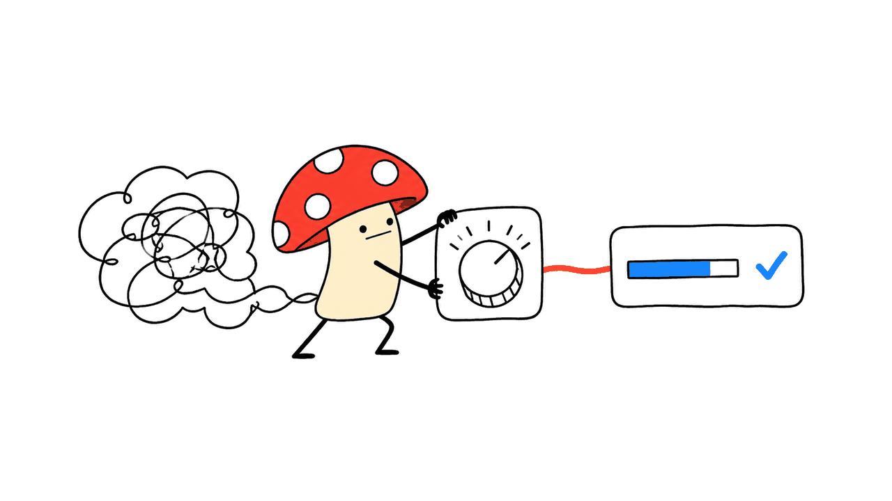
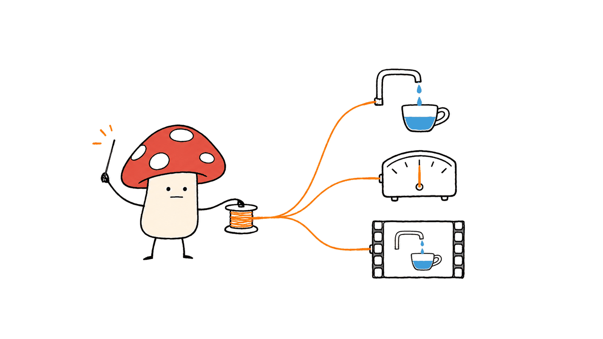
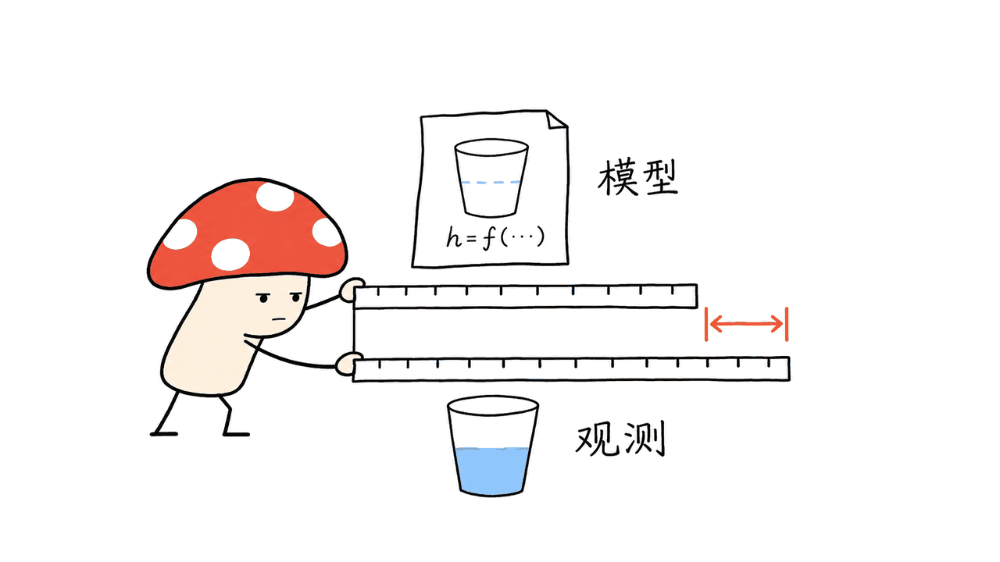

SimuLab是一套帮助Claude把问题做成交互实验室的技能：先建立能核算的模型，再让物件、数字和操作一起变化。它适合解释机制、制作培训材料和验证产品想法；画面能动，并不等于现实预测已经准确。

作者Kapri（@0xKapri）的仓库采用MIT许可，提供9步方法和7组可复制提示。技能免费，调用Claude产生的费用另算。本文核对的代码版本为 `a0561f868d9c642d92c667294d98b98c367a45ab`。

仓库：https://github.com/ecapri-dev/simulab-skill

## 为什么先问一个问题，再开始画？

“做一个咖啡模拟器”允许AI交出一台漂亮机器，却没有回答什么。把目标收紧到“研磨粗细为什么改变萃取时间”，才会出现明确输入、变化过程和可检查的输出。

这也是9步方法的主线：定义问题，查清数值，先写模型，复用物件，设计对照章节，开放操作，用关键帧复核，最后导出视频并交付单文件。7组提示则把提问、查证、建模、章节、练习、评审和视频制作串起来。两种计数属于不同层次，并不矛盾。

我们的建议是再加一个验收句：“用户改动哪个参数，哪个结果应怎样变化，在哪些条件下这个解释失效？”这比先规定配色和镜头更能约束生成质量。



## 这里的3D，具体由什么实现？

仓库使用固定等距视角，把三维坐标里的物件投影到Canvas 2D。它提供盒子、圆柱、线缆等绘图能力，以及可复用物件、播放器和界面。不要据此推断它拥有通用物理求解、任意视角漫游或完整CAD能力。

一个实验室通常分成三层：`model.js`计算结果，`demo.js`组织状态与绘制，`demo.json`列出打包文件、说明和假设。构建工具将运行代码和字体嵌入HTML；播放器还提供按时间定位和取帧接口，供静帧及视频工具使用。

有价值的工程约束是让仪表盘和动画共同读取模型结果。否则数字显示“已到目标”，杯子还在流，演示越精致，矛盾越不易被发现。共用状态能减少这种分叉，但不能自动证明模型本身成立。



## 本地实际验证了什么？

Mycelium Protocol在隔离临时目录中构建了仓库的五个完整示例：咖啡、声呐、万用表、焊接和LED闪烁。没有全局安装该技能，也没有让Claude重新生成这些实验室。

五个产物均小于1MB。随后用Chrome和Playwright以本地文件打开，阻断HTTP/HTTPS请求并启用离线模式；检查页面就绪、两个时间点的画面变化、Canvas上下文和运行错误。咖啡示例另检查了旋钮输入及练习模式切换。

我们还直接执行原始咖啡模型函数，做了8项核对，包括基准设定的28秒、粗细变化方向、目标36克、预浸阶段和流量平方关系。这些检查验证代码按其公式运行，不是独立证实真实咖啡风味，也不是教学效果研究。

**本次没有生成新实验室、渲染完整视频或测量手机帧率。** 仓库标注的60fps是视频导出规格，不能改写成所有设备都能稳定60fps交互。

## 有来源的数字，为什么还需要检查假设？

咖啡示例将配方和压力等资料，与“研磨刻度如何对应粒径”“28秒如何校准”等模型假设分开说明。这是值得借鉴的习惯。

但把某个旋钮变化写成流量平方关系，再用时间阈值判断酸苦，仍是教学简化。真实结果还受豆子、温度、粉饼和操作影响。通过一组公式检查，只能证明演示内部一致；不能把它当成经过实测标定的机器数字孪生。

工程师可以采用两份验收表：一份检查代码是否按模型计算，另一份比较模型与真实观测是否一致。后者应留下误差、适用区间和反例。对没有足够资料的场景，明确写“示意”比用精确小数营造可信度更好。



## 如何开始，怎样复用才划算？

官方安装命令如下，运行前应阅读技能及工具脚本：

```bash
npx skills add ecapri-dev/simulab-skill -g -a claude-code
```

依赖包括Node.js 20及以上、Python和浏览器；视频另需ffmpeg，音频工具使用Python数值依赖。可以先在项目副本构建现成示例，确认环境再安装到日常工作区：

```bash
node tools/build.mjs demos/labE1-espresso
```

建议先复制一个最接近的示例，只改变问题、输入变量和模型。保留控制量、状态和绘制的分层，让同一个结果驱动画面、说明及导出。新增物件时再沉淀到组件库，避免每次从空白提示重新开始。

例如给Claude的中文任务可以写成：

> 做一个说明“队列为什么越积越长”的实验室。先列出到达率、服务率的来源与假设，确定一个可调参数；给出可手算的基准和边界案例。画面、队列长度与解释读取同一模型。用关键帧和输入操作验收，暂不做视频。

这是本文改写的工程提示，不是声称仓库已经包含排队论实验。技能降低的是组织与呈现成本，领域模型和验收责任仍在制作者手里。

### 离线HTML等于离线AI吗？

不等于。构建后的五个示例在本次阻断网络的浏览器检查中运行正常；让Claude研究和编写新实验室是另一阶段，不能据此宣称整个创作链路离线。

### 能免费用于自己的项目吗？

代码采用MIT许可，需保留相应许可和版权说明；随附字体使用SIL Open Font License。外部资料、模型服务和后来加入的素材仍需分别核对。

### 中文和手机支持能直接承诺吗？

仓库有多语言字典与响应式处理，但新实验室文本需要相应词条。本次没有完整中文逐屏验收或手机性能测试，因此不能承诺所有内容自动翻译、所有设备流畅。

资料：

https://github.com/ecapri-dev/simulab-skill/blob/a0561f868d9c642d92c667294d98b98c367a45ab/SKILL.md

https://github.com/ecapri-dev/simulab-skill/blob/a0561f868d9c642d92c667294d98b98c367a45ab/PROMPTS.md

封面采用该仓库公开的咖啡示例图，作者为Kapri；正文小M配图为流程示意。

---

> © 2026 Author: Mycelium Protocol. 本文采用 [CC BY 4.0](https://creativecommons.org/licenses/by/4.0/deed.zh) 授权——欢迎转载和引用，须注明作者姓名及原文链接，不得去除署名后以原创发布。

<!--EN-->

SimuLab helps Claude turn a question into an interactive lab. It starts with a checkable model, then connects the objects, numbers and controls to that model. This is useful for explaining mechanisms and prototyping training material. An animated scene alone does not establish predictive accuracy.

Kapri (@0xKapri) publishes the skill under MIT. The workflow has nine steps and seven prompt groups. The skill is free; using Claude can incur separate charges. We examined commit `a0561f868d9c642d92c667294d98b98c367a45ab`.

Repository: https://github.com/ecapri-dev/simulab-skill

## Why begin with a question?

“Make a coffee simulator” leaves room for an attractive machine that explains very little. “Why does grind size change extraction time?” establishes an input, a mechanism and an observable result.

The method moves from a question and sourced values to a model, reusable objects, contrasting chapters, practice controls, frame review and final delivery. The prompt groups organize the corresponding conversation. The different counts describe different levels of the process.

We recommend adding an acceptance statement before visual design: which control changes which result, in what direction, and where should that explanation stop applying?


## What does 3D mean here?

The kit projects objects in three-dimensional coordinates onto Canvas 2D with a fixed isometric view. It includes drawing primitives, reusable objects, UI and playback. This does not establish a general physics solver, free-camera scene editor or CAD system.

A lab separates calculations in `model.js`, state and drawing in `demo.js`, and bundle metadata and assumptions in `demo.json`. The builder embeds code and fonts into HTML. Time-seeking and frame-capture interfaces also support the image and video tools.

The useful constraint is a shared state for animation and instruments. It prevents a display from declaring completion while the scene shows an incompatible process. Internal consistency still cannot validate the underlying model.


## What did we verify locally?

Mycelium Protocol built all five complete upstream examples in an isolated temporary directory: espresso, sonar, multimeter, soldering and LED blinking. We did not install the skill globally or ask Claude to generate replacement examples.

All five outputs were below 1 MB. Chrome and Playwright opened the files with offline mode enabled and HTTP/HTTPS traffic blocked. We checked readiness, different frames at two timeline positions, Canvas initialization and runtime errors. The espresso page also received a slider input and a practice-mode switch.

Eight additional checks executed the original espresso model functions: the 28-second reference, response to finer and coarser settings, the 36-gram target, pre-infusion and the squared flow relationship among them. These confirm implementation behavior, not real coffee quality or learning outcomes.

**We did not generate a new lab, render a complete video or benchmark mobile frame rates.** A 60 fps export setting is not evidence of stable 60 fps interaction on every device.

## Why separate facts from assumptions?

The espresso example distinguishes recipe and pressure references from assumptions about particle size and calibration. That makes the explanatory model easier to inspect.

However, a flow equation and time-based taste categories remain a simplification. Beans, temperature, preparation and equipment also affect the outcome. Passing formula checks does not turn a teaching demonstration into a calibrated digital twin.

Use two acceptance tracks: does the software compute the stated model correctly, and does that model agree with independent observations? The second needs error bounds, a valid operating range and counterexamples. Label unsupported relationships as illustrations rather than giving them an appearance of certainty through extra decimal places.


## How should engineers start?

Read the skill and scripts before installing:

```bash
npx skills add ecapri-dev/simulab-skill -g -a claude-code
```

The toolkit requires Node.js 20 or newer, Python and a browser. Video needs ffmpeg, and audio tooling needs Python numerical dependencies. First build an existing example in a project copy:

```bash
node tools/build.mjs demos/labE1-espresso
```

Copy the closest example and change its question, input and model before redesigning every object. Keep calculations separate from presentation, with the same result feeding labels, animation and export. Add reusable objects when a real need emerges.

An adapted prompt could ask for a queueing lab: identify arrival and service assumptions, choose one control, provide a hand-checkable baseline and boundary cases, and make both the queue and dashboard read the same model. Review frames and interactions before rendering a video. This is our proposed prompt, not an existing upstream queueing example.

### Does offline HTML mean offline AI?

No. The built examples ran in our network-blocked browser checks. Researching and authoring a new lab with Claude is a separate phase with its own service requirements.

### Is the toolkit free for projects?

The code is MIT-licensed with attribution and license obligations. Bundled fonts use the SIL Open Font License. Added material and model services need their own checks.

### Are Chinese localization and mobile performance guaranteed?

The kit contains translation dictionaries and responsive handling. New text needs matching entries. We did not complete a Chinese screen-by-screen audit or a mobile performance test.

Sources:

https://github.com/ecapri-dev/simulab-skill/blob/a0561f868d9c642d92c667294d98b98c367a45ab/SKILL.md

https://github.com/ecapri-dev/simulab-skill/blob/a0561f868d9c642d92c667294d98b98c367a45ab/PROMPTS.md

The cover uses Kapri's public espresso example image from the repository. The Little M illustrations explain the workflow.

---

> © 2026 Author: Mycelium Protocol. Licensed under [CC BY 4.0](https://creativecommons.org/licenses/by/4.0/) — free to share and adapt with attribution. You must credit the author and link to the original; removing attribution and republishing as original is not permitted.
