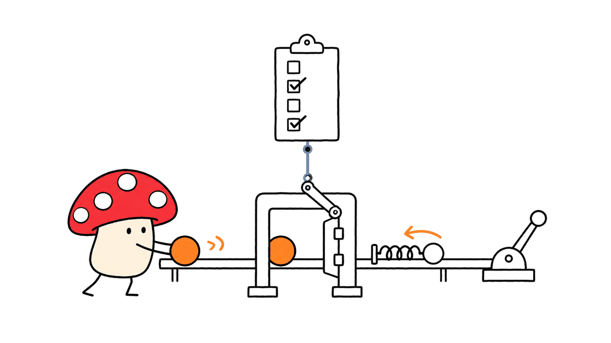

SingVL S1 4B是一个把文本、JSON和图像转成结构化决策的模型，适合在给定候选项之间选择、判断命题或给输入分级。它的工程价值，是把自由生成缩成更容易验证的接口。

inclusionAI在Hugging Face提供了模型权重、Python推理代码、FastAPI服务及Decision Index适配器。本文核对版本为c7a7f32ab027735b7dd2742e5b6cfcacaa43f97a；公开成绩来自维护者，本文没有下载权重、运行GPU推理或复现榜单。

模型与代码：https://huggingface.co/inclusionAI/SingVL_S1_4B

## 为什么Agent需要一个“会选择”的模型？

很多Agent步骤不需要长回答，而需要决定下一步：把工单分给哪个队列、图片中哪个位置符合条件、现有证据是否支持某个命题，或者内容应归入哪个等级。

用聊天模型做这些事，通常需要处理格式错误、额外解释和重试。SingVL使用命名问题与固定返回结构，把业务端关心的结果直接放在`answers`里。结构收敛可以减少解析工作，但不会消除判断错误。

| 类型 | 输入契约 | 返回意义 |
| --- | --- | --- |
| Choice | 2—256个候选项 | 选中项和各候选项概率 |
| Noul | 是非命题 | `true`对应的概率 |
| Score | 从低到高排列的2—10个等级 | 等级概率与零起点等级期望 |

例如三个等级的概率是0.1、0.3、0.6，Score为`0×0.1+1×0.3+2×0.6=1.5`。这不是天然的百分制分数，也不说明相邻等级在业务上的损失差异相同；等级定义必须由应用方设计。

## 它如何从Qwen3.5变成决策接口？

配置声明架构为Qwen3.5条件生成模型，提供的推理实现却不是普通的逐token聊天调用。

每个命名问题会被展开为完整输入。推理代码对完整注意力层应用双向前缀处理，GDN保持因果模式，不使用KV缓存；随后读取最后有效输入位置的候选token logits，再对当前候选项做softmax。API记录的输出token数为0，因为它直接读出决策，而非生成一段回答。

这不代表推理免费：模型仍需处理输入，图像也需要编码。不能拿“没有生成token”推导低延迟、低显存或相对于其他模型的速度优势。

另一个细节是复用边界：视觉特征可以在请求内复用，但多个问题仍各自构成完整提示。文本多问题按长度组批，默认每次前向使用65,536个填充token预算；它不是65,536个并发请求，也不是无条件的上下文性能保证。

## 69.75和73.75应该怎样读？

模型卡给出Public Decision Index 0.3批处理版本的Text 69.75、Vision约73.7495，分别覆盖140,178和12,210个请求。原始串行提交的Text是69.76，Vision约73.75。

这里是不同数据集和指标按评测规则汇总的指数，不是所有任务都达到69.75%的准确率。卡片还列出历史Vision 73.94，但它使用更大的图像预算；正式提交限制为1,638,400像素，两者不能混为同一次结果。

分项也提醒我们不要只看总分：公开表中部分任务表现较强，另一些任务明显较弱；标有脚注的若干数据集不计入Text Index。上线前应评估自己的问题与候选项，而不是把综合分直接转换成业务准确率。

模型卡写明，私有Text/Vision评测和单张RTX PRO 6000的官方延迟资格验证仍由维护者运行。本文不把这些待验证事项写成已经独立确认的成绩。

## 概率为什么不等于“有把握正确”？

返回值是当前候选集合内的归一化结果。如果所有选项都错，softmax仍然会把概率分配给它们，甚至产生一个很高的最大值。

因此，支付、删除、发信等有副作用的动作，不宜只用“最高概率超过0.9”自动执行。更可靠的接入方式是：保留“信息不足”选项，用历史业务数据评估校准和误报代价，在低置信度或证据不足时转人工。

这属于本文的工程建议，未在该模型上进行校准实验。增加拒绝选项也需要重新评估，不能默认一个新标签就会产生可靠的拒答能力。

## 能否完全本地运行？

官方提供从本地checkpoint加载的Python接口，也提供绑定本机地址的HTTP调用示例。推理路径不要求把输入交给外部聊天API。

示例使用Python 3.12和CUDA，依赖固定到PyTorch 2.10.0、torchvision 0.25.0、Transformers 5.13.1等版本。文档中的本地API默认示例端口为8173，路径为`/v1/systemone`，并不是通用聊天接口。

图像最多四张，按列表顺序与`<image>`占位符对应；没有占位符时由代码补入。服务接受Base64以及限制在`--image-root`内的本地路径。公开实现也对保留控制标记、选项数量、等级数量等做检查。

这些说明支持“有本地部署路径”，不证明已经适配手机、MLX、Ollama或任意消费级显卡。BF16权重、图像预算、输入长度及批次都会影响实际内存；本文未测量峰值显存和吞吐。

还需区分公开下载与开放许可：本次固定版本的模型卡元数据没有明确license字段，文件清单中也未见独立LICENSE。因此本文不替发布者推定Apache或MIT授权，尤其不据此承诺商用条件；接入前应核对发布方的适用许可。

## 我们实际检查了哪些代码？

本文从固定版本`inference/model.py`中提取未改动的输入校验、提示构造及图像预处理函数，在CPU环境执行了15项检查。

检查覆盖候选顺序、图像标记自动插入、Noul默认选项、Score零起点等级、非法类型与数量的拒绝、控制标记拒绝，以及像素上限和RGBA转换。15项均通过。

这验证的是接口边界与预处理行为。它不包含权重加载、注意力实现执行、真实logits、模型正确率、FastAPI端到端请求、GPU兼容性或速度测试，不能当作模型推理实测。

## 工程师怎样借鉴？

我更看重它把“模型判断”和“业务执行”分开的接口形状。应用端先给出有意义的候选项，再校验输入与输出，把结果连同模型版本、候选顺序和证据保存，最后由独立的业务规则决定是否执行动作。

对视觉任务，还要保存图像顺序、像素预算和预处理版本。原始串行与批处理结果的微小差异，也说明版本和运行方式应进入实验记录。

第一个试点可以选可回滚、损失可控的路由或分级任务：与现有规则并行运行，统计混淆矩阵、拒绝覆盖率、尾延迟和内存，再决定是否替换生产步骤。不要从一个公开总分直接跳到自动执行高代价动作。

## 常见问题

### 它是完整Agent吗？

不是。它提供决策读出，工具调用、权限、动作执行、重试和回滚仍由应用负责。

### Score可以直接当风险概率吗？

不可以。Score是有序等级的期望，Noul也是模型返回的候选概率；真实业务概率需要独立校准验证。

### 已经有本地性能实测吗？

本文只有15项纯函数检查，没有运行4B权重。公开榜单数据来自模型卡和维护者结果，不能归为本文实测。

## 来源

固定版本模型卡：https://huggingface.co/inclusionAI/SingVL_S1_4B/blob/c7a7f32ab027735b7dd2742e5b6cfcacaa43f97a/README.md

推理实现：https://huggingface.co/inclusionAI/SingVL_S1_4B/blob/c7a7f32ab027735b7dd2742e5b6cfcacaa43f97a/inference/model.py

复现说明：https://huggingface.co/inclusionAI/SingVL_S1_4B/blob/c7a7f32ab027735b7dd2742e5b6cfcacaa43f97a/inference/DECISION_INDEX.md

批处理公开结果：https://huggingface.co/datasets/echoxvf/SingVL_S1_4B-DI-results/tree/709aaf417ebf1d00dd01fdb49e306573b801d488/releases/batch-65k

---

> © 2026 Author: Mycelium Protocol. 本文采用 [CC BY 4.0](https://creativecommons.org/licenses/by/4.0/deed.zh) 授权——欢迎转载和引用，须注明作者姓名及原文链接，不得去除署名后以原创发布。

<!--EN-->

SingVL S1 4B turns text, JSON and images into typed decisions: a selected option, a yes/no probability, or an expected ordinal level. Its practical appeal is a constrained interface that is easier to validate than free-form chat.

inclusionAI provides weights, Python inference code, a FastAPI service and a Decision Index adapter on Hugging Face. We reviewed revision c7a7f32ab027735b7dd2742e5b6cfcacaa43f97a. We did not download weights or reproduce model benchmarks.

Model: https://huggingface.co/inclusionAI/SingVL_S1_4B

## What decisions does it return?

Choice supports 2–256 candidates and returns the selected key plus candidate probabilities. Noul returns the probability associated with `true`. Score accepts 2–10 ordered levels and returns their distribution and zero-based expected level.

For probabilities 0.1, 0.3 and 0.6 across three levels, Score is 1.5 on a 0–2 scale. It is not automatically a percentage, a calibrated risk estimate, or a statement that adjacent categories carry equal business costs.

Suitable uses include routing, constrained visual choices and content grading. Typed output reduces parsing work; it does not eliminate mistaken decisions.

## How does inference differ from chat?

The configuration uses the Qwen3.5 conditional-generation architecture. The supplied implementation applies bidirectional full attention to complete inputs while keeping GDN causal, without a KV cache. It reads candidate-token logits at the last valid input position and normalizes the current candidates with softmax.

The API reports zero output tokens because it reads a decision instead of generating an answer sequence. The input and images still require computation. Zero generated tokens is not a latency or memory benchmark.

Each named question becomes a complete prompt. Multiple text questions are batched by length under a default 65,536 padded-token forward-pass budget. This is not a concurrency count. Visual features can be reused within a request, but that does not make every question free.

## What do the public scores establish?

The model card reports Public Decision Index 0.3 batch results of Text 69.75 over 140,178 requests and Vision approximately 73.7495 over 12,210 requests. The original serial submission scored Text 69.76 and Vision approximately 73.75.

These are aggregates across different datasets and metrics, not universal accuracy percentages. A historical Vision score of 73.94 used a larger image budget; the submitted run uses a 1,638,400-pixel cap. Some separately reported text datasets are excluded from the aggregate.

The card states that private Text/Vision evaluation and official single-RTX-PRO-6000 latency qualification remain maintainer-run. We do not treat those as independently verified results. Production acceptance should use the application's own distribution, candidates and error costs.

## Are its probabilities calibrated confidence?

Not necessarily. Softmax distributes probability over supplied candidates even when all candidates are wrong. A high maximum probability does not establish real-world correctness.

Our engineering recommendation is to evaluate abstention options, calibration and costly false positives on held-out application data. An “insufficient information” option also needs validation; adding a label does not guarantee reliable abstention.

The model's decision should remain separate from permission to send messages, transfer money or delete data. Those actions require application rules and appropriate review. These recommendations have not been experimentally validated on SingVL in this article.

## Can inference stay local?

The Python API loads a local checkpoint, and the repository includes a local HTTP server with `/v1/systemone` on the example port 8173. The supplied inference path does not require an external chat API.

Examples target Python 3.12 and CUDA with pinned dependencies, including PyTorch 2.10.0 and Transformers 5.13.1. Up to four images are matched to placeholders in list order, with automatic insertion when no markers are supplied. The server accepts Base64 inputs and paths constrained to its image root.

This establishes a local deployment path, not verified support for phones, MLX, Ollama or arbitrary consumer GPUs. Weight precision, image budgets, input lengths and batches affect memory. We measured neither GPU memory nor throughput.

Public availability also does not establish permissive licensing. At the reviewed revision, we found no explicit license field in model-card metadata or standalone LICENSE in the file list. We do not infer Apache/MIT or commercial permission; users should verify applicable terms with the publisher.

## What did our checks actually run?

We extracted unmodified pure functions for input validation, rendering and image preprocessing from the pinned `inference/model.py`, and ran 15 CPU checks.

They passed candidate-order preservation, automatic image markers, Noul defaults, zero-based Score levels, invalid types and counts, reserved-control-marker rejection, image pixel caps and RGBA conversion.

These are contract and preprocessing checks. They do not execute checkpoint loading, attention, real logits, model accuracy, end-to-end HTTP inference or GPU performance. Mycelium Protocol distinguishes these limited checks from maintainer-reported benchmark results.

## How should engineers adopt the interface?

Keep input contracts, model decisions and business execution separate. Record the model revision, candidate ordering and supporting evidence. For vision, also record image order, pixel budget and preprocessing version.

Start with a reversible routing or grading task in shadow mode. Measure errors, abstention coverage, tail latency and memory before replacing an existing production step. A public aggregate score is insufficient evidence for autonomous high-cost actions.

## FAQ

### Is this a complete agent?

No. It supplies decisions. Tools, permissions, execution, retries and rollback remain application responsibilities.

### Is Score a risk probability?

No. It is an expected ordinal level. Noul's probability also needs application-specific calibration before such use.

### Did we measure local model performance?

No. We ran 15 pure-function checks without loading the 4B weights. Public model scores are attributed to the publisher.

## Sources

Pinned card: https://huggingface.co/inclusionAI/SingVL_S1_4B/blob/c7a7f32ab027735b7dd2742e5b6cfcacaa43f97a/README.md

Inference code: https://huggingface.co/inclusionAI/SingVL_S1_4B/blob/c7a7f32ab027735b7dd2742e5b6cfcacaa43f97a/inference/model.py

Reproduction guide: https://huggingface.co/inclusionAI/SingVL_S1_4B/blob/c7a7f32ab027735b7dd2742e5b6cfcacaa43f97a/inference/DECISION_INDEX.md

Batch results: https://huggingface.co/datasets/echoxvf/SingVL_S1_4B-DI-results/tree/709aaf417ebf1d00dd01fdb49e306573b801d488/releases/batch-65k

---

> © 2026 Author: Mycelium Protocol. Licensed under [CC BY 4.0](https://creativecommons.org/licenses/by/4.0/) — free to share and adapt with attribution. You must credit the author and link to the original; removing attribution and republishing as original is not permitted.
