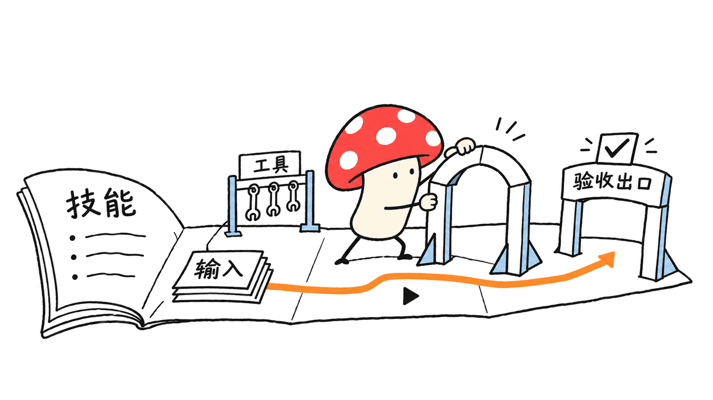
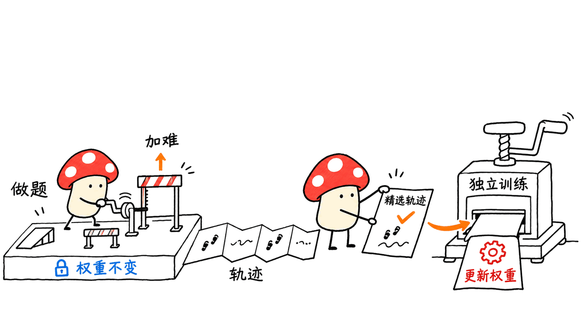
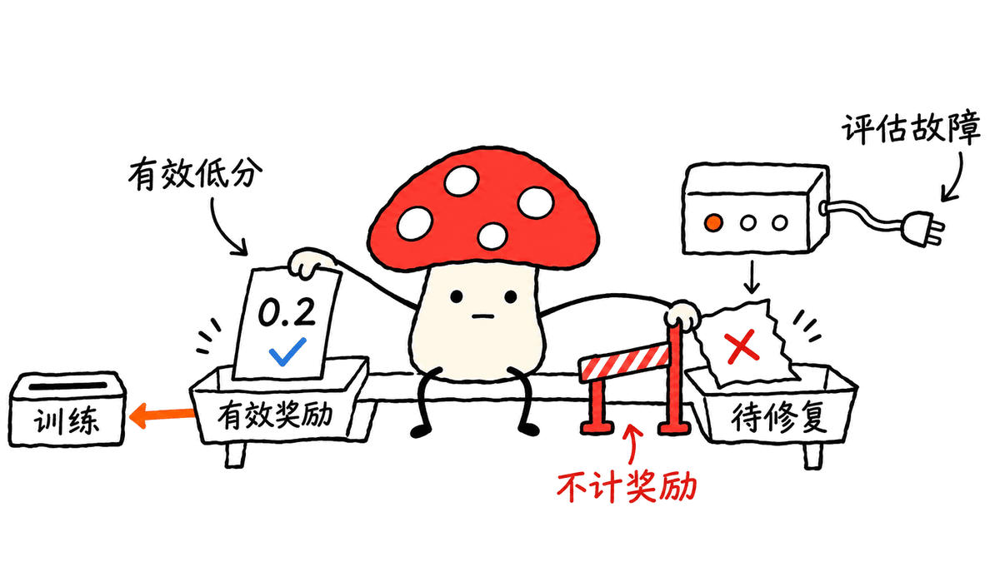

Skill2Env 把技能说明书变成有文件、工具和验收规则的训练任务，再用执行证据改进任务难度。它研究的是怎样构造训练环境；“边做题边升级”需要经过轨迹筛选和后训练，并不意味着运行中的模型会自行更新权重。

你这段素材对应 AllSpark Research 的论文《Skill2Env: Capability-Oriented Environment Synthesis from Skills for General Agents》。准确名称是 **Skill2Env**，项目入口如下：

- 论文：https://arxiv.org/abs/2609.33772
- 项目与任务：https://github.com/AllSpark-Research/AgentEnv/tree/main/Skill2Env
- 公开模型：https://huggingface.co/AllSpark-Research/Skill2Env

我们核对的仓库提交是 `1deac75488f1f9ce1caf19b47e216ebc59810be8`。搜索时还会遇到 `NVlabs/Skill2Env`，但该仓库引用的是《Reinforcing Agents with Collective Skills》，标题、作者和项目入口均不同。本文不把它的运行命令、许可证或结果套到 AllSpark 这篇论文上。

## 为什么给一份 Skill 还不够？

Skill 可以告诉智能体怎样清洗 CSV、处理文档或检查日志，却通常没有指定某一次任务的输入、机器状态、权限、完成条件和评分方式。模型会背操作步骤，不代表它能处理真实工作中的例外与冲突。

例如“给运维助理的上下文瘦身”，不是简单要求把文档写短。公开示例 `context-slimming` 要求保留必要事实，把长手册移到按需目录，统一重复规则，满足文件字节预算，写报告，并在示例工作区的 Git 仓库中提交变更。可检查的交付物让任务超出了泛泛的文字总结。

其中的字节上限属于这个示例任务的合同，不能拿来宣称某个真实产品的通用 token 节省比例。它描述的上下文注入行为也是任务设定，我们没有验证真实 OpenClaw 的所有版本。

## 三个阶段怎样连起来？

第一阶段是能力挑战。论文围绕环境理解、规划、技能使用、长程一致性和错误恢复设计可复用的难度模式。难度应来自需要完成的推理与行动，而不是靠缺文件、工具坏掉或描述自相矛盾让模型失败。

第二阶段是任务蓝图。蓝图说明目标、挑战、环境事实、信息边界与验收标准，再共同约束指令、执行环境、工作区和评分规则。作者侧知道的标准答案与求解器可见的信息需要分开，否则模型可能直接读到验收答案，得到没有学习价值的高分。

第三阶段是迭代加难。让求解器执行，检查轨迹是否绕过了原本的挑战，再修改任务蓝图和对应环境。论文还要求先排除环境条件不一致或评估错误，避免把基础设施问题诊断成模型能力不足。

工程上最值得借鉴的是这个同步关系：改了输入分布、工具能力或完成条件，评估也必须一起更新。否则会出现模型做对了但旧评分器扣分，或者只满足旧评分器就能投机过关。

## “升级”的到底是什么？

加难阶段使用固定的 Qwen3.6-35B-A3B 作为求解器。论文设定奖励超过 0.7 的任务进一步加难，其余保留；这是课程构造策略，不是每次得分低就更新模型。

后续由 DeepSeek-V4-Flash 在这些任务上生成轨迹，筛选奖励大于 0.9 的 1.5K 条用于 SFT。论文报告对 Qwen3.6-35B-A3B 训练 5 个 epoch。任务加难、轨迹生成、参数训练是不同阶段，既有模型调用成本，也有训练成本。

官方报告构造了 2,963 个任务，模型在七项下游基准上的非加权平均从 36.6 提升到 45.0，增加 8.4 个点。Terminal-Bench 2.1 从 44.9 到 58.4，SkillsBench 从 32.5 到 46.9。增益由未四舍五入的数据计算，不能看到显示值差零点一就认定计算错误。

这些是论文结果，不是我们的复现。七项评测还用了不同的原生指标与框架，不能把平均分解释为“所有业务任务成功率 45%”，也不能据此推导本地小模型只读 Skill 就能获得相同收益。

## 仓库现在实际公开了什么？

固定提交下，`Skill2Env/tasks/` 有 **20 个示例任务**，不是论文全部 2,963 个任务，也不是完整的自动合成与后训练流水线。任务目录提供可阅读的指令、环境配置、初始工作区、源技能和验收实现。

| 组成 | 工程作用 |
|---|---|
| `instruction.md` | 给求解器的任务要求 |
| `task.toml` | 任务与运行配置 |
| `environment/` | Dockerfile、准备步骤和工作区材料 |
| `environment/workspace/_skill_ref/` | 求解器可见的 Skill 与参考资料 |
| `tests/verify.py` | 确定性检查 |
| `tests/eval_spec.json` | 验收条目、权重与评估方法 |
| `tests/run_verifier.py` | 汇总评估并写入最终奖励 |

本地清点与官方 README 一致：16 个任务结合确定性检查和 LLM 评审，4 个只用确定性评估。混合任务需要 `JUDGE_BASE_URL`、`JUDGE_MODEL`，以及端点要求时的密钥。任务可以有本地输入文件，但验收未必离线、免费或确定性可复现。

模型 Hub 文件清单中有 15 个 safetensors 权重文件，合计约 71.9GB。这是文件字节数，不是运行内存；A3B 的激活参数标记也不代表只需存放 3B 权重。我们没有下载或运行这个模型。

公开模型卡声明 Apache 2.0；我们检查的 AllSpark 仓库根目录未见统一 LICENSE 文件。因此，不能借同名 NVlabs 项目的 Apache 2.0 声明概括这里所有任务素材的许可，复用时仍应核对具体内容的授权来源。

## 我们实际跑了哪一个检查？

我们复制 `context-slimming` 的初始工作区到临时目录，清除评审服务配置，调用其真实 `run_verifier.py`，没有改动用户的 Agent 工作区。

验收入口退出码为 **1**，明确报告缺少 `JUDGE_BASE_URL`，并且没有生成 `reward.txt`。这与“求解器任务得分为 0”有本质区别：没有有效评审结果，就不应把它混进训练奖励或能力统计。

这里只验证了一个配置缺失时的错误路径，同时核对了 20 个任务的目录合同和评分方法。没有运行 Docker 任务、调用付费评审模型、让智能体做题、生成新环境或复现 SFT 成绩。脚本、配置清点与真实错误输出已保留，便于复核。

## 小团队可以怎样借鉴？

先拿一个已有 Skill 和一项具体工作，写出可核验的完成条件。准备一套固定输入、最小工具和初始状态，让团队能重复跑同一题。能够通过程序判断的条目优先确定性检查，确实涉及语义质量的部分再引入评审模型。

随后观察真实执行轨迹：模型是否用了捷径？是否反复重试？任务到底在考规划，还是只是在考一个未安装的依赖？先修环境，再增加一个能力挑战，并同时维护任务与验收版本。

把这套方法用于回归测试和技能验收，往往比立即启动大规模模型训练更容易得到反馈。只有任务、奖励和轨迹质量稳定了，继续做后训练才有可靠的监督来源。

## 常见问题

### 能否克隆仓库直接复现整篇论文？

当前检查到的是 20 个公开示例和模型入口，不能把它当成全部合成任务、训练数据及完整训练流水线。

### 得分更低就代表任务更好吗？

不是。输入损坏、信息矛盾或评分器故障也会造成低分。论文强调从有效执行证据诊断能力，先排除环境与评估错误。

### 它会让正在运行的 Agent 自动更新权重吗？

论文中的加难阶段固定求解模型，之后再生成、筛选轨迹并做 SFT。运行任务和更新权重没有被合成一个自动在线过程。

相关阅读：https://blog.mushroom.cv/blog/tokin-token-native-agent-rl-gateway-guide/

Mycelium Protocol 的独立分析来自上述一手论文、项目与模型卡，并包含固定版本的目录清点和验收错误路径检查。没有把研究结果写成本地实测。

---

> © 2026 Author: Mycelium Protocol. 本文采用 [CC BY 4.0](https://creativecommons.org/licenses/by/4.0/deed.zh) 授权——欢迎转载和引用，须注明作者姓名及原文链接，不得去除署名后以原创发布。

<!--EN-->

Skill2Env turns skill documentation into training tasks with files, tools and acceptance criteria, then uses execution evidence to improve task difficulty. It constructs training environments; model improvement still requires trajectory selection and post-training rather than automatic weight updates during ordinary execution.

The supplied description matches AllSpark Research's **Skill2Env: Capability-Oriented Environment Synthesis from Skills for General Agents**:

- Paper: https://arxiv.org/abs/2609.33772
- Project and tasks: https://github.com/AllSpark-Research/AgentEnv/tree/main/Skill2Env
- Released model: https://huggingface.co/AllSpark-Research/Skill2Env

We inspected revision `1deac75488f1f9ce1caf19b47e216ebc59810be8`. Search also finds `NVlabs/Skill2Env`, whose citation is **Reinforcing Agents with Collective Skills**, with different authors and project references. Its commands, licensing and results should not be attributed to the AllSpark paper.

## Why is a Skill not enough?

A Skill describes procedures but usually leaves a concrete task's inputs, machine state, permissions and completion criteria unspecified. Knowing a procedure is different from resolving conflicting instructions and handling exceptions in a workspace.

The released `context-slimming` example illustrates this distinction. It asks a solver to reduce injected context while preserving facts, move detailed manuals into on-demand files, deduplicate rules, meet byte budgets, write a report and commit changes inside a supplied Git workspace.

Those limits are a task-specific contract, not measured token savings for every real application. Its description of context injection is also an environment assumption; we did not verify all real OpenClaw versions.

## How do the three stages fit together?

First, capability-oriented difficulty patterns target environment understanding, planning, skill usage, long-horizon consistency and error recovery. Meaningful difficulty should come from the intended reasoning and actions, not broken dependencies or contradictory requirements.

Second, a task blueprint specifies objectives, challenges, environment facts, information boundaries and acceptance criteria. It guides the instruction, execution substrate, workspace and evaluator together. Author-side answers must remain separate from solver-visible materials, or a shortcut can replace meaningful task execution.

Third, Iterative Task Hardening inspects solver rollouts, identifies bypassed challenges and updates the blueprint and environment. The paper first excludes inconsistent task conditions and evaluator errors from capability diagnosis.

The engineering lesson is to version tasks and evaluators together. Changing the input distribution or completion contract without updating verification can penalize correct behavior or reward an obsolete shortcut.

## What actually gets upgraded?

During hardening, the solver is a fixed Qwen3.6-35B-A3B. The paper hardens tasks whose reward exceeds 0.7 and retains the others. This is curriculum construction, not an online model update after every attempt.

DeepSeek-V4-Flash subsequently generates trajectories; 1.5K with rewards above 0.9 are selected for five epochs of SFT on Qwen3.6-35B-A3B. Hardening, trajectory generation and parameter training are separate stages with separate inference and training costs.

The authors report 2,963 constructed tasks and an unweighted seven-benchmark mean rising from 36.6 to 45.0, an 8.4-point gain. Terminal-Bench 2.1 rises from 44.9 to 58.4 and SkillsBench from 32.5 to 46.9. Displayed scores are rounded independently from gains calculated on unrounded values.

These are paper results, not our reproduction. The benchmarks use different native metrics and harnesses. Their mean is not a universal business-task success rate, and does not establish that a small local model gains the same capability simply by reading a Skill.

## What is actually released?

The pinned repository contains **20 example tasks** under `Skill2Env/tasks/`, rather than the complete set of 2,963 or the full synthesis and training pipeline. Each example includes an instruction, task configuration, Docker environment setup, initial workspace, source skill and evaluator files.

`tests/verify.py` implements deterministic checks; `tests/eval_spec.json` defines rubric items, weights and methods; `tests/run_verifier.py` writes the final reward. The source Skill lives under `environment/workspace/_skill_ref/`.

Our inventory matches the README: 16 tasks combine deterministic checks and LLM judging; four are deterministic only. Hybrid tasks require `JUDGE_BASE_URL`, `JUDGE_MODEL` and an API key when the endpoint requires one. Local input files do not guarantee offline, free or deterministic evaluation.

The Hub lists 15 safetensors weight files totaling approximately 71.9GB. This is file size, not runtime memory; an A3B active-parameter label does not imply storing only 3B parameters. We did not download or run the checkpoint.

The model card declares Apache 2.0. We found no unified LICENSE at the AllSpark repository root in this checkout; the namesake NVlabs license should not be used to characterize all these task materials. Check the relevant sources when reusing them.

## What did we execute locally?

We copied the `context-slimming` initial workspace to a temporary directory, removed judge configuration and ran its actual `run_verifier.py`. We did not modify the user's real agent workspace.

The entry point exited with **code 1**, reported missing `JUDGE_BASE_URL`, and did not produce `reward.txt`. An unavailable evaluator is different from a solver earning zero reward. Invalid evaluation should not silently enter capability statistics or a training reward stream.

This verifies one missing-configuration error path and inventories the 20 task contracts and scoring methods. We did not run Docker tasks, pay for model judging, execute a solver, synthesize environments or reproduce SFT results. The script and observed output are retained.

## How can a small team use the idea?

Start with one Skill and one specific workflow. Write verifiable completion conditions, provide fixed inputs and a minimal execution environment, and make repeated runs possible. Use deterministic checks where they fit; reserve model judging for criteria that need semantic assessment.

Read execution traces before increasing difficulty. Did the solver exploit a shortcut, repeatedly retry, or encounter an uninstalled dependency? Repair the environment first, then add one capability challenge and update verification alongside it.

Regression testing and skill acceptance can deliver useful feedback before a large training run. Stable tasks, rewards and trajectories are prerequisites for meaningful post-training supervision.

## FAQ

### Can cloning this repository reproduce the whole paper?

The inspected release provides 20 examples and a model reference. It does not establish availability of all synthesized tasks, training trajectories and the complete training pipeline.

### Does a lower solver score mean a better task?

No. Broken inputs, inconsistent information and evaluator failures can also lower scores. Diagnose capability only from valid execution evidence.

### Does running the task automatically update agent weights?

No. The paper fixes the solver during hardening, then separately generates and filters trajectories for SFT.

Related reading: https://blog.mushroom.cv/blog/tokin-token-native-agent-rl-gateway-guide/

Mycelium Protocol contributed the pinned-source inventory, evaluator error-path check and engineering analysis above, separate from the paper's reported training results.

---

> © 2026 Author: Mycelium Protocol. Licensed under [CC BY 4.0](https://creativecommons.org/licenses/by/4.0/) — free to share and adapt with attribution. You must credit the author and link to the original; removing attribution and republishing as original is not permitted.
