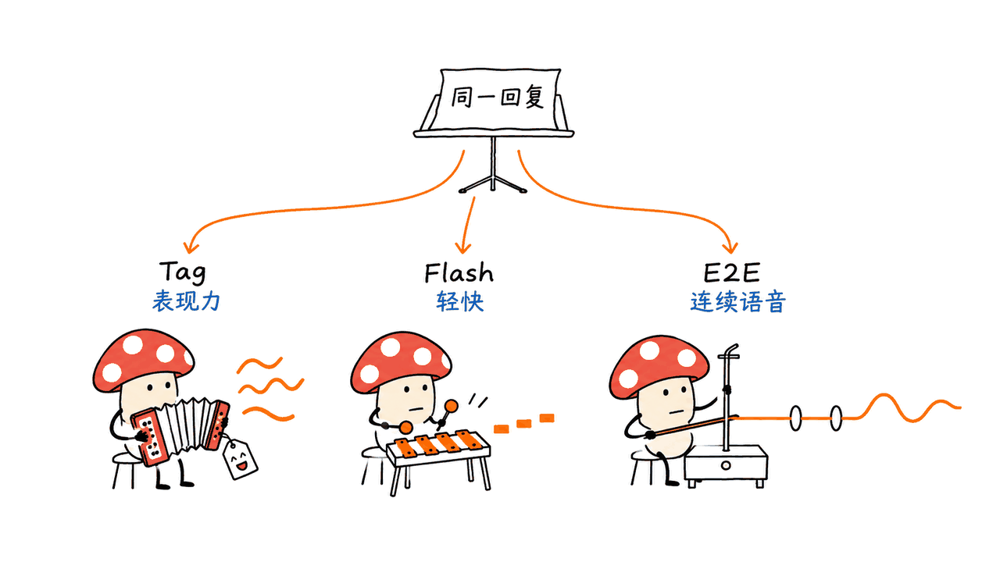

Sophon-Realtime 是一套能边听边说、处理插话和语气的开放语音模型。它值得关注的地方，是把“什么时候开口”和“怎么说出来”一起做进对话系统；但三个版本、32B 与 4B、服务器与 Mac，能力和硬件条件不能混着看。

Adventists AI 在官方仓库提供代码、权重入口和部署方法，许可证为 Apache 2.0。本文按 2026 年 11 月 22 日仓库快照核对，并运行了 20 项原始音频缓冲与增益单元测试；没有加载模型，也没有把演示视频或作者性能表写成本地实测。

## Sophon 的全双工，和普通语音助手差在哪？

传统流水线通常先转写，再让语言模型回答，最后合成语音。文本保住了“说了什么”，却容易丢掉笑声、犹豫、重音和讽刺。Sophon 的音频编码器直接接收声音，由同一个理解模型处理内容与轮次决策。

官方描述的关键行为是：停顿时判断你是否说完、仍在组织语言或只是附和；提前草拟回答，如果你继续说就丢弃草稿；你插话时停止播放，只把已经听到的部分留进历史。能同时收音和输出，还需要这些状态处理才能形成自然对话。

语气理解来自同团队的 DuplexJev。官方给出 VoiceBench 82.8、Big Bench Audio 81.8%，以及多个副语言基准的汇总分 48.6。这些是团队评测：评委模型、任务子集和提示词设置会影响结果，不能由一个汇总分推断所有情绪、所有说话者都能准确识别。

## Tag、Flash、E2E，究竟该选哪个？

三个名字主要区分语音输出路线，不是三种价格，也不是只有三个权重文件。最初的 32B 理解模型之外，项目已经发布 4B 分支和量化、MLX 等变体。

| 路线 | 声音怎么生成 | 主要取舍 |
|---|---|---|
| Tag | 理解模型写回复与笑声、叹气、重音等标记，表达型语音模型执行 | 优先表现力，官方推荐起点 |
| Flash | 同样的标记文本交给更轻的语音模型，按 80 毫秒帧生成 | 优先速度和并发 |
| E2E | 约 350M talker 把逐步产生的回复变成连续语音向量，再经解码器与声码器输出 | 减少中间语音 token 路径，仍有多个模块 |

所以，E2E 并不意味着系统里完全没有文本、轮次判断或解码器。它改变的是声音生成环节，不是把所有工程依赖消掉。

官方 32B 单用户首音数据约为 Tag 0.6 秒、Flash 0.31 秒、E2E 自有引擎 0.25 秒，条件是一张 H100 80GB。E2E 换用 vLLM-Omni 时约 0.35 秒；并发、语音引擎、GPU 都会改变结果。不能把 H100 的首音延迟贴到普通笔记本上。

## 4B 和 Mac，真的降低了本地门槛吗？

降低了，但要接受不同层面的交换。官方 4B 表中，Flash 约需 21GB 显存；Tag 约 27GB，E2E 约 31GB。这里“4B”说的是理解底座，不能直接用四十亿参数乘量化字节数，估算整个语音系统的占用。

Tag-4B-W4 将语言模型量化到 4 bit，官方给出约 21GB；Mac 的 Flash-4B-MLX 则使用 8 bit 理解模型，权重下载约 9GB，运行约 11GB。两者不是同一套量化方案。

更关键的是证据条件：项目明确披露，小显存测试是在 H100 限制显存预算，Mac 4B 则在 M4 Max 限制 MLX 内存进行，尚未在实体 24GB 显卡或 16GB Mac 上完成对应验证。Mac 4B 的 0.3—0.5 秒响应也是 M4 Max 数据，不是基础款 M4 实测。

4B 保留了不少对话交互行为，却显著减少了知识和推理能力。作者给出的 VoiceBench 从 32B 的 82.8 降至 62.4，Big Bench Audio 从 81.8% 降至 44.3%。我更愿意把它作为本地角色、交互原型和轮次研究的起点，而不是直接承诺能回答可靠的业务问题。

## 几秒克隆声音，所有部署都支持吗？

服务器 Tag、Flash 支持约 3—10 秒参考音频，E2E 在后续版本中也加入克隆，参考约 5—12 秒。不是重新训练一个人的模型，而是在请求时使用参考声音条件。

但当前 Mac README 明确写着：只有内置声音，暂不支持零样本音色克隆、工具调用和摄像头。把服务器功能照搬到 Mac 介绍会误导部署决策。参考声音也应来自自己或获得许可的人；Apache 许可证没有替你取得某个人的声音授权。

本地运行和云端 API 都存在。模型服务、网页演示、Live 网关和 Mac 客户端是不同层，选择托管 API 后，音频自然会离开本机。“项目能离线部署”不能等同于所有入口默认离线。

## 我们实际验证了什么？

Mycelium Protocol 在固定提交上运行原仓库 `mac/tests`：20 项通过、无失败。测试针对纯 Python 的 Playout 和 InputGain，输入是模拟的往返时延、生成时长、卡顿和音量数值，不需要 MLX 或模型权重。

可复核的行为包括：链路抖动时增加播放提前量，低于语速的生成需要预缓冲，近期卡顿增加等待，取消的回复不污染速度统计，以及安静语音逐步提高增益。它们说明作者实现了适应链路和机器负载的控制逻辑，不能证明模型听懂了情绪、音色克隆像本人，或真实麦克风下的插话延迟。

阅读部署代码也发现一个会影响产品承诺的条件：Mac 网络服务默认在回复生成、发送、播放及尾音阶段忽略麦克风；要持续听取插话需要 `--talk-over`，同时处理客户端回声消除。网络服务没有内置鉴权，要求绑定指定接口。用于设备原型时，需要先明确接入范围和收音、回声方案。

我的判断是：Sophon 的价值不只是“会笑”，而是把轮次管理、语音表达和可部署的服务路径放在一起。选型顺序应该是先确定交互需求，再确定理解能力与硬件，最后验证整条音频链路。先用预置声音测试插话、长回复、回声和多人环境，再评估克隆，比只听一段精彩演示更接近产品验收。

## 常见问题

### Apache 2.0 能用于商业项目吗？

代码和核对的官方模型卡都声明 Apache 2.0，可以按其条款使用和修改；仍需保留许可证、NOTICE 与第三方组件说明。模型许可和参考声音的使用授权是两件事。

### 16GB Mac 是否已经被我们实测跑通？

没有。本次只运行了 20 项无权重测试。官方小内存数据也来自限制内存的 M4 Max，实际机器的可用内存、GPU 带宽、收音设备与系统负载还需验证。

### 首音 0.25 秒等于完整对话延迟吗？

不是。它是特定 H100、引擎和单用户条件下的官方首音结果。端点判断、网络、播放缓冲和音频设备会继续影响用户实际听到回复的时间。

## 一手资料与延伸阅读

官方仓库：https://github.com/adventists-ai/sophon-realtime

版本与部署条件：https://github.com/adventists-ai/sophon-realtime/blob/main/README.md

Mac 支持和限制：https://github.com/adventists-ai/sophon-realtime/blob/main/mac/README.md

Tag 模型卡：https://huggingface.co/adventists-ai/Sophon-Realtime-32B-Tag

第三方组件说明：https://github.com/adventists-ai/sophon-realtime/blob/main/NOTICE

相关：GLM-ASR-Nano 只做识别时，评测和部署该怎么看：https://blog.mushroom.cv/blog/glm-asr-nano-2512-whisper-dialect-local-guide/

固定代码提交：6b1713518eb75f8495415662870f682357372d09。以上性能数字属于作者报告，本文未独立复现模型推理与实时语音指标。封面和正文图为解释性创作，不是产品截图。

---

> © 2026 Author: Mycelium Protocol. 本文采用 [CC BY 4.0](https://creativecommons.org/licenses/by/4.0/deed.zh) 授权——欢迎转载和引用，须注明作者姓名及原文链接，不得去除署名后以原创发布。

<!--EN-->

Sophon-Realtime is an open voice system that listens while speaking and handles interruptions and expressive speech. Its useful idea is to combine conversational timing with vocal delivery. Selecting a build still requires separating server features, smaller models and Mac limitations.

Adventists AI publishes code and model weights under Apache 2.0. We reviewed a fixed repository snapshot on November 22, 2026 and ran 20 unchanged adaptive-audio unit tests. We did not load model weights or reproduce speech-quality and latency results.

## What does full duplex change?

An ASR-to-language-model-to-TTS pipeline preserves words more easily than laughter, hesitation, stress or sarcasm. Sophon sends audio into an audio encoder and uses the understanding model for both content and conversational decisions.

According to the project, pauses trigger a decision about whether the user has finished, is thinking or is backchanneling. The system drafts early, discards a draft if speech continues and stops when interrupted. Conversation history retains the portion actually heard. Simultaneous input and output need these state transitions to become usable conversation.

The listening component comes from the team's DuplexJev work. Reported scores include VoiceBench 82.8, Big Bench Audio 81.8% and a combined paralinguistic score of 48.6. These are author evaluations with specified judges, prompts and subsets, rather than our measurements or proof of reliable recognition across every speaker and emotion.

## Which output route should you choose?

Tag, Flash and E2E describe output architectures. They do not mean that the entire release consists of exactly three checkpoint files: 4B, quantized and MLX variants have since been added.

| Build | Output path | Main tradeoff |
|---|---|---|
| Tag | Tagged reply text drives an expressive speech model | Expression; the author's recommended starting point |
| Flash | A lighter speech model renders the same tags in 80 ms frames | Speed and serving capacity |
| E2E | An approximately 350M talker emits continuous voice vectors, followed by a decoder and vocoder | Faster initial audio without an intermediate speech-token model |

E2E still contains reply text, an understanding model and multiple audio stages. Its name describes a particular output path, rather than the absence of system components.

Author-reported first audio on one H100 80GB is approximately 0.6 seconds for Tag, 0.31 for Flash and 0.25 for the E2E custom engine. E2E through vLLM-Omni is approximately 0.35 seconds. Engine, hardware and concurrent load matter; these numbers do not transfer to an ordinary laptop.

## Do the smaller builds solve local deployment?

They lower the entry cost while introducing tradeoffs. The official 4B table reports approximately 21GB for Flash, 27GB for Tag and 31GB for E2E. The 4B label refers to the understanding backbone, not the entire speech stack's memory requirement.

Tag-4B-W4 quantizes the language model to four bits and reports approximately 21GB. Mac Flash-4B-MLX uses an eight-bit language model, approximately 9GB of downloads and 11GB of runtime memory. These are different packages and quantization choices.

The authors disclose that the smaller GPU target was tested by restricting H100 memory, and the Mac target by limiting MLX memory on an M4 Max. Corresponding physical 24GB cards and 16GB Macs had not yet been validated. The Mac 4B claim of 0.3–0.5 seconds also comes from M4 Max, rather than our base-M4 measurement.

The smaller brain loses substantial knowledge and reasoning capability: author-reported VoiceBench falls from 82.8 to 62.4, while Big Bench Audio falls from 81.8% to 44.3%. Preserved turn-taking does not imply equivalent answer quality. Local characters and interaction prototypes are more defensible initial targets than knowledge-critical business advice.

## Does every deployment support voice cloning?

Server Tag and Flash accept approximately 3–10 seconds of reference speech. E2E gained cloning in later releases with approximately 5–12 seconds. Reference conditioning avoids training a new speaker model for each voice.

The current Mac documentation explicitly excludes zero-shot cloning, tool calls and camera input. It provides built-in voices. Server features should not be copied into a Mac deployment promise. Reference audio should belong to the user or an authorized speaker; an Apache license does not grant rights to impersonate someone.

Self-hosting and a hosted API are both available. Engines, clients and the optional Live gateway are separate layers. Choosing the hosted API sends audio off the device; local deployment being possible does not make every access path offline.

## What did we actually verify?

Mycelium Protocol ran the original `mac/tests` suite at the pinned commit: 20 passed with no failures. These pure-Python Playout and InputGain tests feed synthetic round-trip times, generation durations, stalls and audio-level values. They do not use MLX or model weights.

Verified fixture behavior includes expanding the playback lead under jitter, holding audio when generation is slower than playback, responding to recent stalls, excluding cancelled replies from speed estimates and gradually amplifying quiet speech. This supports the existence of adaptive control logic. It does not establish emotion understanding, speaker similarity or live microphone interruption latency.

A source review also reveals a consequential device-server default: the Mac network service ignores microphone input while generating, sending and playing replies, including an echo tail. Continuous listening requires `--talk-over` and a suitable echo-cancellation arrangement. The service documents no built-in authentication and requires binding a particular interface. A device prototype therefore needs an explicit network-access and acoustic design.

Our assessment is that the contribution extends beyond expressive laughs: it packages conversational timing, voice delivery and deployable service paths. Choose the interaction requirement first, then understanding capability and hardware, and finally validate the complete acoustic loop. Test interruption, long replies, echo and competing speakers with built-in voices before judging a cloning demonstration.

## Frequently asked questions

### Is commercial use allowed?

The code and checked official model cards declare Apache 2.0. Its conditions and third-party notices still apply. A model license and permission to use a person's voice remain separate questions.

### Did we run the model on a 16GB Mac?

No. We ran 20 tests without weights. The author's constrained-memory M4 Max experiment also does not replace validation on the intended physical machine, microphone and workload.

### Is 0.25 seconds the full conversational delay?

No. It is an author-reported first-audio result for a specific H100 engine and single-user condition. Endpoint decisions, transport, buffering and audio-device playback affect what the user experiences.

## Primary sources and related reading

Repository: https://github.com/adventists-ai/sophon-realtime

Build comparison: https://github.com/adventists-ai/sophon-realtime/blob/main/README.md

Mac deployment and limitations: https://github.com/adventists-ai/sophon-realtime/blob/main/mac/README.md

Tag model card: https://huggingface.co/adventists-ai/Sophon-Realtime-32B-Tag

Third-party notices: https://github.com/adventists-ai/sophon-realtime/blob/main/NOTICE

Related ASR evaluation analysis: https://blog.mushroom.cv/blog/glm-asr-nano-2512-whisper-dialect-local-guide/

Pinned source commit: 6b1713518eb75f8495415662870f682357372d09. All model performance figures above belong to the authors and were not independently reproduced here. Cover and body images are explanatory artwork, not product screenshots.

---

> © 2026 Author: Mycelium Protocol. Licensed under [CC BY 4.0](https://creativecommons.org/licenses/by/4.0/) — free to share and adapt with attribution. You must credit the author and link to the original; removing attribution and republishing as original is not permitted.
