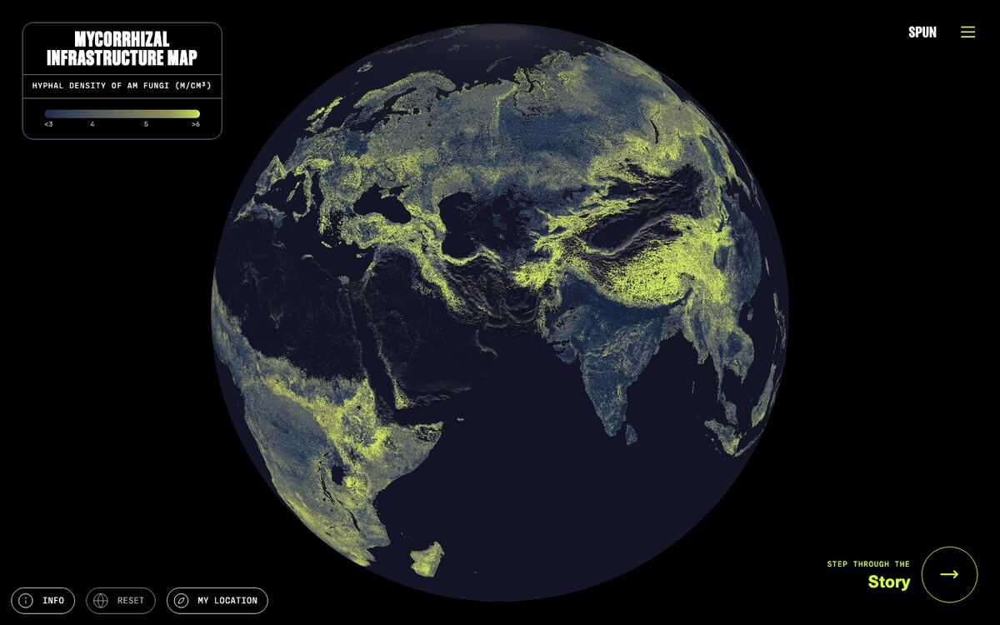
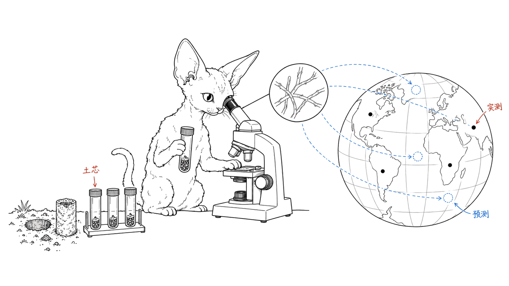
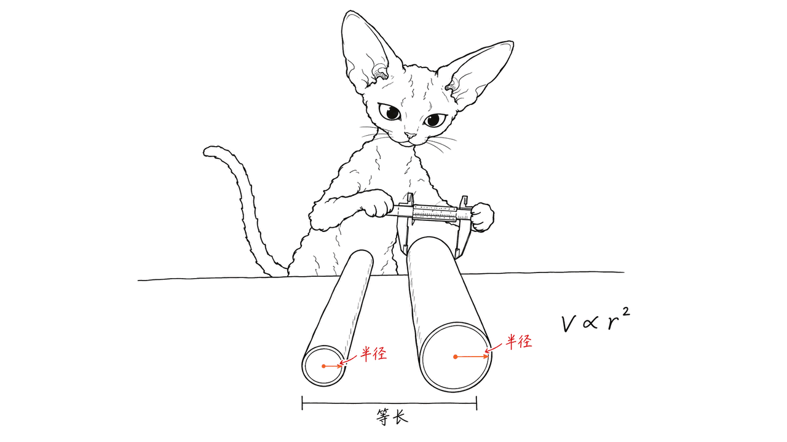
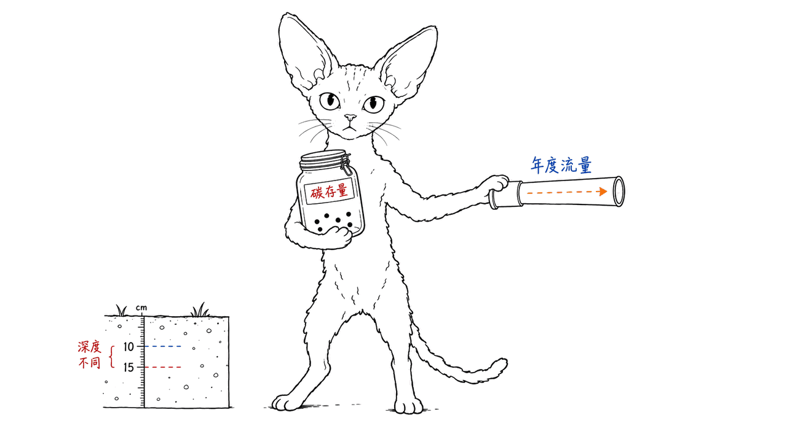

A Hidden Infrastructure 是让你探索地下菌根真菌分布的交互式科学网站：地图展示全球预测的菌丝密度，滚动叙事解释这些数字怎样得来。

它由科研组织 SPUN 与合作者制作，研究发表于 2026 年 6 月 11 日的《Science》，可视化由 Moritz Stefaner / Truth & Beauty 合作设计。重点是丛枝菌根真菌（AM fungi）的活体菌丝，不是地下所有真菌，也不是把一根根菌丝在全球逐条拍出来。

网站入口：https://a-hidden-infrastructure.spun.earth/

地图：https://a-hidden-infrastructure.spun.earth/map

图：2026 年 10 月 13 日抓取的官方地图。科学内容来自 SPUN 及研究合作者，网页与地图设计由 Moritz Stefaner / Truth & Beauty 合作完成。封面与后文手绘图为主题示意，不是实测菌丝照片或原始数据图。

## 地图究竟画了什么？

菌根真菌与植物根部形成共生关系：植物通过光合作用获得碳，向真菌分配其中一部分；真菌的细管状菌丝伸入土壤，帮助获取养分。这样一个微小而广泛的交换系统，很难用地上森林的照片直观理解。

网站将菌丝密度以地理颜色呈现，图例单位是 `m/cm³`，即每立方厘米土壤对应多少米菌丝。它是一张模型预测的密度地图，不能用颜色去推断某两棵树是否直接相连，更不能把分散的菌丝总长度看成一条绕地球不断延伸的单一生物。

“首次”也应限定对象。这项工作提供 AM 菌丝密度与生物量的全球尺度估算；SPUN 在 2025 年已经发布过菌根真菌多样性相关地图。密度、生物量和物种丰富度，是不同的问题。

## 1.6 万份样本如何变成全球地图？

研究团队不是新采集了所有样本，而是汇集已有研究：322 项研究、超过 16,000 份土芯、覆盖 9 类生物群系。网站另将它们组织为来自约 4,000 个地点的全球数据集。

这条证据链可以分成三步：

| 步骤 | 直接取得的信息 | 推算的对象 |
| --- | --- | --- |
| 土芯与显微测量 | 局部土壤里的菌丝长度和密度 | 建立训练与比较数据 |
| 机器学习与环境图层 | 气候、植被、土壤和土地利用条件 | 约 1 平方公里尺度的空间密度预测 |
| 活体网络成像 | 菌丝宽度等形态信息 | 将长度换算为体积，再估算碳生物量 |

作者存档稿描述使用随机森林学习环境条件与菌丝密度的关系。全球颜色连续，并不意味着每个像素都取过土芯：未采样地区的数值依赖模型外推，采样较少的地方更不确定。

网站的方法章节还解释了一个关键点：菌丝体积随半径平方变化。相同长度的粗菌丝和细菌丝，生物量不会相同。研究通过机器人显微成像取得超过 300,000 次菌丝宽度测量，为长度到生物量的转换提供依据。

方法说明：https://a-hidden-infrastructure.spun.earth/about

## 11 亿亿公里和 3 亿吨，怎样读才准确？

“110 quadrillion km”对应 `1.10 × 10^17 km`，中文可以写作约 11 亿亿公里。它把研究范围内的菌丝长度相加，是数量级估算，并非实际追踪一条全球连通的路线。

更容易误解的是质量单位。作者存档稿的结果写作 `300 ± 60 Mt C`：约 **3 亿吨碳生物量**，不是 3 亿吨含水真菌的总重量，也不是每年新增 3 亿吨永久封存的碳。

| 指标 | 作者存档稿给出的估计 | 不能据此推出什么 |
| --- | --- | --- |
| 活体 AM 菌丝总长 | `1.10 × 10^17 ± 0.13 × 10^17 km`，± 为 SD | 全球所有真菌总长、单一连通网络 |
| 活体菌丝碳生物量 | `300 ± 60 Mt C`，± 为 SD | 湿重、年度固定量、永久碳移除量 |
| 深度口径 | 存档稿结果与方法使用表层 15 cm | 自动包含更深土层与死亡菌丝 |

SD 是标准差，不应直接改写成“95% 置信区间”。活体生物量是某一估算范围内的存量；植物向真菌分配的年度碳是流量；形成长期稳定土壤碳的份额又是另一个过程。这三个数字不能互相替代。

我们还发现了明确的来源差异：网站 About 写的是“upper 10 cm”，作者公开存档稿的结果和方法则写“top 15 cm”。本文在给出详细数字时使用并标注存档稿的 15 cm 口径，保留这处不一致，不声称已经确认网页和最终出版版本的深度完全相同。

论文 DOI：https://doi.org/10.1126/science.adu4373

SPUN 提供的论文说明与作者存档入口：https://www.spun.earth/peer-reviewed-papers/the-planets-largest-biological-infrastructure-lies-beneath-our-feet

## 看完地图，哪些保护问题会变得不一样？

森林的地上生物量很醒目，草地的地下结构却容易被忽视。作者存档稿估计，草地生态系统合计约占全球 AM 菌丝碳生物量的 40%；不要将这个比例缩写成仅山地和淹水草地两个类别之和。

网站另报告，耕地的 AM 网络密度平均比非耕地低约 47%。这是汇总层面的比较，不能读成每块农田都减少了同样比例，也不能单凭它判断某一种耕作措施的因果效果。网站本身也说明，还需要进一步连接具体农业实践与菌根健康。

对保护工作的实际启示，是将地下结构纳入调查和恢复的对象。地图可以帮助寻找采样缺口、确定进一步调查的位置；落实到某块土地的管理决策，仍需要当地数据与具体生态背景。

耕地章节：https://a-hidden-infrastructure.spun.earth/story/cropland-impact

## 这个网站的交互设计为什么值得看？

它先解释菌丝、样本与显微成像，再让读者进入地图和总量比较。这个顺序让人知道地图来自哪些证据，也能理解模型在哪些地区更有把握。

About 列出的实现包括 SvelteKit、MapLibre GL JS、PMTiles，以及用 Cloud Optimized GeoTIFF 和 geotiff.js 在浏览器查询像素值。这些开源组件支持地图交互，但不能据此认定整个网站源码、全部数据和媒体都采用同一种开源许可证。

Mycelium Protocol 的独立判断是：这类可视化最有价值的地方，是让公众同时接触研究对象和推算过程。漂亮的连续地图容易制造确定感，因此量纲、采样位置和不确定性应与视觉效果一起阅读。

本次我们使用 Jina Reader 抓取主页面、About 与方法和结果章节，读取 SPUN 链接的作者公开存档稿，并在本机 Chromium 打开地图：页面返回 200、地图画布可见、图例正常，未出现 JavaScript 页面错误。我们没有复跑全球机器学习模型，也没有独立重测土芯或显微数据。

如果第一次看，建议先读采样与测量章节，再进入地图比较不同区域。对自己熟悉的地方，先问“这里有多少采样依据”，再问“颜色为什么不同”。这种读图习惯比记住一个惊人的总长度更有用。

## 常见问题

### 这是不是全部地下真菌的地图？

不是。研究聚焦活体丛枝菌根真菌菌丝；其他菌根类型、其他真菌和死亡菌丝不应混进这组总量。

### 地图里每个地方都真的采样了吗？

没有。样本提供经验依据，模型结合环境图层进行空间预测；约 1 平方公里的分辨率不等于每平方公里都有实测值。

### 3 亿吨就是年度碳减排量吗？

不是。存档稿以碳生物量描述活体菌丝存量；碳输入、周转和长期稳定留存需要分别分析。

### 网页和论文的土层深度一致吗？

本次核对发现网站 About 的 10 cm 与作者存档稿的 15 cm 不一致。本文明确保留该差异，未将二者当作相同深度的估算。

## 一手来源与署名

- 交互网站：https://a-hidden-infrastructure.spun.earth/
- 全球数据集：https://a-hidden-infrastructure.spun.earth/story/a-global-dataset
- 测量生物量：https://a-hidden-infrastructure.spun.earth/story/measuring-biomass
- 方法与网页设计署名：https://a-hidden-infrastructure.spun.earth/about
- Science 论文：https://doi.org/10.1126/science.adu4373
- SPUN 作者存档下载：https://drive.google.com/uc?export=download&id=1KRl_nslx1-uNc5A0PdZcjkSpOt--RadL

---

> © 2026 Author: Mycelium Protocol. 本文采用 [CC BY 4.0](https://creativecommons.org/licenses/by/4.0/deed.zh) 授权——欢迎转载和引用，须注明作者姓名及原文链接，不得去除署名后以原创发布。官方地图与研究素材的权利归原作者，本文授权不替代其各自条款。

<!--EN-->

A Hidden Infrastructure is an interactive science website for exploring underground mycorrhizal fungi: a map shows predicted global hyphal density, while the story explains how researchers obtained the estimates.

SPUN and collaborators produced the research, published in Science on June 11, 2026. Moritz Stefaner / Truth & Beauty collaborated on the visualization. Its focus is living arbuscular mycorrhizal (AM) hyphae, not every underground fungus or a filament-by-filament scan of the planet.

Website: https://a-hidden-infrastructure.spun.earth/

Map: https://a-hidden-infrastructure.spun.earth/map

Captured October 13, 2026. Science: SPUN and research collaborators. Web and map design: Moritz Stefaner / Truth & Beauty. The cover and hand-drawn illustrations are explanatory imagery, not measured hyphal photographs or original data figures.

## What does the map actually show?

Mycorrhizal fungi partner with plant roots. Plants allocate some photosynthetic carbon to fungi, whose tubular hyphae explore soil and help obtain nutrients. The microscopic network is widespread but difficult to communicate through aboveground landscape photographs.

Map colors express density in `m/cm³`: meters of hyphae per cubic centimeter of soil. A predicted density surface cannot establish whether two particular trees share a direct connection. Summing filament lengths also does not demonstrate a single connected planetary organism.

The first-map claim needs a defined scope. This research estimates AM hyphal density and biomass globally; SPUN had already published mycorrhizal diversity maps in 2025. Density, biomass and species richness answer different questions.

## How do 16,000 soil cores become a global estimate?

The team assembled existing evidence rather than freshly collecting every sample: 322 studies, more than 16,000 cores and nine biomes. The website describes approximately 4,000 contributing locations.

| Stage | Direct information | What it supports |
| --- | --- | --- |
| Soil cores and microscopy | Local hyphal length and density | Empirical training and comparison data |
| Environmental layers and machine learning | Climate, vegetation, soil and land use | Density predictions at approximately 1 km² resolution |
| Imaging living networks | Hyphal width and morphology | Conversion from length to volume and carbon biomass |

The author archive describes Random Forest models. Continuous global color does not mean every pixel was sampled. Estimates in sparsely sampled environments rely more heavily on extrapolation and carry greater uncertainty.

Width matters because tubular volume scales with radius squared. Equal filament lengths can have different biomass. More than 300,000 width measurements from robotic imaging supported the conversion.

Methods: https://a-hidden-infrastructure.spun.earth/about

## What do 110 quadrillion kilometers and 300 million tons mean?

The length is approximately `1.10 × 10^17 km`, a sum within the study's scope. It is not a traced path through one connected organism.

The author archive expresses biomass as **`300 ± 60 Mt C`: carbon biomass**, not the wet weight of all fungi or a permanently removed annual carbon quantity.

| Estimate | Author-archive value | What it does not establish |
| --- | --- | --- |
| Living AM hyphal length | `1.10 × 10^17 ± 0.13 × 10^17 km`, SD | All fungi or a globally connected route |
| Living hyphal carbon biomass | `300 ± 60 Mt C`, SD | Wet weight or annual permanent removal |
| Depth | Top 15 cm in archive results and methods | Inclusion of deeper soil or dead hyphae |

SD means standard deviation, not a 95% confidence interval. Living biomass is a stock; annual plant carbon allocation is a flow; the fraction reaching stable soil pools is another process. They should not be interchanged.

Our source comparison found a depth discrepancy: the live About page says the upper 10 cm, while the publicly linked author archive uses the top 15 cm. Detailed estimates here explicitly follow the archive's 15 cm scope. We preserve the discrepancy rather than claiming the website and final published version have been reconciled.

Paper: https://doi.org/10.1126/science.adu4373

SPUN's paper summary and author-archive link: https://www.spun.earth/peer-reviewed-papers/the-planets-largest-biological-infrastructure-lies-beneath-our-feet

## What could change in conservation decisions?

Forests have conspicuous aboveground biomass; grasslands can hide substantial underground infrastructure. The author archive estimates grassland ecosystems together account for approximately 40% of global AM hyphal carbon biomass. That should not be narrowed to only montane and flooded grasslands.

The website reports about 47% lower average AM network density in cropland than non-cropland soils. This aggregate comparison does not imply an identical reduction on every farm or isolate the causal effect of a particular farming practice. The narrative itself calls for more work linking practices to mycorrhizal health.

Maps can help identify sampling gaps and places for further investigation. Local management still needs local evidence and ecological context.

Cropland chapter: https://a-hidden-infrastructure.spun.earth/story/cropland-impact

## Why is the interactive presentation useful?

The narrative introduces hyphae, sampling and imaging before the map and total estimates. Readers can therefore see the empirical and modeling stages behind a visual result.

The About page credits SvelteKit, MapLibre GL JS, PMTiles, Cloud Optimized GeoTIFF and geotiff.js. Open-source components do not establish a single open-source license for all application code, datasets and media.

Mycelium Protocol's assessment is that the strongest communication benefit is showing both the hidden subject and the estimation process. A continuous map can suggest excessive certainty; units, sampling coverage and uncertainty deserve as much attention as visual detail.

We fetched the main page and science chapters with Jina Reader, read the publicly linked author archive, and opened the map in local Chromium. It returned 200, displayed its canvas and legend, and raised no JavaScript page errors. We did not reproduce the global machine-learning analysis or independently measure soils or microscopy data.

Start with sampling and measurement, then compare places on the map. Ask how much empirical support exists in a region before interpreting differences in color.

## FAQ

### Does this map cover all underground fungi?

No. It focuses on living AM hyphae. Other fungal groups and dead hyphae should not be included in these totals.

### Is every square kilometer directly sampled?

No. Samples support spatial predictions through environmental layers. Approximate 1 km² resolution is not evidence of one field measurement per cell.

### Is 300 million tons an annual climate benefit?

No. The archive reports living carbon biomass. Input, turnover and long-term retention are separate quantities.

### Do the sources agree on soil depth?

Our check found 10 cm on the live About page and 15 cm in the author archive. We explicitly retain that difference rather than equating their scopes.

## Primary sources and credits

- Interactive website: https://a-hidden-infrastructure.spun.earth/
- Global dataset: https://a-hidden-infrastructure.spun.earth/story/a-global-dataset
- Biomass measurement: https://a-hidden-infrastructure.spun.earth/story/measuring-biomass
- Methods and design credits: https://a-hidden-infrastructure.spun.earth/about
- Science paper: https://doi.org/10.1126/science.adu4373
- Author archive linked by SPUN: https://drive.google.com/uc?export=download&id=1KRl_nslx1-uNc5A0PdZcjkSpOt--RadL

---

> © 2026 Author: Mycelium Protocol. Licensed under [CC BY 4.0](https://creativecommons.org/licenses/by/4.0/) — free to share and adapt with attribution. You must credit the author and link to the original; removing attribution and republishing as original is not permitted. Official maps and research media retain their original rights; this license does not replace their terms.
