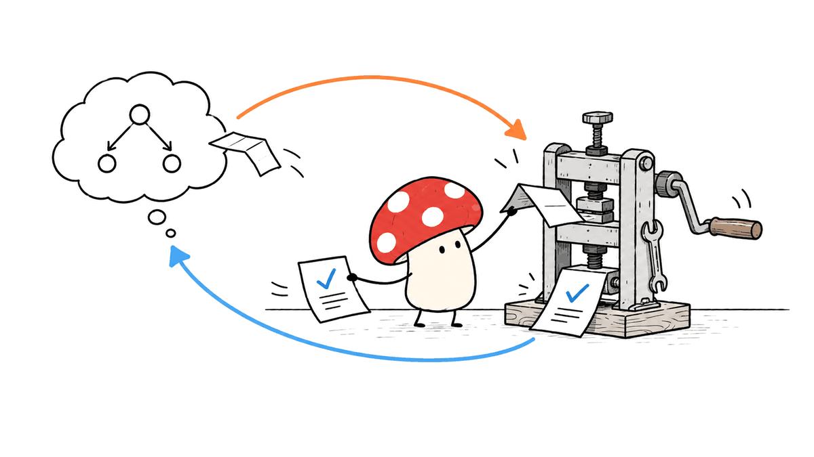
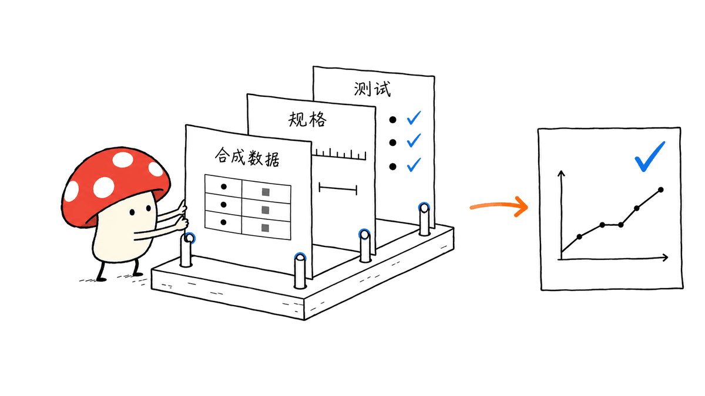

CS146S 2026 秋季版从编程代理内部原理讲起；配套学习资源中，FL-Bin/stanford-ai-course 提供非官方中英双语教材、按周笔记及 PDF。它适合已经会写一些代码、准备系统学习 AI 辅助开发的学生与工程师。

课程与笔记需要分开看：前者决定授课主题与原始材料，后者帮助读者用中文理解概念、安排练习。截至 2026 年 10 月 29 日核查，笔记教材完成前五章，第六至十章尚待更新。

> 官方课程：https://themodernsoftware.dev/
> 中文学习笔记：https://github.com/FL-Bin/stanford-ai-course
> PDF 发布页：https://github.com/FL-Bin/stanford-ai-course/releases/tag/pdf-latest

## CS146S 是怎样一门课，零基础能直接学吗？

《The Modern Software Developer》关注的是人和编程代理怎样共同完成软件工程。官方课程说明涵盖 MCP、Agent Skills、规格驱动开发、迭代循环设计与软件工厂，要求学生把需求转为可执行规格，再组织规划、构建、评估和改进。

它是一门 3 学分课程，讲师为 Mihail Eric。2026 年官网列出的先修条件是 CS111/CS161 等效编程经验，并建议具有 CS221/CS229 背景。因此，“入门 AI 开发”可以成立，“不需要编程基础”则不符合官网条件。

对科研学生而言，适合的起点是已经能运行 Python 脚本、理解函数和文件路径，并且有一个实际问题：批量整理动捕数据、检查实验记录、跑统计或生成图表。完全没接触过编程的读者，宜先补函数、异常、虚拟环境、终端与 Git。

## 2026 年究竟改了什么？

官方页面同时保留 Fall 2026 和 Fall 2025 入口。旧版第一周讲 LLM 与提示词基础；新版第一周主题变成编程代理内部原理，9 月 22 日的课次明确写有“200 行构建 Claude Code”，并给出 Slides 和 Completed code 链接。

这说明教学切入点从“怎样向模型提问”推进到了“怎样让程序把模型接到真实开发环境”。200 行是教学用最小代理的尺度，不能理解成完整复刻商业版 Claude Code 的权限体系、沙箱、编辑器交互和上下文管理。

素材中“85% 的 Fall 2025 材料被替换”的说法对应讲师的 X 公告链接，但本次直接读取该帖子遇到 403，未将这一比例当成独立核验结果。官网新旧大纲足以确认主题发生明显变化；也没有依据把一次改版扩大成“每年全部重构”。

公告入口：https://x.com/mihail_eric/status/2095166860740174273

| 周次 | 2026 年官网主题 | 自学时要回答的问题 |
|---|---|---|
| 1 | 编程代理内部原理 | 模型怎样读文件、提出修改并接收工具结果？ |
| 2 | 进阶上下文工程 | 需求、规格、上下文与 MCP 如何配合？ |
| 3 | Agent Skills 与 CLI | 哪些操作应写成可复用工作流？ |
| 4 | 定制代理与仓库 | AGENTS.md、hooks 和子代理分别约束什么？ |
| 5 | 让代码库适合代理 | 测试、文档和构建命令是否足够明确？ |
| 6 | 代理代码审查 | 生成代码后，怎样获得可信的审查？ |
| 7 | 安全 | 如何识别依赖、密钥泄露和提示注入风险？ |
| 8 | 后台代理 | 异步任务和并行代理怎样管理？ |
| 9 | AI 原生团队 | 权限化工具接入、模型路由和成本怎样统一？ |
| 10 | 软件工厂与未来 | 如何持续运行、评估和维护整套系统？ |

以上后几周是课程计划，不能据此声称所有对应录像与讲义均已开放。部分材料有访问限制，学习笔记也明确标记了待官方材料的嘉宾内容。

## 先看懂最小代理，再学习工具名称

编程代理的关键结构可以写成一个闭环：模型根据需求与上下文提出工具调用；宿主程序执行读取、编辑或命令；结果追加到对话；模型决定继续行动还是结束。

模型负责选择动作，真正接触文件的是运行工具的程序。理解这一区别，才能解释为什么更换模型并不会自动改变文件权限，为什么一次错误编辑会影响下一轮推理，以及为什么工具输出越堆越多会消耗上下文。



最小示例适合暴露结构，不能直接充当生产系统。安全的练习目录、工具允许范围、循环次数上限、错误处理、费用预算与测试结果，都需要额外设计。仓库第一章也明确把讲解用代码与官方示例区分开，没有把讲解片段包装成官方源码。

科研工作尤其要区分“脚本能跑”和“结果可信”。代理完成统计图，不代表样本剔除规则、单位换算或检验方法正确。验收标准应包含数据含义和数值检查，而不只是一张漂亮图片。

## stanford-ai-course 仓库提供哪些学习入口？

核对仓库快照 b7a24a29f95a02ddae841ce996b482a9c0152ff5 后，可以确认它与素材描述相符。仓库明确标为非官方，与斯坦福及课程团队无隶属、审阅或认可关系，内容是作者整理的转述与讲解。

它提供三个互补入口：

- `book/zh/` 与 `book/en/`：按概念重新编排的教材，适合连续阅读。
- `LEARNING_PATH.md`：按上课日期对应讲者、官方材料和教材章节，适合核对来源。
- `weeks/`：按课件顺序整理的每周笔记，适合回查具体课堂内容。

正文、补充框和短引用分别承担课程转述、作者延伸和原文摘引。这个分层很有价值：遇到一个判断时，读者可以先辨别它来自课堂还是笔记作者，再去官方链接复核。

前五章依次讲代理原理、上下文与规格、MCP 和 Skills、代理定制、代码库准备。它们并非把前五周机械翻译成五章，例如第三章整合了第二周的工具调用与第三周的 Skills 内容。


仓库更新日志显示，10 月 27 日新增了教材形式及前五章。README 预计 12 月上旬完成全部十周内容，这是维护者计划，不能当作交付保证。本次核查时官方日程已进入第六周，而教材仍完成前五章，二者并不矛盾。

## PDF 怎么下载，许可有什么边界？

GitHub 的 `pdf-latest` Release 实际列出四份文件：中英文教材，以及中英文按周笔记。教材与按周笔记并非同一本文件换名，下载时应按阅读目的选择。README 表示 PDF 由自动化流程随仓库更新生成，固定链接会指向后续版本。

中文教材直链：https://github.com/FL-Bin/stanford-ai-course/releases/download/pdf-latest/CS146S-book-zh.pdf

英文教材直链：https://github.com/FL-Bin/stanford-ai-course/releases/download/pdf-latest/CS146S-book-en.pdf

需要跟踪更新时，可以克隆仓库，保留自己读过的提交号；只看文件则直接在线浏览或下载 PDF 即可，不必安装编程代理。

```bash
git clone https://github.com/FL-Bin/stanford-ai-course.git
cd stanford-ai-course
git rev-parse HEAD
```

笔记原创内容采用 CC BY-NC-SA 4.0：涉及署名、非商业使用及相同方式共享要求。该许可不覆盖链接出去的官方课件、代码、论文和阅读材料。因此，它更准确的定位是开放学习笔记资源，不能直接当成 MIT 或 Apache 2.0 软件包使用。

## 科研和开发学生怎样真正学进去？

建议选一个小型练习贯穿前五章，例如“把若干实验 CSV 转成经过检查的汇总表和图”。以下是基于课程主题设计的自学路线，并非官方作业复刻。

1. **先建立人工基线。** 准备少量合成数据，明确输入列、单位、缺失值处理和预期输出，手工算出一组可比对结果。
2. **读第一章并观察代理轨迹。** 逐步记录代理看了哪个文件、为什么调用工具、修改了哪里。完成标准是能解释一次失败如何反馈到下一轮。
3. **读第二章，把口头需求变成规格。** 写出边界条件、禁止修改的目录和验收测试。让代理先形成方案，再执行修改。
4. **读第三、四章，把重复动作固定下来。** 将已有检查脚本组织成 Skills；在 AGENTS.md 记录运行命令与项目约束。只有确实要连接外部能力时再引入 MCP。
5. **读第五章，改善仓库本身。** 让一条命令能运行测试，记录数据格式和输出位置。换一个干净会话，检查代理能否重现相同结果。



这条路线的价值在于可检查的产物：需求说明、工具轨迹、代码差异、测试与复现步骤。把十个工具都安装一遍，并不能替代这些证据。涉及真实受试者资料时，练习应先使用合成或获准的数据，避免随手把敏感内容送入模型服务。

本站的 pstack 工程流程介绍也可作为延伸阅读：https://blog.mushroom.cv/blog/pstack-engineering-workflow/

## 常见问题

### 200 行示例可以替代 Claude Code 吗？

不能。它帮助读者看懂模型、工具和循环的关系；产品级代理的权限、安全、上下文压缩、长任务恢复和交互体验需要更多工程实现。

### 中文仓库是斯坦福官方教材吗？

不是。FL-Bin/stanford-ai-course 明确声明为非官方整理，提供个人撰写的双语转述、补充练习及官方链接，不能把它署名为斯坦福发布。

### 必须购买高配 Mac 或本地跑大模型吗？

阅读 Markdown、下载 PDF 和运行轻量 Python 练习不要求独立显卡。实际代理练习取决于采用的模型服务和工具：云端 API 可能收费，本地推理则另有内存要求，课程公开不意味着模型调用免费。

### 应从中文教材还是官方页面开始？

先核对官网年份和大纲，再从教材第一章读起。遇到关键代码、评分要求、工具行为和来源不明的观点，应沿学习路线返回官方材料；课程更新后也以官网为准。

## 来源与核查范围

官方课程：https://themodernsoftware.dev/

笔记仓库、README、教材目录、第一章与更新日志：https://github.com/FL-Bin/stanford-ai-course

PDF 文件列表：https://github.com/FL-Bin/stanford-ai-course/releases/tag/pdf-latest

本次核查覆盖课程公开页面及其前端大纲、仓库文件与 Release 列表，没有运行官方代理代码，也没有对课程学习效果做实验。“85%”原帖未直接读通，文中保留这一限制。对入门者最有帮助的选择，是读懂一个闭环，再用可复核的小任务逐步增加能力。

---

> © 2026 Author: Mycelium Protocol. 本文采用 [CC BY 4.0](https://creativecommons.org/licenses/by/4.0/deed.zh) 授权——欢迎转载和引用，须注明作者姓名及原文链接，不得去除署名后以原创发布。

<!--EN-->

Stanford CS146S Fall 2026 begins with the internals of coding agents. FL-Bin/stanford-ai-course complements the official course with unofficial bilingual explanations, weekly notes, and downloadable PDFs. The combination suits students and developers who already have some programming experience and want a structured introduction to AI-assisted engineering.

As checked on October 29, 2026, the textbook contains chapters 1–5; chapters 6–10 remain pending.

Official course: https://themodernsoftware.dev/
Bilingual notes: https://github.com/FL-Bin/stanford-ai-course
PDF release: https://github.com/FL-Bin/stanford-ai-course/releases/tag/pdf-latest

## What does CS146S teach, and who is ready for it?

The three-unit course, taught by Mihail Eric, examines how developers organize work with coding agents. Its official description names MCP, agent skills, spec-driven development, loop engineering, and the software factory. Students turn requirements into executable specifications and coordinate planning, building, evaluation, and improvement.

The website requires CS111/CS161-equivalent programming experience and recommends CS221/CS229 background. It is an introduction to working with AI in software engineering, rather than a replacement for introductory programming.

Research students who can already run scripts, understand functions, and navigate files have useful starting projects: cleaning motion-capture data, checking experiment records, computing statistics, or producing repeatable figures. Readers without that background should first learn functions, exceptions, environments, shell basics, and Git.

## What changed in Fall 2026?

The official site retains separate 2025 and 2026 versions. The older first week introduced LLMs and prompting; the new opening week focuses on coding-agent internals. The September 22 session explicitly lists building Claude Code in 200 lines and links slides and completed code.

That is a teaching exercise in a minimal agent. It does not reproduce the complete permissions, sandboxing, interface, or context management of a commercial coding product.

The supplied claim that 85% of the previous material was replaced points to the instructor's announcement. Direct retrieval of the X post returned 403 during this review, so that percentage is not presented as independently verified. Comparing the official syllabi establishes a substantial change without assuming that every annual edition is completely rebuilt.

Announcement link: https://x.com/mihail_eric/status/2095166860740174273

| Week | Official 2026 theme | Learning question |
|---|---|---|
| 1 | Coding-agent internals | How do model decisions become file operations? |
| 2 | Advanced context engineering | How do specifications, context, and MCP fit together? |
| 3 | Agent skills and CLI | Which workflows deserve reusable instructions? |
| 4 | Customizing agents and repositories | What belongs in instructions, hooks, or subagents? |
| 5 | Agent-ready codebases | Can an agent discover the tests and build process? |
| 6 | Agentic code review | How can generated changes be evaluated? |
| 7 | Security | What risks arise from dependencies, secrets, and injection? |
| 8 | Background agents | How are asynchronous tasks managed? |
| 9 | AI-native teams | How are tool permissions, routing, and costs coordinated? |
| 10 | Software factory and future | How are systems operated and improved over time? |

Scheduled topics do not prove that every recording and slide deck is already public. Some materials have access restrictions, and the notes identify guest sessions whose official materials are still unavailable.

## Understand the loop before collecting tools

A coding agent repeatedly sends a task and context to a model, executes requested tools through a host program, appends results, and asks the model what to do next. The host touches the filesystem; the model selects actions through the interface it receives.

That distinction explains why changing models does not change permissions, why failed edits affect later decisions, and why accumulating tool output increases context costs.


A teaching implementation exposes the structure. A dependable system additionally needs limits on tools, iterations, spending, error handling, and filesystem access. The notes distinguish their explanatory snippets from the linked official example, rather than presenting those snippets as official source code.

For scientific work, a successful script execution is only one check. Inclusion rules, measurement units, and statistical assumptions still need independent validation. A polished plot cannot establish their correctness.

## What does the bilingual repository provide?

The reviewed snapshot is b7a24a29f95a02ddae841ce996b482a9c0152ff5. Its README explicitly describes an unofficial project with no affiliation, review, or endorsement by Stanford or the course staff.

There are three useful entry points. `book/zh/` and `book/en/` provide a concept-based textbook. `LEARNING_PATH.md` maps dates, speakers, official sources, and chapters. `weeks/` follows the order of class materials for reference.

The project separates course explanations, author supplements, and short attributed quotations. That helps readers trace whether a statement comes from a lecture or the note author's interpretation.

Chapters 1–5 cover agent internals, context and specifications, MCP and skills, agent customization, and repository readiness. Chapter numbering is not a one-to-one translation of weekly scheduling: the tools chapter combines material from weeks two and three.


The changelog records the textbook addition on October 27. Completion in early December is the maintainer's plan, not a guarantee. On the review date, the official schedule had reached week six while the textbook still contained five completed chapters.

## Where are the PDFs, and what does the license cover?

The `pdf-latest` release lists four assets: Chinese and English textbooks plus Chinese and English weekly notes. The README says automated builds update these fixed download links as the repository evolves.

Chinese textbook: https://github.com/FL-Bin/stanford-ai-course/releases/download/pdf-latest/CS146S-book-zh.pdf

English textbook: https://github.com/FL-Bin/stanford-ai-course/releases/download/pdf-latest/CS146S-book-en.pdf

Online reading or PDF downloads require no agent installation. Cloning is useful for recording a revision and following changes:

```bash
git clone https://github.com/FL-Bin/stanford-ai-course.git
cd stanford-ai-course
git rev-parse HEAD
```

The original notes use CC BY-NC-SA 4.0, with attribution, noncommercial, and share-alike conditions. That license does not cover linked slides, code, papers, or readings. Public availability should not be treated as an MIT or Apache software license for all related material.

## How can students turn reading into useful practice?

A small synthetic-data project can carry the concepts through the first five chapters. The following study plan is an independent suggestion, not a reproduction of an official assignment.

1. Define a manual baseline: input columns, units, missing-value rules, and one hand-checked expected result.
2. Read chapter one and inspect a tool trace. Explain each file read, edit, and failed action.
3. Read chapter two and write a specification with boundaries and acceptance tests before implementation.
4. Read chapters three and four to package repeated checks as skills and document project commands in AGENTS.md. Add MCP when an external capability actually requires it.
5. Read chapter five to make tests runnable through one command and outputs reproducible. Check whether a fresh agent session can repeat the result.


Useful evidence includes a specification, execution trace, diff, tests, and reproduction instructions. Installing many tools does not substitute for those artifacts. For work involving participants or confidential records, start with synthetic or approved data rather than uploading sensitive files to an arbitrary model service.

Related engineering workflow overview: https://blog.mushroom.cv/blog/pstack-engineering-workflow/

## Frequently asked questions

### Can the 200-line exercise replace Claude Code?

No. It teaches the relationship between models, tools, and an execution loop. Production permissions, safety, long-task recovery, context handling, and interaction require additional engineering.

### Is the Chinese repository an official Stanford textbook?

No. It provides independent bilingual explanations, supplements, and source links. Its content should not be attributed to Stanford as an official publication.

### Does studying require an expensive Mac or local model?

Reading Markdown and PDFs and running lightweight Python exercises does not require a discrete GPU. Agent exercises depend on the selected model and tools: cloud APIs may cost money, while local inference has separate memory requirements.

### Which source should a learner start with?

Check the official course year and syllabus, then read textbook chapter one. Follow source links for code behavior, assessment requirements, and important claims; use the official site for course updates.

## Sources and limits of this review

Official course and embedded syllabus: https://themodernsoftware.dev/

Repository README, textbook contents, first chapter, and changelog: https://github.com/FL-Bin/stanford-ai-course

Release asset list: https://github.com/FL-Bin/stanford-ai-course/releases/tag/pdf-latest

This review inspected public course material, repository files, and release metadata. It did not execute the official agent example or measure learning outcomes. The original X announcement was not directly retrievable. The practical starting point is to understand one agent loop, then add capabilities through a small project with checkable results.

---

> © 2026 Author: Mycelium Protocol. Licensed under [CC BY 4.0](https://creativecommons.org/licenses/by/4.0/) — free to share and adapt with attribution. You must credit the author and link to the original; removing attribution and republishing as original is not permitted.
