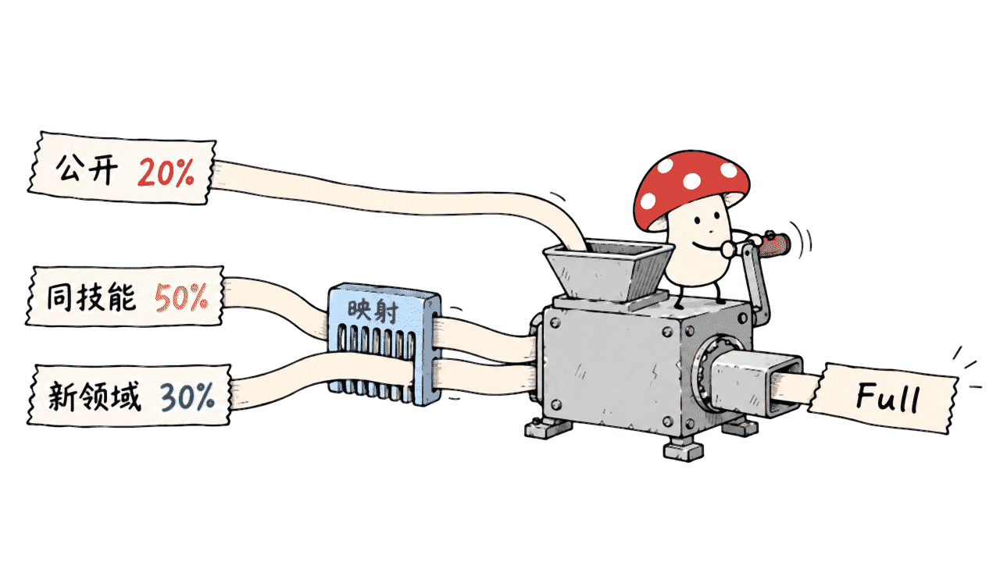
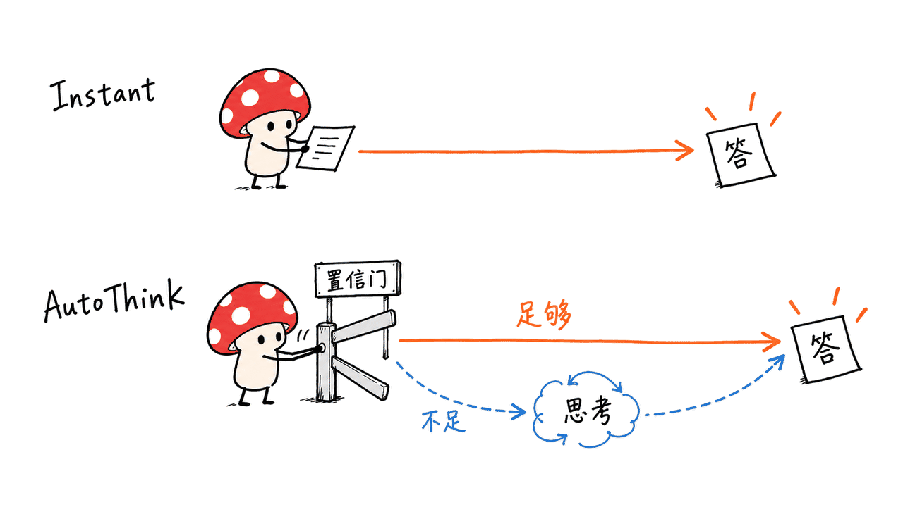
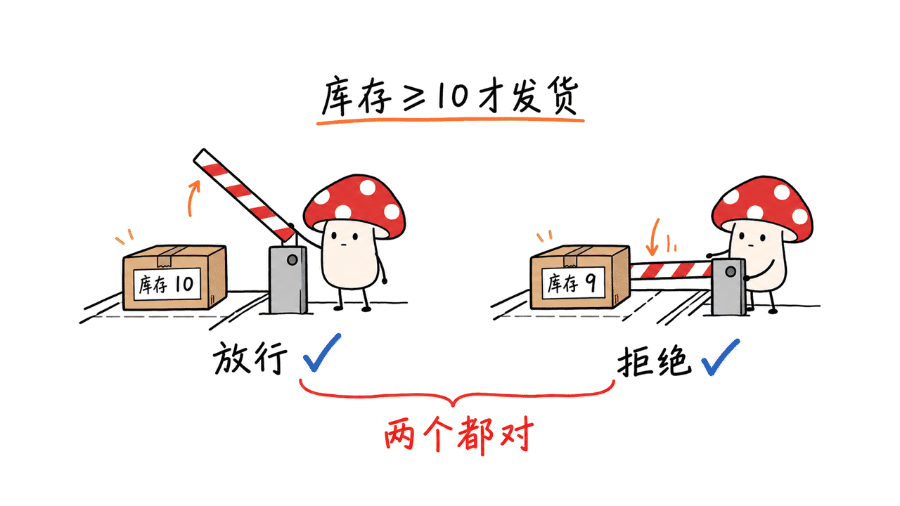

Decision Index 衡量模型能否根据状态和规则做出结构化选择，并给各选项分配概率。近期发布的 Instant／AutoThink 成绩来自 StartLux-Decision v1.1；其中 AutoThink 的 73.4 是论文公开子集成绩，当前官网榜首是 Instant 27B 的 Full score 69.12。

本文于 2026-10-18 更新原有 StartLux 文章，保留 10 月 3 日的原链接。官网当前标签为 **Decision Index 0.3.2**，本文表格来自其 2026-10-16 19:00:10 UTC 生成的数据，不冒充 10 月 18 日新跑的一轮测试。

官方榜单：https://huggingface.co/spaces/multimodalart/jev-decision-index

直接打开交互榜：https://multimodalart-jev-decision-index.static.hf.space/index.html

## Decision Index 到底测什么？

输入通常包含 `state` 和一组有明确候选项的 `questions`；输出是选择及其概率，而非一段可自由发挥的回答。适合的问题包括客服路由、工具选择、证据判断、规则约束下的行动选择。

它不是聊天体验、长文创作或完整智能体任务成功率的总榜。模型选对一个动作，也不能单独证明工具执行成功、权限正确或业务目标完成。

| 容易混淆的名字 | 实际含义 |
|---|---|
| Decision Index 0.3／0.3.2 | 评测体系及其修订版本 |
| StartLux-Decision v1.1 | 本文介绍的 Instant／AutoThink 模型族 |
| vLLM-SR Decision 3.0，简称 d3 | 另一家决策模型族，也是榜单参赛者 |

当前官网数据展示 42 个基准，37 个计入 Public index。五个能力领域的权重约为：知识推理 25.85%、语言理解 25.85%、检索分类 20.02%、工具自动化 18.28%、艺术与人类偏好 10%。领域内标为金标准的基准按 1.2 权重计。

Public 不是原始正确率。先对每项基准做随机猜测校正，再按领域聚合；未回答或不支持的请求按错处理。以四选一为简化例子，正确率 75%、随机基线 25%，校正后为 `(0.75-0.25)/(1-0.25)=66.7%`，而非 75 分。不同基准的随机基线按其具体指标确定。



## 为什么 Full score 不能直接拿三列原始分数相加？

0.3 的核心变化是把主排名改为 Full score：公开基准占 20%，同技能私有测试占 50%，新领域私有任务占 30%。私有部分先用未调优基础模型作为标尺，映射到公开分数的尺度，再加权。

```text
Full ≈ 0.20 × Public
     + 0.50 × 映射后的同技能私有分数
     + 0.30 × 映射后的新领域私有分数
```

以榜首为例：原始 Public／同技能／新领域分别是 72.88、64.82、61.41；两个私有分数映射后约为 64.51、74.28，再聚合得到约 69.12。因此，把原始三列直接加权算出另一个数，不代表榜单算错。

同技能私有题减少只适应公开题型的优势，新领域题检验迁移。这是更强的评测设计，但私有内容未公开，外部用户无法只靠公开套件完整复现 Full score。公开工具能复现的是 Public 部分，不能把它包装成全榜复现。

## 当前 Decision Index 前十条配置有哪些？

以下按 Full score 降序取前十条，快照共 174 条系统／配置记录。保留官方并列名次组：组内与首条相差不到 0.9 分的配置共享名次，下一组名次递增。表格不是强行编号为十个互不并列的模型。

| 官方名次组 | 系统／配置 | Full score | Public |
|---:|---|---:|---:|
| 1 | StartLux-Decision v1.1 27B | 69.12 | 72.88 |
| 2 | vLLM-SR d3 (27B) | 66.26 | 65.45 |
| 2 | linne-oak 1.0 (31B) | 65.61 | 63.94 |
| 2 | Perplexity Decider v1.2 (27B) | 65.55 | 67.74 |
| 3 | Decider 31B (NVFP4) | 64.62 | 64.27 |
| 3 | Amos 1 Large (27B) | 64.08 | 64.94 |
| 3 | Sieve 31B | 63.81 | 62.52 |
| 4 | Lychee-27B | 62.99 | 62.76 |
| 4 | KnowLine 35B-A3B Gen1 | 62.92 | 69.49 |
| 4 | Bobcat 1.3 (31B) | 62.83 | 59.31 |

榜首的模型卡明确指向 `StartLux-Decision-v1.1-27B-Instant`，不是 27B AutoThink。第 2 名次组中的 d3、linne-oak 和 Decider 也不能因小数点差异就解释为确定的能力先后。

官网另有视觉榜，其 Full 采用公开视觉测试与同技能私有测试各 50% 的口径；不要把它与上表的文字／结构化决策综合榜混排。公开工具文档还把推理专榜列为后续计划，因此 AutoThink 的论文成绩不能自行插进当前榜当作新的官方名次。

## 0.3 相比旧版改变了什么？

相较旧文使用的 0.2.1，0.3 的公开套件重建了 GSM8K 的错误选项，减少仅凭候选答案形式猜中答案的线索；移除 ForecastBench，并将 WinoGrande 计入知识推理领域。主榜同时引入 Full、私有尺度映射与并列规则。

当前网页标签是 0.3.2，其更新说明还记录了计分修复：0.3 发布后评分的 37 个模型，曾漏计 GPQA、MMLU-Pro、BBH 对应的部分同技能私有集合；现已补齐。因此读分数至少同时记录评测版本、数据生成时间、模型配置与 Public／Full 字段。

旧文的 v1 27B 在 0.2.1 上得 63.88，是旧模型和旧口径记录；既不能与 v1.1 的 73.37 直接相减宣布“能力涨了多少”，也不能继续用旧文“尚未进入公榜”描述今天的 v1.1。

## Instant 和 AutoThink 有什么区别？

Instant 通过一次前向读出选项概率，并使用其训练时的双向提示词注意力。AutoThink 先读一次概率：足够确信就直接答，不够确信才生成推理，再读出答案。因此“StartLux 全系列永不生成文字”已经不适用于现在的模型族。

| 尺寸 | Instant：DI 0.3 Public | AutoThink：DI 0.3 Public | DecisionPivot：Instant → AutoThink |
|---|---:|---:|---:|
| 27B | 72.83 | 73.37 | 75.4% → 86.9% |
| 9B | 69.96 | 70.45 | 47.5% → 59.9% |
| 4B | 67.88 | 68.21 | 41.5% → 59.9% |
| 2B | 59.14 | 未列该规格 | 21.1% → 未列 |
| 0.8B | 53.75 | 未列该规格 | 8.1% → 未列 |

这是作者发布的模型表，DI 一列仅指 0.3 公开子集，AutoThink 使用门控阈值 0.9。其 27B Instant 的 72.83 与榜单快照 Public 72.88 来自不同记录，本文保留各自数值，不把细小差异擅自归因于某项优化。

“Instant 高 7.4–16.9 分”是作者在已评测的同规模开放权重决策模型之间做的比较，不是领先所有通用模型的保证。论文也明确说，公开 DI 分数参与了数据配方、注意力方案及检查点选择，所以不属于独立测试成绩。

AutoThink 的训练包含 RLCD²，以概率质量改善为奖励，并抑制过长推理。当前服务默认 `gate=0.6`，而发布成绩使用 0.9；直接照当前快速启动默认值运行，不等同复现论文配置。



## DecisionPivot 为什么要成对计分？

它包含 7,800 个核心样例，按只改一个关键细节、答案就翻转的对照题组织，标签可程序化验证。Pair accuracy 要求一对中的两个答案都正确：只答对一边不算这一对成功。

举一个自拟示意：规则为“库存至少 10 件才能发货”。库存 10 件应放行，其他条件不变而库存改成 9 件应拒绝。模型如果两次都答放行，单题正确率还有一半，但成对正确率为零。

这个设计专门检查模型是否真的读取决定答案的条件。作者表中的 AutoThink 相比 Instant，27B、9B、4B 分别提高 11.5、12.4、18.4 个百分点；它们是成对准确率的绝对百分点，不是相对提升百分比。

论文声明 DecisionPivot 未用于数据、检查点或配置选择，因此在该报告里担当独立评估；仍应称作作者设计并评测的基准，而非第三方已经独立验证所有结果。计算型对照题也不能覆盖全部现实业务、分布变化和工具执行问题。



## Mac 上怎么起步，为什么不能只下载量化文件？

项目提供 vLLM、llama.cpp、MLX 和 Transformers 后端。已核对 0.8B Instant 与 4B AutoThink 的官方 MLX 4-bit 仓库存在，也有 GGUF 和 MLX 8-bit 版本链接。没有在本文运行模型，不提供 Mac 吞吐或最低内存保证。

MLX 可以从独立环境安装当前仓库，再用官方转换好的目录启动。以下是按上游文档整理、尚未本机执行的命令；精确复现应固定仓库提交、模型 revision 和依赖版本。

```bash
python -m pip install -e '.[mlx]'
hf download startlux-models/StartLux-Decision-v1.1-4B-AutoThink-MLX-4bit   --local-dir models/startlux-4b-autothink-mlx
startlux-decide serve --model models/startlux-4b-autothink-mlx   --backend mlx --gate 0.9 --port 8090
```

第一行需在项目检出目录执行。接口为 `POST /v1/systemone`，选择、是非判断和分级评分有各自结构；概率字段也需要在自己的任务分布上检查校准，而不是直接当作正确率。

Instant 的注意力路径尤其重要：vLLM 需要项目插件；GGUF 要保留非因果标记，llama.cpp 的预填充、并行槽和缓存也要按部署文档配置；MLX 则使用项目对应的引擎。错误地按普通因果聊天模型读取，不是同一套推理设置。

量化会改变概率分布，可能改变 AutoThink 是否触发思考。4-bit 权重文件大小也不是运行内存：还需考虑视觉塔、KV 缓存、上下文及运行时占用。模型能加载，不等于长上下文和并发都符合预期。

许可也必须分开看：推理代码为 Apache-2.0；本次核对的 v1.1 原始与量化模型卡均标注 CC BY-NC 4.0，带非商业限制。旧文“商业使用无限制”不应继续作为当前权重的使用建议。

## 我们做了哪些验证？

我们抓取官方榜单 JSON，按 Full 降序提取前十条，并用公开的映射参数重算全部 174 条配置。由于原始 JSON 分数已四舍五入，最大复算差约 0.012 分；这是核对已发布算式，没有重新测模型。

另外，Decision Index 工具仓库的 `test_index03.py` 15 项离线测试全部通过，涉及公开计分、领域权重与版本处理。我们未重建全量语料、未执行模型推理、未接触私有题，也没有测量延迟或量化精度。

Mycelium Protocol 的选型建议是先用固定业务样本比较错误类型与概率校准，再测延迟、思考触发率和拒绝策略。决策模型的优势是让程序直接使用结构化判断；榜单分数仍不能替代实际系统的验证。

## 常见问题

### 73.4 与 69.12 是同一个成绩吗？

不是。73.4 是 27B AutoThink 的论文 0.3 Public 成绩四舍五入；69.12 是当前快照中 27B Instant 的 0.3.2 Full，模型配置与计分字段都不同。

### 0.3 是不是 Decision 3.0 模型？

不是。Decision Index 0.3 是评测版本，vLLM-SR Decision 3.0 是另一组参赛模型。名字接近，不代表版本继承关系。

### 开放代码后可以直接商用权重吗？

不能只凭代码许可证作判断。当前已核对的 v1.1 模型卡为 CC BY-NC 4.0，应另行核对权重、底座及部署用途对应的条款。

## 一手资料

榜单：https://huggingface.co/spaces/multimodalart/jev-decision-index

方法说明：https://multimodalart-jev-decision-index.static.hf.space/methodology.html

榜单数据：https://multimodalart-jev-decision-index.static.hf.space/data/v03.json

公开复现工具：https://github.com/apolinario/decision-index

StartLux 源码：https://github.com/StartLuxLabs/StartLux-Decision

技术报告：https://arxiv.org/abs/2610.17309

模型卡：https://huggingface.co/startlux-models/StartLux-Decision-v1.1-27B-AutoThink

官方 MLX 4-bit：https://huggingface.co/startlux-models/StartLux-Decision-v1.1-4B-AutoThink-MLX-4bit

量化与部署：https://github.com/StartLuxLabs/StartLux-Decision/blob/main/docs/deployment.md

相关介绍：https://blog.mushroom.cv/blog/decision30-multimodal-system-one/

原链接和合格封面复用，新增配图为概念示意。本文替换旧版过时的排名、机制和许可表述；

审查固定源码版本：StartLux `83fe6c7d61a687a6e17f118b4f7d8f429f5d3a01`；公开评测工具 `f5a6e4fd85fed05e77878dfc4966d0568bfb45ec`。

---

> © 2026 Author: Mycelium Protocol. 本文采用 [CC BY 4.0](https://creativecommons.org/licenses/by/4.0/deed.zh) 授权——欢迎转载和引用，须注明作者姓名及原文链接，不得去除署名后以原创发布。

<!--EN-->

Decision Index evaluates structured decisions and option probabilities, rather than general chat quality. The supplied claims refer to StartLux-Decision v1.1: AutoThink's 73.4 is a paper public-subset result, while the current board leader is 27B Instant with a 69.12 Full score.

Updated October 18, 2026 at the original October 3 article URL. The official page currently reads Decision Index 0.3.2. The table below preserves its October 16, 19:00:10 UTC data snapshot; these are not newly measured October 18 results.

Official interactive board: https://huggingface.co/spaces/multimodalart/jev-decision-index

## What does Decision Index measure?

Models receive a state and typed questions with candidate answers, then return decisions and probabilities. Relevant applications include routing, tool selection and evidence-based rule decisions. A correct option does not establish successful tool execution or end-to-end agent performance.

Keep three names separate: Decision Index 0.3/0.3.2 is the benchmark edition; StartLux-Decision v1.1 is the Instant/AutoThink family; vLLM-SR Decision 3.0, or d3, is another entrant family.

The snapshot displays 42 benchmarks, with 37 contributing to the Public index. Approximate area weights are 25.85% knowledge/reasoning, 25.85% language, 20.02% retrieval/classification, 18.28% tools/automation and 10% arts/human taste. Gold benchmarks receive 1.2 weight within their area.

Scores are chance-corrected and coverage-adjusted. For a simple four-option task, 75% accuracy with 25% chance becomes `(0.75-0.25)/(1-0.25)=66.7%` skill. Missing or unsupported answers count as wrong. Each benchmark's chance baseline depends on its metric.


## How does the Full score work?

Version 0.3 ranks by 20% public benchmarks, 50% private same-skill tests and 30% private new-domain tasks. Private scores are mapped to the public scale using untuned stock models before aggregation.

```text
Full ≈ .20 × Public + .50 × equated same-skill + .30 × equated new-domain
```

For the leader, raw components 72.88, 64.82 and 61.41 do not directly yield 69.12. The private values first map to approximately 64.51 and 74.28. This equating step explains the apparent discrepancy.

Private tasks provide evidence beyond public benchmark adaptation, but their contents are unavailable to outside users. The public kit reproduces the Public index, not the complete Full ranking.

## Which configurations occupy the first ten rows?

The snapshot contains 174 configurations. The following rows are sorted by Full score and retain the official dense tie groups: configurations within 0.9 points of their group's first entry share its rank.

| Official rank group | System / configuration | Full score | Public |
|---:|---|---:|---:|
| 1 | StartLux-Decision v1.1 27B | 69.12 | 72.88 |
| 2 | vLLM-SR d3 (27B) | 66.26 | 65.45 |
| 2 | linne-oak 1.0 (31B) | 65.61 | 63.94 |
| 2 | Perplexity Decider v1.2 (27B) | 65.55 | 67.74 |
| 3 | Decider 31B (NVFP4) | 64.62 | 64.27 |
| 3 | Amos 1 Large (27B) | 64.08 | 64.94 |
| 3 | Sieve 31B | 63.81 | 62.52 |
| 4 | Lychee-27B | 62.99 | 62.76 |
| 4 | KnowLine 35B-A3B Gen1 | 62.92 | 69.49 |
| 4 | Bobcat 1.3 (31B) | 62.83 | 59.31 |

The leader's model URL identifies 27B Instant, not AutoThink. Small differences inside a shared rank group should not be promoted into definite capability ordering.

The separate Vision board uses 50% public vision tests and 50% private same-skill tests. Its scores should not be mixed into this table. The public kit describes a separate reasoning board as forthcoming; a paper AutoThink score cannot be inserted as an official rank here.

## What changed after 0.2.1?

The 0.3 public suite rebuilds GSM8K distractors to reduce answer-revealing cues, retires ForecastBench and moves WinoGrande into knowledge/reasoning. The main board adds Full scoring, private equating and tie groups.

The current 0.3.2 page also records a scoring correction: some GPQA, MMLU-Pro and BBH same-skill private sets had been omitted for 37 models scored since 0.3 launched. Record the edition, snapshot time, model configuration and score field together.

The original article's 63.88 for v1 on 0.2.1 remains historical evidence, not a number to subtract from v1.1's 73.37 as a clean model improvement. The old statement that StartLux had not joined the public board is outdated for v1.1.

## How do Instant and AutoThink differ?

Instant reads option probabilities in one forward pass with prompt-bidirectional attention. AutoThink answers confident cases directly and generates reasoning for uncertain cases before another probability readout. The old blanket description that this entire family never generates text no longer applies.

| Size | Instant DI 0.3 Public | AutoThink DI 0.3 Public | DecisionPivot Instant → AutoThink |
|---|---:|---:|---:|
|27B|72.83|73.37|75.4% →86.9%|
|9B|69.96|70.45|47.5% →59.9%|
|4B|67.88|68.21|41.5% →59.9%|
|2B|59.14|Not listed|21.1% →not listed|
|0.8B|53.75|Not listed|8.1% →not listed|

This is the author's released model table, using the public 0.3 suite and gate 0.9 for AutoThink. Its 27B Instant 72.83 and the board's 72.88 belong to different published records; we preserve both rather than inventing an explanation for the difference.

The 7.4–16.9-point advantage concerns evaluated comparable-scale open-weight decision models. The paper explicitly says public DI scores informed data recipes, attention variants and checkpoint selection, so they are not independent test results.

AutoThink training includes RLCD², rewarding improved decision probabilities while discouraging excessive reasoning. The current serving default gate is 0.6, whereas published results use 0.9. A default quickstart is therefore not the paper's exact configuration.


## Why does DecisionPivot score contrast pairs?

Its 7,800 core examples are arranged in pairs differing in one answer-changing detail, with programmatically verifiable labels. Pair accuracy requires both answers to be correct.

Our illustrative example is a shipping rule requiring at least 10 items: stock 10 permits shipment, while stock 9 rejects it. Always approving gets one question right but fails the pair. This example is explanatory, not an actual benchmark item.

AutoThink's pair-accuracy gains over Instant are 11.5, 12.4 and 18.4 percentage points at 27B, 9B and 4B. These are absolute points, not relative percentage gains.

The authors state DecisionPivot did not guide data, checkpoint or configuration choices, making it the report's independent evaluation. It remains an author-designed and author-evaluated benchmark, rather than a third-party reproduction, and computational contrast tasks do not cover all business or tool-execution risks.


## What should a Mac user verify?

The project supports vLLM, llama.cpp, MLX and Transformers. We verified official 0.8B Instant and 4B AutoThink MLX 4-bit repositories; links also exist for GGUF and MLX 8-bit builds. We did not run model inference or measure Mac throughput or minimum memory.

In an isolated environment and the checked-out project directory, the upstream-style MLX path is:

```bash
python -m pip install -e '.[mlx]'
hf download startlux-models/StartLux-Decision-v1.1-4B-AutoThink-MLX-4bit   --local-dir models/startlux-4b-autothink-mlx
startlux-decide serve --model models/startlux-4b-autothink-mlx   --backend mlx --gate 0.9 --port 8090
```

These commands were not executed here. Pin source, model revision and dependencies for reproduction. Requests use `/v1/systemone`; evaluate probability calibration on the deployment distribution instead of treating confidence as guaranteed accuracy.

Instant requires its correct attention path: the vLLM plugin, non-causal GGUF metadata and documented llama.cpp prefill/cache settings, or the corresponding MLX engine. Ordinary causal-chat inference changes the evaluated setup.

Quantization can shift probabilities and AutoThink's reasoning trigger. File size excludes additional runtime memory, visual components, KV cache and concurrency costs.

The inference code is Apache-2.0, but every v1.1 base/quantized model card checked here specifies CC BY-NC 4.0. The old article's unrestricted-commercial-use statement must not be reused as advice for current weights.

## What did we verify ourselves?

We extracted the official JSON and recomputed all 174 Full scores from its published equating parameters. Rounded input data produces a maximum difference of approximately 0.012 points. This checks published arithmetic, not model capability.

All 15 upstream `test_index03.py` offline tests passed, covering public scoring, area weights and edition handling. We rebuilt no full corpus, ran no model, accessed no private questions and measured no latency or quantization accuracy.

Our practical recommendation is to compare error types and calibration on frozen business examples before measuring latency, reasoning frequency and abstention. Structured probabilities are useful interfaces; leaderboard scores do not replace system acceptance.

## FAQ

### Are 73.4 and 69.12 the same result?

No. 73.4 rounds 27B AutoThink's paper 0.3 Public score; 69.12 is 27B Instant's 0.3.2 Full score in the current snapshot.

### Is Decision Index 0.3 the Decision 3.0 model?

No. One is a benchmark edition; the other is a separate entrant model family.

### Does the code license authorize commercial model use?

Do not infer that from the code. The checked v1.1 weight cards specify CC BY-NC 4.0; inspect the relevant weight, base and deployment terms separately.

## Primary sources

Board: https://huggingface.co/spaces/multimodalart/jev-decision-index

Methodology: https://multimodalart-jev-decision-index.static.hf.space/methodology.html

Board data: https://multimodalart-jev-decision-index.static.hf.space/data/v03.json

Public kit: https://github.com/apolinario/decision-index

Model source: https://github.com/StartLuxLabs/StartLux-Decision

Technical report: https://arxiv.org/abs/2610.17309

Model card: https://huggingface.co/startlux-models/StartLux-Decision-v1.1-27B-AutoThink

Official MLX 4-bit: https://huggingface.co/startlux-models/StartLux-Decision-v1.1-4B-AutoThink-MLX-4bit

Deployment: https://github.com/StartLuxLabs/StartLux-Decision/blob/main/docs/deployment.md

Related family: https://blog.mushroom.cv/blog/decision30-multimodal-system-one/

The existing URL and qualified concept cover are reused. New figures are conceptual. Outdated ranking, inference and licensing statements were replaced.

Reviewed source revisions: StartLux `83fe6c7d61a687a6e17f118b4f7d8f429f5d3a01`; public kit `f5a6e4fd85fed05e77878dfc4966d0568bfb45ec`.

---

> © 2026 Author: Mycelium Protocol. Licensed under [CC BY 4.0](https://creativecommons.org/licenses/by/4.0/) — free to share and adapt with attribution. You must credit the author and link to the original; removing attribution and republishing as original is not permitted.
