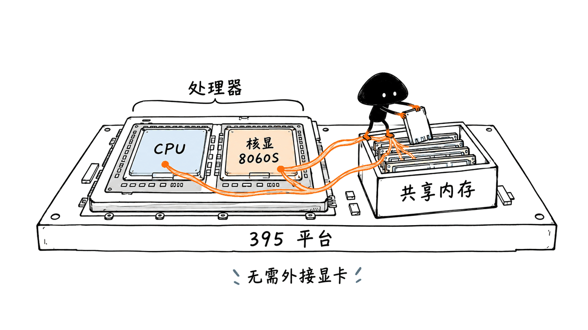
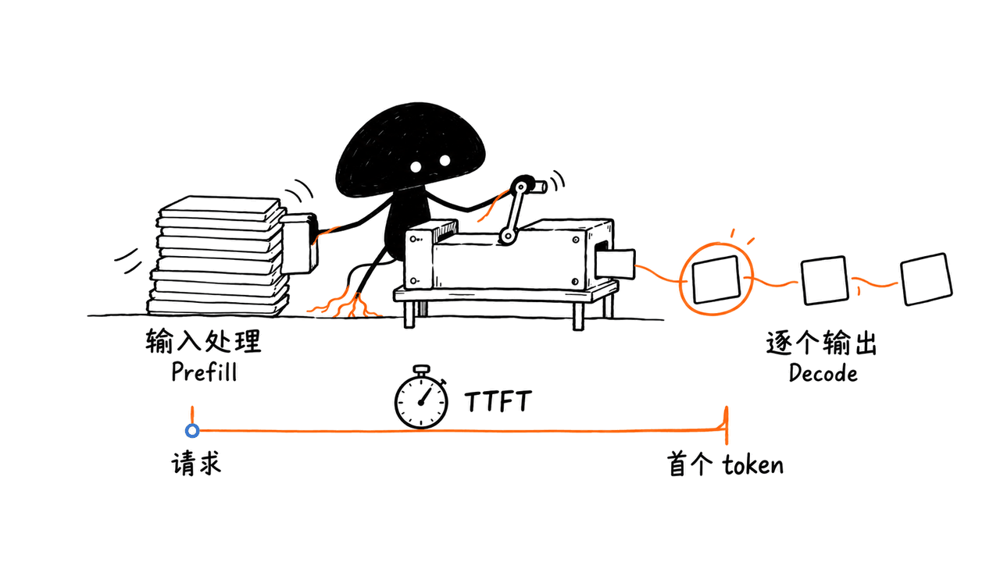

Halogen 和 Gufo 是针对 AMD Strix Halo 平台优化的本地推理引擎，确实能在不外接显卡的情况下，把特定模型的 prefill 做到接近 2000 token/s。但这里用到了内置 GPU，数字也不是大模型每秒生成两千 token。

你提到的“395”，对应 Ryzen AI Max+ 395，配备 Radeon 8060S，GPU 架构标识为 `gfx1151`。本文截至 2026-10-20 核对一手仓库、基准文档和公开数据，没有在 395 机器上执行推理测速。

先把项目地址放出来：

- Gufo：https://github.com/gufo-org/gufo
- Halogen Flash-Next：https://github.com/peonist-ai/halogen-flash-server
- Halogen 27B 的独立项目：https://github.com/peonist-ai/halogen-server

Gufo 采用 MIT 开源；Halogen 核心引擎以自有 EULA 分发二进制。免费使用和可商用，不等于采用相同的开源许可。

## “不需要外加显卡”究竟意味着什么？

它不等于 CPU 单独计算，也不等于一定在使用 NPU。这里的主要路径是 Radeon 8060S 核显上的 HIP/ROCm 推理，CPU、GPU 共享系统内存。

AMD 官方规格给出 256-bit LPDDR5x、最高 128 GB 内存和 LPDDR5x-8000。大容量共享内存让某些超出常见消费级独显显存的模型有机会装进去；是否跑得快，仍取决于模型算子、内存访问、量化和运行时优化。

不能只看到处理器型号相同，就认为所有机器都能复现结果。公开基准大多来自 128 GB 配置，笔记本、迷你主机和台式机的持续功耗、散热及可用内存也会不同。64 GB 机器能运行某些模型，不代表能照搬这里的 Flash-Next 配置。

同样，NPU 上的 embedding、分类服务，或另一些 GPU+NPU 实验路径，不能自动算作本篇主线 GPU 基准的组成部分。



## 接近 2000 的数字，具体对应什么？

### Gufo：1801.01 的口径是约 2K 新输入

固定版本的 Gufo 文档公布了下面这些结果。模型是 Qwen3.8-Flash-Next，Unsloth `UD-Q4_K_XL` 四分片，单用户 AR，即不使用投机解码；HTTP、greedy、thinking off。

| 名义缓存前缀深度 | JSON 中实际缓存 token | 本轮新处理 token | Prefill | AR 输出速度 |
|---|---:|---:|---:|---:|
| 0 | 0 | 2040 | 1801.01 token/s | 28.29 token/s |
| 32,768 | 32,718 | 2029 | 1672.60 token/s | 28.18 token/s |
| 131,072 | 130,932 | 2047 | 1557.18 token/s | 27.85 token/s |

这张表的名义输入是 `pp2048 / tg128`，其中 depth 表示已经存在的会话缓存前缀。**“128K 深度仍有 1557”描述的是深上下文下处理新增约 2K token，并非冷启动重新处理全部 128K。**

Gufo 的这些 Flash-Next 表在 2026-10-18 刷新，记录构建 `fec4759d`。文档说明多数点是一份 warmed 样本，不能理解为经过大量重复测量后，每台机器都能稳定落在同一个值。

模型本身也很重要。同一固定仓库的 Qwen3.8-27B Q4 表，零深度 AR prefill 是 648.89 token/s。395 不是装了专用引擎后，所有模型都会自动到 1800。Flash-Next 的 MoE、混合循环/QSA 结构与 dense 27B 的计算路径不同，总参数规模也不能直接当作每 token 的计算量。

### Halogen：新版本给出了约 1836 的 8K 输入记录

Halogen README 仍展示 `0.18.0` 的 1821 token/s，但更新的 `docs/performance.md` 已包含 `0.18.11`。下面选取新表的 v2 checkpoint、关闭 prompt cache 的数据：

| 版本与模型格式 | 合成提示长度 | Prefill |
|---|---:|---:|
| Halogen 0.18.11，v2 原生 checkpoint，cache off | 8192 token | 1836 token/s |
| Halogen 0.18.11，v2 原生 checkpoint，cache off | 32768 token | 1785 token/s |

这是维护者公布的 Strix Halo 测量，相关 v2 机器为 Ryzen AI Max+ 395、128 GB，持续封装功耗约 85 W。封装功耗不是整机插座功耗，也不等于每台 395 都固定运行在 85 W。

Halogen 的合成 `sweep` 与真实文本经过聊天模板的请求有差别：README 在其 0.18.0 说明中明确提示，真实文本 prefill 大约低 8%–12%。新性能页还修正了早期 cache-on 测试与校准请求部分复用的问题，因此缓存开启的历史行不宜跨表直接比较。

这两组数字足以支持“已有接近 2000 的公开记录”。但 Gufo 和 Halogen 的提示长度、格式、量化和测量路径不同，不能用 `1836 ÷ 1801` 排出谁更快。

## Prefill 快，为什么不代表回答也一样快？

至少要区分三类指标：

| 指标 | 实际在问什么 |
|---|---|
| Prefill / pp | 新输入被模型处理得多快 |
| Decode / tg | 回答的新 token 生成得多快 |
| TTFT | 从发出请求到收到第一个 token 等多久，可能还包含排队、模板、缓存处理等时间 |

做一个纯算术例子：假设输入一万 token、prefill 为 1800 token/s，处理输入约需 5.6 秒；若再输出一千 token、decode 为 40 token/s，输出还需约 25 秒。这不是实测延迟，也没计入其他开销，只用于说明两个阶段的区别。

Gufo 的同一份 Flash-Next 文档中，零深度 AR 输出为 28.29 token/s；MTP 混合文本为 35.79，重复性输出可达 116.93。八用户重复文本的 245.81 是按文档定义汇总各请求 decode 速率，不是每个用户都得到 245.81，也不是简单的总 token 除以共同墙钟时间。

Halogen 0.18.11 则公布了 v2 在十种提示形态上的 greedy、带 draft `bench` 平均 64.2 token/s。它不能与另一项目的不同提示集直接对决。投机解码的接受率受内容影响，重复文本、代码和新写的自然语言并不是同一种负载。

缓存还会改变体感。Halogen README 中约 1.6 秒开始回答的 agent turn，是长会话复用后的特定任务记录；同一说明中的冷首轮约 34K 提示花了 21 秒。不能把这两种请求解释成“每轮都把几万 token 从零读完，只要 1.6 秒”。



## 两个引擎分别押注什么？

Gufo 是 C++/HIP 的开源实现，围绕 `gfx1151` 和选定模型做优化。它的价值还包括会话、并发、取消和缓存管理；仓库也在扩展语音、图像等模型，但不能据此认为任意架构的 GGUF 都可直接运行。

Halogen 更集中在特定 GPU 与模型家族，提供自己的 checkpoint、投机解码和缓存服务。Flash-Next 项目也支持指定 GGUF 路径，但格式支持、MTP 配套文件和质量验证仍须按它的文档来，不能随便混用其他模型或 draft head。

我们的判断是：专用引擎的优势来自缩小适配范围后，针对模型形状、量化布局、GPU kernel 和会话执行路径进行优化；它也以减少通用性和硬件覆盖为代价。仅凭最终速度，无法把提升精确分摊到某一项 kernel 改动。

| 选型点 | Gufo | Halogen Flash-Next |
|---|---|---|
| 核心分发 | MIT 源码 | 自有 EULA 的编译引擎与容器 |
| 优先诉求 | 希望阅读、修改和参与引擎开发 | 接受二进制分发，使用其专用模型服务路径 |
| Flash-Next 模型 | 指定 `UD-Q4_K_XL`，可配 Q8 MTP 文件 | 原生 `.hgn`；也有受支持的 GGUF 路径 |
| 平台判断 | 主线看 Linux/ROCm；Windows 是尚未合入的独立移植 | 按对应 Linux 容器文档，其他集成另行核对 |
| 不能只看 | 首页最高 pp、重复文本 tg | 默认 checkpoint 数字、短缓存命中 TTFT |

Halogen 的 EULA 明确允许免费商用、原样再分发和发布 benchmark，但这与 MIT 源码许可不同。模型权重及镜像内第三方组件也各有条款，不能用引擎的许可替代它们。

## 已经有 395，怎么试才容易判断结果？

先确认 Linux、ROCm、`gfx1151` 设备识别，以及容器访问 `/dev/kfd`、`/dev/dri` 的权限。本文引用的 Gufo Flash-Next 数据记录 ROCm 7.2.3；另一个社区配置的 ROCm 10 是另一套环境，不能把版本号拼成唯一必需组合。

Gufo 建议从固定源码和对应模型页开始。以下是构建完成后使用指定 Flash-Next GGUF 的服务形态，不是本文已验证的部署结果：

```bash
./result/bin/gufo serve --port 8080 llm \
  --model /path/to/first-target-shard.gguf \
  --speculative mtp --mtp-model /path/to/shared-mtp.gguf \
  --sessions 1 --context 32768
```

模型页给出了固定权重 revision 和下载列表。不要漏掉其他分片，也不要把有无 MTP、上下文容量、thinking、采样参数不同的结果记成同一条基准。

Halogen 的固定版本启动形态如下。这里把官方例子的端口绑定收窄为本机回环；其余资源要求仍需按文档准备：

```bash
mkdir -p ~/halogen-models
podman run --rm -p 127.0.0.1:8731:8731 \
  --device /dev/kfd --device /dev/dri --group-add keep-groups \
  --ipc=host --ulimit memlock=-1:-1 \
  -e HALOGEN_DOWNLOAD=peonist-ai/halogen-qwen3.8-flash-next \
  -v ~/halogen-models:/models \
  ghcr.io/peonist-ai/halogen-flash-server:0.18.11
```

官方 quickstart 写明，首次自动取回的原生资源约 111 GiB。需要提前判断磁盘和内存，而不是把它当成一个小模型安装。文档还要求将 BIOS 的 UMA carve-out 调到较小的显式值，避免固件提前划走大量内存；这与一些其他引擎偏好的配置不同，不能通用照搬。

`keep-groups` 是 Podman 参数，Docker 需要根据主机设备权限使用对应 group 配置。先只运行一个大模型服务，确认权重和健康状态，再接自己的客户端。

复测至少记录：引擎提交或镜像 digest、模型文件及哈希、量化、系统与 ROCm、持续功耗、冷/热缓存、实际新输入 token、已有缓存 token、输出 token、thinking、采样、投机模式和并发数。同时报告 TTFT、pp、tg 与完整请求时间，才知道提升发生在哪。

## 我们这次核验了什么，没有核验什么？

我们固定 Gufo 仓库到 `877518953c153b2aac57f7b77fc904e8540b1fde`，Halogen Flash 仓库到 `002589b11480cf3422f209b336c19dcc208fc69f`，并执行脚本核对 Gufo Flash-Next 单用户 AR 表的 8 行数据：文档速率与公开 JSON 一致，实际缓存、新输入和 128 token 输出计数也在其声明的范围内。

这只是公开数据的一致性检查。该 JSON 没有提供足够的完整原始阶段耗时，让我们独立重做计时；测速真实性、模型输出质量和真实硬件表现没有因此得到额外证明。

另一个同机对比配置仓库很有参考价值，但它说明最终示例只有 153 token 提示，不能用它验证大批量 prefill；配置了三个会话槽，也不等于三路满上下文同时运行。文档写清的限制应该保留在引用中。

本机是 macOS arm64，没有执行这两套引擎，也未下载大模型、进行 ROCm 调优或复现 395 性能。本篇是一手资料调研与公开记录核验，所有引擎速度均来自相应发布方。

## 该怎么理解这波提升？

如果已经有 128 GB 的 395，专用引擎值得纳入测试清单：它们表明，这块核显的实际推理上限不能简单由某一个通用运行时的旧成绩代表。

如果准备为了某个数字买机器，则需要先拿自己的模型和任务核验。接近 2000 的 prefill 是有条件的能力，不是所有模型的速度标签；真正影响使用体验的，往往是冷首轮、后续缓存轮、输出内容以及长期运行的内存行为。

相关本地推理阅读：https://blog.mushroom.cv/blog/rapid-mlx-apple-silicon-local-ai-inference/

## 常见问题

### 不接独显，是不是只用 CPU 或 NPU？

不是。本文主线数据依赖 Radeon 8060S 核显与共享内存。NPU 扩展任务和 GPU+NPU 分支需要分别看，不能把它们的数字混到主线 GPU 结果里。

### 两个引擎都开源吗？

Gufo 采用 MIT。Halogen 核心是采用自有 EULA 分发的编译二进制，允许免费使用和部分再分发，不应简单称作同样的开源实现。请分别查阅引擎、模型与第三方组件许可。

### 1800 token/s 能当作生成速度吗？

不能。它是特定负载的新输入处理速率；decode、TTFT、缓存命中和并发汇总有不同定义。本文还特别核对了 Gufo 深上下文表中的实际新增 token，避免把缓存深度当成冷输入长度。

## 一手来源

AMD 395 规格：https://www.amd.com/en/products/processors/laptop/ryzen/ai-300-series/amd-ryzen-ai-max-plus-395.html
Gufo：https://github.com/gufo-org/gufo
Gufo 固定基准：https://github.com/gufo-org/gufo/blob/877518953c153b2aac57f7b77fc904e8540b1fde/docs/models/qwen3.8-flash-next/BENCHMARKS.md
Gufo 方法与边界：https://github.com/gufo-org/gufo/blob/877518953c153b2aac57f7b77fc904e8540b1fde/docs/models/qwen3.8-flash-next/QUALITY.md
Halogen 性能页：https://github.com/peonist-ai/halogen-flash-server/blob/002589b11480cf3422f209b336c19dcc208fc69f/docs/performance.md
Halogen 许可：https://github.com/peonist-ai/halogen-flash-server/blob/002589b11480cf3422f209b336c19dcc208fc69f/LICENSE.md
Halogen 启动说明：https://github.com/peonist-ai/halogen-flash-server/blob/002589b11480cf3422f209b336c19dcc208fc69f/docs/getting-started.md
同机配置参考：https://github.com/orenaksakal/strix-halo-gufo-halogen-configs/tree/b107629aee438b956b903079c461bf711dac7a50

---

> © 2026 Author: Mycelium Protocol. 本文采用 [CC BY 4.0](https://creativecommons.org/licenses/by/4.0/deed.zh) 授权——欢迎转载和引用，须注明作者姓名及原文链接，不得去除署名后以原创发布。

<!--EN-->

Halogen and Gufo are local inference engines optimized for AMD Strix Halo. Published results do put specific models near 2,000 token/s prefill without an external graphics card. They still use the integrated GPU, and that number is not the model's output speed.

“395” refers to Ryzen AI Max+ 395 with Radeon 8060S, identified as `gfx1151`. This review checks primary repositories, benchmark documentation and published records as of 2026-10-20. We did not benchmark inference on a 395 machine.

Projects:

- Gufo: https://github.com/gufo-org/gufo
- Halogen Flash-Next: https://github.com/peonist-ai/halogen-flash-server
- Separate Halogen 27B project: https://github.com/peonist-ai/halogen-server

Gufo is MIT-licensed open source. Halogen distributes its core compiled engine under its own EULA. Free commercial use is not the same licensing model.

## What Does “No External GPU” Mean?

It does not mean CPU-only inference or mandatory NPU acceleration. The main path discussed here uses HIP/ROCm on the integrated Radeon 8060S, sharing system memory with the CPU.

AMD specifies 256-bit LPDDR5x, up to 128 GB and LPDDR5x-8000. That capacity can accommodate models larger than the VRAM of common consumer graphics cards, but performance still depends on operators, memory access, quantization and runtime optimization.

Matching the processor name is not enough to reproduce a result. Published measurements commonly use 128 GB configurations, and sustained power, cooling and available memory vary by machine. A 64 GB system running some models cannot automatically copy the Flash-Next configuration here.

Separate NPU embedding/classification services and GPU+NPU experiments must not be silently folded into these mainline GPU measurements.


## What Exactly Reaches Nearly 2,000 token/s?

### Gufo: 1,801.01 Processes Approximately 2K New Tokens

The pinned Gufo documentation reports Qwen3.8-Flash-Next using Unsloth's four-shard `UD-Q4_K_XL`, single-user AR without speculative decoding, HTTP, greedy and thinking off.

| Nominal cached-prefix depth | Actual cached tokens | New prompt tokens | Prefill | AR decode |
|---|---:|---:|---:|---:|
| 0 | 0 | 2040 | 1801.01 token/s | 28.29 token/s |
| 32,768 | 32,718 | 2029 | 1672.60 token/s | 28.18 token/s |
| 131,072 | 130,932 | 2047 | 1557.18 token/s | 27.85 token/s |

The nominal workload is `pp2048 / tg128`; depth describes an existing conversation-cache prefix. **The 128K-depth result measures roughly 2K additional tokens against that prefix, not a cold reprocessing of all 128K.**

These Flash-Next tables were refreshed on 2026-10-18 using build `fec4759d`. Most points are one warmed sample, not a large repeated estimate guaranteeing the same speed on every host.

Model identity matters. The pinned Qwen3.8-27B Q4 table reports 648.89 token/s AR prefill at zero depth. A dedicated engine does not automatically make every model reach 1,800. Flash-Next uses a hybrid recurrent/QSA MoE structure, unlike the dense 27B path; total parameter count is not a direct measure of per-token computation.

### Halogen: Approximately 1,836 on an 8K Synthetic Prompt

The README still highlights 1,821 token/s from `0.18.0`, while the updated performance page includes `0.18.11`. Its v2 checkpoint, prompt-cache-off rows are:

| Version and format | Synthetic prompt length | Prefill |
|---|---:|---:|
| Halogen 0.18.11, native v2 checkpoint, cache off | 8192 tokens | 1836 token/s |
| Halogen 0.18.11, native v2 checkpoint, cache off | 32768 tokens | 1785 token/s |

These are maintainer measurements on Ryzen AI Max+ 395 with 128 GB; the relevant v2 host is described at roughly 85 W sustained package power. Package power is not wall power or a fixed setting shared by every 395 system.

Synthetic `sweep` is also different from real text passed through a chat template. The README's 0.18.0 discussion puts real-text prefill approximately 8%–12% lower. The newer performance page corrects earlier cache-on runs that partially reused calibration input, so historical cache-on rows should not be compared across those tables.

This supports the existence of published results near 2,000. It does not support ranking the engines by dividing 1,836 by 1,801: prompt lengths, formats, quantization and measurement paths differ.

## Why Is Prefill Different from Answer Speed?

| Metric | Question answered |
|---|---|
| Prefill / pp | How quickly are new input tokens processed? |
| Decode / tg | How quickly are answer tokens produced? |
| TTFT | How long from request submission to the first received token, including possible queue, template and cache work? |

For arithmetic illustration only, 10,000 input tokens at 1,800 token/s take about 5.6 seconds to process. Producing another 1,000 tokens at 40 token/s takes approximately 25 seconds. This is not a measured request and excludes other overhead.

Gufo's same Flash-Next documentation reports 28.29 token/s zero-depth AR decode, 35.79 with MTP on mixed text and 116.93 on repetitive output. The eight-user repetitive figure of 245.81 sums individual request decode rates under the document's definition; it is neither each user's speed nor simply total tokens over a common wall-clock interval.

Halogen 0.18.11 reports a v2 drafting `bench` mean of 64.2 token/s across ten prompt shapes, greedy. Different prompt sets do not make a direct engine comparison. Speculative acceptance depends on content, so repetition, code and new prose should not share one universal speed label.

Cache reuse also changes perceived latency. Halogen's approximately 1.6-second first token for agent turns describes a particular continuing-session workload. The same README reports a cold first turn with approximately 34K input taking 21 seconds. That is not evidence of freshly processing tens of thousands of tokens in 1.6 seconds on every turn.


## What Does Each Engine Optimize For?

Gufo is an open C++/HIP implementation targeting `gfx1151` and selected models, including work on sessions, concurrency, cancellation and caching. Its expansion into other modalities does not establish arbitrary GGUF-architecture support.

Halogen concentrates on a particular GPU and model family, with native checkpoints, speculative decoding and cache-serving behavior. The Flash-Next project also accepts supported GGUFs, but target formats and draft files must follow its documentation rather than being mixed arbitrarily.

Our interpretation is that narrowing support allows model-shape, quantization-layout, kernel and session-path optimization, at the cost of generality. Final throughput alone cannot attribute a measured gain to one particular kernel change.

| Decision | Gufo | Halogen Flash-Next |
|---|---|---|
| Core distribution | MIT source | Compiled engine/container under its own EULA |
| Priority | Read, modify and contribute to the engine | Accept binary distribution and its dedicated serving path |
| Flash-Next format | Specified `UD-Q4_K_XL`, optional Q8 MTP file | Native `.hgn`, plus supported GGUF paths |
| Platform | Mainline Linux/ROCm; separate unmerged Windows port | Follow the corresponding Linux-container guide; check other integrations separately |
| Misleading shortcut | Peak pp or repetitive tg alone | Default-checkpoint speed or cached-turn TTFT alone |

The Halogen EULA permits royalty-free commercial use, unmodified redistribution and benchmark publication. That is distinct from MIT source distribution. Model and third-party component licenses remain separate.

## How Should an Existing 395 Owner Try Them?

First check Linux, ROCm, `gfx1151` recognition and container permissions for `/dev/kfd` and `/dev/dri`. The cited Gufo Flash-Next artifact records ROCm 7.2.3; a community configuration using ROCm 10 is a separate environment, not an additional universal requirement.

For Gufo, start with a fixed source revision and the exact model guide. After building, the documented serving shape for the specified Flash-Next GGUF is:

```bash
./result/bin/gufo serve --port 8080 llm \
  --model /path/to/first-target-shard.gguf \
  --speculative mtp --mtp-model /path/to/shared-mtp.gguf \
  --sessions 1 --context 32768
```

This is guidance, not a deployment we verified here. Download all model shards and the correct predictor. Record MTP, context capacity, thinking and sampling settings separately.

For Halogen, this adapts the official example by restricting the published port to loopback:

```bash
mkdir -p ~/halogen-models
podman run --rm -p 127.0.0.1:8731:8731 \
  --device /dev/kfd --device /dev/dri --group-add keep-groups \
  --ipc=host --ulimit memlock=-1:-1 \
  -e HALOGEN_DOWNLOAD=peonist-ai/halogen-qwen3.8-flash-next \
  -v ~/halogen-models:/models \
  ghcr.io/peonist-ai/halogen-flash-server:0.18.11
```

The official quickstart says its initial native-resource download is approximately 111 GiB. Check disk and memory first. It also recommends a small explicit BIOS UMA carve-out to avoid firmware hiding a large share of memory; other engines can favor different settings.

`keep-groups` is Podman-specific; Docker needs group settings matching the host devices. Start only one large model service initially, verify loading and readiness, then connect clients.

For a meaningful benchmark, retain engine revision/image digest, model hashes, quantization, OS/ROCm, sustained power, cold/warm cache state, new and cached token counts, output length, thinking, sampling, speculation and concurrency. Report TTFT, pp, tg and full request time together.

## What Did We Verify Here?

We pinned Gufo to `877518953c153b2aac57f7b77fc904e8540b1fde` and Halogen Flash to `002589b11480cf3422f209b336c19dcc208fc69f`. Our script checked all eight Gufo Flash-Next single-user AR table rows against the public JSON, including rates and the documented ranges for actual cached/new input and 128 output tokens.

This establishes published-data consistency only. The JSON does not expose sufficient full raw phase timings to independently rerun the timer calculation. It does not independently establish engine speed, numerical quality or hardware behavior.

A separate same-host configuration repository is useful, but explicitly says its final example has only 153 prompt tokens. That cannot verify bulk prefill; three configured session slots also do not establish three simultaneous full-context requests. Those limitations belong with any quotation of its setup.

Our host is macOS arm64. We did not execute either engine, download large models, tune ROCm or reproduce 395 performance. All engine-speed figures here are attributed published measurements.

## What Is the Practical Conclusion?

For an existing 128 GB 395 owner, dedicated engines deserve testing. Their results show why one general runtime's historical score should not be treated as the integrated GPU's permanent limit.

For a prospective buyer, test your model and workload before buying on a headline number. Near-2,000 prefill is a conditional capability, not a universal model-speed label. Cold first turns, cached continuation, output content and long-running memory behavior can matter more in practice.

Related local inference reading: https://blog.mushroom.cv/blog/rapid-mlx-apple-silicon-local-ai-inference/

## FAQ

### Does No Discrete GPU Mean CPU-Only or NPU-Only Inference?

No. The mainline figures here rely on Radeon 8060S and shared memory. NPU services and GPU+NPU branches need separate evidence and must not be mixed into these GPU results.

### Are Both Engines Open Source?

Gufo uses MIT. Halogen distributes its compiled core under its own EULA, permitting free use and specified redistribution. Check engine, model and dependency licenses separately rather than labeling both as equivalent open-source implementations.

### Can 1,800 token/s Be Treated as Generation Speed?

No. It is new-input processing under particular conditions. Decode, TTFT, cached reuse and aggregate concurrency have different meanings. We also checked actual new-token counts in the deep-context Gufo table to avoid confusing prefix depth with cold prompt length.

## Primary Sources

AMD specifications: https://www.amd.com/en/products/processors/laptop/ryzen/ai-300-series/amd-ryzen-ai-max-plus-395.html
Gufo: https://github.com/gufo-org/gufo
Pinned Gufo benchmark: https://github.com/gufo-org/gufo/blob/877518953c153b2aac57f7b77fc904e8540b1fde/docs/models/qwen3.8-flash-next/BENCHMARKS.md
Methods and limits: https://github.com/gufo-org/gufo/blob/877518953c153b2aac57f7b77fc904e8540b1fde/docs/models/qwen3.8-flash-next/QUALITY.md
Halogen performance: https://github.com/peonist-ai/halogen-flash-server/blob/002589b11480cf3422f209b336c19dcc208fc69f/docs/performance.md
Halogen license: https://github.com/peonist-ai/halogen-flash-server/blob/002589b11480cf3422f209b336c19dcc208fc69f/LICENSE.md
Halogen quickstart: https://github.com/peonist-ai/halogen-flash-server/blob/002589b11480cf3422f209b336c19dcc208fc69f/docs/getting-started.md
Same-host configuration reference: https://github.com/orenaksakal/strix-halo-gufo-halogen-configs/tree/b107629aee438b956b903079c461bf711dac7a50

---

> © 2026 Author: Mycelium Protocol. Licensed under [CC BY 4.0](https://creativecommons.org/licenses/by/4.0/) — free to share and adapt with attribution. You must credit the author and link to the original; removing attribution and republishing as original is not permitted.
