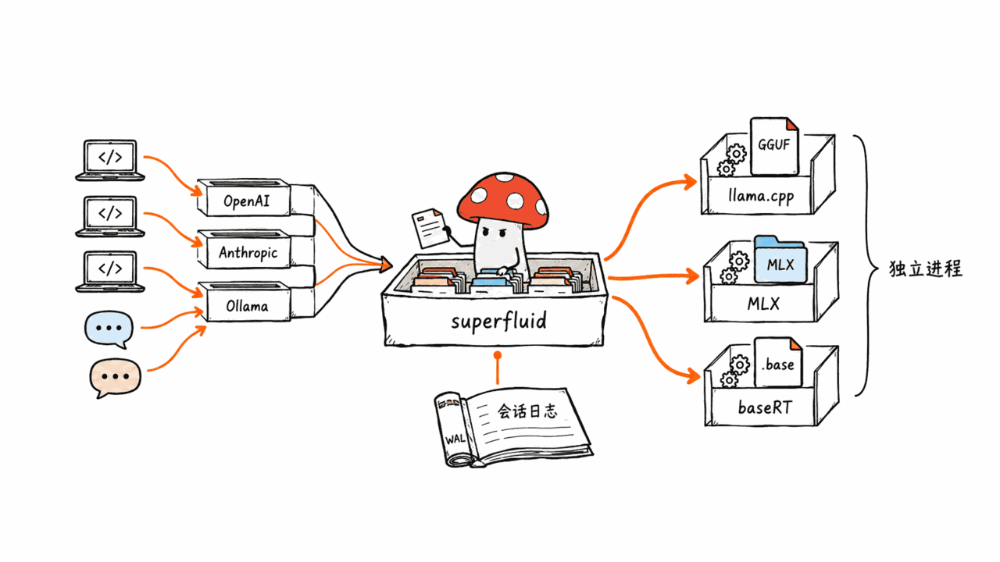
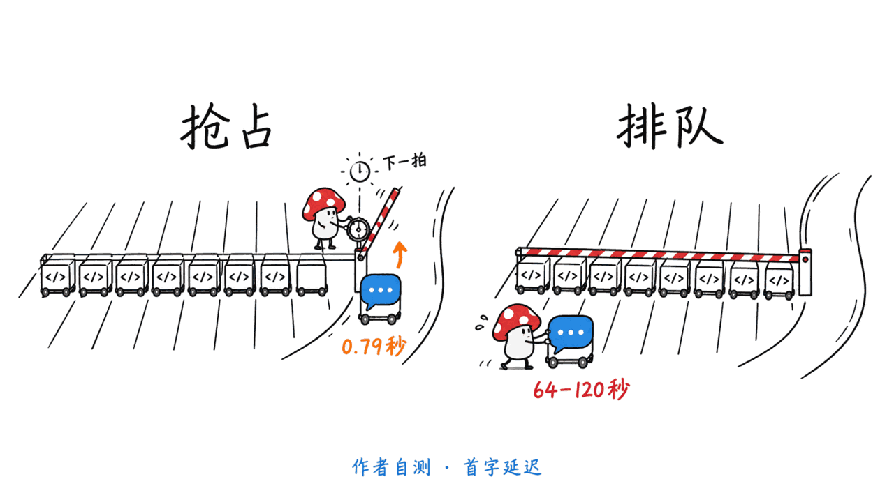
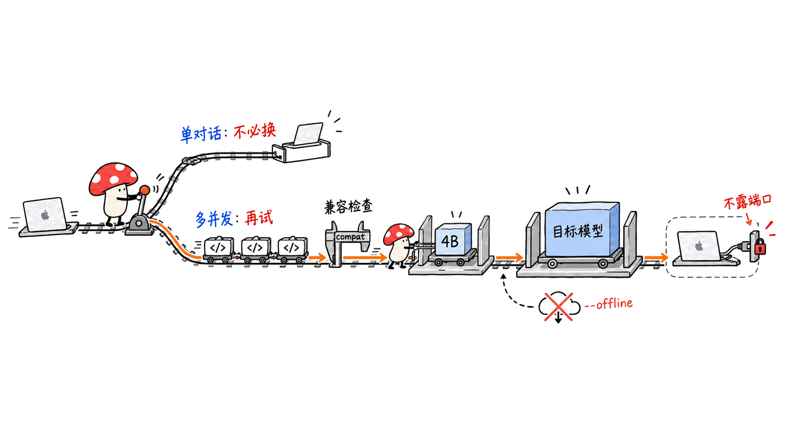

superfluid 想解决的是：你在一台 Mac 上同时跑好几个编码 Agent，再顺手开个聊天窗口，聊天就得排在 Agent 后面等。它不是新推理引擎，而是放在 llama.cpp、MLX、baseRT 前面的一个服务守护进程，自带调度器和写前日志（WAL）。**结论先说：思路有价值，但它是 2026-10-08 才创建的 pre-1.0 项目，19 颗星，性能数字全是作者自测、模型只有 Qwen3-4B，Mac 用户可以小范围试，不要直接换掉现有服务。**

核实时间 2026-10-23。仓库 basecompute/superfluid，Rust，Apache-2.0，最近一次推送 2026-10-23，最新版本 v0.1.3（2026-10-22）。本文只读了 README、基准文档、安全文档和 CHANGELOG，**没有在本机安装和复测**。

## 它到底是什么？

README 的一句话：一个调度器、一份持久会话日志、一套 API，放在 llama.cpp、MLX 和 baseRT 前面。客户端用 OpenAI、Anthropic 或 Ollama 的接口都能直接连。

- 模型文件决定运行时：GGUF 走 llama.cpp，MLX 目录走 MLX（Apple Silicon），`.base` 包走 baseRT。
- 每个运行时在独立 worker 进程里，首次使用时从各自项目的发布页安装；superfluid 不内置、不链接它们的代码。
- 安装方式是 `curl -fsSL https://superfluid.sh/install.sh | sh`，然后 `superfluid serve unsloth/Qwen3.8-27B-GGUF:UD-Q4_K_M`；`superfluid launch claude --model ...` 可以直接把 Claude Code 指到它上面。
- 默认监听 127.0.0.1:8453，默认不要密钥，README 称不回传数据。

## 跟 llama-server、Ollama、mlx_lm.server 有什么区别？

区别不在单请求速度，而在多请求下的调度和故障恢复。

| 能力 | superfluid | 同类 |
|---|---|---|
| 交互请求抢占批处理 | 下一个调度 tick 抢占 | 文档称 llama-server、Ollama、mlx_lm.server 该场景未通过 |
| 共享前缀 | 32 个请求共享 5k token 提示，约预填 1 次 | llama-server 和 Ollama 约 8 次 |
| 崩溃恢复 | WAL 记录每个已提交 token，worker 被杀或重启可续 | 文档称 Ollama 在 worker kill 场景未通过 |
| 多机 | `node join` 加入，局域网自动发现 | 同类无对应功能 |

自测环境：Apple M5 Pro，Qwen3-4B 4-bit，对比各运行时自己的服务器。README 表格给的是：八个 Agent 在跑时，一个聊天的首 token 为 0.79 s，对比 llama-server 67 s、Ollama 64 s、mlx_lm.server 120 s；八个场景通过数分别是 8、3、5、1。

## 这些数字能信多少？

先看它做得好的地方：吞吐部分很克制。基准文档（M1 Max 64 GB，llama.cpp b11284，mlx-lm 0.31.3）显示 llama.cpp 经过 superfluid 与 llama-server 持平：1 并发 76.7 对 76.8 tok/s，8 并发 150.8 对 145.1 tok/s。也就是说它承诺的只是“不拖后腿”。MLX 侧在 8 并发是 130.2 对 96.8 tok/s，因为 mlx_lm.server 一次只服务一个请求。

需要打折的地方：

1. 数据全部由作者自测，每个格子只跑一次场景，没有第三方复现。
2. 吞吐在 M1 Max 上测，语义场景在 M5 Pro 上测，不是同一台机器，文档自己也承认。
3. 模型是 4B 的 4-bit。你真正想跑的 27B 级别，README 只有一段 baseRT 的演示动图（M5 Pro），没有对照表。
4. “抢占”场景的通过条件是作者自己设的（首 token 1.0 s 内）；文档还披露，若只按首 token 时间比较，llama-server 和 Ollama 的共享前缀场景也会算通过（30.3 s 对 65.8 s）。这说明评分标准会影响“8/8 对 3/8”的观感。
5. mlx_lm.server 的共享前缀场景首次失败、单独重跑通过，这在文档脚注里写明了，值得肯定。

## 给 Mac 用户的建议

- **适合试用的人**：同一台 Mac 同时挂多个编码 Agent、还要偶尔聊天；或者想把 GGUF 和 MLX 模型放在一个端点后面。
- **不适合的人**：只跑单个对话。这时它的优势用不上，却多了一层 pre-1.0 软件。
- **试用方式**：先用 4B 小模型跑它自带的场景，再换你的目标模型；先看 `superfluid compat` 输出确认你的 llama.cpp、mlx-lm 版本在测试范围内（v0.1.3 列出 llama.cpp b11284/b11642，mlx-lm 0.31/0.32）。
- **安装前**：`curl | sh` 习惯上先下载脚本读一遍；`serve <id>` 会从 Hugging Face 拉模型，想禁止就加 `--offline`。
- **内存**：KV 池按“批并发 × 上下文”分配，`--max-batch` 默认 8；27B 模型叠上 8 个车道，64 GB 以下要手动调小。

## 局限与坑

- **pre-1.0**：README 明说标志、协议和磁盘格式随版本可能变化。仓库 4 天前才发了 v0.1.3，0.1.0 到 0.1.3 都在 10 月内。
- **默认无鉴权**：安全文档写明不支持 TLS，会话日志里每个提示和回复都是明文，`POST /v1/models/load` 能加载守护进程用户可读的任意路径。要上网络，必须放反向代理并设 `--api-key`。
- **文档自相矛盾**：安全文档说多机的 head 到 node 流量是未加密 TCP；而分布式文档说有令牌时链路用 Noise 加密。我没法判断哪份是旧的，用多机功能前请自己抓包确认，或者直接走 WireGuard、Tailscale。
- **许可证要核实 baseRT**：superfluid 本身是 Apache-2.0，但 README 说 baseRT 引擎“是单独产品、有自己的许可证”；baseRT 的 GitHub 仓库页（237 星）显示 Apache-2.0，主要是 CLI、格式和绑定，引擎二进制由安装脚本下发。商用前请自己读 baseRT 的 LICENSE 与引擎条款。
- **基准脚本未公开**：文档写“bench harness is not shipped”，只给了方法，`tools/suite` 里有场景套件。
- **社区很小**：19 星、2 个 fork、4 个未关闭 issue，遇到问题主要靠 Discord 和作者。

## 常见问题

**它会替代 Ollama 吗？** 不会。它面向多 Agent 并发和故障恢复；Ollama 面向“拉模型、对话”。能接 Ollama 客户端是它的兼容层。

**单请求更快吗？** 文档的目标是“持平”，不是更快。llama.cpp 路径下数字与 llama-server 基本一致。

**需要重新转换模型吗？** GGUF 和 MLX 模型不用；只有用 baseRT 才要 `.base` 格式。

**能离线用吗？** 运行时安装和模型下载需要联网（`runtime install` 走 HTTPS 并校验摘要），装好后配合 `--offline` 可以不再联网。

## 一手源

GitHub 仓库：https://github.com/basecompute/superfluid
基准文档：https://github.com/basecompute/superfluid/blob/main/docs/performance/benchmarks.md
安全文档：https://github.com/basecompute/superfluid/blob/main/docs/deployment/security.md
CHANGELOG：https://github.com/basecompute/superfluid/blob/main/CHANGELOG.md
官网：https://superfluid.sh
baseRT：https://github.com/basecompute/baseRT

> **声明**：本文为客观拆解，基于公开资料，未做本机复测。开源仅供学习，使用前请自行核实许可证与安全性。

---

> © 2026 Author: Mycelium Protocol. 本文采用 [CC BY 4.0](https://creativecommons.org/licenses/by/4.0/deed.zh) 授权——欢迎转载和引用，须注明作者姓名及原文链接，不得去除署名后以原创发布。

<!--EN-->

superfluid is built for the moment when several coding agents share one Mac and you also want to chat: the chat normally waits behind the agents. It is not a new engine. It is a serving daemon in front of llama.cpp, MLX and baseRT, with its own scheduler and a write-ahead log (WAL). **Bottom line: the idea is useful, but this is a pre-1.0 project created on 2026-10-08 with 19 stars, every performance number is self-run, and the only model tested is Qwen3-4B. Mac users can try it on the side; do not swap out a working server yet.**

Checked on 2026-10-23. Repo basecompute/superfluid, Rust, Apache-2.0, last push 2026-10-23, latest release v0.1.3 (2026-10-22). I read the README, benchmark doc, security doc and CHANGELOG. **I did not install or re-run it locally.**

## What is it, exactly?

The README's one-liner: one scheduler, one durable session log and one set of APIs in front of llama.cpp, MLX and baseRT. OpenAI, Anthropic and Ollama clients connect unchanged.

- The model file picks the runtime: GGUF goes to llama.cpp, MLX directories to MLX (Apple silicon), `.base` bundles to baseRT.
- Each runtime runs in its own worker process, installed on first use from that project's releases; nothing is vendored or linked.
- Install with `curl -fsSL https://superfluid.sh/install.sh | sh`, then `superfluid serve unsloth/Qwen3.8-27B-GGUF:UD-Q4_K_M`; `superfluid launch claude --model ...` points Claude Code at it.
- It binds to 127.0.0.1:8453 and asks for no key by default; the README says nothing phones home.

## How does it differ from llama-server, Ollama and mlx_lm.server?

The difference is not single-request speed. It is scheduling and failure recovery under concurrency.

| Capability | superfluid | Others |
|---|---|---|
| Interactive preempts batch work | at the next scheduler tick | per its docs, llama-server, Ollama and mlx_lm.server fail that scenario |
| Shared prefix | 32 requests sharing a 5k-token prompt prefill it about once | llama-server and Ollama about 8 times |
| Crash recovery | WAL holds every committed token; a killed worker or restarted server resumes | per its docs, Ollama fails the worker-kill scenario |
| Multi-machine | `node join`, LAN discovery | no equivalent in the others |

Self-run on an Apple M5 Pro with Qwen3-4B 4-bit, against each runtime's own server. The README table: with eight agents running, a chat's first token took 0.79 s versus 67 s (llama-server), 64 s (Ollama) and 120 s (mlx_lm.server); scenarios passed out of eight were 8, 3, 5 and 1.

## How far can you trust the numbers?

First, what it gets right: the throughput claim is modest. The benchmark doc (M1 Max 64 GB, llama.cpp b11284, mlx-lm 0.31.3) shows llama.cpp through superfluid matching llama-server: 76.7 vs 76.8 tok/s at 1 request, 150.8 vs 145.1 at 8. The promise is "no overhead", not "faster". On MLX at 8 requests it is 130.2 vs 96.8 tok/s, because mlx_lm.server serves one request at a time.

What deserves a discount:

1. All data is the author's own; each scenario cell is a single run, with no third-party reproduction.
2. Throughput was measured on an M1 Max and the serving scenarios on an M5 Pro; the doc admits they are different machines.
3. The model is a 4B 4-bit. For the 27B-class models you actually want, the README has only a baseRT demo GIF (M5 Pro), no comparison table.
4. The pass criteria are the author's (chat first token within 1.0 s). The doc itself discloses that judged on first-token time alone, llama-server and Ollama would also pass the shared-prefix scenario (30.3 s vs 65.8 s). Scoring rules shape the "8 vs 3" headline.
5. mlx_lm.server failed the shared-prefix scenario once and passed on a rerun; the doc footnotes this honestly, which is to its credit.

## Advice for Mac users

- **Good fit**: several coding agents on one Mac plus occasional chat, or GGUF and MLX models behind a single endpoint.
- **Poor fit**: one chat session at a time. You get none of the benefit and add a layer of pre-1.0 software.
- **How to try**: run its scenarios with a 4B model first, then your target model. Run `superfluid compat` to check your llama.cpp and mlx-lm versions are inside the tested range (v0.1.3 lists llama.cpp b11284/b11642 and mlx-lm 0.31/0.32).
- **Before installing**: read the `curl | sh` script first. `serve <id>` pulls from Hugging Face; add `--offline` to forbid that.
- **Memory**: the KV pool is sized for every lane (`--max-batch` defaults to 8). A 27B model with 8 lanes needs manual tuning below 64 GB.

## Limits and pitfalls

- **Pre-1.0**: the README says flags, protocols and on-disk formats may change. v0.1.0 through v0.1.3 all landed in October.
- **No auth by default**: the security doc says nothing speaks TLS, the session log holds every prompt and reply in plain text, and `POST /v1/models/load` loads any path the daemon's user can read. To expose it, use a reverse proxy and `--api-key`.
- **Docs contradict each other**: the security doc says head-to-node fleet traffic is unencrypted TCP, while the distributed-serving doc says a token makes the link Noise-encrypted. I cannot tell which is stale. Verify with a packet capture before using fleet mode, or run it over WireGuard or Tailscale.
- **Check baseRT's license**: superfluid is Apache-2.0, but its README says baseRT is a separate product under its own license. The baseRT GitHub page (237 stars) shows Apache-2.0 for the CLI, format and bindings, while the engine binary comes from an install script. Read baseRT's LICENSE and engine terms before commercial use.
- **Benchmark harness not shipped**: the doc says so; only the method and `tools/suite` scenarios are public.
- **Tiny community**: 19 stars, 2 forks, 4 open issues; support is Discord and the author.

## FAQ

**Does it replace Ollama?** No. It targets multi-agent concurrency and recovery; Ollama targets pull-and-chat. The Ollama API is a compatibility layer here.

**Is single-request speed better?** The doc's goal is parity, not a win. On llama.cpp the numbers match llama-server.

**Do I need to reconvert models?** Not for GGUF or MLX. Only baseRT needs the `.base` format.

**Does it work offline?** Runtime install and model download need the network (`runtime install` uses HTTPS with pinned digests). Once installed, `--offline` stops further downloads.

## Primary sources

GitHub repo: https://github.com/basecompute/superfluid
Benchmarks: https://github.com/basecompute/superfluid/blob/main/docs/performance/benchmarks.md
Security: https://github.com/basecompute/superfluid/blob/main/docs/deployment/security.md
CHANGELOG: https://github.com/basecompute/superfluid/blob/main/CHANGELOG.md
Site: https://superfluid.sh
baseRT: https://github.com/basecompute/baseRT

> **Note**: This is an objective teardown from public material; I did not re-run it locally. Open source, for study only; verify the license and security yourself before use.

---

> © 2026 Author: Mycelium Protocol. Licensed under [CC BY 4.0](https://creativecommons.org/licenses/by/4.0/) — free to share and adapt with attribution. You must credit the author and link to the original; removing attribution and republishing as original is not permitted.
