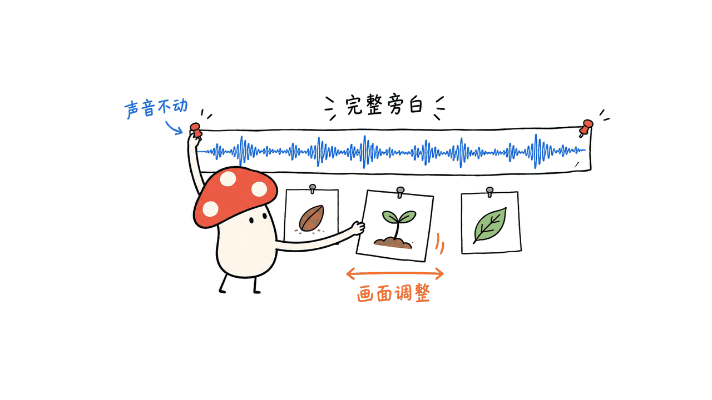

sweety-handdraw-video 把主题或文章编排成边画边讲的视频：Agent 设计口播、分镜和插画，本地工具完成描线、填色、字幕与导出。它把几道制作工序连起来，但仍需要图像生成、声音和运行环境配合。

官方仓库是 `threerocks/sweety-handdraw-video`，采用 MIT。本文核对代码提交 `5206ec0d17f9b353e400b64b9c51ad69e721e02a`，包内 `VERSION` 为1.2.3，日期为2026年10月15日。

仓库：https://github.com/threerocks/sweety-handdraw-video

## 输入一篇文章之后，谁在做什么？

可以把流程分成三个层次，而不是把它想成一个收到文本就直接输出视频的独立模型。

| 层次 | 负责什么 | 需要注意什么 |
| --- | --- | --- |
| Agent与美术规划 | 理解文章、保留事实与限定，写口播、设计画面、调用生图 | 讲解是否准确、画面是否真的表达因果，仍需审查 |
| 声音与对齐 | 生成或接收整篇旁白，核对内容，准备时间戳 | 不能把旁白按页面随意切开、插空白来迁就绘画 |
| 本地渲染 | 逐笔显示轮廓、按部位填色、手部叠层、逐字书写、字幕及编码 | 主实现为Python、Pillow、SciPy与FFmpeg，需要本地依赖 |

这里的“手绘”主要是一种可编排的动画效果：围绕插画组织绘制路径，让手部或画笔沿路径移动。它不等于真人画师作画录像，也不需要外部图生视频模型去合成每一帧。

这种做法让字幕、声音、素材和时间线可以分别修订。例如只修字幕时，有机会复用已认可的插画和声音；换了旁白，则必须重算其后的对齐关系。可复用的前提是检查仍对应当前文件。


## 为什么先锁定完整旁白，再安排画面？

许多自动视频会按页分别配音，再把每页拼接。这样容易在翻页处产生固定空白，或者为了让图画完，把呼吸裁掉、语速拉慢。

这个项目的生产约定是先准备完整口播和母带，再核对文字、声音与时间戳，最后安排画面。页面和字幕是音轨上的标记，不是剪切声音的单位。调整换图点，应先调整视觉时间线。



如果声音后端无法稳定生成长篇，文档允许在声音制作阶段按语义分段并完成编辑，但需要记录实际做法，不能把编辑后的母带说成“一次生成”。漏读、重复或截断应先修声音，再重建画面。

这套思路的价值是减少机械停顿，并使修订来源可追踪；它不保证任何声音模型都能正确读完任意长文。时间戳也必须来自真实转写/对齐并与原文核对，不能按字数平均分配后冒充实测。

旁白约定：https://github.com/threerocks/sweety-handdraw-video/blob/main/skills/sweety-handdraw-video/references/continuous-narration.md

## 怎样让画面看起来是在被画出来？

只有一张插画还不够。项目要求在生图前规划主体、遮挡、留白、部位和笔画组，生图后再按实际图像划定语义部位与轮廓。人物的头、颈、躯干、手臂和下半身不能简单用等高横条替代。

轮廓与填色遵循相同的部位顺序，独立笔画之间需要抬笔。没有清晰黑轮廓的水彩、纸雕等方向，还要准备可追踪轮廓或对齐遮罩，避免把大片深色直接当作线稿。

所以，难点不只是“生成一张好看的图”，还有“这张图能否在旁白时长里按合理顺序揭示”。若插画过于复杂，可以简化画面或重做规划；不应靠给音轨加无意义静音补时间。

包内提供21个画风入口，即20个编号加一个稳定变体；也允许独立设计或自定义方向。画风库是美术配方，不代表21种风格都经过同等强度的视频验证。

绘制约定：https://github.com/threerocks/sweety-handdraw-video/blob/main/skills/sweety-handdraw-video/references/style-and-drawing.md

## 配音可以用什么？需要什么机器？

| 路径 | 条件 | 边界 |
| --- | --- | --- |
| VoxCPM2本地适配器 | Apple Silicon、MLX环境及已下载模型 | 作者验证的是VoxCPM2-8bit MLX，不能直接当作Windows/NVIDIA方案 |
| VoiceStudio本机服务 | 兼容HTTP接口、已经配置的TTS引擎 | 需要指定接口；同名软件不一定兼容 |
| 已有整篇旁白 | 核对过的音频和时间戳 | 可省去重新合成，但仍需检查覆盖与对齐 |

VoiceStudio是服务接口，VoxCPM2、Qwen3-TTS是模型，参考音色又是另一层，三者不能混为一谈。文档列出六款声音选择与试听，但不意味着所有声音都在所有后端上有相同效果。

作者报告的硬件是M3 Max、36GB内存，VoxCPM2-8bit权重约3.23GB；权重大小不是运行内存需求。官方没有据此确定8GB或16GB设备的最低条件，我们也没有在这台M4上运行它的TTS适配器。

即使生成声音在本机完成，Agent和生图仍可能调用外部服务。因此“本地渲染”不能自动延伸为“整条流程完全离线”或“所有生成成本为零”。

## 怎样开始试用，而不先堆一整套环境？

官方安装入口如下，本文仅在临时检出目录研究和测试，没有安装或替换个人Skill目录：

```bash
npx skills add threerocks/sweety-handdraw-video --skill sweety-handdraw-video
```

手动安装要复制整个技能目录，只复制 `SKILL.md` 会缺脚本、素材及内置依赖。项目内置五项制作资料/实现快照，不要求再分别安装；可按 `THIRD_PARTY_NOTICES.md` 查来源与许可。

按官方路径创建独立渲染环境：

```bash
python3 -m venv .venv
source .venv/bin/activate
python -m pip install -r skills/sweety-handdraw-video/scripts/requirements.txt
python skills/sweety-handdraw-video/scripts/validate_package.py
```

这一步不会顺便配好FFmpeg、中文字体、Bun、ExifTool和声音模型，也不包含新的插画生成能力。先让Agent列出实际缺项，再用短主题试一个代表场景，会比直接提交几十页长文更容易定位问题。

可用的起步请求是：

```text
把“为什么备份要定期验证恢复”做成约一分钟的手绘讲解。
面向普通办公用户，讲清一个具体机制，保留事实与适用条件。
画风、手部和字幕自动选择，不加广告、水印和背景音乐。
先检查运行环境与可用旁白路径；先渲染代表段，再完成整片。
```

默认画布为1920×1080、30fps，包含1秒封面；片长应随实际口播调整。换成竖屏时，需要重新检查构图、字号、手部遮挡与字幕，不能只改输出尺寸。

## 我们在本机实际验证了什么？

在这台Mac的临时Python3.12环境中，我们运行了仓库未修改的59项回归测试，全部通过；还运行了 `smoke_test.py` 的离线构建、渲染和验证流程。

| 验证项 | 实际范围 |
| --- | --- |
| 测试输入 | 脚本生成的简图、文字和正弦测试音调 |
| 视频规格 | 960×540、24fps，是测试夹具设置，非默认生产规格 |
| 渲染检查 | 两页、三段，时序取决于输入音频长度；H.264/AAC完整解码 |
| 交付门槛 | 测试夹具被拒绝作为正式作品交付 |
| 旧结果失效 | 修改任务后，旧验证记录被拒绝复用 |

这证明指定夹具的运行链路与部分回归约束成立。它没有经过真实口播、生图、美术语义分区或完整成片听看验收，因此不是“一键生成的新作品”。我们不会把测试音调视频作为可交付讲解片展示。

本机已有FFmpeg和Bun，但在PATH中没有找到ExifTool。离线夹具通过，不能据此宣称完整图片隐私处理链路已经就绪，也不能据此宣称新文章到真人感旁白的端到端制作已跑通。

验证记录来自实际运行，不是引用作者自己的通过数量。官方还提供了成片示例，可在README中播放，但本文没有完整听看这些样片，不给它们作主观质量背书。

## “文件通过”与“视频讲对了”有什么区别？

项目会把素材、任务和检查记录的哈希绑定起来，以防文件变化后沿用旧的通过结论；默认只保留一套字幕，并将内容、画面、动作、声音与隐私分开记录。

这些门槛可以防止一类机械错误，却不能替Agent判断人物是否真的拿着道具、关键结果是否可见，或声音是否自然。脚本能核对审查记录存在且对应当前素材；审查内容本身仍要来自实际观察。


我们的判断是，它的工程价值在于把制作分层、保存中间产物并允许局部返工。值得先用于结构清楚的知识讲解和短故事；对于精细动作、密集长文、严格发音或复杂遮挡，应预留逐层审查时间。

质量门槛：https://github.com/threerocks/sweety-handdraw-video/blob/main/skills/sweety-handdraw-video/references/quality-gates.md

### 开源是否意味着无需模型或费用？

代码和文档是MIT，仍需要Agent、生图和配音来源。使用云端模型可能产生费用，本地模型也需要硬件与运行环境。

### 安装后能在任意聊天框直接运行吗？

需要能读取技能、执行命令并生成或获取素材的宿主。官方完整制作验证主要使用Codex，没有把任意宿主的兼容性都验证完。

### 这与普通图生视频有什么不同？

它以脚本、插画、声音与路径编排来渲染逐笔效果，主成片不依赖外部图生视频模型。优点是过程可修改，代价是需要让规划与实际素材对应。

相关本地语音验证：https://blog.mushroom.cv/blog/zixi-51m-mac-local-tts/

这只是理解TTS运行边界的参考，不代表zixi-51M已经接入了本项目的声音适配器。

固定源码：https://github.com/threerocks/sweety-handdraw-video/tree/5206ec0d17f9b353e400b64b9c51ad69e721e02a

---

> © 2026 Author: Mycelium Protocol. 本文采用 [CC BY 4.0](https://creativecommons.org/licenses/by/4.0/deed.zh) 授权——欢迎转载和引用，须注明作者姓名及原文链接，不得去除署名后以原创发布。

<!--EN-->

sweety-handdraw-video turns topics or articles into narrated drawing videos. An agent plans the script, storyboard and illustrations; local tools animate outlines, coloring, handwriting and captions. It connects production stages while still requiring image generation, audio and a working runtime.

Repository: https://github.com/threerocks/sweety-handdraw-video

The project is MIT-licensed. This review pins commit `5206ec0d17f9b353e400b64b9c51ad69e721e02a`, package VERSION 1.2.3, inspected on October 15, 2026.

## What happens after you supply an article?

| Layer | Responsibility | Boundary |
| --- | --- | --- |
| Agent and visual planning | Preserve source facts, write narration, design shots and generate illustrations | Factual accuracy and visible causal relationships still need review |
| Audio and alignment | Prepare and check a complete narration master and timestamps | Pages should not become arbitrary audio cuts |
| Local rendering | Reveal strokes, fill parts, overlay hands, draw text, add captions and encode | Main implementation uses Python, Pillow, SciPy and FFmpeg |

The hand-drawn effect is an animation process over illustrations and drawing paths, not a recording of a human illustrator. The final renderer does not require an external image-to-video model.

Separating scripts, assets, audio and timing makes focused revisions possible. Correcting captions may reuse approved art and narration; changing narration requires downstream alignment work. Reuse is valid only when checks still match the current files.


## Why does the complete narration come first?

Generating audio page by page can introduce mechanical gaps or encourage cutting breaths and stretching speech to fit unfinished drawings.

The production contract starts with the complete script and narration master. After content and timestamps are checked, visuals and captions are arranged around that track. Pages are markers on the audio, not audio-editing units.


When a backend cannot reliably synthesize a long script, the documentation permits semantic segmentation and editing during audio production, with the actual process recorded. The result must not be described as a single generation. Missing, repeated or truncated words require audio repair before rebuilding visuals.

This creates a clearer revision boundary without guaranteeing that every TTS model can read every document correctly. Timestamps must come from real transcription/alignment and source checking, rather than character-count estimates presented as measurements.

Narration contract: https://github.com/threerocks/sweety-handdraw-video/blob/main/skills/sweety-handdraw-video/references/continuous-narration.md

## What makes an image drawable?

The workflow plans subjects, occlusion, whitespace, semantic parts and stroke groups before image generation, then maps those plans onto the actual image. Human body parts cannot simply become equal-height horizontal strips.

Outlines and fills follow corresponding part order, with pen lifts between independent strokes. Styles without clear outlines may need a separate aligned outline mask. A dark filled area should not be mistaken for every contour.

The constraint is whether the illustration can be meaningfully revealed during the actual narration. Complex artwork may require simpler composition, rather than empty audio padding.

The catalog has 21 style entries: 20 numbered styles and one stable variant. Independent/custom directions are allowed. These are art recipes, not 21 equally validated video modes.

Drawing contract: https://github.com/threerocks/sweety-handdraw-video/blob/main/skills/sweety-handdraw-video/references/style-and-drawing.md

## Which narration paths are available?

| Path | Requirements | Limits |
| --- | --- | --- |
| Local VoxCPM2 adapter | Apple Silicon, MLX environment and downloaded weights | The author validated VoxCPM2-8bit MLX, not a Windows/NVIDIA deployment |
| Local VoiceStudio service | Compatible HTTP endpoints and configured TTS engine | A similarly named service need not implement the required API |
| Existing full narration | Checked audio and timestamps | Avoids synthesis, but still requires coverage/alignment review |

VoiceStudio is an interface, VoxCPM2/Qwen3-TTS are models, and reference voices are separate assets. Six voice choices do not imply identical quality across backends.

The author reports an M3 Max with 36GB memory and roughly 3.23GB VoxCPM2-8bit weights. Weight size is not runtime memory demand. Minimum 8GB/16GB feasibility remains unestablished, and we did not run its TTS adapter on this M4.

Local voice generation does not make the whole workflow offline: the agent and image generation can still use hosted services. MIT code also does not make all model calls free.

## How should you start?

The official installation command is:

```bash
npx skills add threerocks/sweety-handdraw-video --skill sweety-handdraw-video
```

We studied and tested a temporary checkout rather than replacing a personal Skills installation. A manual installation needs the entire folder; copying only SKILL.md omits scripts, assets and bundled dependencies. Five upstream method/code snapshots are included, with provenance in THIRD_PARTY_NOTICES.md.

The documented rendering environment is:

```bash
python3 -m venv .venv
source .venv/bin/activate
python -m pip install -r skills/sweety-handdraw-video/scripts/requirements.txt
python skills/sweety-handdraw-video/scripts/validate_package.py
```

This does not install FFmpeg, Chinese fonts, Bun, ExifTool, voice weights or image-generation capabilities. Ask the agent to report actual gaps, then try one representative scene before a long document.

A bounded first request could explain why backups need restoration tests, for an office audience, preserving factual conditions. Let the agent select art, hands and captions, with no advertising, watermark or background music; inspect the runtime, narration path and a representative segment first.

Defaults are 1920×1080 at 30fps with a 1-second cover. Duration follows the actual narration. Vertical output requires renewed layout, font, hand-occlusion and caption checks, not just a resolution change.

## What did we actually verify locally?

In a temporary Python 3.12 environment on this Mac, all 59 unmodified upstream regression tests passed. We also ran the original offline `smoke_test.py` through construction, rendering and verification.

| Check | Actual scope |
| --- | --- |
| Inputs | Generated simple shapes, text and sine test tones |
| Video |960×540 at 24fps: fixture settings, not default production settings |
| Runtime | Two pages, three beats; timing follows input audio; full H.264/AAC decode |
| Delivery guard | Runtime fixture rejected as a finished deliverable |
| Stale review | Modified job rejected reuse of old verification |

This establishes the tested fixture path and selected regression constraints. It is not a new narrated explainer: we did not run real speech synthesis, image generation, semantic illustration segmentation or full perceptual acceptance. We do not distribute the tone-based fixture as a finished story.

FFmpeg and Bun were available; ExifTool was not found on PATH. Fixture success therefore does not establish the complete image-privacy workflow or article-to-narrated-video production on this machine.

The counts above come from our run. Official completed examples are linked in the README; we did not fully watch/listen to them and provide no subjective endorsement.

## Does passing a file check mean the video explains correctly?

The workflow binds jobs, assets and reviews to hashes to invalidate stale approvals. It also keeps one caption layer and records content, visuals, motion, audio and privacy separately.

These gates address mechanical mistakes. They cannot independently establish that a character holds the right prop, a causal result is visible, or a voice sounds natural. A record matching the current image still needs actual observation behind its contents.


Our assessment is that its useful engineering contribution is a layered production process with retained intermediate artifacts and targeted rework. It suits structured explainers and short stories as a starting point; precise motion, dense documents and demanding pronunciation require deliberate review.

Quality gates: https://github.com/threerocks/sweety-handdraw-video/blob/main/skills/sweety-handdraw-video/references/quality-gates.md

### Does open source mean no models or costs are needed?

No. The MIT code still needs an agent, images and narration. Hosted services may charge; local models require hardware and setup.

### Can any chat window run it?

The host must read skills, execute commands and obtain assets. Full production validation mainly used Codex; arbitrary host compatibility has not been established.

### How does it differ from ordinary image-to-video?

It renders drawing effects through scripts, illustrations, audio and paths rather than a separate external image-to-video model. That makes stages editable but requires the plan to match actual assets.

Related local TTS verification: https://blog.mushroom.cv/blog/zixi-51m-mac-local-tts/

That article provides runtime context; it does not establish a zixi-51M adapter in this project.

Pinned source: https://github.com/threerocks/sweety-handdraw-video/tree/5206ec0d17f9b353e400b64b9c51ad69e721e02a

---

> © 2026 Author: Mycelium Protocol. Licensed under [CC BY 4.0](https://creativecommons.org/licenses/by/4.0/) — free to share and adapt with attribution. You must credit the author and link to the original; removing attribution and republishing as original is not permitted.
