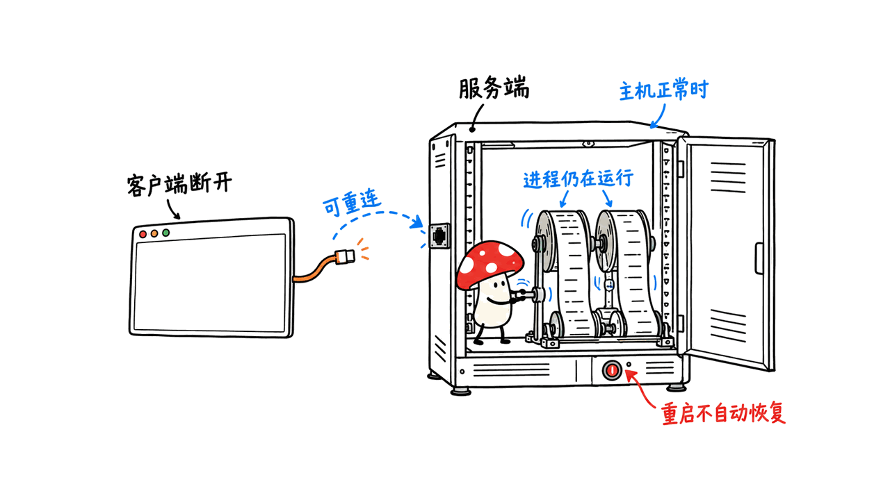
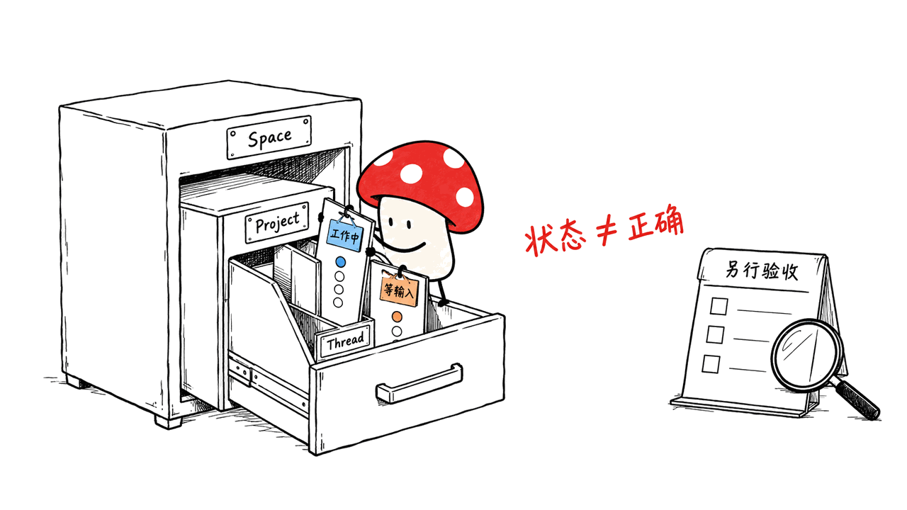
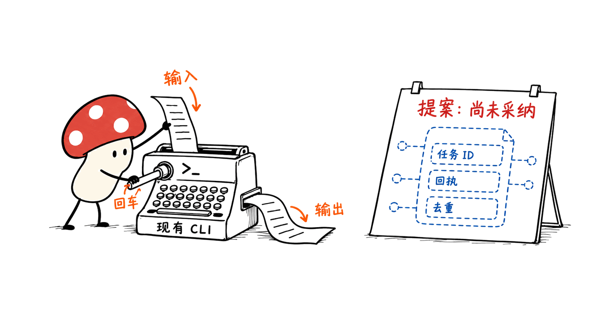

ThinkTerm 是把多个编码智能体和远程终端放在同一个工作台里管理的工具。找到的官方仓库是 RoversX/ThinkTerm；截至本次核验，最新发布为 0.2.9，仓库约 139 星，主项目采用 GPL-3.0-only。

它确实适合同时使用 Claude Code、Codex 等工具的人，但“多 Agent 工作台”和“能自主协调团队的框架”之间还有距离：前者已经有产品实现，后者的原生协议仍在设计讨论中。本文依据 2026 年 10 月 20 日的官方资料，并固定源码版本，避免把规划写成现成功能。

官方仓库：https://github.com/RoversX/ThinkTerm
发布记录：https://github.com/RoversX/ThinkTerm/releases/tag/0.2.9
源码版本：109de1d1690f6e3658e58725bf510f06af40ebfe

## 它是编辑器，还是多 Agent 协调工具？

更准确的分类是原生终端工作台。它使用 Rust，界面直接经 GPU 绘制，不依赖 Electron 或嵌入式 WebView；基于 WezTerm 的终端与多路复用能力，提供文件浏览、源码预览、外部编辑器打开、笔记以及插件扩展。你在终端中启动自己的编码 Agent，ThinkTerm 管理这些会话的可见性与连接。

| 层次 | 当前作用 | 不宜推导出的能力 |
| --- | --- | --- |
| 终端与 mux | 管理进程、标签页和分屏 | 自动恢复主机重启前的所有进程 |
| 文件与项目 | 浏览项目、预览代码、组织会话 | 完整替代现有代码 IDE |
| Agent 面板 | 识别部分工具及其运行状态 | 证明任务完成或代码正确 |
| CLI | 列出会话、读取输出、发送输入 | 已有可靠的原生 Agent 消息总线 |
| 多客户端 | 桌面、TUI、浏览器连接 | 所有客户端功能完全相同 |

这套取舍很实用：既然很多编码 Agent 本来就住在终端，先把终端的组织和重连做好，能够减少切窗口、找项目、猜进度的成本。至于模型怎么规划、代码怎么审查、失败怎么回滚，仍需 Agent 和工程流程承担。

## 会话为什么能在关闭窗口后继续？

关键是 mux 服务端拥有会话进程，桌面窗口等客户端负责显示与交互。关闭客户端或脱离连接，与关闭运行任务的 pane 不是同一件事。在服务端仍然正常运行的前提下，客户端可以重新连接。

这也决定了能力边界：主机宕机、服务端退出或重启，并不会因为存在一个 UI 就自动恢复活进程。不同主机各自运行服务端，统一入口不等于把任务进程从一台机器迁移到另一台。



本地和远程环境可以通过 Space、Project、Thread 组织：Space 容纳不同环境或上下文，Project 对应项目目录，Thread 组织具体会话、标签页和分屏。SSH、Mosh 和 ThinkTerm Connect 解决连接问题；远程服务端的安装与版本配合仍须按官方说明处理。

把长时间运行的 Agent 放在稳定主机上，再从不同客户端查看，是自然的使用方式。把所有重要任务只放在随时休眠的笔记本上，然后把“可重连”理解为“不会中断”，就会用错它。

## Agent 状态面板解决什么问题？

官方实现结合进程身份、终端屏幕规则和状态契约来识别 Agent。面板可以显示哪些会话正在工作、等待输入或处于其他状态；相关功能需要在设置中启用，不能假定安装后默认开启。

源码里的身份识别并非简单地搜索一个名字：它会处理解释器包装、npm 启动器、符号链接和已知安装路径，并避免把任意含有 codex 字样的路径或脚本内容当作真实 Agent。状态层还有屏幕信号与契约的优先级、过期处理及去抖规则。

但这里识别的是终端状态。一个 Agent 回到输入提示符，可能只是停止运行，也可能在等待你发现它漏做了一步；面板无法替代测试、差异审查与验收。当前 Claude 集成依赖屏幕规则，不能把旧版 hook 机制描述为仍在使用的可靠链路。



我们的实际验证很有限但可复核：下载固定版本未经修改的 `mux/src/agent_status/proc_match.rs`，用 Rust 自带测试运行器独立执行了该模块的全部十项现有测试，结果为 10 项通过、0 项失败。覆盖了普通进程名、解释器参数、包路径与符号链接等识别情形。

这不是完整应用测试，也没有启动真实 Claude Code、Codex、远程服务端或浏览器客户端，更没有测量识别准确率与延迟。模块通过只能说明这些已有规则样例在本机运行成立。

## 已有 CLI，不等于已有原生协作协议

官方协作设计文档明确标注：Exploratory proposal，Not yet adopted。当前示例通过 CLI 向另一个 pane 发送文本，再发送回车，并读取终端输出；原生 Agent 间通信是未来设计方向。

终端输入输出是一条可用的连接管道，却没有天然提供可靠任务系统所需的完整语义：请求是否送达、是否重复执行、输出对应哪项任务、超时如何处理、谁有权批准敏感操作。解析屏幕文本还会受到提示符、交互模式和工具版本变化影响。



我的建议是先做人工可审查的分工：一个会话分析需求，一个实现限定模块，一个审查补丁；使用不同 Git worktree，明确文件归属，由一个负责集成的人合并结果。ThinkTerm 负责让这些会话容易找到、观察和重新连接，而不是替代共享状态管理。

不要让两个 Agent 无约束地改同一个工作目录，再期待终端工具替你处理语义冲突。若真要自动派单，应在外部增加任务 ID、验收命令、重试去重和操作权限，再把终端作为执行界面。

## 安装后如何做第一轮工程验证？

macOS 官方提供的 Homebrew 安装入口如下。以下是读者操作指南，我们没有在这次研究中安装或启动完整桌面应用。

```bash
brew install --cask roversx/tap/thinkterm
thinkterm --help
thinkterm cli --help
thinkterm tui --help
```

第一轮先创建独立测试目录，启动一个无敏感数据的普通 shell 会话。按顺序检查分屏、文件预览、客户端脱离和重新连接，再测试远程机器；确认你关闭的是客户端，而不是承载进程的 pane。最后才接入真实 Agent，并逐一验证面板显示是否符合实际状态。

多机环境要记录每台主机与服务端版本，检查连接失败、主机休眠和网络重连后的表现。手机方面，官方将 iOS、Android 列为开发中，不应据此安排已交付的移动端工作流。

## 浏览器接入和隐私有哪些边界？

Web 客户端需要显式开启，WebGPU 还涉及安全上下文要求。官方设计包含 token 验证，非回环监听默认要求 TLS。更保守的起点是保留本地回环地址，通过自己的 SSH 隧道连接，再按部署文档核对配置。

终端访问 token 应按高权限凭证保管：它不是普通只读仪表盘的登录码。能查看终端或发送输入，往往就接近相应用户的文件和 shell 权限，因此不应把访问入口直接暴露成公共演示页面。

官方表示不设置遥测和跟踪，但这不意味着所有网络流量消失：更新检查、远程连接和笔记图片加载可能联网，Agent 使用的模型服务也各有数据边界。“终端在本机”不能自动推出“代码永不出设备”。

许可证也要分层读：主项目 GPL-3.0-only，保留的 WezTerm 来源代码有 MIT 声明，herdr 检测清单包含 Apache-2.0 声明。不要把其中某个依赖的宽松协议当成整个产品的许可证。

## 哪些团队值得试？

如果你已经同时维护几个 CLI 编码 Agent，项目分布在本机和远程 Linux 主机，主要痛点是会话散乱、重连麻烦、进度难观察，ThinkTerm 的产品方向很贴合。它把已有工具放进一个更有组织的终端环境，不强迫先迁移到另一套 Agent 框架。

如果你需要无人值守的可靠工作流、强隔离执行环境或完整 IDE 调试体验，就要继续补齐相应系统。当前最值得评估的是会话基础设施和操作体验；“自动指挥智能体团队”仍需要额外的调度与验收设计。

## 常见问题

### 它自己包含大模型吗？

它主要管理终端与会话。编码能力取决于你另外启动的 Agent 及其模型配置，本次没有测模型效果。

### 关窗口就一定不会中断吗？

只有在服务端和进程仍正常运行、操作没有关闭 pane 的情况下，客户端断开后才能重新接入。它不是主机重启后的进程恢复保证。

### 可以当作成熟的多 Agent 框架吗？

当前可将其用作多 Agent 终端工作台。官方原生协作协议尚未采纳，现有终端输入输出示例不等于可靠的结构化调度框架。

延伸阅读：我们也介绍过持久化编码终端 herdr，可对照不同工具的会话组织方式：https://blog.mushroom.cv/blog/herdr-coding-agent-runtime-persistent-terminal-multiplexer-rust/

## 资料与复核范围

README：https://github.com/RoversX/ThinkTerm
状态机制：https://github.com/RoversX/ThinkTerm/blob/109de1d1690f6e3658e58725bf510f06af40ebfe/docs/agent-status.md
协作提案：https://github.com/RoversX/ThinkTerm/blob/109de1d1690f6e3658e58725bf510f06af40ebfe/docs/thinkterm/agent-collaboration.md
Web 接入：https://github.com/RoversX/ThinkTerm/blob/109de1d1690f6e3658e58725bf510f06af40ebfe/docs/thinkterm/web-access.md
隐私声明：https://github.com/RoversX/ThinkTerm/blob/109de1d1690f6e3658e58725bf510f06af40ebfe/PRIVACY.md
许可证：https://github.com/RoversX/ThinkTerm/blob/109de1d1690f6e3658e58725bf510f06af40ebfe/LICENSE.md

封面为与多机终端主题匹配的原创概念图，正文配图用于解释架构，不是实际应用截图。核验日期：2026-10-20；没有完整 GUI、真实 Agent 或跨机器协作实测。

---

> © 2026 Author: Mycelium Protocol. 本文采用 [CC BY 4.0](https://creativecommons.org/licenses/by/4.0/deed.zh) 授权——欢迎转载和引用，须注明作者姓名及原文链接，不得去除署名后以原创发布。

<!--EN-->

ThinkTerm is a terminal workspace for managing coding agents and remote sessions in one place. The official repository is RoversX/ThinkTerm; our October 20, 2026 snapshot shows release 0.2.9 and about 139 stars. The main project is GPL-3.0-only.

Its useful distinction is between a workspace that hosts several agents and a framework that autonomously coordinates them. ThinkTerm already implements the former. Its native collaboration protocol remains an exploratory proposal, explicitly not adopted.

Repository: https://github.com/RoversX/ThinkTerm
Release: https://github.com/RoversX/ThinkTerm/releases/tag/0.2.9
Pinned source: 109de1d1690f6e3658e58725bf510f06af40ebfe

## Is it an editor or a coordination framework?

ThinkTerm is a native Rust terminal built on WezTerm technology. Its desktop interface renders on the GPU without Electron or an embedded WebView. It combines multiplexed sessions, file browsing and previews, opening files in an external editor, notes, and plugins. Your coding agent still runs as a separate terminal program. ThinkTerm improves where you find and observe that program.

| Layer | Existing role | Limit |
| --- | --- | --- |
| Terminal and mux | Own processes, tabs, and splits | No automatic process recovery after host reboot |
| Project navigation | Organize directories and sessions | Does not establish full IDE parity |
| Agent panel | Detect supported tools and visible states | Does not validate completed work |
| CLI | Read terminal output and send input | Not a reliable structured agent message bus |
| Clients | Desktop, TUI, and browser access | Feature parity should be checked individually |

This is a sensible product focus. Coding agents already live in terminals; organizing those terminals can reduce window switching and lost context. Planning, code review, rollback, and acceptance remain separate responsibilities.

## Why can a session survive a closed window?

The mux server owns the session processes. Clients display and interact with them. Detaching or closing a client therefore differs from closing the pane that contains a running process. Reconnection works while the server and its processes remain available.

A crashed or rebooted host is a different failure. The client/server split does not restore live processes after that failure. Each host also has its own server: a common navigation surface does not migrate a process between machines.


Spaces group environments or contexts, projects represent directories, and threads organize sessions, tabs, and panes. SSH, Mosh, and ThinkTerm Connect provide remote connection paths; server installation and version compatibility still matter.

A stable remote host is a natural home for long jobs. A laptop that sleeps unexpectedly is not made reliable merely by adding a reconnecting client.

## What does the agent panel actually know?

Detection combines process identity, terminal-screen rules, and an agent status contract. Enable the relevant settings before expecting the panel to appear. Process recognition handles interpreter wrappers, npm package layouts, launchers, and symlinks rather than matching any arbitrary path containing an agent name.

The status layer includes signal precedence, stale-report handling, and screen-state hysteresis. These rules improve a status display; they do not establish that a task passed its acceptance criteria. An agent returning to a prompt may have finished, failed, or overlooked something.

Current Claude integration uses screen rules. The old hook installation path should not be described as the current reliable status channel.


We performed one narrow, reproducible check: the unmodified pinned `mux/src/agent_status/proc_match.rs` module ran through Rust's test runner. All ten existing module tests passed, covering names, interpreter arguments, known package layouts, and symlink targets.

This was not an application installation or a live Claude Code/Codex detection test. We did not exercise the GUI, remote servers, browser client, full state pipeline, detection accuracy, or latency. Passing those ten cases only validates the tested recognition examples on this machine.

## Existing CLI versus proposed collaboration

The official collaboration document begins with “Exploratory proposal” and “Not yet adopted.” Existing examples send text into another pane, send Enter separately, and read terminal output. A native agent collaboration protocol is a future design direction.

Terminal input/output is a useful transport surface. It does not automatically provide task identifiers, delivery acknowledgments, duplicate suppression, timeout semantics, authorization, or structured results. Screen parsing also depends on prompts and interactive modes.


A practical starting point is human-reviewable delegation: one agent studies requirements, another implements a bounded module, and a third reviews the patch. Give them separate Git worktrees and clear file ownership, with one integration owner. ThinkTerm makes the sessions easier to observe and reconnect to; it does not solve conflicting edits.

For automated dispatch, add explicit task IDs, acceptance commands, retry deduplication, and permissions outside the terminal UI. Treat the terminal as an execution interface, not the entire workflow engine.

## A conservative installation and validation path

The documented macOS Homebrew entry point is:

```bash
brew install --cask roversx/tap/thinkterm
thinkterm --help
thinkterm cli --help
thinkterm tui --help
```

These are reader instructions. We did not install or launch the full desktop application for this report.

Start in a disposable directory with an ordinary shell and no sensitive data. Check splits, previews, client detachment, and reconnection before adding a remote host. Confirm that your action closes the client rather than the process-owning pane. Add real agents only after those basics work, and compare each reported state with the actual program.

Record host and server versions. Test disconnection, sleep, and reconnection explicitly. Official iOS and Android clients are listed as in development, so do not design a delivered mobile workflow around them.

## Web access, privacy, and licensing

Browser access must be enabled explicitly. WebGPU introduces secure-context requirements. The documented configuration uses token authentication, with TLS required by default for non-loopback listening. A conservative deployment keeps the service on loopback and uses a private SSH tunnel, following the official configuration instructions.

Treat the token as a privileged terminal credential. The ability to inspect panes or send input can approach the permissions of the underlying user account. This is not merely access to a read-only progress dashboard.

The project says it has no telemetry or trackers. Update checks, remote connections, and note images can still use the network, while the agent's model provider has separate data handling. A local terminal does not establish that code never leaves the device.

Read licensing by component: the main project is GPL-3.0-only; retained WezTerm-derived code has MIT notices; herdr detection manifests have Apache-2.0 notices. A permissive component license does not replace the main project's terms.

## Who should evaluate it?

ThinkTerm fits developers already using several CLI agents across local and remote projects, especially when finding sessions and recovering connections are recurring problems. It improves the workspace around existing tools without requiring an immediate switch to another agent framework.

Teams needing reliable unattended execution, strong sandboxing, or a full IDE debugging environment must supply those systems separately. Evaluate ThinkTerm first as session infrastructure. Automatic team coordination still requires explicit scheduling and acceptance design.

## Frequently asked questions

### Does it include its own language model?

Its primary role is terminal and session management. Coding capability comes from the agent and model configuration you bring; we did not evaluate model quality.

### Does closing a window guarantee uninterrupted work?

Only when the server and process remain healthy and the operation does not close the pane. It is not a reboot-recovery guarantee.

### Is it a mature multi-agent orchestration framework?

It is usable as a multi-agent terminal workspace. The proposed native collaboration protocol has not been adopted, and terminal input/output examples do not establish reliable structured scheduling.

Related reading: our herdr terminal analysis provides another session-management reference: https://blog.mushroom.cv/blog/herdr-coding-agent-runtime-persistent-terminal-multiplexer-rust/

## Primary sources and verification scope

README: https://github.com/RoversX/ThinkTerm
Status detection: https://github.com/RoversX/ThinkTerm/blob/109de1d1690f6e3658e58725bf510f06af40ebfe/docs/agent-status.md
Collaboration proposal: https://github.com/RoversX/ThinkTerm/blob/109de1d1690f6e3658e58725bf510f06af40ebfe/docs/thinkterm/agent-collaboration.md
Web access: https://github.com/RoversX/ThinkTerm/blob/109de1d1690f6e3658e58725bf510f06af40ebfe/docs/thinkterm/web-access.md
Privacy: https://github.com/RoversX/ThinkTerm/blob/109de1d1690f6e3658e58725bf510f06af40ebfe/PRIVACY.md
License: https://github.com/RoversX/ThinkTerm/blob/109de1d1690f6e3658e58725bf510f06af40ebfe/LICENSE.md

The cover is an original conceptual illustration of connected computing hosts. Body figures explain architecture and are not application screenshots. Checked October 20, 2026; no full GUI, live-agent, or cross-host collaboration test was performed.

---

> © 2026 Author: Mycelium Protocol. Licensed under [CC BY 4.0](https://creativecommons.org/licenses/by/4.0/) — free to share and adapt with attribution. You must credit the author and link to the original; removing attribution and republishing as original is not permitted.
