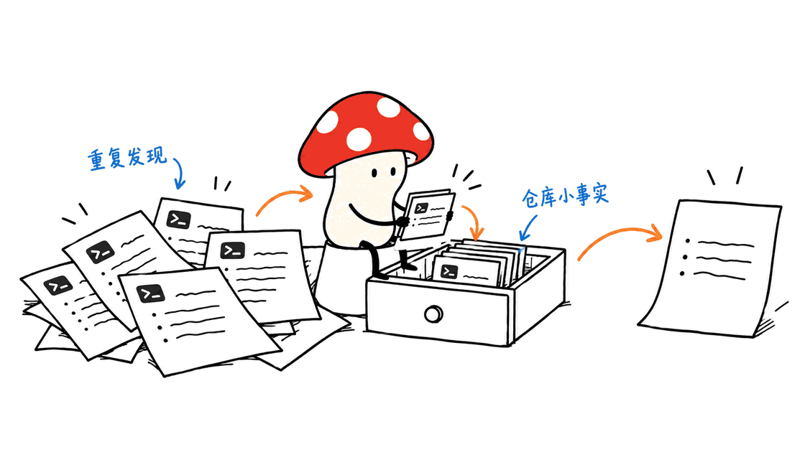
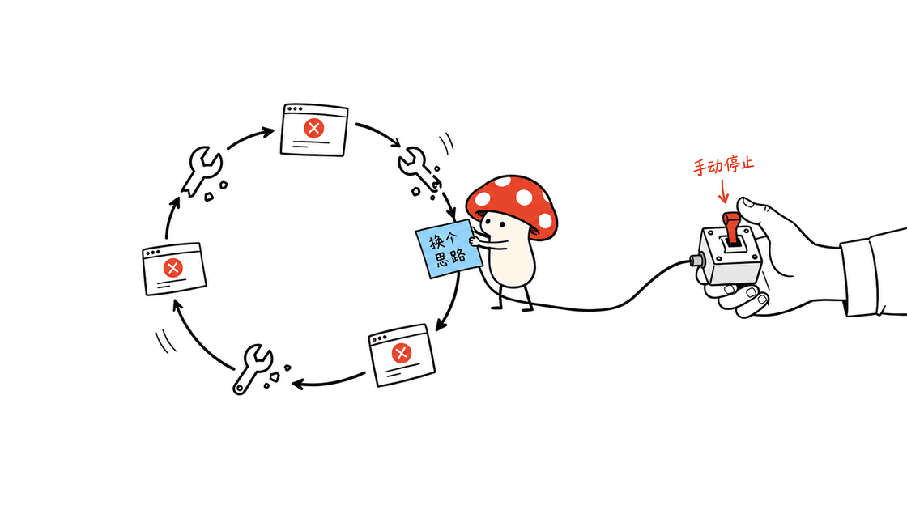

TokenEconomizer是一款让编码Agent复用仓库经验、减少重复消耗的插件，适合长期维护同一项目的团队。它由UC Berkeley、Microsoft Research和Microsoft Security研究人员合作，代码采用Apache-2.0许可。省费数字来自作者实验；当前交互插件的默认设置与实验控制器存在重要差异。

本文核对的仓库提交为`c53a4a6dcdebaeb9df6fcaa5c7026f0401cd8f23`，日期为2026年11月1日。原始论文于10月15日提交，不能把社交平台的传播日期当成发布日期。

官方仓库：https://github.com/microsoft/TokenEconomizer
项目页面：https://tokeneconomizer.github.io/
论文：https://arxiv.org/abs/2610.22732

## TokenEconomizer到底优化什么？

同一个代码库里，代理可能不断重查测试入口、重复加载闲置工具，或者对同一失败反复修补。项目将控制点放在任务周围：整理已有会话，影响后续提示上下文、工具配置和运行中的提醒，不训练新模型，也不要求重写代理主体。

这类优化的价值取决于任务分布。每次都换一个陌生仓库，知识复用空间较小；持续维护同一服务，重复的构建和验证路径更可能值得压缩。仓库经验也可能过时，因此“记住一次”不能等同于永久正确。



### 三个机制如何分工？

| 机制 | 干预的位置 | 需要关注的代价 |
|---|---|---|
| Micro-skills | 在后续会话注入经证据支持的简短仓库事实 | 学习调用有成本，错误事实会污染上下文 |
| Tool pruning | 在后续会话减少不需要加载的工具或能力包 | 误删工具可能增加绕路，必须能够恢复 |
| Loop guard | 观察失败循环并给出换思路的提醒 | 判断和提醒也要调用模型，误判会打断有效探索 |

这张表是对控制位置的概括，不代表所有宿主都实现了相同功能。工具裁剪的粒度尤其不同，后文会单独列出。

## “省18.4%至30.9%”应该怎样读？

作者报告在6个仓库的277道SWE-Bench任务上，比较5种Agent与模型组合，按仓库顺序执行任务。平均成本下降18.4%至30.9%，包含控制器自身的模型调用；4种组合的Pass@1提高，另1种没有提高。

官方结果绘图脚本给出了如下表格；Pass@1变化使用百分点，不是相对百分比。表格为作者数据，未在本机重跑。

| Agent × 模型 | 平均成本下降 | Pass@1变化 |
|---|---:|---:|
| Claude Code × Sonnet 5 | 23.6% | +1.3个百分点 |
| Claude Code × Opus 4.8 | 30.9% | −1.0个百分点 |
| Codex × GPT-5.6 Terra | 24.7% | +0.9个百分点 |
| Codex × GPT-5.6 Sol | 26.1% | +1.6个百分点 |
| Copilot CLI × Sonnet 5 | 18.4% | +2.6个百分点 |

数据脚本：https://github.com/microsoft/TokenEconomizer/blob/main/docs/assets/results_overview.py

这些数字描述特定实验条件下的平均变化。它们不证明每个任务都更便宜，不证明质量全面提升，也不等于实际订阅账单必然同比下降。订阅额度、缓存计费、模型路由和完成任务数量，都会改变用户感受到的节省。

原始口径见论文和实验目录：
https://arxiv.org/abs/2610.22732
https://github.com/microsoft/TokenEconomizer/tree/main/experiments

更关键的是，实验环境有官方任务评分，可以判断是否解决问题；真实插件用会话事件推断“这一轮结束后没有失败验证”等信号。没有报错并不保证满足业务要求。把交互插件安装成功，不能视为已经复现论文结果。

## 当前插件与论文有哪些区别？

官方`docs/PLUGIN.md`明确列出两者差异。安装决策应以当前实现为准，而不是把论文控制器的能力全部套到插件上。

| 问题 | 当前插件的行为 |
|---|---|
| Micro-skills装上就学习吗？ | 默认关闭，需要自行启用；也有不调用模型的`envfacts`模式 |
| 长时间卡住会自动停止吗？ | 不会；先提醒换思路，仍卡住时提示人如何停止 |
| 工具马上消失吗？ | 默认等待仓库会话闲置后写配置，并从后续会话生效 |
| 学习跨不同Agent共享吗？ | 设置可共享，但事实、工具证据和运行尺度按Agent及仓库分别保留 |
| 一次失败就永久记住吗？ | 不应如此；事实需要重复证据，后续矛盾会影响保留状态 |

最容易造成误解的是Loop guard：无人值守时，没有人看到提示，任务仍可能继续消耗到代理自身的限制。要控制自动任务预算，仍需在外层设置超时、调用额度和人工接管条件。

实现差异与限制：
https://github.com/microsoft/TokenEconomizer/blob/main/docs/PLUGIN.md



## Claude Code、Codex、Copilot和Pi支持一样吗？

工具裁剪模块与配置写入代码显示，宿主提供的控制面不同，不能只看“支持”两个字。

| 宿主 | 裁剪对象 | 重要限制 |
|---|---|---|
| Claude Code | 单个工具 | 写入项目的`.claude/settings.local.json` |
| Codex | 能力包 | 写入`.codex/config.toml`；不是任意单工具开关 |
| GitHub Copilot CLI | 整个MCP服务器 | 写入`.github/copilot/settings.local.json` |
| Pi | 当前不裁剪 | 不能套用其他宿主的工具裁剪收益 |
| opencode | 当前不裁剪 | 支持仍属实验性质 |

源码与说明：https://github.com/microsoft/TokenEconomizer/tree/main/tokeneconomizer/toolprune

截至本次核对，README列出的测试版本范围为Claude Code 2.1.300–2.1.310、Codex 0.153.1–0.164.0、Copilot CLI 1.0.83–1.0.102、Pi 1.2.0–1.3.0；opencode测试了1.19.5及2.2.0。它们是已测试范围，不是未来版本兼容承诺，升级后要重新检查状态和实际生效配置。

## 如何安装，并保留撤回路径？

需要已能使用的宿主，以及PATH中的Python 3.10以上版本。本机测试发现，仅用Python 3.12启动测试还不够：Shell启动器可能另找系统Python 3.9，必须同时核对PATH；项目也提供`TE_PYTHON`覆盖项。插件Python包没有额外运行时依赖，也不需要为插件单独申请API Key；已有代理的登录、模型用量和权限仍然适用。

以Claude Code为例，下面命令来自官方安装说明，执行位置应是准备长期保留克隆目录的父目录：

```bash
git clone https://github.com/microsoft/TokenEconomizer.git
claude plugin marketplace add "$PWD/TokenEconomizer"
claude plugin install tokeneconomizer@tokeneconomizer
```

开启新会话后，检查状态并建立工具目录。以下是Claude Code中的命令，不能直接粘到系统Shell：

```text
/tokeneconomizer:status
/tokeneconomizer:toolprune refresh-catalog
```

建议先以只提议模式观察工具裁剪；确认学习所涉及的模型调用和数据范围后，再启用微技能：

```text
/tokeneconomizer:config set toolprune=propose
/tokeneconomizer:config set microskills=on
```

其他宿主的官方安装入口：
https://github.com/microsoft/TokenEconomizer/blob/main/plugin/README.md

需要撤回已应用的工具裁剪时，使用`/tokeneconomizer:toolprune restore`。只把`toolprune`设为`off`会停止产生新列表，并不自动撤回已写入的规则。卸载前应恢复各仓库的规则，并按官方文档清理宿主插件；不要直接删除整个项目配置文件。

## 状态在本地，是否意味着完全离线？

不是。路径实现将状态放在`~/.tokeneconomizer`，也允许通过`TOKENECONOMIZER_HOME`指定位置。仓库标识优先从`origin`推导，同仓库的克隆可能共用经验；但长期分叉的环境不一定具有相同约束，需留意经验迁移是否适用。

状态可能包含仓库路径、命令、错误和费用记录。它需要纳入团队的本机备份、访问控制和清理策略，而不是因为没有独立服务器就忽略数据治理。

模型侧调用代码则通过用户已有的宿主CLI调用提议器和判断器。启用相关功能时，构造的摘要仍可能进入该宿主使用的模型服务。“存储在本地”不能推导出“内容不离开电脑”。

路径代码：https://github.com/microsoft/TokenEconomizer/blob/main/tokeneconomizer/plugin/paths.py
模型调用代码：https://github.com/microsoft/TokenEconomizer/blob/main/tokeneconomizer/plugin/sidecall.py

## 如何验证它在自己的项目里值得使用？

Mycelium Protocol建议按完成任务的质量与总成本验收，而非仅比较Token数量。可以选择一组真实维护任务，固定宿主、模型、缓存计费规则和任务验收标准，分别记录冷启动阶段及经验积累阶段。

至少保留五项记录：最终测试是否通过、总计费成本、插件附加调用成本、人工返工时间，以及被裁剪工具的恢复次数。比较时应包含失败任务和中断任务，避免只挑成功省钱的会话。

一个可解释的指标是“全部尝试成本÷验收通过的任务数”。假设总花费下降20%，通过的任务数却下降25%，单位成功任务成本变成原来的`0.8÷0.75≈1.067`，反而上升约6.7%。这只是说明计算方法的构造示例，不是TokenEconomizer的实测结果。


本次对上游离线测试的首次运行得到421项通过、6项跳过和4项启动器失败。3项通过指定`TE_PYTHON`复查通过，另1项测试清理了该变量，改用Python 3.12所在目录前置到PATH后通过。总计425项已通过、6项跳过，分阶段日志保留；没有将初次失败隐藏为一次全绿运行。

本次验证范围为固定提交的代码审阅与离线测试，不包含将插件接入真实付费会话、运行完整SWE-Bench或测量账单节省。离线检查只能证明测试覆盖的行为在当前环境成立，不能替代实际使用对照。

建立验收样本的方法，也可参考本站的Agent评测文章：
https://blog.mushroom.cv/blog/hamel-domain-specific-agent-evals-guide/

## 常见问题

### 它会让模型变聪明吗？

TokenEconomizer不更新模型权重。它试图改善代理获取经验和使用工具的方式，减少操作浪费；模型推理能力是否足够，仍需通过任务结果检验。

### 免费插件能保证账单降低吗？

不能。开源许可与模型用量是两回事。提议器、循环判断和提醒都可能产生额外调用，最终收益取决于减少的重复工作是否超过新增成本。

### 哪些项目适合先尝试？

优先选择反复维护、测试路径清晰、可以记录验收结果的仓库。一次性任务、工具需求频繁变化或无人值守任务，应先从可观察配置和明确的外部预算限制开始。

---

> © 2026 Author: Mycelium Protocol. 本文采用 [CC BY 4.0](https://creativecommons.org/licenses/by/4.0/deed.zh) 授权——欢迎转载和引用，须注明作者姓名及原文链接，不得去除署名后以原创发布。

<!--EN-->

TokenEconomizer is a plugin that helps coding agents reuse repository experience and reduce repeated work. It is most relevant to developers who maintain the same codebase over many sessions. Researchers affiliated with UC Berkeley, Microsoft Research and Microsoft Security released the code under Apache-2.0. Its reported savings come from author-run experiments, and the current interactive plugin differs from the experimental controller.

This review pins commit `c53a4a6dcdebaeb9df6fcaa5c7026f0401cd8f23`, checked on November 1, 2026. The paper was submitted on October 15; a later social post is not the original publication date.

Repository: https://github.com/microsoft/TokenEconomizer
Project: https://tokeneconomizer.github.io/
Paper: https://arxiv.org/abs/2610.22732

## What work does TokenEconomizer remove?

A coding agent may repeatedly rediscover the test command, load tools it never uses, or retry an unsuccessful repair without changing its approach. TokenEconomizer places a controller around those activities. Completed sessions inform later context, tool settings and reminders during execution. It does not train model weights or require replacing the agent's core implementation.

The opportunity depends on the workload. Repeated maintenance offers more reusable context than a stream of unrelated repositories. Experience also expires: a build migration can make an instruction that was correct last month actively misleading today. Retaining facts requires evidence and a way to respond to contradiction.


### How do the three mechanisms differ?

| Mechanism | Control point | Cost or failure to monitor |
|---|---|---|
| Micro-skills | Add supported repository facts to later sessions | Learning calls and incorrect context |
| Tool pruning | Reduce tools or capability packages loaded later | Detours caused by removing needed capabilities |
| Loop guard | Redirect an apparently stuck turn | Judgment overhead and interruption of productive work |

These describe control locations, rather than identical features on every host. The tool-pruning implementation depends on the settings surface each host provides.

## What does the savings range establish?

The authors report 18.4–30.9% lower mean cost across five agent–model combinations on 277 SWE-Bench tasks from six repositories. Tasks follow a sequence within each repository, and accounting includes controller model calls. Pass@1 improves in four combinations, leaving one without an improvement.

The official figure-generation script lists the following author-reported values. Pass@1 differences are percentage points, rather than relative percentages. None was rerun locally.

| Agent and model | Mean cost reduction | Pass@1 change |
|---|---:|---:|
| Claude Code × Sonnet 5 | 23.6% | +1.3 points |
| Claude Code × Opus 4.8 | 30.9% | −1.0 points |
| Codex × GPT-5.6 Terra | 24.7% | +0.9 points |
| Codex × GPT-5.6 Sol | 26.1% | +1.6 points |
| Copilot CLI × Sonnet 5 | 18.4% | +2.6 points |

Data script: https://github.com/microsoft/TokenEconomizer/blob/main/docs/assets/results_overview.py

The range describes averages under those conditions. It does not mean every task becomes cheaper or that every installation improves quality. A subscription invoice also depends on quota rules, cache prices, routing and the number of completed tasks. Fewer tokens and a smaller cash bill are related measurements, not interchangeable ones.

Paper and reproduction code:
https://arxiv.org/abs/2610.22732
https://github.com/microsoft/TokenEconomizer/tree/main/experiments

The benchmark can use an official grader to identify a solved task. Interactive use lacks that oracle. A turn ending without a failed verification is useful evidence, but may still miss a business requirement. Installing the plugin therefore does not reproduce the experimental result.

## How does the shipped plugin differ from the experiments?

The official implementation notes explicitly document the differences. Those notes matter more for deployment than an assumption that every benchmark control exists unchanged in the plugin.

| Question | Current plugin behavior |
|---|---|
| Are micro-skills active immediately? | They are off by default; `envfacts` offers a mode without proposer model calls |
| Does a stuck turn stop automatically? | No: a redirect is followed by a notice telling the person how to stop |
| Does tool pruning change the current session? | Settings are written after an idle interval and affect later sessions |
| Do all hosts share learned experience? | Settings are shared, while learned evidence and turn scales remain host-specific |
| Is one observed failure a permanent rule? | Facts require supporting evidence and can lose support after contradiction |

For unattended work, a notice is not a spending limit. A task can continue until the agent's own limits intervene. An external runner still needs explicit deadlines, quotas and a handoff policy. This is an engineering consequence of the plugin's documented behavior, rather than a measured failure rate.

Implementation notes:
https://github.com/microsoft/TokenEconomizer/blob/main/docs/PLUGIN.md


## Do all supported agents expose the same controls?

No. Reviewing the pruning module and configuration writer shows meaningful differences between hosts.

| Host | Pruning unit | Configuration destination or limitation |
|---|---|---|
| Claude Code | Individual tools | `.claude/settings.local.json` |
| Codex | Capability packages | `.codex/config.toml`; not arbitrary individual tools |
| GitHub Copilot CLI | Entire MCP servers | `.github/copilot/settings.local.json` |
| Pi | No pruning currently | Savings cannot assume this mechanism is active |
| opencode | No pruning currently | Support remains experimental |

Source: https://github.com/microsoft/TokenEconomizer/tree/main/tokeneconomizer/toolprune

At the pinned revision, the README lists tested ranges of Claude Code 2.1.300–2.1.310, Codex 0.153.1–0.164.0, Copilot CLI 1.0.83–1.0.102 and Pi 1.2.0–1.3.0. The tested opencode versions are 1.19.5 and 2.2.0. These ranges document testing, not a guarantee for future releases. Recheck status and effective configuration after upgrading a host.

## How should a team install and reverse it?

The plugin requires a working supported agent and Python 3.10 or newer on PATH. Local tests exposed a practical issue: running pytest under Python 3.12 did not prevent shell launchers from selecting system Python 3.9. Check PATH as well; the project also supports a `TE_PYTHON` override. Its Python runtime uses the standard library. It needs no separate API key, but the existing agent's login, permissions and model usage still apply.

For Claude Code, run the official commands from the parent directory where the clone should remain:

```bash
git clone https://github.com/microsoft/TokenEconomizer.git
claude plugin marketplace add "$PWD/TokenEconomizer"
claude plugin install tokeneconomizer@tokeneconomizer
```

Start a new agent session and use the following inside Claude Code, rather than in the operating-system shell:

```text
/tokeneconomizer:status
/tokeneconomizer:toolprune refresh-catalog
```

A cautious trial can begin with pruning proposals only. Enable micro-skills after reviewing its model calls and data scope:

```text
/tokeneconomizer:config set toolprune=propose
/tokeneconomizer:config set microskills=on
```

Host-specific installation and removal instructions:
https://github.com/microsoft/TokenEconomizer/blob/main/plugin/README.md

To reverse applied pruning, use `/tokeneconomizer:toolprune restore`. Turning pruning off stops new proposals but does not remove existing rules. Restore affected repositories before uninstalling, and follow the host-specific removal steps. Deleting the entire project configuration could remove unrelated settings.

## Does local state imply offline processing?

The path implementation defaults to `~/.tokeneconomizer`, with a `TOKENECONOMIZER_HOME` override. Repository identity preferentially derives from the origin remote, so clones can reuse experience. Long-lived forks may have different environments even when sharing an origin; inspect whether old facts remain appropriate.

State includes information derived from session logs, such as repository paths, commands, errors and costs. Treat it as part of the team's local access-control, backup and retention policy.

The side-call implementation invokes the user's existing agent CLI for proposals and loop judgments. When enabled, the resulting digests can reach the model service used by that host. Keeping learned state locally does not establish that all processing stays on the computer.

Paths: https://github.com/microsoft/TokenEconomizer/blob/main/tokeneconomizer/plugin/paths.py
Model calls: https://github.com/microsoft/TokenEconomizer/blob/main/tokeneconomizer/plugin/sidecall.py

## How can a repository validate useful savings?

Mycelium Protocol recommends evaluating total cost alongside accepted work. Choose representative maintenance tasks, fix the host and model, document cache pricing, and define acceptance before collecting results. Keep cold-start sessions separate from sessions that can use accumulated experience.

Record acceptance-test outcomes, total billed cost, additional plugin calls, human rework and restoration of pruned tools. Include interrupted and unsuccessful attempts. Otherwise a controller can appear efficient simply because expensive failures disappeared from the report.

A useful metric is all attempted-work cost divided by accepted tasks. Consider a constructed example: spending falls 20%, but accepted tasks fall 25%. Cost per accepted task becomes `0.8 / 0.75 ≈ 1.067` of the original, an increase of about 6.7%. This illustrates the denominator problem; it is not a TokenEconomizer measurement.


The initial upstream offline suite produced 421 passes, six skips and four launcher failures. Three failures passed when rechecked with `TE_PYTHON` set. One test deliberately discarded that variable; placing Python 3.12 first on PATH made it pass. In total, 425 cases have passed and six remain skipped across these recorded runs. This was not a single all-green invocation.

This review examines the pinned source and runs offline checks. It does not connect the plugin to paid agent sessions, rerun the full SWE-Bench experiment or measure invoice savings. Offline tests establish behavior covered by their fixtures in this environment, not an economic outcome in a production workflow.

For building acceptance examples, see the related evaluation guide:
https://blog.mushroom.cv/blog/hamel-domain-specific-agent-evals-guide/

## FAQ

### Does TokenEconomizer improve model intelligence?

It does not update model weights. It changes how an agent receives experience and tools. Whether the underlying model can solve a task still requires checking the final result.

### Does an open-source plugin guarantee a lower bill?

No. The license and model consumption are separate matters. Proposal generation, judgments and redirects can add calls. Savings require the removed repeated work to exceed those additional costs.

### Which repositories should try it first?

Repeated maintenance with clear verification and observable costs is a useful starting point. For one-off tasks, frequently changing tool needs or unattended runs, begin with visible proposals and explicit external budget limits.

---

> © 2026 Author: Mycelium Protocol. Licensed under [CC BY 4.0](https://creativecommons.org/licenses/by/4.0/) — free to share and adapt with attribution. You must credit the author and link to the original; removing attribution and republishing as original is not permitted.
