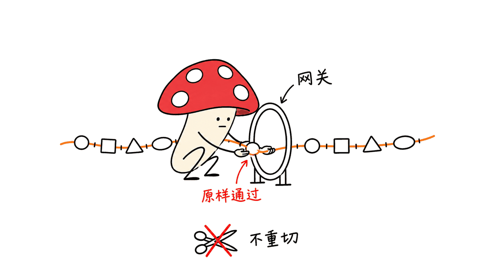
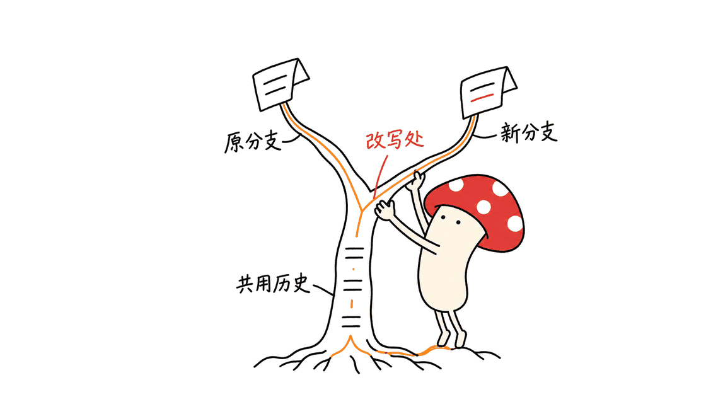
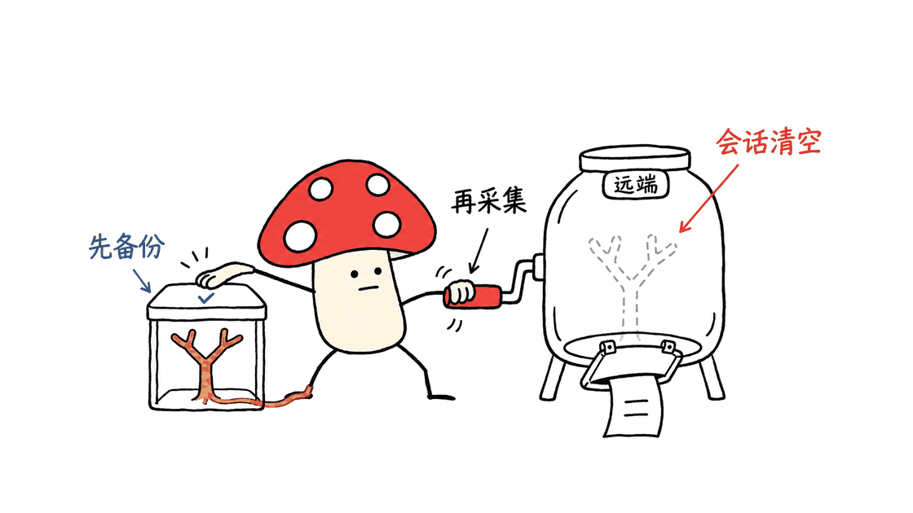

tokin 让现有 Agent 运行框架产出保留原始 token ID 的训练轨迹，减少多轮强化学习中的序列错位。

项目位于 `open-rollout/tokin`，采用 Apache 2.0，要求 Python 3.12 及以上。我们核对 PyPI 确认 v0.1.0 已发布，项目将其标为 beta；安装命令就是 `pip install tokin`。

Mycelium Protocol 检查了提交 `555801f15bd6db7878ab1ee81f0869cb7855b8e7`，并比对发布 wheel：包内26个 Python 文件与该源码版本逐字节一致。本文结合作者 Yuan He 的原始博客、源码、本地测试和真实 HTTP 冒烟验证，解释它适合接在哪一层。

## 为什么文字相同，训练用的 token 还会不同？

Agent 的运行框架负责对话、调用工具、读取结果、重试和压缩历史。多数框架向模型发送文字消息，再拿回文字与工具调用；训练器则需要模型实际采样的 token ID 和对应概率。

中间一旦经历“token ID → 文字 → 再编码”，就不能仅凭文字相同保证 ID 仍相同。聊天模板还可能改变历史推理段或工具调用的序列化方式。对于多轮训练，这意味着后续上下文和训练样本可能偏离真实采样路径。

作者用一个词被切成不同片段来说明这个问题。重要的不是某个英文词必然怎样分词，而是训练要保留当时那组离散 ID，不能靠重新分词猜回来。



这里的 token-native 指序列保真。token 数量、账单、任务成功率和推理速度，仍需要各自测量；项目没有给出安装网关就自动降低成本的保证。

## tokin 在架构中做什么？

它放在 Agent 框架和推理引擎之间。框架继续说 Chat Completions 格式的文字消息，tokin 把输入转成 ID 交给引擎，再把生成结果解析成框架需要的助手消息。

| 部件 | 负责什么 |
|---|---|
| Agent 框架 | 对话循环、工具执行、重试、历史管理 |
| tokin | 聊天模板、原始 token、会话分支、轨迹导出 |
| SGLang | 按输入 ID 生成输出 ID，并返回相关推理信息 |
| 训练器 | 奖励、优势估计、loss、参数更新与调度 |

其核心约束可以写成：

```text
本轮输入ID = 上轮输入ID + 上轮实际输出ID + 本轮新增提示ID
```

只编码新加入的部分，旧输出沿用真实采样的 ID。这是 Token-In, Token-Out（TITO）在连续轨迹每个前缀上的要求，不只是最后保存一份 token 列表。

导出的 `token_ids` 对应整条路径；`loss_mask` 在模型生成部分标1、提示和工具观察部分标0；`logprobs` 与位置对齐，提示位置用0占位。生成概率关掉后，也就不能指望导出时补回真实概率。

## 为什么会话必须是一棵树？

真实框架经常重试、改写较早的工具结果，或者并发运行多个子任务。如果只记“最新一条对话”，容易把分支接错。

tokin 会找请求能够继续的最深历史节点，必要时从较早节点分叉。同一会话的并发生成也能形成兄弟节点。每个叶子对应一条从根走下来的 rollout，而非把所有请求硬拼成一个线性样本。

历史被压缩成摘要后，匹配不到原路径，就从新根开始。因长度上限截断的回复也不会按正常完成回合继续。TITO 保证作用于各自连续的路径，不能据此理解为摘要后的样本仍含摘要前完整上下文。



还有一个训练细节：多个叶子可能共享生成前缀。通用导出的每条 rollout 都有自己的 mask；如果训练时逐条直接累加，共享部分可能获得额外权重。仓库的 pi 训练示例会按 turn ID 去重，让共享生成只训练一次，并按会话处理奖励分组。这是训练配方承担的工作。

## 当前 beta 支持哪些接口？

v0.1.0 的实际边界很清楚：文本消息、OpenAI 风格的 Chat Completions、SGLang 推理后端，以及已适配的聊天模板与工具调用语法。

模板注册表包含 Qwen2.5、Qwen3.5、Qwen3.8 和 GLM4.5 系列入口，具体检查点列在各模板的 `models` 中。营销文字里的模型代际范围，不能替代对某个特定 Coder、VL、Math 或自定义模型的兼容核对。

原始博客将 Codex 使用的 Responses API、Claude Code 使用的 Messages API 列为后续工作。标题里的“任意框架”体现接口解耦的目标，当前工程接入仍要满足已经实现的协议、模板和引擎条件。

源码支持 SSE 形式的响应，但 SGLang 适配器用 `stream=False` 取得完整生成；网关等待时发送保活，生成完成后再输出回复事件。这与引擎逐 token 透传有区别，交互首字延迟需要另外评估。

## 怎样搭起最小使用链路？

先准备匹配的 SGLang 环境和模型权重；下面三项是不同工作：安装 Python 网关、启动模型服务、启动网关。仅安装 tokin 不会自动运行模型。

```bash
python3.12 -m venv .venv
source .venv/bin/activate
pip install tokin==0.1.0
```

SGLang 需要按其运行平台另外安装和配置。官方示例分别启动两个服务：

```bash
# 终端一：已安装SGLang的环境
python -m sglang.launch_server \
  --model-path Qwen/Qwen3.5-0.8B --port 30000

# 终端二：安装了tokin的环境
tokin serve --model-path Qwen/Qwen3.5-0.8B \
  --engine-url http://localhost:30000
```

两侧模型和 tokenizer 要一致。网关默认监听 `127.0.0.1:8000`；每个任务样本创建一个会话：

```bash
URL=$(tokin open --params '{"return_logprobs": true}')
printf '%s\n' "$URL"
```

返回的是带 session ID 的专属 `/v1` 地址。按 README，在 pi 的 provider 配置里把它设为 `baseUrl`，选用 `openai-completions` 协议和相同模型 ID，再正常运行任务。每个样本应使用自己的会话，避免混入另一任务历史。

训练侧在会话里固定的采样参数优先于单次请求参数，源码会记录冲突。接入时不仅要看请求是否成功，还要确认实际温度、生成预算和概率输出与训练方案一致。

## 导出轨迹之前，要知道什么？

任务结束后可以导出：

```bash
tokin collect "$URL" -o rollouts.jsonl
```

但 `collect` 带有清理语义：会读取并删除远程会话。当前 `Session.collect` 把删除放在 `finally` 中，读取或解包失败也会进入删除逻辑；CLI 随后才写 JSONL。因此，它不适合被当成可无限重试的只读下载命令。

重要运行应先通过 GET `/sessions/<SESSION_ID>` 备份原始 safetensors payload，确认备份可读，再执行 collect 并核对本地输出。默认服务将会话保存在进程内字典中，服务重启的持久恢复也需要训练平台另外设计。



框架训练还要处理奖励、沙箱、样本去重、失败恢复和权重更新。tokin 可记录引擎返回的权重版本与可选路由信息，但这些记录本身不会消除异步训练的策略滞后。

## 原始博客的训练成绩该怎样读？

作者用 pi、slime、MiMo 代码任务与 E2B 沙箱训练，报告如下 pass@1。数字是作者结果，本次未复现训练。

| 模型 | 留出的MiMo任务 | Terminal-Bench 2.1 |
|---|---|---|
| Qwen3.8-27B | 49.9% → 79.7%，增加29.8个百分点 | 59.3% → 66.3%，增加7.0个百分点 |
| Qwen3.5-35B-A3B | 23.8% → 37.3%，增加13.5个百分点 | 36.8% → 41.9%，增加5.1个百分点 |

博客说明留出256道 MiMo 任务，Terminal-Bench 2.1 为89道任务，每道评估采样4次。采样4次用来估计 pass@1，不能将指标改称 pass@4。每个训练实验的配置包括3个训练节点加3个 rollout 节点，每节点8张 H200，合计48张 GPU。

这些提升来自整套强化学习方案，不能单独归因于网关。作者另做了冻结模型的对照：2,568组成对样本中，保留原始 ID 相对每轮重新渲染的 pass@1 差异为 **+0.1个百分点，95%置信区间为[-1.5,+1.7]**，没有测出明确的评估差异。

因此，合理的价值判断是：它提供了一种让真实框架参与训练、保持序列可追溯的工程接口。训练效果仍由模型、数据、奖励、优化方法及资源配置共同决定。

## 我们实际验证到了哪一步？

本地在独立 Python 3.12 环境中运行上游测试：快速测试204项通过、1,705项未选中；指定 Qwen3.5-0.8B 的真实 tokenizer 测试29项通过、5项按测试条件跳过，其余1,671项未选中。后者检查的是 tokenizer 和模板，不下载或运行模型权重。

我们还启动了真实 localhost HTTP 服务，用模拟引擎和一个刻意不能往返还原的 tokenizer 跑3次生成：同一文本重新编码会改变 ID，但后续输入仍保留原采样 ID；历史分叉形成2个叶子；token、mask、概率保持对齐；collect 后会话返回404。

这个冒烟过程也发现一个兼容细节：把回复中 `tool_calls: null` 原样放进下一次请求，本版本返回400；删除未使用的 null 字段后，续接成功。适配客户端时应核对实际序列化结果，不能仅凭“兼容Chat Completions”就跳过验收。

以上测试没有启动真实 SGLang、调用付费模型、跑 GPU 推理或 RL，也没有测量吞吐、账单和端到端首字延迟。Mycelium Protocol 的建议是先验证一条工具调用与历史分支的完整导出，再扩大到训练集群。

相关背景可读本站对 Agent 强化学习实验的介绍：https://blog.mushroom.cv/blog/agentic-rl-lab-grpo-vision-post-training-low-cost-geometry/ 。网关保证采样记录的表达，训练配方负责如何使用这些记录。

## 常见问题

### pip安装后就能训练Agent吗？

安装的是网关。还需模型推理服务、可调用框架、任务环境、奖励与训练器，才能形成完整训练闭环。

### 当前能直接接所有商业模型接口吗？

当前实现需要能接收输入ID、返回采样ID的SGLang后端，前端实现Chat Completions。Responses和Messages接口在作者计划中。

### 上下文压缩后还能保留原路径吗？

摘要历史通常从新根开始。原始ID保真在每条连续路径内成立，摘要不会自动恢复被移除的完整历史。

### collect可以反复调用吗？

它会删除远程会话，读取失败也可能触发清理。重要数据先备份原始会话payload，再导出并检查本地文件。

## 一手资料

- 仓库：https://github.com/open-rollout/tokin
- 本次源码：https://github.com/open-rollout/tokin/tree/555801f15bd6db7878ab1ee81f0869cb7855b8e7
- 作者原始博客：https://www.yuanhe.wiki/posts/technical/tokin/
- 发布包：https://pypi.org/project/tokin/0.1.0/
- pi训练配方：https://github.com/open-rollout/tokin/tree/555801f15bd6db7878ab1ee81f0869cb7855b8e7/examples/pi_mimo_rl

---

> © 2026 Author: Mycelium Protocol. 本文采用 [CC BY 4.0](https://creativecommons.org/licenses/by/4.0/deed.zh) 授权——欢迎转载和引用，须注明作者姓名及原文链接，不得去除署名后以原创发布。

<!--EN-->

tokin lets existing agent harnesses produce training trajectories that preserve the token IDs originally sampled by the model.

The Apache-2.0 project is published at `open-rollout/tokin`, requires Python 3.12 or newer, and has a verified v0.1.0 PyPI release described as beta. Install it with `pip install tokin`.

Mycelium Protocol inspected commit `555801f15bd6db7878ab1ee81f0869cb7855b8e7`. All 26 Python files in the published wheel were byte-identical to that source snapshot. This article combines Yuan He's original blog, implementation inspection and local behavioral checks.

## Why can identical text produce different training tokens?

A harness manages conversations, tool execution, retries and history. It usually sends text messages and receives text or tool calls. A reinforcement-learning trainer needs the actual sampled IDs and their probabilities.

Decoding IDs to text and encoding that text again does not guarantee recovery of the sampled sequence. Chat templates may also alter historical reasoning or serialize tool calls differently. A later prompt can therefore diverge from the trajectory actually sampled.

The author's split-word illustration explains the possibility; it is not a claim that a particular word always receives a particular segmentation. The engineering requirement is to preserve the original discrete sequence.


Token-native here means sequence fidelity. Token counts, billing, task success and latency require separate measurement.

## What does the gateway own?

| Component | Responsibility |
|---|---|
| Harness | Interaction loop, tools, retries and history |
| tokin | Templates, sampled IDs, session branches and rollout export |
| SGLang | Generate output IDs from input IDs |
| Trainer | Rewards, advantages, losses, updates and scheduling |

The central invariant is:

```text
current input IDs = previous input IDs + previous sampled output IDs + new prompt IDs
```

Only newly added material is encoded. Prior sampled IDs remain unchanged. This extends Token-In, Token-Out fidelity to each prefix of a continuous trajectory.

A rollout exposes `token_ids`, a `loss_mask` marking generated positions as 1 and prompt/observation positions as 0, and aligned `logprobs` with zero placeholders for prompt positions. Probabilities not requested during generation cannot be reconstructed at export time.

## Why represent sessions as trees?

Retries, edited tool observations and concurrent subagents need more than one latest conversation. tokin attaches a request to the deepest compatible earlier turn, creating siblings or branches when appropriate. Each leaf yields a root-to-leaf rollout.

Compaction that replaces history with a summary starts a new root when no prior path matches. Replies cut at the length limit are not continued as ordinary completed turns. Prefix fidelity applies within each continuous path; summarized history does not retain the removed context automatically.


Shared prefixes also affect training weights. The general exporter gives each rollout its own mask. The pi training example separately tracks turn IDs to train shared generations once and treats rewards at session level. A trainer that simply sums every exported leaf must decide how to weight shared material.

## What does the beta support?

The current implementation handles text, OpenAI-style Chat Completions, SGLang and the implemented template/tool-call families. The registry contains Qwen2.5, Qwen3.5, Qwen3.8 and GLM4.5 family entries, with specific checkpoints declared in their `models` lists.

Check a particular specialized or custom checkpoint rather than assuming that a broad generation range covers every variant. The author's blog lists Responses API support for Codex and Messages API support for Claude Code as future work. “Any harness” describes the architectural goal; current integration still depends on implemented protocols and templates.

The HTTP interface supports SSE, but its SGLang adapter requests `stream=False`. It sends keep-alive events while waiting and emits the reply after generation completes. This is different from forwarding each model token as it is generated; assess interactive first-token latency separately.

## How do you start a minimal setup?

Installing the gateway, preparing SGLang and starting model inference are separate steps:

```bash
python3.12 -m venv .venv
source .venv/bin/activate
pip install tokin==0.1.0
```

Install and configure SGLang for its execution platform separately. The official example starts the inference service and gateway in separate terminals:

```bash
# Terminal one: environment with SGLang installed
python -m sglang.launch_server \
  --model-path Qwen/Qwen3.5-0.8B --port 30000

# Terminal two: environment with tokin installed
tokin serve --model-path Qwen/Qwen3.5-0.8B \
  --engine-url http://localhost:30000
```

Use a matching model and tokenizer on both sides. The gateway defaults to `127.0.0.1:8000`. Open a session for each task sample:

```bash
URL=$(tokin open --params '{"return_logprobs": true}')
printf '%s\n' "$URL"
```

The returned `/v1` URL contains a session ID. Following the README, configure it as pi's provider `baseUrl`, select `openai-completions` and the same model ID, then run the task. Keep separate samples in separate sessions.

Session-level sampling parameters override individual requests, with conflicts logged. Verify the effective temperature, generation budget and probability settings, not merely successful HTTP responses.

## What should you know before collecting trajectories?

After the task finishes:

```bash
tokin collect "$URL" -o rollouts.jsonl
```

Collection includes cleanup. `Session.collect` deletes the remote session in a `finally` block, including when reading or unpacking fails; the CLI writes JSONL afterward. Treat it as a consuming operation rather than an indefinitely repeatable read.

For important runs, first back up the raw safetensors payload through GET `/sessions/<SESSION_ID>` and verify it can be read. Then collect and validate the local export. Sessions live in an in-memory dictionary by default, so durable recovery across restarts needs additional platform design.


The surrounding training platform still owns rewards, sandboxes, deduplication, recovery and updates. Recording reported weight versions and optional expert-routing information does not itself eliminate asynchronous policy lag.

## How should you interpret the reported gains?

The author reports training pi with slime, MiMo coding tasks and E2B sandboxes. These are author results, not our reproduced training measurements:

| Model | Held-out MiMo pass@1 | Terminal-Bench 2.1 pass@1 |
|---|---|---|
| Qwen3.8-27B | 49.9% → 79.7%, +29.8 points | 59.3% → 66.3%, +7.0 points |
| Qwen3.5-35B-A3B | 23.8% → 37.3%, +13.5 points | 36.8% → 41.9%, +5.1 points |

The blog describes 256 held-out MiMo tasks and 89 Terminal-Bench tasks, with four evaluation samples per task. Four samples estimate pass@1 here; the metric is not pass@4. Each training setup uses three training nodes and three rollout nodes, each with eight H200 GPUs: 48 GPUs total.

Those gains belong to the full RL recipe. A separate frozen-policy comparison across 2,568 paired samples found a +0.1 percentage-point difference for preserved IDs versus re-rendered text, with a 95% confidence interval of [-1.5,+1.7]. It did not establish a measurable evaluation benefit from adding the gateway alone.

The useful contribution is an interface for training within real harnesses while retaining traceable sampled sequences. Final learning outcomes still depend on models, data, rewards, optimization and resources.

## What did we verify locally?

In an isolated Python 3.12 environment, upstream fast tests produced 204 passes and 1,705 deselections. Selecting the real Qwen3.5-0.8B tokenizer produced 29 passes, five conditional skips and 1,671 deselections. Tokenizer checks do not run model weights.

We also started an actual localhost HTTP service with a simulated engine and deliberately non-roundtripping tokenizer. Three generations created two rollout leaves. Subsequent inputs preserved the original sampled ID, branch prefixes remained intact, IDs/masks/probabilities aligned and collection deleted the session.

The HTTP exercise exposed one compatibility detail: echoing an assistant object with `tool_calls: null` returned 400 in this version. Omitting unused null fields allowed continuation. Inspect actual client serialization during integration instead of relying solely on the protocol label.

We did not run real SGLang inference, paid models, GPUs or RL training, and measured no throughput, cost or end-to-end first-token latency. Start by validating tool use, history branches and collection before scaling the training deployment.

For related RL context, see https://blog.mushroom.cv/blog/agentic-rl-lab-grpo-vision-post-training-low-cost-geometry/ . The gateway defines how sampling records are represented; the training recipe defines how they are used.

## FAQ

### Does installing tokin provide a complete agent trainer?

It installs the gateway. Inference, a compatible harness, task environments, rewards and a trainer complete the training loop.

### Can it use any hosted commercial model API?

The current backend needs SGLang token-ID inputs and outputs. The frontend implements Chat Completions; Responses and Messages are planned extensions.

### Does compaction preserve the entire original trajectory?

A summarized history generally starts a new root. Fidelity applies along each continuous path and does not restore removed context.

### Can collection be repeated safely?

Collection deletes the remote session, including on some failures. Back up important raw session payloads first and verify local outputs afterward.

## Primary sources

- Repository: https://github.com/open-rollout/tokin
- Inspected source: https://github.com/open-rollout/tokin/tree/555801f15bd6db7878ab1ee81f0869cb7855b8e7
- Author's blog: https://www.yuanhe.wiki/posts/technical/tokin/
- Release: https://pypi.org/project/tokin/0.1.0/
- pi training recipe: https://github.com/open-rollout/tokin/tree/555801f15bd6db7878ab1ee81f0869cb7855b8e7/examples/pi_mimo_rl

---

> © 2026 Author: Mycelium Protocol. Licensed under [CC BY 4.0](https://creativecommons.org/licenses/by/4.0/) — free to share and adapt with attribution. You must credit the author and link to the original; removing attribution and republishing as original is not permitted.
