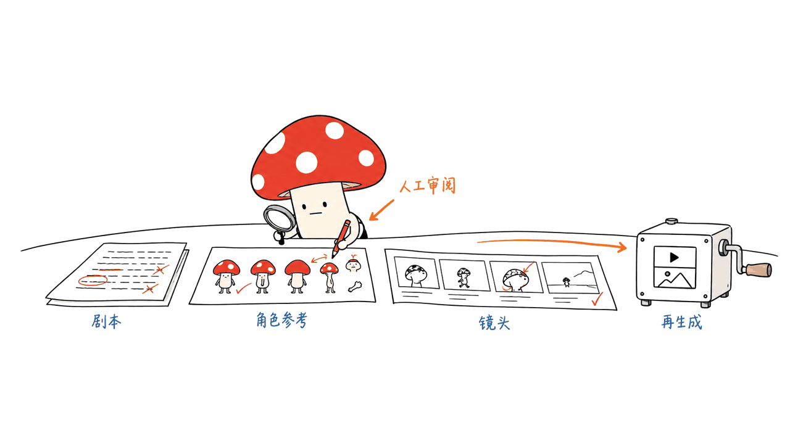

Toonflow 把剧本、分镜、角色与场景素材、图片和视频生成组织到同一个创作工作台。它的价值是减少创作环节之间的搬运，让人能在无限画布里逐步检查和修改作品。原始项目是 HBAI-Ltd/Toonflow-app，当前核对的主线代码采用 MIT 许可。

“两小时、130元”有出处，但要把限定条件一起读：官方记录的是约两小时制作一段约两分钟的作品，模型调用费约130元，公开演示是压缩后的480p。它不是整季短剧报价，也不是我们复现过的成本或速度。

官方仓库：https://github.com/HBAI-Ltd/Toonflow-app

本文固定源码：`d2e94aca7b59659ff6b4ca15f03cf134ec7f0e1d`；核验日期：2026年10月16日。我们对照了 README、许可证、部署配置与服务端代码，没有调用付费模型或制作成片。

## 两小时、130元，到底买到了什么？

原仓库的作品示例列出了三个模型：语言部分是 Claude Opus 4.6，图片部分是 GPT Image 2，视频部分是 Seedance 2.0。仓库将费用约分为语言10元、视频120元、图片不足1元。它们都是案例中的近似数，不是精确到分的可审计账单。

| 项目 | 官方案例记录 | 不能由此推断 |
| --- | --- | --- |
| 制作时间 | 约2小时 | 任意篇幅、题材都能两小时交付 |
| 成片时长 | 约2分钟 | 一整季、长片或多集产能 |
| 模型调用费 | 约130元 | 已包括人工、机器、返工及所有交付成本 |
| 公开演示 | 压缩后的480p | 原始生成分辨率或实际客户交付规格 |

仓库没有为这个案例提供完整逐镜头调用日志、失败率、重试账单或创作者工时拆解。因此最稳妥的表述是“作者公布了这样一个案例”，而不是“已经证明任何人都能以这个价格复制”。

视频项约占所列模型费用的九成。这个比例给出一个比标题更有用的方向：应优先减少无效视频镜头，再去节省剧本 Token。先审剧本、角色与关键帧，通常比整批生成完才发现人物不一致更容易控制返工；这是工程建议，不是本次测得的节省比例。



案例原文：
https://github.com/HBAI-Ltd/Toonflow-app/blob/d2e94aca7b59659ff6b4ca15f03cf134ec7f0e1d/README.md

## 一站式，指的是怎样的工作流？

当前 README 强调无限画布上的文本、素材与生成节点。可以先梳理小说情节或剧本，再组织角色、场景、道具及分镜，连接图片和视频生成服务，最后预览、整理与下载素材。支持的参考类型、音频、分辨率和片长取决于所选模型与供应商。

这里要区分两个交付物：一个是已经生成并整理好的镜头素材，另一个是通过剪辑、音量、字幕、节奏与审核验收的完整作品。官方当前入门说明写到预览与下载后按需求继续处理；不能因此自动补出“任意输入都能无人值守交付最终成片”的承诺。

角色资产和参考图也只是创作约束的一部分，不是跨镜头身份一致性的数学保证。镜头连续性、口型、文字、音乐与对白的可用性，仍应由创作者审阅。把这些验收点放进流程，才有资格讨论产能。

| 层次 | Toonflow组织的东西 | 应由使用者验收的东西 |
| --- | --- | --- |
| 文本与分镜 | 故事、提示词、镜头意图 | 信息是否完整，叙事与镜头是否合理 |
| 角色与场景资产 | 参考素材与画布连接 | 人物外观、服装和空间是否连续 |
| 图像与视频调用 | 接口配置、任务与结果 | 画面、动作、声音与服务费用 |
| 输出整理 | 预览、组织、下载 | 最终剪辑、字幕、版权素材与交付规格 |

## 免费开源，为什么还要花模型费？

Toonflow 是编排和交互工具，并不附赠所有模型的无限推理额度。当前配置可以选择语言模型、媒体模型与供应商；自定义供应商适配也能连接已有 ComfyUI 工作流，但要自行准备模型环境、工作流与算力。

对一段需要多个镜头的作品，更实用的预算方式是把“可用输出”作为分母：

```text
预计模型成本
= 文本与图片费用
+ 各类视频尝试次数 × 对应一次尝试的计费

单位可用镜头成本
= 所有尝试的总费用 / 最终验收镜头数
```

一次调用按秒、按次还是按档位收费，要以实际服务规则为准；失败任务是否收费也不能一概而论。同样的两分钟作品，镜头数量、返工次数、生成时长与最终采用比例不同，费用可能差很多。“最后用了120秒视频”不等于只付了120秒的生成费。

项目也运营 TF-Router 模型中转服务，仓库提供相应链接，并声称其平台源码开放。它是服务选择之一，不代表安装工作台必须购买统一订阅，也不能把历史促销条件当成今天仍有效的价格。本文不推荐某个平台，也没有测试中转服务。


## 怎样部署，先验证什么？

官方发布页提供 Windows、Apple Silicon macOS 和 Android ARM64 客户端。当前桌面项目使用 Electrobun，Web 使用 Vue，服务端使用 Bun；不要把旧版本或增强分支的技术栈直接套到当前主线。

下载入口：https://github.com/HBAI-Ltd/Toonflow-app/releases

服务器与 Docker 路径更适合需要固定工作目录和备份的团队。仓库 Dockerfile 使用 Bun 1.3.14，包含 FFmpeg；Compose 将宿主端口绑定到回环地址，并把数据保存到命名卷。

```bash
git clone https://github.com/HBAI-Ltd/Toonflow-app.git
cd Toonflow-app
# 本文对应版本；按需要选择固定版本，而不是混用旧教程
git checkout d2e94aca7b59659ff6b4ca15f03cf134ec7f0e1d
docker compose up -d --build
# 打开 http://127.0.0.1:3000
docker compose logs -f toonflow
```

Compose 的关键配置是 `127.0.0.1:3000:3000` 与 `toonflowData:/app/data`。停止或重建容器与删除数据卷是不同操作；项目、配置和插件的备份应覆盖整个数据目录。官方说明也指出当前业务页面与 API 没有独立登录鉴权，远程个人使用可通过 SSH 隧道，团队访问需另设带认证的入口。这个结论不能扩大成所有 MCP 接口都没有授权：源码给 MCP 路由单独传入了 authorize 函数。

```bash
ssh -N -L 3000:127.0.0.1:3000 user@your-server
```

我建议先完成四个验收点：新建工作区后能重新打开；模型配置能返回预期结果；先完成一个低成本镜头并检查计费；备份后能恢复素材与项目。前两项解决“页面能打开但生产链路没通”，后两项解决“能生成但不能交付或恢复”。这些是建议的部署验收，不是本文已经完成的整链路实测。

部署配置：
https://github.com/HBAI-Ltd/Toonflow-app/blob/d2e94aca7b59659ff6b4ca15f03cf134ec7f0e1d/compose.yaml

## Agent、MCP与插件能替代导演吗？

项目把 Agent、工具、MCP 和插件放进扩展路径。服务端代码会初始化内置工具、节点、媒体供应商及技能，挂载 MCP 与 A2A 路由。它让重复操作与外部协作有可编程入口，但“有 Agent”不是对叙事、角色连续性和审美质量的验收。

接入自动化时，可以把流程分成提议、审阅、执行：让 Agent 提出分镜与素材关联，创作者确认关键帧后，再释放视频生成预算。验收失败时只返工对应镜头，而不是把整部作品重新抽签。这里描述的是落地设计建议，不是声称仓库已经默认替所有人强制实施审批。


服务端入口：
https://github.com/HBAI-Ltd/Toonflow-app/blob/d2e94aca7b59659ff6b4ca15f03cf134ec7f0e1d/apps/server/src/app.ts

## 我们核验了什么，还有哪些没测？

在 M4 / 16GB / macOS 26.6.2 上，我们使用本机 Bun 1.4.2，完成 `bun install --frozen-lockfile` 与 `bun run build:server`。仓库指定及 Docker 使用的是 Bun 1.3.14，因此这不是该版本容器的复现。构建脚本只改变了 stdio 源文件的可执行权限，没有手改上游代码内容。

随后用隔离数据目录调用源码 `createApp`，加载已构建 Web 和插件，只监听本机回环临时端口。首页返回 HTML、工作区列表返回预建目录，原创文本通过文件 API 写入后读回一致，四个请求均为200。这个检查没有经过生产启动入口或完整 MCP runtime 初始化，也没有浏览器交互、桌面打包、Android、Docker、付费模型或视频生成验收。我们没有运行一个不存在的全仓库测试套件，也没有复现130元案例。

本文最大的结论不是130元很便宜，而是成本控制需要落实到每个被接受的镜头。Toonflow 提供了组织故事、资产与生成任务的工作空间；能否稳定交付，还取决于模型、重试策略、创作者判断及交付要求。

当前 LICENSE 是 MIT，旧版本的 AGPL 或 Apache 加附加条款不能被当前名称一笔抹掉；不同版本应查看对应条款。模型、插件和输入素材也分别有自己的许可。我们没有为具体商用情形作法律判断。

对照阅读：另一个本地创作工作台 Valtz。
https://blog.mushroom.cv/blog/valtz-local-ai-creative-studio/

## 常见问题

### 两小时和130元是保证吗？

不是，是官方公布的一次约两分钟成片案例；没有独立复现或完整账单核验。

### 本地部署就不需要云模型了吗？

不是。项目和界面可以在本地，配置的远程模型仍接收请求。使用本地推理服务需要另行准备和适配。

### 能直接把任意小说变成可交付短剧吗？

不能据现有资料这样承诺。需要审核分镜与生成素材，并完成符合交付要求的后续制作。

---

> © 2026 Author: Mycelium Protocol. 本文采用 [CC BY 4.0](https://creativecommons.org/licenses/by/4.0/deed.zh) 授权——欢迎转载和引用，须注明作者姓名及原文链接，不得去除署名后以原创发布。

<!--EN-->

Toonflow brings scripts, storyboards, character and scene assets, image generation and video generation into one creative workspace. Its practical value is reducing handoffs while keeping work visible and editable on an infinite canvas. The original project is HBAI-Ltd/Toonflow-app; the reviewed mainline code uses MIT.

The two-hour, RMB130 claim has a source, but its scope matters: the repository describes roughly two hours to produce approximately two minutes of video, with about RMB130 in model calls. The public demo is compressed to 480p. This is an author-reported example, not our reproduction or a fixed production quote.

Repository: https://github.com/HBAI-Ltd/Toonflow-app

Reviewed source: `d2e94aca7b59659ff6b4ca15f03cf134ec7f0e1d`, October 16, 2026. We checked documentation, the license, deployment files and server source. We made no paid model calls or finished film.

## What did the reported budget cover?

The example uses Claude Opus 4.6 for language, GPT Image 2 for images and Seedance 2.0 for video. Its approximate breakdown is RMB10 for language, RMB120 for video and less than RMB1 for images. These are rounded case figures, not a transaction-level audited bill.

| Item | Repository example | What it does not establish |
| --- | --- | --- |
| Production time | About two hours | A universal turnaround across subjects and lengths |
| Final duration | About two minutes | A season, feature film or multi-episode throughput |
| Model calls | About RMB130 | Full labor, hardware, rework and delivery costs |
| Public demo | Compressed 480p | Original generation or customer delivery resolution |

A complete shot-level ledger, failed-generation rate, retry bill and labor breakdown are not supplied for this example. Report it as the author's case rather than evidence that everyone can reproduce that price. Video accounts for roughly nine tenths of the listed model expense. Reviewing scripts, references and keyframes before ordering video is therefore a sensible place to control waste; we have not measured the savings from that recommendation.


Case source: https://github.com/HBAI-Ltd/Toonflow-app/blob/d2e94aca7b59659ff6b4ca15f03cf134ec7f0e1d/README.md

## What does the workspace actually organize?

The current workflow centers on text, assets and generation nodes on a canvas. A creator can develop a story and shots, organize characters, scenes and props, connect image/video services, then preview and download materials. Reference types, audio, resolution and duration depend on the selected provider and model.

Generated shot assets and a finished, accepted film are different deliverables. The current quick start includes further processing after preview and download; it does not justify a promise of unattended delivery from arbitrary text. Reference images also do not guarantee identity consistency. Continuity, motion, lip sync, text and audio still need review.

| Layer | What the workspace organizes | What the creator must accept |
| --- | --- | --- |
| Text and shots | Story, prompts and shot intentions | Narrative completeness and useful shot design |
| Assets | References and canvas connections | Consistent faces, clothes and spatial layout |
| Generation | Providers, tasks and outputs | Usable picture/audio and actual charges |
| Output | Preview, organization and downloads | Editing, captions, media rights and delivery specs |

## Why does an open-source tool still have model bills?

The application provides orchestration and interaction, not unlimited inference credits. Language and media services are configured separately. Custom providers can adapt existing ComfyUI workflows, but their runtime, models, workflows and compute must be prepared separately.

Budget for accepted output:

```text
Expected model spend
= text/image costs
+ attempts in each video category × charge per attempt

Cost per accepted shot
= spend across all attempts / accepted shots
```

Services may bill by duration, request or tier, and failed-task rules differ. Two final minutes do not imply only two billed minutes. Shot count, retries, requested duration and acceptance rate all matter.

The project also operates TF-Router, a model relay linked from the repository, and states that its platform source is available. This is one service option, not proof that installation requires a bundled subscription. Historical promotions are not current price guarantees. We did not evaluate or recommend the relay.


## How should you deploy and accept it?

Official releases offer Windows, Apple Silicon macOS and Android ARM64 clients. Current mainline uses Electrobun for desktop, Vue for the web interface and Bun for the backend; old releases and enhanced forks should not be treated as the same implementation.

Releases: https://github.com/HBAI-Ltd/Toonflow-app/releases

Docker and server deployment suit persistent workspaces. The Dockerfile uses Bun 1.3.14 and includes FFmpeg. Compose binds the host port to loopback and persists data in a named volume.

```bash
git clone https://github.com/HBAI-Ltd/Toonflow-app.git
cd Toonflow-app
git checkout d2e94aca7b59659ff6b4ca15f03cf134ec7f0e1d
docker compose up -d --build
# Open http://127.0.0.1:3000
docker compose logs -f toonflow
```

The important settings are 127.0.0.1:3000:3000 and toonflowData:/app/data. Container replacement and volume deletion are different operations; backup should preserve the full project/configuration/plugin data. The README explicitly says the business UI and API lack separate login authentication. Use an SSH tunnel for personal remote access or provide an authenticated entry for teams. This should not be generalized to every MCP endpoint: the server supplies a separate authorize function to its MCP router.

```bash
ssh -N -L 3000:127.0.0.1:3000 user@your-server
```

Suggested acceptance steps are: reopen a saved workspace; verify configured model responses; finish one inexpensive shot and inspect billing; restore the workspace and media from backup. These are deployment recommendations, not claims that we completed an end-to-end acceptance run.

Compose: https://github.com/HBAI-Ltd/Toonflow-app/blob/d2e94aca7b59659ff6b4ca15f03cf134ec7f0e1d/compose.yaml

## Can agents and plugins replace directing?

The server initializes built-in tools, nodes, media providers and skills, then mounts MCP and A2A routes. Those are programmable integration paths, not acceptance tests for story quality or continuity.

A useful automation design separates proposing shots, reviewing keyframes and authorizing paid generation. Rework failed shots individually rather than regenerating everything. This is our engineering recommendation, not a claim that mandatory approval is already enforced for every user.


Server: https://github.com/HBAI-Ltd/Toonflow-app/blob/d2e94aca7b59659ff6b4ca15f03cf134ec7f0e1d/apps/server/src/app.ts

## What did we verify?

On an M4/16GB/macOS 26.6.2, dependency installation with the frozen lockfile and the server build succeeded under installed Bun 1.4.2. The repository and Docker specify Bun 1.3.14, so this is not a reproduction of that container. The build changed only the executable mode of stdio source, not its contents.

We invoked source createApp with isolated data, built web/plugins and a loopback-only ephemeral listener. Four HTTP requests returned 200: HTML, workspace listing, an original text-file write and a byte-identical read. This did not use the production startup entry or complete MCP runtime initialization. No browser UI, desktop packaging, Android, Docker, paid model or video-generation acceptance was performed. We did not run a full-repository test suite or reproduce the RMB130 example.

The useful lesson is to manage cost per accepted shot. Toonflow supplies a workspace for stories, assets and generation tasks; reliable delivery still depends on models, retries, creative judgment and output requirements.

Current code is MIT. Earlier AGPL releases and Apache releases with supplementary terms remain version-specific; model, plugin and input-media terms are separate. This is not a legal assessment of a particular commercial use.

Related workspace review: https://blog.mushroom.cv/blog/valtz-local-ai-creative-studio/

## Frequently asked questions

### Are two hours and RMB130 guaranteed?

No. They describe one author-reported two-minute example, without our independent reproduction or a complete bill audit.

### Does local hosting remove cloud models?

No. A local workspace can still call remote models. Local inference requires a separately prepared and adapted service.

### Does arbitrary fiction become a finished deliverable automatically?

The reviewed material does not support that promise. Shots and generated assets need review and subsequent production work.

---

> © 2026 Author: Mycelium Protocol. Licensed under [CC BY 4.0](https://creativecommons.org/licenses/by/4.0/) — free to share and adapt with attribution. You must credit the author and link to the original; removing attribution and republishing as original is not permitted.
