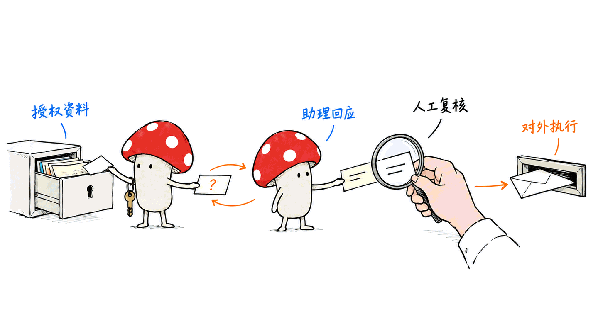
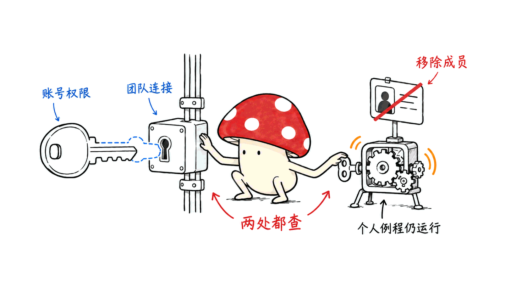

Town 想解决的是团队之间的等待：每个人的 AI 助手不仅帮本人做事，还能在授权范围内互相询问、移交任务，并使用共享流程。它的价值应看业务从请求到完成用了多久，而不只是邮件写得多快。

这是对 town.com 及其 Townie 产品的公开资料调研，截止 2026-10-25。我们核对官网、新闻中心、产品文档、价格页、信任与数据处理资料，以及投资人和媒体报道。没有登录客户工作区、接入真实邮箱或完成付费试用；产品能力与安全承诺均按公开证据分级呈现。

官网：https://www.town.com/
文档：https://www.town.com/docs/getting-started
新闻中心：https://www.town.com/press

## 一、先认清公司：从税务自动化到工作助手

主体为美国旧金山的 Town.com, Inc.，联合创始人为 Jean-Denis Greze 和 Tony Vincent。a16z 的投资说明介绍：Greze 曾任 Plaid CTO、Dropbox 工程负责人；Vincent 曾在 Google 负责产品与 AI，也有 Dropbox 设计经历。[1]

公司 LinkedIn 页面列成立年份为 2024。关于早期税务业务，创始人参与的 a16z 官方播客节目说明明确提到从税务软件转向个人 AI 助手。这个转向有公开依据，但不能把税务时期的收入当作当前 Townie 的收入。[2]

| 时间 | 公开事件 | 能说明什么 |
|---|---|---|
| 2024 | 公司页面列成立年份 | 成立时间不同于正式产品发布日期 |
| 2026-06-03 | 公开推出产品，宣布 5,500 万美元 A 轮，a16z 领投 | 从个性化助手切入日常工作 |
| 2026-07 至 09 月 | Wiki、短信、群聊与浏览器操作、新主界面陆续公布 | 从单次问答走向持续上下文与行动 |
| 2026-10-19 | 宣布 1.08 亿美元 B 轮，估值 10 亿美元，Forerunner 与 Menlo 共同领投 | 更明确推进团队助手协作 |

A、B 两轮金额可在公司公告直接核对。部分第三方还列出早期种子轮，但本文不把不同来源的累计融资口径拼成一个“官方总额”。融资说明了资本投入，不能证明产品可靠性或客户投资回报率。[3]

B 轮公告称，公开上线数周内达到七位数 ARR；自 7 月以来，付费客户增至 4 倍、付费团队增至 9 倍。这些是公司披露的增长信号，未提供起始绝对人数、流失率和独立审计数据。投资人同时也是使用者，其体验文章有价值，也存在利益关联。[3][4]

另一个容易混淆的地方：Val Town 也有名为 Townie 的编程代理，青少年零工平台也使用 Townie 名称。本文讨论的始终是 town.com 的工作助手。

## 二、核心价值：个人上下文如何变成团队协作？

可以分三层理解。

第一层是个人代理。Townie 接入你选择的邮箱、日历、文档及业务系统，学习常见联系人、项目与写作方式，整理邮件、准备会议、生成草稿，按权限执行动作。这减少了每次把背景复制给聊天机器人的工作。[5]

第二层是代理之间的交接。信息在同事那里时，你的 Townie 可以向对方的 Townie 请求帮助，把获准共享的信息带回任务。员工仍然分别拥有自己的助手，不是给全公司一个无差别访问所有邮箱的机器人。[3][6]

第三层是组织流程。团队可以共享连接、例行任务和技能，使共同的工作方法被多个助手使用。企业积累的不只是文档，还包括任务怎么做、谁有权答复、哪些动作需要人确认。

这里的组织上下文有潜在壁垒：接入越深、纠错越充分，助手可能越了解真实工作。但这首先是一个产品假设。更多记忆也会带来过期事实、隐私暴露和迁移成本；更多代理也可能制造更多请求与审批。是否形成正向网络效应，需要看获授权的交接能否真正减少人工等待。

## 三、产品地图：它已经不只是邮箱机器人

以下来自当前产品文档，属于公开功能说明，未逐项实测。

| 模块 | 用户怎么用 | 对团队工作的意义 |
|---|---|---|
| 主对话与 Tasks | 提交任务，在任务线程补资料、审批和检查结果 | 让任务状态可追踪，而非只留下聊天答案 |
| Profile、Memory、Wiki | 查看与修正角色、偏好、联系人和项目理解 | 让跨渠道工作使用同一份用户上下文 |
| Routines | 按时间、邮件、日历等触发重复任务 | 把一次委派变为持续运行的流程 |
| Skills | 保存某类工作的说明和约定，按需调用 | 统一团队写作、支持回复或演示文稿规范 |
| Teams | 管理成员、连接、流程、技能与访问规则 | 增加组织层的共享和管理 |
| Recordings | 录音、转写、摘要、提取后续任务 | 让会议内容进入助手可用的工作上下文 |
| Decks | 把线程、文档、录音与调研整理为可编辑演示 | 支持后续人工编辑和对话迭代 |
| 多渠道入口 | Web、Mac、iOS、邮件、Slack、短信等 | 在原有工作入口里委派与接收结果 |

Wiki 不是一份只增不改的事实列表。官方说明它每晚综合 Profile、偏好、目标与项目，合并重复、淘汰过期内容，并允许用户编辑、评论和查看更新。记忆还区分全局偏好与单个 routine 的偏好。[7]

这里的“学习用户”不等于为每个用户训练一个模型。公开文档主要描述上下文、画像和记忆的持续更新，未披露可据以复现的模型训练架构。

Recordings 文档明确提到音频上传后转写，因此不能把 Mac/iOS 原生录音界面理解为本地离线处理。Decks 主要是可交互、持续编辑的网页式演示，也不宜未经验证就承诺与传统幻灯片文件完全等价。[8]

## 四、一次跨部门销售任务，可能怎样完成？

用“给客户准备更新后的销售方案”举例。下面是基于公开能力设计的目标流程，不是我们在 Town 内跑过的案例。

1. 销售经理给 Townie 一项任务：准备客户方案，核对报价与交付计划，先不要外发。
2. Townie 读取获授权的客户往来、会议记录和 CRM 信息，明确缺什么，而不是猜一个折扣。
3. 需要财务或运营信息时，向对应人员或其 Townie 请求获准共享的答案；不能获得权限时，回到人处理。
4. 将可确认信息整理为方案草稿，列出来源、日期和仍待确认的内容。
5. 报价、承诺和收件人由人检查，发送工具通过相应审批后再执行。
6. 保存结果与任务状态；如果 CRM 更新失败，应显示失败，而不是把“邮件已发送”当成整个流程结束。

官方披露的协作例子包括比较多人日历、询问同事助手，以及业务运营更新竞品资料后改善销售通话准备。但真实报价审批、订单状态和跨系统写入能否端到端可靠完成，仍取决于连接器、源系统权限和企业自己的验收。[3][4]

Routines 的进度文档描述了按步骤保存结果：审批暂停后恢复时，复用该次运行中已完成步骤；下一次触发是新的运行。它有助于理解暂停与恢复，但不能据此推断第三方写入拥有分布式事务或绝不重复的保证。[9]

## 五、团队共享有三种形式，不能混为一谈

| 形式 | 在哪里运行 | 谁的数据和连接 | 维护时要注意什么 |
|---|---|---|---|
| Installable Routine | 每位安装者自己的账号 | 各人的身份与个人数据 | 安装者得到副本，不能默认所有副本永远同步更新 |
| Background Routine | 团队本身 | 团队连接与共享上下文 | 一个共享实例，需付费团队计划 |
| Skill | 由助手在匹配任务时使用 | 取决于当次任务及工具权限 | 是可复用说明，没有独立触发器 |

文档还区分“邀请编辑我拥有的 routine”和“分享给别人安装”。前者仍在拥有者的连接上运行；后者生成安装者自己的副本。共享工作方法，不等于共享账号凭据。[6][10]

因此，采购演示中的“一处更新，全员受益”需要追问实现形式：更新的是团队共享实例、团队技能，还是分发出去的个人副本？这些对象的所有权、升级与回滚方式并不一样。

## 六、谁会先感受到价值？

| 用户与场景 | 适合先交给助手的部分 | 需要人保留的决定 |
|---|---|---|
| 创始人、投资与运营团队 | 晨报、联系人背景、会前准备、跟进草稿 | 商业判断与对外承诺 |
| 销售、客户成功、顾问 | 客户线程汇总、会议准备、方案初稿 | 报价、折扣、交付范围 |
| 招聘与行政协调 | 面试日程、候选人资料汇总、通知草稿 | 录用判断、敏感候选人信息披露 |
| 邮件驱动的中小企业 | 重复资料整理、预约、任务清单 | 付款、合同与异常处理 |
| 跨团队负责人 | 共享流程、固定会议资料、工单初步归类 | 负责人分配与升级规则 |

Menlo 的文章称已在全公司使用 Town，并列出创始人、中小企业经营者、房地产经纪、行政助理和顾问等用户群体。a16z 也介绍了招聘、信息整理等用途。这些支持“谁可能需要它”的判断，但不是独立对照实验，也不是完整客户名单。[1][4]

不适合直接全自动的，是错误代价高、权限混乱、流程本身尚无标准答案的任务。给一个不清晰的组织加上代理，并不会自动消除职责冲突。

## 七、连接器、MCP 与浏览器操作的边界

官网和文档覆盖 Google、Microsoft 365、Slack、CRM、项目管理、财务和开发工具；Menlo 文章称超过 60 个集成。支持列表能说明接入方向，不能保证每个工具都拥有完整读写能力。[4]

Town 还支持接入自定义 MCP 服务。文档提供服务器 URL、OAuth 回调和按 routine 启用工具的方式。这适合把内部工具接入，但仍要确认云端可达性、认证、工具权限与上下文开销。它不意味着本机 localhost 服务会自动被 Town 云端访问，也不意味着 Town 的完整后端已经开源。[11]

9 月的产品文章公开了浏览器操作，例子包括表单、预约和购物，并强调购买前确认。这里需要区分宣传中的能力方向与具体站点的登录、验证码、限流和失败恢复，不能接受“所有网站都能稳定完成”的泛化承诺。

一个明确的未发布边界是 1Password：10 月 23 日更新的文档标题仍写 coming soon。它列出的范围是美国站 Individual/ Families 的个人保管库，暂不支持 Business、团队或共享保管库。公司存在一项接入介绍，不等于企业密码库功能已全面上线。[12]

本次检索未发现 Townie 完整服务的官方开源仓库或自托管安装文档。合理定位是托管 SaaS；不要把 Val Town 的开源 Townie 仓库当成它的源码。

## 八、价格：座席费之外，还要算工作量

下面是 2026-10-25 官网与 10 月 23 日产品文档的快照，美元价格。除 Starter 明确月付外，表中付费档均为年付折算的每月价格；月付价格可能更高，实际以购买页面为准。[13]

| 计划 | 标示价格 | 每月额度 |
|---|---:|---:|
| Free | $0 | 30 次聊天；新用户另有 7 天 Pro 试用，受试用额度限制 |
| Starter | $15/月，月付 | 1,250 credits |
| Pro | $49/人/月，年付 | 5,000 credits |
| Power | $99/人/月，年付 | 12,000 credits |
| Power Plus | $199/人/月，年付 | 40,000 credits |
| Team | $59/席位/月，年付 | 每席位 6,000 credits，团队池化 |
| Team Plus | $149/席位/月，年付 | 每席位 18,000 credits，团队池化 |
| Enterprise | 定制合同 | 定制 |

Team Free 允许共享部分连接、技能与可安装流程，成员继续使用各自计划；它没有共享积分池，也不能运行团队后台 routine。个人 Pro 起提供助手间协作，但不等于拥有付费 Team 的全部管理能力。[6][13]

credits 是平台用量单位，不是 Token。工作读取、推理和执行越多，消耗可能越高。额度每周期重置、不结转；Pro 及以上可以启用超额计费，默认超额上限为 $0，没开预算时用尽会暂停。Team 公开超额单价为 $0.038/credit。[14]

举例说，10 个 Team 席位的年付基础费按标示价计算为 59 × 10 × 12 = 7,080 美元，月度团队额度为 60,000 credits。这是预算演算，不是实际账单；还未包括超额、税费、连接维护与人工复核成本。真正要比较的是每个正确完成的业务案例总成本。

## 九、安全：最容易被一句“企业级”掩盖的细节

### 1. 默认审批不等于永远审批

Modes & Approvals 文档列出会话、routine 与单工具多层权限。默认要求变更先获同意，但用户可选择安全动作自动批准，甚至允许会话全部动作；routine 也可采用自主、需审批或只读模式。文档对只读模式向本人发送报告有例外，不能把它理解为完全不产生任何消息。[15]

批量批准、单工具 Always allow、外部通信等都应纳入验收。Town 会提示某些危险组合，但这不是提示注入已被消灭的证明：读取私密内容、接收不可信输入、再允许外发，仍然是需要测试的组合。

### 2. 共享连接可能扩大访问范围

Teams 文档直接提醒：多数连接器使用连接者的账号，团队成员可能获得该连接能够访问的内容。团队 Slack Bot 与个人账号连接不同，Notion 又有页面选择范围；不能假定它们都自动继承每位使用者在原系统中的细粒度权限。[6]

若只想让每位员工访问自己原本能看的数据，文档建议使用个人连接。团队后台流程还以团队身份运行，限制成员直接使用连接，不一定等于后台流程也无法使用。应按连接和执行主体分别检查。

### 3. “移出团队”不是完整离职处理

移除成员会撤掉团队资源访问，但不会删除其个人 Town 账号或停掉个人 routine。当前文档称完整停用需要联系支持。这是很具体的企业采购缺口，应把个人连接、仍在运行的任务和组织数据处置都放进离职演练，而不是只点击移除成员。[6]

### 4. 不训练，不等于不处理、不保存或不出设备

官方 Trust 页面说默认关闭训练；Google 数据不用于训练，其他数据有主动选择加入的设置，企业可在合同中要求组织范围禁用训练。AI provider 页面列出 Anthropic 为主要提供商，另有按功能使用的模型与路由服务。[16]

Town 说不复制或索引整份收件箱，而是任务需要时拉取内容；但共同生成的会话与记忆会被保存，录音也有上传与转写流程。因此“不保存整份邮箱”和“没有服务端数据”是两回事。

Trust 页面称托管于美国的 Convex 与 AWS，SOC 2 Type 2 审计及渗透测试报告通过 NDA 提供。我们没有获得这些非公开报告，也未做安全测试。DPA、隐私政策和分处理者列表可以公开查阅，不能拿一条认证描述替代企业自己的数据流审查。[16][17]

分处理者名单还区分常规供应商和条件供应商，包括模型处理、沙盒代码、消息及集成执行。名单并不是全功能可用性清单。DPA 对个人聊天、其他客户数据和服务数据的处理有不同条款；“公司拥有上下文”的产品表述，仍需与合同、员工隐私及删除安排逐项对齐。[17]

## 十、竞争力与产品壁垒，应该如何评价？

Town 的产品组合把个人记忆、跨工具执行、人与代理的协作和团队流程放在一个入口。优势假设是：既保留个人助手的细致理解，又减少每个人手动转发和重新解释背景的劳动。

它的潜在壁垒包括被用户纠正过的上下文、稳定的工具连接、重复流程与团队内扩散。但连接覆盖不等于可靠执行；团队人数增加不必然产生网络效应；离职和导出困难也可能被误当成“黏性”。

评估竞品时，建议直接比较五件事：上下文能否查看纠正；动作能否追踪和撤销；跨人请求如何授权；模板与共享实例怎样升级；完整任务的成功率和总成本。不要仅比较聊天界面、集成数量或融资额。

模型中立性也是相对的。Town 可以采用多家模型服务，减少对单一模型能力的绑定，但客户仍依赖 Town 的记忆、流程和连接层。模型可换，不等于应用层没有迁移成本。

## 十一、给企业的 30 天试点方案

下面是我们的实施建议，不是 Town 已验证的收益数字。

- 第 1 周：挑 5—10 名跨部门用户，记录现有任务从请求到完成的时间、人工接触次数与返工。先接非敏感、范围可控的数据。
- 第 2 周：做晨报、会前准备和草稿；保留外发审批，检查来源与过期记忆，统计错误和复核时间。
- 第 3 周：只上线一条跨人流程，区分个人副本与团队后台实例。测试拒绝共享、权限不足、连接中断和额度耗尽。
- 第 4 周：演练移除成员、撤销连接、删除数据与流程变更。用实际账单和人工成本决定是否扩大范围。

验收至少要有端到端完成率、等待时间的中位数与高分位、人工复核分钟数、错误外发次数、每个合格案例成本。没有基线时，不能把“生成了很多草稿”当成生产率提升。

Mycelium Protocol 的结论是：Town 最值得研究的是把个人代理变成组织协作网络的尝试。它能否兑现价值，取决于交接是否减少等待、权限是否正确、异常是否可控，以及企业能否在成员变化后收回数据和执行能力。

## 常见问题

### Town 是否开源，能否部署在内网？

本次没有找到完整服务的官方开源或自托管说明。自定义 MCP 接入不等于能把整个 Town 部署到内网；应向供应商确认合同和部署选项。

### 免费版能证明团队协作价值吗？

可以了解交互和部分共享功能，但有消息和流程限制。跨助手协作、后台流程和管理能力涉及不同计划，不能用免费个人试用推断整套团队能力。

### 这篇报告是否实测了助手间权限隔离？

没有。本文完成的是公开资料交叉核查，列出文档明示的控制与缺口。真正的权限隔离、异常恢复和 ROI 需要在授权测试账号中验收。

## 资料导航与证据范围

本报告覆盖截至日期能够公开访问的主要资料，不能保证穷尽所有社交动态、付费报道或 NDA 资料。产品文档多数标注 2026-10-23 更新；价格与供应商配置以后可能变化。

1. a16z 投资说明：https://a16z.com/announcement/investing-in-town/
2. 公司页面：https://www.linkedin.com/company/town-com/ ；创始人参与的 a16z 节目：https://podcasts.apple.com/us/podcast/what-happens-when-al-agents-can-spend-your-money/id842818711?i=1000797053623
3. A 轮：https://www.town.com/press/series-a ；B 轮：https://www.town.com/press/series-b
4. Menlo 使用与投资说明：https://menlovc.com/perspective/talk-of-the-town-menlo-is-co-leading-towns-108m-series-b/
5. 入门：https://www.town.com/docs/getting-started
6. 团队与共享权限：https://www.town.com/docs/teams
7. Wiki：https://www.town.com/docs/features/wiki ；记忆：https://www.town.com/docs/features/context-and-memory
8. 录音：https://www.town.com/docs/features/recordings ；演示：https://www.town.com/docs/features/decks
9. 暂停与恢复：https://www.town.com/docs/routines/custom-routines/concepts/steps-and-caching
10. 流程分享：https://www.town.com/docs/routines/stock-routines/routine-sharing
11. MCP：https://www.town.com/docs/integrations/mcp-servers
12. 1Password（预告）：https://www.town.com/docs/integrations/1password
13. 价格：https://www.town.com/pricing ；计划说明：https://www.town.com/docs/billing/plans
14. 用量与超额：https://www.town.com/docs/billing/credits
15. 审批：https://www.town.com/docs/safety/modes-approvals
16. 信任：https://www.town.com/trust ；模型供应商：https://www.town.com/ai-model-providers
17. DPA：https://www.town.com/dpa ；隐私：https://www.town.com/privacy-policy ；分处理者：https://www.town.com/subprocessors ；服务条款：https://www.town.com/terms-of-service

产品博客可沿新闻中心继续读：6 月 3 日创立理念、7 月 27 日 Wiki、8 月 12 日短信、9 月 3 日群聊与浏览器、9 月 30 日界面改版、10 月 19 日团队方向，分别位于：

- https://www.town.com/why-we-built-town
- https://www.town.com/how-a-townie-gets-to-know-you
- https://www.town.com/text-town
- https://www.town.com/group-text
- https://www.town.com/town-redesign
- https://www.town.com/operate-at-the-speed-of-ai

外部报道入口：TechCrunch 2026-10-19 融资报道：https://techcrunch.com/2026/10/19/ai-assistant-startup-town-nabs-unicorn-valuation-four-months-after-launch/ ；Fortune 2026-06-03 报道：https://fortune.com/2026/06/03/towns-ai-assistants-andreessen-horowitz-forerunner-55-million/ 。投资人文章与公司公告不是独立效果测评，部分媒体全文可能需要订阅。

封面为 Town 官网公开的 Bo 与 Claus 形象拼合，版权归原权利人；并非实际产品截图。

原文：https://blog.mushroom.cv/blog/town-townie-research/

---

> © 2026 Author: Mycelium Protocol. 本文采用 [CC BY 4.0](https://creativecommons.org/licenses/by/4.0/deed.zh) 授权——欢迎转载和引用，须注明作者姓名及原文链接，不得去除署名后以原创发布。第三方品牌图像权利不因本文授权而改变。

<!--EN-->

Town aims to reduce waiting between colleagues. Each person's Townie can work on their behalf, request authorized help from other assistants and use shared workflows. Its business value should be measured by completed work and reduced handoff time, rather than faster drafting alone.

This is public-source research on town.com as of October 25, 2026. We reviewed company pages, product documentation, pricing, privacy and processing materials, investor commentary and reporting. We did not connect a customer inbox, enter a private workspace or run a paid product trial. Public descriptions are distinguished from our analysis and proposed acceptance tests.

Website: https://www.town.com/
Documentation: https://www.town.com/docs/getting-started
News: https://www.town.com/press

## What company and product are we discussing?

Town.com, Inc. is based in San Francisco. Its founders are Jean-Denis Greze and Tony Vincent. The a16z investment announcement describes Greze's Plaid CTO and Dropbox engineering background and Vincent's Google product/AI and Dropbox design experience. The company LinkedIn page lists 2024 as its founding year. An official a16z podcast listing with Greze confirms the shift from tax software to a personal assistant. Earlier tax revenue should not be treated as current Townie revenue.[1][2]

| Date | Public milestone | Interpretation |
|---|---|---|
| 2024 | Founding year on the company page | Distinct from public product launch |
| June 3, 2026 | Public launch and $55M Series A led by a16z | Personalized assistance for everyday work |
| July–September | Wiki, texting, group/browser work and redesigned interface | Persistent context and more action surfaces |
| October 19 | $108M Series B at $1B valuation, co-led by Forerunner and Menlo | Stronger team collaboration positioning |

The two financing announcements are directly verifiable. We do not present a blended total from inconsistent sources as an official cumulative figure. Town also reports seven-digit ARR within weeks of launch and growth of 4x in paying customers and 9x in paying teams since July; starting counts, churn and independent audit evidence were not disclosed. Funding and growth are signals, not reliability or ROI tests.[3]

This is not Val Town's coding agent named Townie, nor another unrelated service with the same name.

## Where could the team value come from?

There are three layers. Personal assistance uses connected email, calendars, documents and business systems to prepare work with the user's context. Assistant-to-assistant requests can bring back information a colleague is permitted to share. Team resources distribute connections, routines and skills, reducing repeated configuration.[3][5][6]

The potential moat is corrected, useful context combined with reliable execution and adoption inside teams. It remains a hypothesis: more memory can mean stale facts, more agents can mean more interruptions, and more connections can mean more exposed data. A positive network effect requires authorized handoffs to reduce human waiting.

## What is in the product?

| Module | Publicly documented role |
|---|---|
| Main conversation and Tasks | Delegate, track work, supply context and review requested decisions |
| Profile, Memory and Wiki | Maintain and correct user preferences, relationships, goals and projects |
| Routines | Repeat work on schedules or supported events |
| Skills | Reuse instructions for a kind of work without their own triggers |
| Teams | Share resources and administer members and access |
| Recordings | Capture, transcribe, summarize and turn conversations into work |
| Decks | Build editable, interactive presentations from existing context |
| Channels | Reach the same assistant through web, Mac, iOS, email and messaging |

The Wiki is described as a nightly synthesis that merges information and retires stale material; users can edit it. Global and routine-specific memories influence work across channels. This describes context management, not evidence of a separately trained model for every employee.[7]

Recording documentation says audio is uploaded and transcribed. A native Mac recording interface is therefore not proof of offline processing. Decks are interactive web-based artifacts; we did not verify full equivalence with traditional presentation files.[8]

## What would a cross-department task look like?

Consider preparing an updated sales proposal. This is our proposed workflow based on documented capabilities, not an executed Town trial:

1. Request a draft, explicitly withholding external sending.
2. Gather authorized customer correspondence, meeting notes and CRM information.
3. Request missing pricing or delivery information from the relevant person or assistant. Escalate when authorization or a decision is missing.
4. Produce a draft identifying sources, dates and unresolved items.
5. Have a person review commitments, recipients and prices before the sending action is approved.
6. Record completion and expose partial failures, such as a CRM write failing after email delivery.

Public examples include scheduling across calendars and asking another Townie for help. They do not establish that a particular company's quote-to-order process is reliable. Source systems, permissions and connectors still determine what can be done.[3][4]

Routine documentation describes saving completed step results within a run and resuming after approval; each new trigger starts a fresh run. That is useful progress handling, not proof of distributed transactions or exactly-once external writes.[9]

## Which kind of shared workflow is it?

| Object | Execution and ownership | Important distinction |
|---|---|---|
| Installable routine | Each installer has a personal copy | Do not assume every copy always updates automatically |
| Background routine | A shared instance runs as the team | Requires a paid team plan |
| Skill | Instructions used when a task matches | No independent trigger |

Inviting editors to an owner's routine is different from sharing it for installation. Editing the owner's routine does not give editors the owner's accounts; installed copies use the installer's connections. Ask a vendor demonstration exactly which object updates when it claims one change benefits everyone.[6][10]

## Who is likely to benefit first?

Founders and operators can try briefings and follow-up drafts; sales and consultants can prepare client material; recruiting and administrative teams can coordinate schedules; small businesses can delegate recurring information work. Keep pricing, contracts, hiring decisions and unusual exceptions with accountable people.

Menlo describes firm-wide use and users including operators, small-business owners, real-estate agents, assistants and consultants. These investor/user accounts help identify demand, but they are neither neutral experiments nor a complete customer list.[4]

## Integrations, browser work and availability

The public materials cover major productivity, CRM, project, finance and development tools. Menlo reports more than 60 integrations. A listed connector does not guarantee complete read/write coverage.[4]

Custom MCP servers can be configured and enabled for routines. Check reachability, OAuth and least-privilege tool access: a cloud client cannot automatically reach a private localhost service. MCP support is also not evidence that the full Town backend is open source.[11]

A September product post announces browser tasks, including forms, appointments and purchases with confirmation. Site-specific login challenges and recovery still need testing. The 1Password documentation, updated October 23, explicitly says coming soon. Its listed scope is US Individual/ Families personal vaults; Business, team and shared vaults are not supported yet.[12]

We found no official full-service source release or self-hosting instructions in the reviewed materials. Treat Town as hosted SaaS unless the vendor confirms another option.

## What does it cost?

These are October 25 public prices in USD. Paid prices below are annual-billing monthly equivalents except Starter, which is monthly only. Monthly purchase prices may be higher.[13]

| Plan | Displayed price | Monthly allowance |
|---|---:|---:|
| Free | $0 | 30 chats; new-user Pro trial limited by seven days or trial usage |
| Starter | $15/month | 1,250 credits |
| Pro | $49/user/month | 5,000 credits |
| Power | $99/user/month | 12,000 credits |
| Power Plus | $199/user/month | 40,000 credits |
| Team | $59/seat/month | 6,000 credits per seat, pooled |
| Team Plus | $149/seat/month | 18,000 credits per seat, pooled |
| Enterprise | Custom | Custom |

Team Free shares certain resources while members retain personal plans; it has no shared pool or background routines. Personal Pro offers assistant collaboration without necessarily providing all paid Team administration features.[6][13]

Credits are platform work units, not tokens. They reset without rollover. Pro and higher offer optional overage; its default spending cap is zero, so exhausted allowances can pause work. Team lists $0.038 per extra credit.[14]

Ten Team seats at the displayed annual rate imply $7,080 base annual spend and 60,000 monthly pooled credits. This is budget arithmetic, not a bill or an ROI result; add overage, tax, integration work and human review. Compare total cost per correctly completed business case.

## What needs special security attention?

Approval-required defaults can be changed. Sessions, routines and tools each have controls, including fully autonomous settings. Read-only routines also have documented exceptions for reports to the user. Test the effective policy rather than relying on a general promise that the assistant always asks.[15]

Shared integration access is a particularly important distinction. Most account-based connectors give a team the connecting account's access. Slack workspace bots and Notion page-scoped connections behave differently. Personal connections may be the better choice when each employee should retain only their existing source-system access. Team background work also has its own execution identity.[6]

Removing a member revokes team resources, but documentation says it does not delete their personal Town account or stop personal routines. Complete offboarding currently requires support. Exercise personal connections and surviving jobs as well as the team removal button.[6]

Training is off by default. Trust materials distinguish Google data, which is not used for training, from other data with an opt-in control; enterprise contracts can enforce organization-wide restrictions. The AI-provider page identifies Anthropic as primary, with other conditional services. This does not mean no inference processing occurs.[16]

Town says it does not copy or index the entire inbox, instead fetching needed material for tasks. Sessions and memories are nevertheless stored, and recordings are uploaded. It describes US hosting on Convex and AWS and SOC 2 Type 2 audit reports available under NDA. We obtained neither private audit reports nor independent security-test results.[16]

Public DPA, privacy and subprocessor materials add details beyond marketing. Conditional suppliers are not a feature availability promise. Personal chats, other customer data and service data have different treatment; clarify corporate context ownership, employee privacy and deletion through the actual agreement.[17]

## How should an organization evaluate the proposition?

Compare inspectable context, traceable actions, cross-person authorization, shared workflow upgrades and end-to-end cost. Model routing flexibility does not remove dependence on Town's memory and execution layer. Switching models is different from migrating the application.

Our proposed 30-day pilot starts with 5–10 cross-functional users and a baseline. Week one measures request-to-completion time and rework. Week two tests briefings and drafts with external approval. Week three introduces one cross-person workflow and exercises denial, missing access, failures and exhausted credits. Week four tests member removal, revoked connections, deletion and workflow changes.

Measure completion rate, median and tail waiting time, human review minutes, erroneous external actions and cost per accepted result. This is an implementation proposal, not a measured claim of savings.

Mycelium Protocol's conclusion: Town is an instructive attempt to make personal assistants an organizational collaboration network. Its value depends on correct handoffs, controllable exceptions and recoverable permissions as people and work change.

## FAQ

### Is Town open source or available on premises?

We found no official full-service source or self-hosting documentation. Custom MCP integration is not the same as deploying Town on premises.

### Is a free personal trial enough to assess team value?

It can demonstrate interaction, but collaboration, background routines and administration have separate plan conditions. Validate the capabilities your proposed rollout actually needs.

### Did this report test isolation between assistants?

No. This is public-source research and a proposed acceptance plan. Permissions, recovery and ROI require authorized test accounts and real workflow evidence.

## Source directory and research limits

This covers major accessible public materials as of the cutoff, not every social post, subscription article or NDA document. Many product pages were updated October 23; pricing and supplier configuration can change.

1. Investor background: https://a16z.com/announcement/investing-in-town/
2. Company profile: https://www.linkedin.com/company/town-com/ ; founder podcast: https://podcasts.apple.com/us/podcast/what-happens-when-al-agents-can-spend-your-money/id842818711?i=1000797053623
3. Financing: https://www.town.com/press/series-a ; https://www.town.com/press/series-b
4. Menlo account: https://menlovc.com/perspective/talk-of-the-town-menlo-is-co-leading-towns-108m-series-b/
5. Introduction: https://www.town.com/docs/getting-started
6. Teams: https://www.town.com/docs/teams
7. Wiki and memory: https://www.town.com/docs/features/wiki ; https://www.town.com/docs/features/context-and-memory
8. Recordings and decks: https://www.town.com/docs/features/recordings ; https://www.town.com/docs/features/decks
9. Routine progress: https://www.town.com/docs/routines/custom-routines/concepts/steps-and-caching
10. Sharing: https://www.town.com/docs/routines/stock-routines/routine-sharing
11. MCP: https://www.town.com/docs/integrations/mcp-servers
12. 1Password preview: https://www.town.com/docs/integrations/1password
13. Pricing: https://www.town.com/pricing ; https://www.town.com/docs/billing/plans
14. Usage: https://www.town.com/docs/billing/credits
15. Approvals: https://www.town.com/docs/safety/modes-approvals
16. Trust and providers: https://www.town.com/trust ; https://www.town.com/ai-model-providers
17. Processing materials: https://www.town.com/dpa ; https://www.town.com/privacy-policy ; https://www.town.com/subprocessors ; https://www.town.com/terms-of-service

Product history: https://www.town.com/why-we-built-town ; https://www.town.com/how-a-townie-gets-to-know-you ; https://www.town.com/text-town ; https://www.town.com/group-text ; https://www.town.com/town-redesign ; https://www.town.com/operate-at-the-speed-of-ai

External reporting: TechCrunch's October 19 financing report: https://techcrunch.com/2026/10/19/ai-assistant-startup-town-nabs-unicorn-valuation-four-months-after-launch/ ; Fortune's June 3 story: https://fortune.com/2026/06/03/towns-ai-assistants-andreessen-horowitz-forerunner-55-million/ . Investor commentary is not independent product validation; some coverage may require a subscription.

Cover: a composition of official Town Bo and Claus artwork, owned by the respective rights holders; not a product screenshot.

Original article: https://blog.mushroom.cv/blog/town-townie-research/

---

> © 2026 Author: Mycelium Protocol. Licensed under [CC BY 4.0](https://creativecommons.org/licenses/by/4.0/) — free to share and adapt with attribution. You must credit the author and link to the original; removing attribution and republishing as original is not permitted. Third-party artwork retains its original rights.
