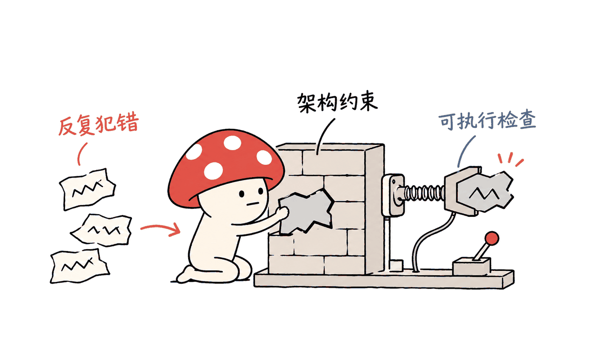
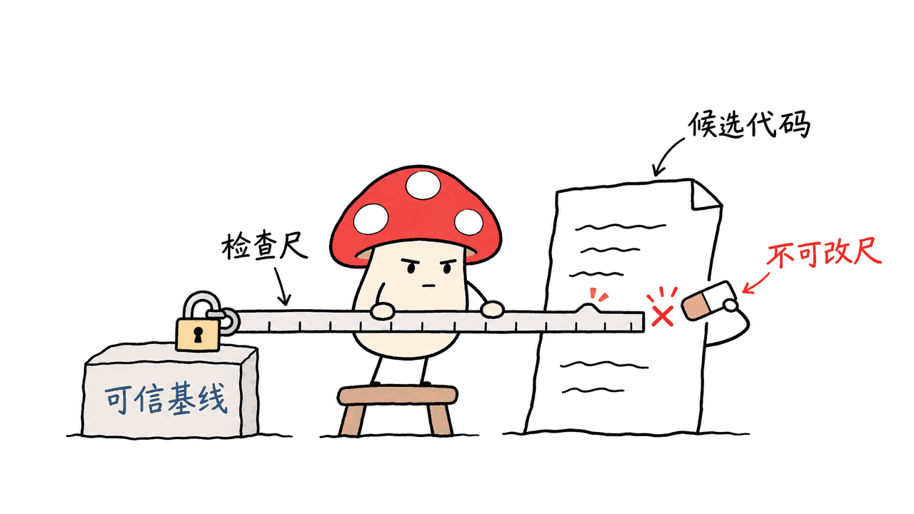
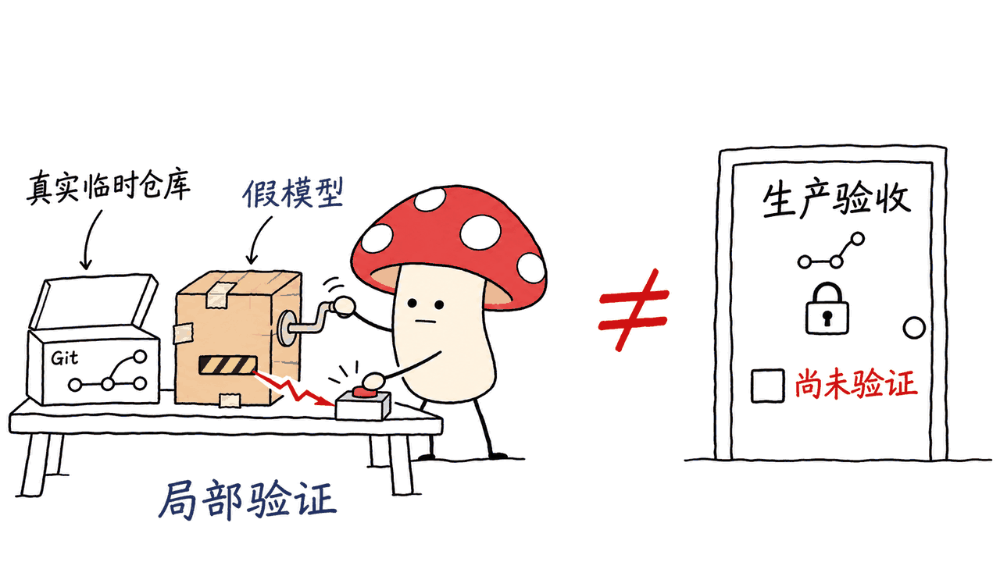

Trust Pyramid是一套让编程Agent用检查结果证明工作完成的技能：把项目容易反复犯的错写成规则，再用自动门禁检查改动。它适合长期维护、有独特约束的代码库，价值需要随规则积累验证。

项目为 `Tim-rppl/trust-pyramid`，本次核查提交 `d3401ada02803a2974b44fbf9e53cd84160423b9`，技能版本0.5.0，MIT许可。它提供Claude Code插件与Codex技能入口，是独立项目；README明确说并非Lauren Tan或其所在组织的官方项目。

仓库：https://github.com/Tim-rppl/trust-pyramid

使用指南：https://github.com/Tim-rppl/trust-pyramid/blob/main/docs/GUIDE.md

## “信任金字塔”到底把信任放在哪里？

项目采用的优先顺序是：架构/API设计、静态分析、行为验证、文字说明、AI审阅，最后才是人。能从接口设计上消除的错误，就不要靠每次提醒；无法消除的，再用lint或测试拦住。

比如前端不该直接调用模型服务。团队可以提供唯一的服务端入口、限制模块依赖，并让lint给出具体修复路径。这样“别把密钥放到浏览器”便不只是文档里的愿望。规则也不能凭空代表正确业务：它只覆盖人已经定义、检查实际能识别的约束。

这套方法与普通审阅技能的差别，是把过去的纠错变成仓库里的长期资产。Agent换了、模型换了，检查仍可执行。错误输出同时告诉执行者哪里错、为什么错、该改哪一层，而非只返回红色退出码。

## 为什么CI不能用这次PR自己带来的规则？

如果PR一边引入违规代码，一边把检查脚本改成永远成功，运行该PR里的脚本当然可能全绿。Trust Pyramid的关键机制，是让CI从base提交读取可信检查入口和受保护路径列表，用基线规则检查候选代码。

`trusted-check.sh`会恢复受保护的脚本与配置，还对既有package.json中的scripts采用base版本，避免把lint命令替换成`true`。变更后的新规则需要先经过合并，才会成为后续PR使用的基线。依赖等其他变更并不是因此全部被回滚。

这里有两个前提。第一次引入门禁时，base还没有可信副本，只能使用本次PR的门禁并明确标注bootstrap；这一轮需要认真审查。之后还要配置必需状态检查、分支保护、代码所有者及实际审批要求，工作流文件本身也要纳入保护，不能把一个CODEOWNERS文件等同于已经强制审批。

本地Stop hook和pre-commit主要提供及时反馈，能被停用或绕过。Stop hook默认最多尝试两次修复，再交接说明问题，不会无限修到“成功”。“不可跳过”成立的范围是正确配置并执行的合并门禁，不是对仓库管理员或机器所有者的绝对约束。

> `trusted-check.sh`会改写执行目录里的受保护文件，官方明确要求只在CI使用；不要为试用而直接在日常工作目录里运行它。

## AI审阅说发现了Bug，怎样才算有证据？

审阅层要求每个finding都有处理状态：confirmed、rejected或deferred。确认的问题必须有测试；拒绝要给具体理由；延期则需理由及规则候选记录。拒绝与延期不等于问题已修复，仍需人判断处置是否合理。

对于confirmed，门禁要求测试在被审代码上失败，在修复后的HEAD上通过。被审提交可以来自审阅记录里的`reviewed_sha`，并检查它确实是HEAD的祖先。这比一律把主分支当“红侧”更准确：如果问题本来就是PR引入的，主分支可能没有Bug。

测试还不能因为模块找不到、依赖缺失等错误而假装“红了”。不过，排除已知错误模式并不自动证明测试完整覆盖了真实需求；它只是把“AI认为有问题”推进为更可检查的证据。

模板里的审阅依赖模型API密钥；运行验证里的fake模型服务也只是可控测试替身。它可以验证应用如何处理超时、限流和异常格式，不能据此判断真实模型回答质量。

## 我们本地复跑的结果是什么？

Mycelium Protocol在隔离的临时克隆中安装测试依赖，直接运行上游`npm test`，不修改实现或断言。第一次90项中88项通过、2项失败：测试选中了旧版Python 3，规则文件使用的联合类型注解在该解释器下不能运行。

将PATH中的`python3`切换到Python 3.12.15后，重新运行同一套测试，90项全部通过，0失败、0跳过。这个兼容性细节很实用：找到一个Python 3解释器，并不代表它满足项目语法要求；上游CI本身配置的是Python 3.12。

测试使用真实临时Git仓库及shell脚本，构造关闭规则、删除检查、缩小受保护列表、放松npm脚本等案例，对照普通门禁与可信基线门禁。也覆盖审阅结果缺失、理由不足、错误的红侧证据、通过的红绿测试，以及升级时的三方合并与冲突。

这些是模板和局部场景的测试，不是把本博客改造成Trust Pyramid项目后的实战。我们没有安装其插件或hook，没有调用真实AI审阅API，也没有端到端验证GitHub分支保护。仓库演示GIF同样注明：终端和截图来自真实项目，但Agent修改由脚本重放。

## 为什么默认选lite，而不是层层加满？

| 环节 | lite默认 | full |
|---|---|---|
| 项目规则、可信CI与pre-commit | 有 | 有，扩展属性测试 |
| Stop hook | 快速检查、有限重试 | 同样如此 |
| AI审阅 | 通常每个PR在CI执行 | 还在每个任务后执行 |
| 运行验证 | CI smoke流程 | 每次可见行为变更都验证 |

作者的小样本实验值得比宣传更早阅读：每个条件只有一次运行。在选定前沿模型任务上，无工具组本已处理好深层陷阱；接近完整配置的Trust Pyramid流程约花2.09美元，无工具组约0.55美元，没有多发现问题。这不是跨模型、跨项目的普遍成本结论。

作者还报告，审阅器对5类植入问题各运行两次，共10次中9次指出目标问题，仍漏过一次日志泄露。这既不能当作90%的生产漏洞检出率，也说明AI审阅不是确定性裁判。

lite自身尚未完成基准验证。长期回归收益、便宜模型收益及真实团队保护分支的完整链路，也列在作者的未测范围里。“规则长期能省下多少审阅”是合理假设，需要项目自己的记录验证，而不是已有实验结论。

实验原文：https://github.com/Tim-rppl/trust-pyramid/blob/main/docs/BENCHMARK.md

## 怎样开始，才不会把治理本身做成负担？

先挑一次确实发生过、能稳定复现的项目错误：例如错误租户读取、模块边界穿透，或某条接口未处理超时。优先改结构；再给剩余错误做会失败的fixture，验证修复能通过，并确认正常代码不会被误伤。

随后用lite跑一个小PR，分别验证本地提醒、提交检查和CI拦截，最后核对平台上真实的合并限制。安装后的文件是需要适配技术栈的骨架，不是复制过去就适用于所有项目的成品。启用hook还有单独的用户安装步骤，不能把复制技能文件误当成已经生效。

我们的判断是：真正有用的交付物不是“多了一层AI审阅”，而是你今天纠正的一次错误，明天不再依赖你记得提醒。衡量它应看重复错误是否减少、误报是否可控、检查耗时是否值得，而不是门禁层数有多少。

## 常见问题

### 不用GitHub还能用吗？

本地规则和测试可以用；仓库模板面向GitHub Actions。迁移到其他CI需要重新验证可信基线与合并保护，而不是只移植脚本名字。

### 可以完全不再看代码吗？

这是项目的目标方向，不是已证明的普遍保证。新规则、首次引入门禁、拒绝或延期的审阅意见，以及未覆盖需求仍需要负责的人判断。

### 开源是否意味着没有费用？

MIT允许按许可证使用代码。确定性检查不消耗模型token，但有运行成本；Agent修复与AI审阅仍可能付推理费。作者报告的设置时间和费用属于特定实验，不能当所有项目报价。

相关实践：https://blog.mushroom.cv/blog/plannotator-agent-review-feedback-workspace-guide/

---

> © 2026 Author: Mycelium Protocol. 本文采用 [CC BY 4.0](https://creativecommons.org/licenses/by/4.0/deed.zh) 授权——欢迎转载和引用，须注明作者姓名及原文链接，不得去除署名后以原创发布。

<!--EN-->

Trust Pyramid helps coding agents demonstrate completed work through executable checks. It turns recurring project-specific mistakes into rules and runs gates against subsequent changes. Its potential value lies in long-lived repositories and must be measured as the rule library grows.

We inspected `Tim-rppl/trust-pyramid` at commit `d3401ada02803a2974b44fbf9e53cd84160423b9`, skill version 0.5.0, under MIT. It offers Claude Code plugin and Codex skill entry points. It is an independent project, not Lauren Tan's own official implementation.

Repository: https://github.com/Tim-rppl/trust-pyramid

Guide: https://github.com/Tim-rppl/trust-pyramid/blob/main/docs/GUIDE.md

## Where does the trust belong?

The method prioritizes architecture and API design, static analysis, behavioral verification, prose, AI review, and finally people. If an API boundary can eliminate an error, avoid relying on a reminder at every change. Use lint and tests for the remaining enforceable constraints.

For example, a single server-side model client and import-boundary rules can prevent browser code from directly reaching a model provider. Useful diagnostics explain what failed, why, and how to fix it. Checks still encode chosen constraints: they do not discover complete business correctness by themselves.

The durable artifact is a repository rule that survives changes in agents and models. A past correction becomes executable project memory rather than another instruction someone might overlook.

## Why must CI distrust the pull request's own gate files?

A change can introduce a violation and simultaneously replace its check with an unconditional success. Trust Pyramid instead loads a trusted entry point and protected-path list from the base commit, then checks candidate code using those rules.

`trusted-check.sh` restores protected scripts and configuration. It also restores the base version of scripts fields in existing package.json files, preventing a lint command from becoming `true`; other dependency changes are not all reverted. Changed rules become the baseline for later PRs only after merging.

There is a bootstrap exception: the first installation has no trusted base copy. It runs the PR's gate files and labels this limitation, so the initial gate deserves careful review. Later enforcement also depends on required checks, branch protection, ownership rules, and actual approval settings. Protect workflow files themselves as well. Merely committing CODEOWNERS does not enable mandatory approval.

Local Stop hooks and pre-commit hooks provide feedback and remain bypassable. The Stop hook defaults to two repair attempts followed by a visible handoff rather than an unlimited loop. Unskippable means enforcement within a correctly configured merge policy, not an absolute restriction on repository administrators or machine owners.

The trusted-check script modifies protected files in its working directory. The project explicitly says to run it in CI, not a normal daily checkout.

## How does an AI review finding become evidence?

Every finding needs a confirmed, rejected, or deferred disposition. Confirmation requires a test; rejection requires a concrete reason; deferral also requires a rule-candidate record. Rejected or deferred findings have not thereby been fixed, and their disposition still deserves scrutiny.

For confirmation, a test must fail on the reviewed code and pass on the repaired HEAD. The reviewed commit can come from `reviewed_sha`, which must identify an ancestor of HEAD. That matters when the PR itself introduced the defect: main may never have contained it.

A missing import or dependency is not acceptable red-side evidence. Detecting such known failure patterns still does not prove that the test captures every relevant requirement; it makes the claim more inspectable.

The reviewer template needs a real model API credential. Conversely, the fake model server used for application verification is a controlled substitute. It tests handling of timeouts, rate limits, and malformed replies, not the quality of real model answers.

## What did our local run establish?

Mycelium Protocol installed test dependencies in an isolated temporary clone and ran the unchanged upstream `npm test`. The first run passed 88 of 90 tests. Two failed because the test selected an older Python 3 interpreter that could not execute a union type annotation in the rule file.

We then placed Python 3.12.15's python3 first on PATH and reran the same suite: all 90 tests passed, with zero failures or skips. This exposes a practical compatibility detail: finding Python 3 is weaker than finding a compatible Python version. Upstream CI itself selects Python 3.12.

The tests use real temporary Git repositories and shell scripts for rule-disable, deleted-check, reduced-protection-list, and altered npm-script scenarios, comparing naive checks with trusted baseline checks. They also cover absent review output, insufficient dispositions, invalid red-side evidence, genuine red-to-green proof, and upgrade merges/conflicts.

These are template and fixture checks. We did not install the project's plugins or hooks into this blog, call a live AI reviewer, or test GitHub branch protection end to end. The repository's demo GIF also discloses that its real-project terminal output and screenshots accompany scripted replay of agent edits.

## Why is lite the default?

| Layer | lite default | full |
|---|---|---|
| Project rules, trusted CI, pre-commit | Included | Included, plus property tests |
| Stop hook | Fast checks, bounded retries | Same |
| AI reviewer | Typically once per PR in CI | Also after each task |
| Runtime verification | CI smoke flow | Each user-visible behavior change |

The author's benchmark is small, with one run per cell. In selected frontier-model tasks, the untooled agent already handled deep traps. A near-full Trust Pyramid setup cost about $2.09 per task versus $0.55 without tooling, without catching more. This is not a general price or performance claim across projects and models.

For five planted issue types, the reviewer identified the target in nine of ten attempts, missing logged notes once. That is not a production vulnerability-recall estimate, and it confirms that the reviewer is not deterministic.

Lite itself has not been benchmarked. Long-term regression value, smaller-model benefits, and team workflows with actual protected GitHub branches also remain unmeasured in the report. Reduced future review effort is a hypothesis to validate with project records.

Benchmark: https://github.com/Tim-rppl/trust-pyramid/blob/main/docs/BENCHMARK.md

## How should a team begin?

Choose one recurring, reproducible project mistake, such as a tenant-boundary violation or an unhandled upstream timeout. Improve structure first. For remaining failures, create a fixture that fails before the fix and passes afterward, while keeping legitimate code clean.

Use lite on a small PR. Verify local feedback, commit checks, CI rejection, and the platform's actual merge restrictions separately. Installed files are stack-specific scaffolding, not universal finished policies. Enabling hooks is a separate user-run installation step; copying a skill does not prove that hooks run.

Our assessment: the useful outcome is that tomorrow's change cannot repeat today's corrected error unnoticed. Measure recurring defects, false positives, and execution overhead rather than counting layers of review.

## FAQ

### Does it require GitHub?

Local rules and tests do not. The included CI templates target GitHub Actions; other platforms need their own trusted-baseline and merge-policy validation.

### Can people stop reading code entirely?

That is an ambition, not a generally established guarantee. New rules, bootstrap, rejected/deferred findings, and uncovered requirements still need accountable judgment.

### Does MIT mean zero operating cost?

No. Deterministic checks avoid model tokens but consume compute. Agent repairs and AI review can incur inference charges. The author's setup costs apply to a particular experiment, not every repository.

Related reading: https://blog.mushroom.cv/blog/plannotator-agent-review-feedback-workspace-guide/

---

> © 2026 Author: Mycelium Protocol. Licensed under [CC BY 4.0](https://creativecommons.org/licenses/by/4.0/) — free to share and adapt with attribution. You must credit the author and link to the original; removing attribution and republishing as original is not permitted.
