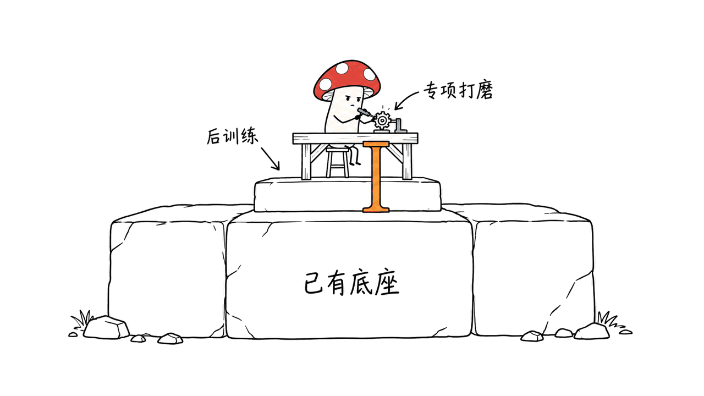
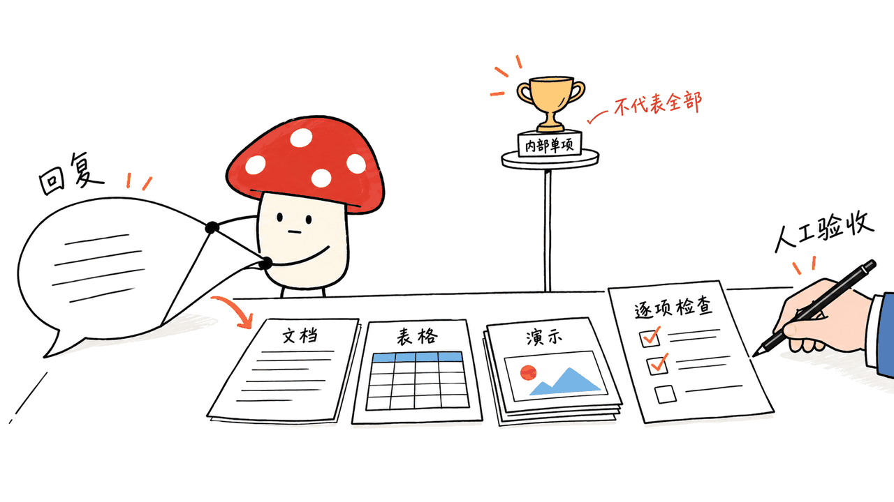
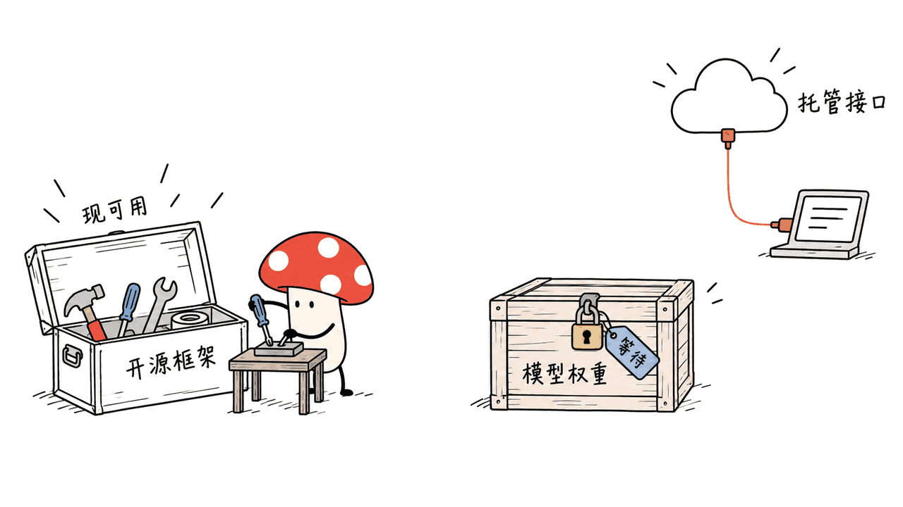

Ultramarine 1 Flash 是一个专攻知识工作的模型，目标是让 Agent 交付可用的文档、表格和演示稿。它借助已有底座做后训练，把竞争焦点从“回答得像不像专家”推向“工作成果是否合格”。

Paper Instruments 于2026年10月14日发布模型介绍。五人、约30万美元是负责人对后训练成本的自述，不是从零训练通用大模型的总成本；截至10月15日，官方页面仍写着权重即将发布，当前可用的是 API 和已公开的框架代码。

官方模型页：https://www.paperinstruments.com/ultramarine

技术报告：https://www.paperinstruments.com/blog/ultramarine

负责人原始公告：https://x.com/bertgodel/status/2110400987622265232

## 30万美元买到了什么，不能据此推出什么？

公告中的原话口径是五人团队、约30万美元“all-in”后训练。技术报告确认底座为 GLM-5.3 Flash。也就是说，工作起点已经包含底座模型的语言、代码和工具能力，不能把这笔费用解释为复制整个底座的成本。

我们没有看到可独立核算的成本明细，不能替团队推断其中的人力、数据合成、评分模型、训练计算、失败实验各占多少，也不能据此承诺另一家公司照做只需30万美元。

真正值得研究的是投入方向：如果一个组织的目标任务足够明确，它能否用有限的增量训练预算，改善交付物质量和完成成本？这个问题比“小团队击败所有大模型”更具体，也更容易被后续验证。

团队介绍的训练数据覆盖四大领域、19类专业实践、88种环境类型，以合成任务和逐项评分标准组织学习，并使用 LoRA 后训练。它让模型围绕交付物接受反馈，而不是只练短答案。这里概括的是作者方法，不是我们复现的结果。



## 59.3对57.8：内部测试成立，全面领先不成立

用户素材中的数字能够在官方页面对应上：PI Knowledge Work 内部测试中，Ultramarine 为59.3，Claude Fable 5为57.8，GLM-5.3 Flash为52.0。59.3是任务评分均值，不应直接写成“59.3%的任务全部完成”。

下面保留六项知识工作成绩，并增加两项代码对照。所有数值均为 Paper Instruments 汇总报告，本文没有重跑模型。

| 评测 | Ultramarine | GLM-5.3 Flash底座 | Claude Fable 5 |
|---|---:|---:|---:|
| PI Knowledge Work（内部） | 59.3 | 52.0 | 57.8 |
| JobBench | 62.9 | 56.3 | 57.4 |
| FrontierFinance | 53.3 | 50.7 | 49.2 |
| AutomationBench | 50.2 | 48.8 | 46.2 |
| DiligenceBench | 50.6 | 48.2 | 52.9 |
| APEX-Agents 1.1 | 57.0 | 52.8 | 63.6 |
| Terminal-Bench 2.1（代码） | 83.2 | 84.3 | 84.3 |
| DeepSWE 1.1（代码） | 61.5 | 63.4 | 69.9 |

它在六项知识工作评分上都高于底座，但在 DiligenceBench、APEX 上低于 Fable；两项代码成绩也低于底座。对企业选型而言，这意味着需要按工作类型路由，而不是把一次专项提升理解为无损升级。

还要区分“公开测试集”与“独立复测”。表格混合了团队运行和其他开发者、排行榜报告的分数，各项 harness、评分器、任务数和预算不同。本文没有找到对本次完整成绩的独立复现，不能把团队公布的结果标成第三方认证。

## 如何判断这张成绩单是否适合自己的业务？

内部测试使用 Feather、262,144-token上下文，由 GPT-5.6 Terra 按任务 rubric 评分；它不是人工逐份验收的同义词。其他评测的具体运行设置见技术报告表8脚注。

我们的判断是，跨模型比较至少要问三件事：输入是否一样、工具和预算是否一样、评分标准能否覆盖真正重要的错误。即使所有模型在同一内部环境运行，环境选择和任务分布仍然决定了“擅长”的含义。

59.3比57.8高1.5分，但仅凭两个均值，无法推断差异的统计显著性。若业务最怕的是财务公式断链、合同遗漏关键例外或数字找不到来源，漂亮的段落不能抵消这些失败。

这也是自建评测最有价值、也最容易自证循环的地方：企业可以把自己的验收标准写清楚，但要留出没有进入训练与调参的任务，记录关键错误，并让负责人做盲评。以上是我们的落地建议，不是官方已证明的产品效果。



## 0.13美元是什么费用，60倍该怎样理解？

官方把内部测试的平均任务 API 费用列为0.13美元，Fable 5最高推理档为8.19美元。按两个已四舍五入的数字计算，后者约为前者的63倍；宣传中的60倍是近似说法。

这是一组特定任务、推理设置和API定价下的比较，不是每种文件、每次请求的统一报价，也不是硬件推理速度之比。API收费还可能体现服务方的定价策略，不能拿它反推训练投入或服务毛利。

我们实际读取了无需认证的公开价格接口，返回以下费率；这次请求没有调用生成模型：

| Token类型 | 每百万Token价格 |
|---|---:|
| 普通输入 | $0.15 |
| 缓存输入 | $0.03 |
| 输出，包含推理 | $0.50 |

价格接口：https://api.paperinstruments.com/v1/pricing

计费说明：https://docs.paperinstruments.com/docs/ultramarine/billing

举例，20,000个未缓存输入Token与1,000个输出Token的费用为0.0035美元。这不意味着一个完整尽调任务也只花这笔钱：Agent 往往有多轮推理与工具调用，任务费用要累加，而非只数最后一段答案。

企业更应该算“合格交付成本”：模型费、检索与工具费、运行环境、失败重试、人工复核，再除以真正通过验收的任务数。若人工修订占主要成本，单看Token单价很容易选错。

## 开放了什么：Feather代码可拿，模型权重仍要等

公开仓库是 `paper-instruments/feather-train`，许可证 MIT。本文固定代码提交 `d8649447cf58dc75eafe0b30b2d40dbe56470f34`，避免后续变化混入当前判断。

仓库：https://github.com/paper-instruments/feather-train

| 层次 | 目前能确认的状态 |
|---|---|
| Ultramarine API | 官方已有文档、模型标识和公开价格 |
| 模型权重 | 官方模型页仍标注 coming soon，公告预计两周后发布 |
| Feather Harness | 公开 Agent 循环、文件与进程工具、上下文压缩、文档技能与CLI |
| Feather Eval | 公开 Harbor任务对接与轨迹导出工具 |
| Feather Train | 公开E2B任务环境集成、评分流程与参考Tinker训练集成 |
| 训练复现输入 | 仍需任务数据、准备好的环境快照和相关服务凭证 |

没有已核验的 Ultramarine Hugging Face 权重下载链接，就不应该拿底座的模型页冒充成品下载地址。框架的MIT许可也不能自动充当尚未发布权重的许可证，待权重发布后要重新核查。

Feather 仓库已经提供实用工程资产，但训练包的存在不意味着一条命令就能复刻原模型。它要求调用方提供数据集与 E2B 快照；安装开源包和拥有完整训练配方、数据、计算资源，是不同的事情。



## 工程上先接哪一层？

如果目标是试用模型，先参考官方 API 快速入门，模型名为 `ultramarine-1-flash`，OpenAI兼容地址为 `https://api.paperinstruments.com/v1`。先在隔离环境设置密钥，以少量非敏感任务验证响应、工具调用及预算。本文未发起付费生成请求。

API入门：https://docs.paperinstruments.com/docs/ultramarine

如果目标是搭建工作流，可以先研究 Feather 的文件工具和任务轨迹，而不必等权重。推荐从文档副本、独立工作目录起步，再逐步引入表格重算、PDF渲染和业务连接器。

```bash
git clone https://github.com/paper-instruments/feather-train.git
cd feather-train
git checkout d8649447cf58dc75eafe0b30b2d40dbe56470f34
uv sync --package feather-harness --extra dev --locked
uv run --package feather-harness --extra dev --locked feather --help
```

这组命令安装最小框架开发环境并查看入口，不包含完整 Office 依赖，也不会下载 Ultramarine 权重。安装 `office` extra 后仍应按任务补齐 Poppler、LibreOffice等系统组件。读取表格单元格不等于重算公式，读取PDF文字也不等于验证页面版式。

框架的 `train` 和 `prod` profile 也要分清：前者用于较简洁的训练条件，后者增加生产指导。切换 profile 会改变 Agent 行为，迁移评测时应一并记录。

提示与组件说明：https://docs.paperinstruments.com/docs/ultramarine/prompting-and-packages

## 我们实际验证了什么？

在本机M4、16GB Mac的临时检出目录中，我们按锁文件安装最小环境，运行CLI帮助，并执行两个原有测试文件：

```bash
uv run --package feather-harness --extra dev --locked pytest \
  feather-harness/tests/tools/test_file_mutation.py \
  feather-harness/tests/tools/test_read.py -q
```

结果为48项通过。覆盖重点包括：修改已有文件前必须读过它；文件在读取后被别人修改，要拒绝基于旧版本覆盖；不唯一的替换需明确处理，以及读取范围等输入行为。

这些行为可以减少 Agent 错改文件的机会，但不是OS权限隔离或业务安全审计。我们没有调用 Ultramarine、复现榜单、运行训练、启动E2B容器或完成Office交付物验收；48项框架测试不能当成模型能力证明。

相比宣称“小团队全面媲美顶级模型”，这个项目更值得观察的，是专项训练、文档工具和任务验收能否形成可迁移的完整工作流。相关的Office编辑路线，也可对照本站GenOffice介绍：
https://blog.mushroom.cv/blog/genoffice-ai-office-suite/

## 常见问题

### 现在可以本地下载模型吗？

截至2026年10月15日，官方仍标注权重即将发布。本文不给出未经核验的下载地址，也不把框架CLI能运行说成本地模型能运行。

### 30万美元是不是训练通用模型的门槛？

不是。它是建立在GLM-5.3 Flash之上的团队后训练成本自述，无法替代底座的预训练投入，也不是另一团队的报价单。

### 是否比Claude Fable 5全面更强？

公开材料不支持这个结论。内部及部分任务得分更高，另一些专业任务和代码任务仍有落后；应按实际交付物选型。

---

> © 2026 Author: Mycelium Protocol. 本文采用 [CC BY 4.0](https://creativecommons.org/licenses/by/4.0/deed.zh) 授权——欢迎转载和引用，须注明作者姓名及原文链接，不得去除署名后以原创发布。

<!--EN-->

Ultramarine 1 Flash targets professional knowledge work: agents producing usable documents, spreadsheets and presentations. The interesting question is whether focused post-training can improve completed work at a manageable incremental cost.

Paper Instruments announced it on October 14, 2026. Its founder reports a five-person team and approximately $300,000 in post-training costs. As of October 15, the official model page still says weights are coming soon. API access and public framework code should not be confused with released model weights.

Model page: https://www.paperinstruments.com/ultramarine

Technical report: https://www.paperinstruments.com/blog/ultramarine

Founder announcement: https://x.com/bertgodel/status/2110400987622265232

## What the $300,000 claim means

GLM-5.3 Flash supplies the pretrained foundation. The reported expenditure concerns post-training, not reproducing the foundation model from scratch. We have no independently auditable cost breakdown and cannot allocate the budget among people, data generation, judging, computation and failed experiments.

The team describes synthetic professional tasks across four domains, 19 practice areas and 88 environment types, with task-specific grading and LoRA post-training. These are author descriptions, not results we reproduced.

Our interpretation is narrower than a general frontier-model claim: a team may concentrate incremental effort on particular deliverables. Whether that transfers to a different organization remains an empirical question.


## Read the full scorecard

These are author-reported results. The internal 59.3 score is a task-rating mean, not necessarily a 59.3% fully successful-task rate.

| Benchmark | Ultramarine | GLM-5.3 Flash | Claude Fable 5 |
|---|---:|---:|---:|
| PI Knowledge Work, internal | 59.3 | 52.0 | 57.8 |
| JobBench | 62.9 | 56.3 | 57.4 |
| FrontierFinance | 53.3 | 50.7 | 49.2 |
| AutomationBench | 50.2 | 48.8 | 46.2 |
| DiligenceBench | 50.6 | 48.2 | 52.9 |
| APEX-Agents 1.1 | 57.0 | 52.8 | 63.6 |
| Terminal-Bench 2.1, coding | 83.2 | 84.3 | 84.3 |
| DeepSWE 1.1, coding | 61.5 | 63.4 | 69.9 |

Ultramarine improves on its base across the six knowledge-work scores, but trails Fable on DiligenceBench and APEX. Both coding scores are lower than its base. A specialized gain is not a lossless replacement for every workload.

The table combines the team's runs with comparison scores from leaderboards and developers. Harnesses, judges and budgets differ by benchmark. A public benchmark is not the same thing as an independent reproduction of this release.

PI Knowledge Work uses Feather, a 262,144-token context and a GPT-5.6 Terra rubric judge. The technical report's Table 8 footnotes specify the other setups. We have not independently reproduced the complete scorecard.

Our selection advice is to check input parity, tool and budget parity, and whether grading catches costly failures. Two means separated by 1.5 points do not establish statistical significance. Keep evaluation tasks out of training and prompt tuning, record critical failures, and use blind human review for important deliverables.


## Task price is not total delivery cost

The internal comparison reports $0.13 per task against $8.19 for Fable at maximum reasoning. Their rounded ratio is approximately 63, consistent with an approximate “60x” claim. This is an API-cost comparison for that workload and configuration, not a universal invoice or hardware-throughput result.

We read the public pricing endpoint without invoking generation. It returned $0.15 per million uncached input tokens, $0.03 cached input and $0.50 output, including reasoning. At those rates, 20,000 uncached input tokens and 1,000 output tokens cost $0.0035. An agent task can accumulate many calls.

Pricing: https://api.paperinstruments.com/v1/pricing

Billing: https://docs.paperinstruments.com/docs/ultramarine/billing

For procurement, count model calls, tools, runtime, retries and human correction, then divide by accepted deliverables. Low token prices alone do not guarantee low delivery costs, nor reveal the provider's training expenditure or margins.

## What is actually open?

The MIT repository `paper-instruments/feather-train` contains separately installable Harness, Eval and Train packages. We pinned commit `d8649447cf58dc75eafe0b30b2d40dbe56470f34`.

Repository: https://github.com/paper-instruments/feather-train

Harness supplies the agent loop, file and process tools, compaction, document skills and CLI. Eval connects Harbor tasks and trajectory export. Train integrates task environments, grading and a reference Tinker recipe, taking datasets and prepared E2B snapshots as inputs.

The repository does not make its inputs, service credentials or original model checkpoint appear automatically. Its MIT license does not establish the license of weights that have not yet been published. The official page has no verified Ultramarine Hugging Face download to recommend today; the founder's announcement estimates two weeks.


## Start with the layer you need

For hosted inference, the documented OpenAI-compatible base is `https://api.paperinstruments.com/v1`, model `ultramarine-1-flash`. Use the official quickstart and a small set of non-sensitive tasks with explicit budgets. We made no paid generation requests.

API quickstart: https://docs.paperinstruments.com/docs/ultramarine

For workflow engineering, the public framework can be examined before model weights arrive:

```bash
git clone https://github.com/paper-instruments/feather-train.git
cd feather-train
git checkout d8649447cf58dc75eafe0b30b2d40dbe56470f34
uv sync --package feather-harness --extra dev --locked
uv run --package feather-harness --extra dev --locked feather --help
```

This installs the minimal development environment, not the Office stack or model weights. Office tasks need their package extra and relevant system tools, including PDF rendering and spreadsheet recalculation. Reading cells is not recalculating formulas; extracting PDF text is not checking layout.

Record whether you use `train` or `prod`: their prompts and guidance differ. Start from copies in a dedicated workspace and validate each added connector and file format.

Profiles and packages: https://docs.paperinstruments.com/docs/ultramarine/prompting-and-packages

## What we verified

On an M4 Mac with 16GB memory, we installed the locked minimal environment in a temporary checkout, ran CLI help and executed the unchanged upstream `test_file_mutation.py` and `test_read.py`: 48 tests passed. They exercise read-before-edit, rejection of stale file revisions, ambiguous replacement behavior and read contracts.

This establishes bounded framework behavior. It is not OS isolation or a business audit system. We did not run Ultramarine inference, reproduce benchmarks, train a model, launch E2B containers or validate completed Office deliverables. Framework tests are not model-quality evidence.

Related Office tooling: https://blog.mushroom.cv/blog/genoffice-ai-office-suite/

## FAQ

### Can I download the weights locally now?

The official page still says coming soon as of October 15, 2026. A working framework CLI does not prove local model inference.

### Is $300,000 the price of training a general model?

No. It is a self-reported post-training budget on an existing base, not a complete pretraining cost or a transferable quotation.

### Is it universally stronger than Fable?

The reported scorecard does not support that claim. Compare target deliverables and failure modes, not just the internal headline score.

---

> © 2026 Author: Mycelium Protocol. Licensed under [CC BY 4.0](https://creativecommons.org/licenses/by/4.0/) — free to share and adapt with attribution. You must credit the author and link to the original; removing attribution and republishing as original is not permitted.
