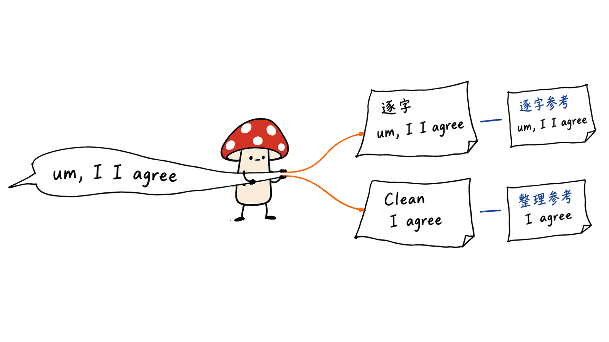

Bark 3.0 是能在本地运行的英文语音识别模型。它把约0.6B参数模型装进163MB下载文件，但下载小不等于运行内存小；默认用于整理口述的Clean版，则是另一个180MB模型。

Underdog官网直接链接ConwayResearch的Hugging Face模型仓库，权重采用CC-BY 4.0。本文核对日期为2026-10-24；官方准确率、应用测速与我们的短音频运行记录分开呈现。这里讨论的是Underdog的ASR，不是Suno同名Bark语音合成项目。

## 到底开源了什么，入口在哪里？

主要入口是Hugging Face模型仓库，里面同时有权重、加载脚本、NOTICE及运行参考，而不是只给一个在线演示。

| 版本 | 官方下载体积 | 输出目标 | 官方模型页 |
|---|---:|---|---|
| Bark 3.0 | 163MB | 保留口头禅与重复的逐字转录 | https://huggingface.co/ConwayResearch/Underdog-Bark-3.0 |
| Bark 3.0 Plus | 180MB | 更高准确率的逐字转录 | https://huggingface.co/ConwayResearch/Underdog-Bark-3.0-Plus |
| Bark 3.0 Clean | 180MB | 基于Plus，内建口头禅、重复和起句修正清理 | https://huggingface.co/ConwayResearch/Underdog-Bark-3.0-Clean |
| Bark 3.0 Pro | 1,254MB | 全精度逐字转录 | https://huggingface.co/ConwayResearch/Underdog-Bark-3.0-Pro |

这一家族基于NVIDIA Parakeet TDT 0.6B v3，经由Moondream的parakeet-ultra演进。标准版模型卡明确标注English only。权重与加载参考公开，不等于Underdog整个应用的源码都在这些仓库里；使用和再分发时也应保留对应署名与NOTICE。

## 7.82%到底是哪一种错误率？

原素材中的“字错率”需要改成英文**词错误率WER**。7.82%是标准版在AMI会议测试上的团队报告值，4.94%才是七个英文测试集的平均值，不能混成同一指标。

| 模型 | 下载体积 | AMI WER | 七集平均WER |
|---|---:|---:|---:|
| Bark 3.0 | 163MB | 7.82% | 4.94% |
| Bark 3.0 Plus | 180MB | 7.76% | 4.76% |
| Bark 3.0 Pro | 1,254MB | 7.16% | 4.29% |
| Parakeet TDT 0.6B v3 | 2,508MB | 9.42% | 4.94% |
| Whisper large-v3 | 9,261MB | 13.63% | 6.04% |

这些是官方模型卡的对照表：Bark行由团队使用Open ASR Leaderboard的评分代码跑出，尚未成为该榜单正式条目；其他模型沿用截至2026年10月9日的公开榜单结果。其中AMI、Earnings-22、GigaSpeech和VoxPopuli采用榜单清理过的测试版本。我们没有重跑这些完整测试集。

因此，可以说团队报告的Bark标准版在AMI上优于表中两条基线；不能说它已获独立榜单认证，更不能扩展成所有语言、录音和任务都更好。七集平均对Parakeet几乎持平：模型卡给出的三位小数为4.937对4.941，相差0.004个百分点。

“57倍”“15倍”说的是表中权重下载体积，不是参数量、内存或速度。模型卡中的9,261MB也只是选定Whisper权重文件的体积，不能当作所有Whisper量化部署的固定大小。

## Clean版为什么会有更高的逐字WER？

标准版写下说过的词；Clean故意去掉“um”“uh”、重复和起句修正。若参考答案要求逐字保留，删掉这些词反而会被计为错误。

团队在250段DisfluencySpeech测试音频上的结果，正好说明评估目标的重要性：

| 模型 | 对整理后文本的WER | 对逐字文本的WER |
|---|---:|---:|
| Bark 3.0 Clean | 4.08% | 13.85% |
| Bark 3.0标准版 | 16.53% | 3.15% |

这里的“整理后文本”是清理口头禅后的参考答案，与前文榜单测试集的数据清理不是同一概念。Clean本身七集平均为5.83%，AMI为12.12%。不能把Plus的4.76%、标准版的7.82%或163MB体积贴到Clean身上，虽然它们属于同一个产品家族。

实际选型可以从交付物倒推：准备可读口述稿、会议笔记可考虑Clean；需要保留原话的任务用标准版或Plus。官网说Underdog的Speak和会议笔记默认使用Clean，但这不改变两类模型的不同目标。



## “5分钟音频半秒完成”能直接复现吗？

官网确实写了这个数字，并给出M5 Max MacBook Pro、Underdog原生应用和约595倍实时速度。它是应用路径的官方宣称，当前页面没有提供足以在本文中独立复现的完整测速材料。

标准版模型卡还给出另一组参考：M2笔记本用stock mlx-audio，约1.5秒处理1分钟音频、约41倍实时。Clean模型卡则写M5 Max上136秒音频约4秒，包含模型加载。

这几组数字不能拼成一张统一排行榜。硬件、版本、输入长度、原生Swift还是Python脚本、加载与预处理是否计时，都不同。第一次运行还可能包含权重解包，Core ML首次编译也可能花数分钟。

本文不会把一个短句跑通写成复现了595倍速度，也不拿它替代真实会议、多人重叠和远场收音测试。


## 163MB为什么仍可能吃掉大量内存？

`model.bark`是熵编码的紧凑权重文件。公开MLX脚本会先解包并缓存执行用权重，默认走FP16；它不是直接拿163MB文件作为全部运行内存。

脚本说明一次解包约需6GB RAM，Clean模型卡也列出解包后约1.25GB的模型内存。执行音频时，还会叠加特征、激活与中间缓冲。

标准版模型卡记录：stock mlx-audio整段处理时，16GB M2跑10分钟音频曾达到约15GB峰值，并建议8GB或16GB Mac将长录音拆成几分钟一段。这是官方观察，不是我们的长音频实测。

切分本身也需要验收：应检查片段边界的词是否丢失、是否重复，不能只把音频机械切开就宣称完整长音频方案已经验证。


## 怎样在Mac上按官方路径运行？

建议单独建环境，并只下载要用的后端，避免同时拉取所有Core ML导出。下面是标准版MLX路径的最小流程；依赖版本以当前模型卡为准。

```bash
python3 -m venv .venv-bark
source .venv-bark/bin/activate
pip install huggingface_hub==2.2.0
hf download ConwayResearch/Underdog-Bark-3.0 --local-dir bark-3.0 \
  --include "model.bark" --include "bark_loader.py" \
  --include "bark_mlx.py" --include "mlx/*" --include "NOTICE"
pip install mlx==0.32.2 mlx-audio==0.5.3 constriction==0.5.0 \
  numpy==2.4.6 soundfile==0.14.0 soxr==1.1.0
cd bark-3.0
python bark_mlx.py recording.wav
```

默认会生成本地解包缓存。标准版`transcribe`会前置0.25秒静音，模型卡称评测使用同一设置；Clean路径的设置不同，不能只替换权重却忽略加载脚本差异。

仓库另有Mac Core ML GPU/ANE和Windows PyTorch CPU/CUDA参考。Core ML的GPU与ANE包是不同执行包，算子实际放置由Core ML决定；不是所有操作都在目标加速器上执行。当前标准版卡片也明确标注iPhone/iPad移植说明尚未在这些设备上测试，不能据此写成手机端已完整验收。

### 我们的本地运行记录

在M4、16GB Mac上，我们下载固定版本标准模型，使用公开`bark_mlx.py`、mlx-audio 0.5.3与默认FP16路径完成加载和推理。输入为macOS `say`生成的约3.24秒合成英文语音，单声道16kHz WAV：

> The meeting starts at nine. Please send the report tomorrow.

实际输出为：

> the meeting starts at nine please send the report tomorrow

这条样本的词序一致，输出没有保留参考句的大小写与标点。模型下载文件为163,398,645字节，本机生成的FP16权重缓存约1.25GB；这是磁盘文件大小，不是峰值RAM。推理阶段启用了Hugging Face离线模式，使用已下载的本地文件。

这只说明一个短句在该路径上跑通。我们没有测试Clean、中文、自然会议、多说话人或长录音，也没有测量并报告转录速度。

## 本地离线能带来什么，又没提供什么？

权重与依赖准备完成后，本地运行路径不需要把音频送到云端识别服务。首次下载模型与依赖仍需要网络；应区分下载阶段、推理阶段以及应用其他功能的数据路径。

官网还明确列出当前缺项：没有逐词时间戳和完整说话人名称区分，会议笔记区分你与通话侧，不是逐人分离。自定义词汇列表目前也不适用于Bark 3.0。若要做带说话人标签、词级定位的会议产品，还需额外的对齐或分离能力。

我们的判断是：Bark 3.0的价值在于把英文ASR的下载门槛做小，同时公开可加载权重和参考运行路径。评估时应分别看逐字准确率、整理稿质量、长录音稳定性和首次启动成本，不能让“163MB”代替整套部署预算。

## 常见问题

### 可以直接识别中文会议吗？

官方标注English only。本文没有测试中文，不能把英文结果外推到中文；Underdog应用为其他语言提供的模型选项也不是Bark本身的能力。

### Clean版是标准版后面接一个大模型润色吗？

官方将清理能力集成进Clean模型，不要求第二个清理模型。它基于Plus，当前下载约180MB，和163MB标准版应分开选择。

### 有模型权重，就代表整个会议应用都开源了吗？

不能这样推断。这里可核验的是Hugging Face权重、加载脚本和运行参考；应用源码、订阅功能及附加服务要另外核对。

## 一手来源

- 官网：https://underdog.ai/bark
- 标准版：https://huggingface.co/ConwayResearch/Underdog-Bark-3.0
- Clean版：https://huggingface.co/ConwayResearch/Underdog-Bark-3.0-Clean
- Plus：https://huggingface.co/ConwayResearch/Underdog-Bark-3.0-Plus
- Pro：https://huggingface.co/ConwayResearch/Underdog-Bark-3.0-Pro
- 标准版固定版本：85db2ad18ab41e534a222ee253c29191d77ed919
- 延伸阅读：AgentEar的语音输入工作流，https://blog.mushroom.cv/blog/agentear-local-voice-input-preview/
- 本文原文：https://blog.mushroom.cv/blog/underdog-bark-3-local-asr/

---

> © 2026 Author: Mycelium Protocol. 本文采用 [CC BY 4.0](https://creativecommons.org/licenses/by/4.0/deed.zh) 授权——欢迎转载和引用，须注明作者姓名及原文链接，不得去除署名后以原创发布。

<!--EN-->

Bark 3.0 is a local English speech-recognition model, with approximately 0.6B parameters packed into a 163MB download. A small download does not imply small runtime memory. Clean, the dictation-oriented default in Underdog, is a separate 180MB model based on Plus.

Checked October 24, 2026, the official Underdog page links the ConwayResearch Hugging Face repositories. We distinguish published maker results from our short local functional check. This is Underdog ASR, not Suno's similarly named text-to-speech project.

## What is publicly available?

The CC-BY 4.0 model repositories contain weights, loaders, NOTICE files and runtime references. Standard is 163MB and verbatim; Plus is 180MB and verbatim; Clean is 180MB, based on Plus, with built-in speech cleanup; Pro is full precision at 1,254MB.

The lineage starts with NVIDIA Parakeet TDT 0.6B v3 via Moondream parakeet-ultra. Public weights and loaders do not establish that the entire Underdog application is open source. Preserve the required attribution and notices.

## What does 7.82% measure?

It is word error rate on AMI meetings, not character error rate and not the seven-set mean.

| Model | Download | AMI WER | Seven-set mean |
|---|---:|---:|---:|
| Bark 3.0 | 163MB | 7.82% | 4.94% |
| Bark 3.0 Plus | 180MB | 7.76% | 4.76% |
| Bark 3.0 Pro | 1,254MB | 7.16% | 4.29% |
| Parakeet TDT 0.6B v3 | 2,508MB | 9.42% | 4.94% |
| Whisper large-v3 | 9,261MB | 13.63% | 6.04% |

The Bark rows are maker-reported runs using Open ASR Leaderboard scoring code and are not submitted leaderboard entries. Baseline rows reuse published leaderboard results as of October 9, 2026. The comparison uses the leaderboard-cleaned versions of AMI, Earnings-22, GigaSpeech and VoxPopuli. We did not rerun the full evaluations.

Bark beats those two AMI baselines in that comparison. Its seven-set average is almost tied with Parakeet: 4.937 versus 4.941 at three decimals, a difference of 0.004 percentage points. Download ratios are not parameter, memory or speed ratios, and the chosen Whisper weight size does not represent every quantized deployment.

## Why can Clean score worse on verbatim WER?

Clean deliberately removes fillers, repeats and false starts. A reference that preserves them penalizes those removals.

| Model | WER against cleaned text | WER against verbatim text |
|---|---:|---:|
| Bark 3.0 Clean | 4.08% | 13.85% |
| Bark 3.0 standard | 16.53% | 3.15% |

These are the team's results on 250 DisfluencySpeech test clips. Clean's own seven-set mean is 5.83%, with 12.12% on AMI. Do not attach Plus's 4.76% mean or standard's 163MB/7.82% figures to Clean.

Choose the output contract first: readable dictation or notes can use Clean; preserving every spoken word calls for standard or Plus.


## Can the half-second claim be reproduced directly?

The official site attributes five minutes in half a second, approximately595x real time, to Underdog's native application on an M5 Max MacBook Pro. The page does not supply enough complete benchmark material for us to independently reproduce that result here.

The standard model card separately reports about1.5 seconds per minute on an M2 using stock mlx-audio, approximately41x real time. Clean's card reports136 seconds processed in about4 seconds on an M5 Max, including loading.

Hardware, model version, runtime, input length and timing boundaries differ. First-use unpacking and Core ML compilation are additional costs. Our short functional check is not a speed benchmark or a reproduction of595x.


## Why can a 163MB model need much more memory?

The entropy-coded `model.bark` is unpacked into execution weights. The public MLX route defaults to FP16 and caches the expanded folder. Its script describes about6GB of RAM for one-time unpacking; Clean's card lists about1.25GB once unpacked. Audio features, activations and intermediate buffers add more.

The standard card reports about15GB peak for ten minutes of audio on a16GB M2 with whole-file stock mlx-audio, recommending chunks of a few minutes on8/16GB Macs. These are official observations, not our long-recording measurements. Chunk boundaries still need testing for lost or repeated words.


## How do you run it locally?

Use a separate environment and download only the selected backend. For the standard MLX route:

```bash
python3 -m venv .venv-bark
source .venv-bark/bin/activate
pip install huggingface_hub==2.2.0
hf download ConwayResearch/Underdog-Bark-3.0 --local-dir bark-3.0 \
  --include "model.bark" --include "bark_loader.py" \
  --include "bark_mlx.py" --include "mlx/*" --include "NOTICE"
pip install mlx==0.32.2 mlx-audio==0.5.3 constriction==0.5.0 \
  numpy==2.4.6 soundfile==0.14.0 soxr==1.1.0
cd bark-3.0
python bark_mlx.py recording.wav
```

The first run expands and caches weights. Standard transcription prepends0.25 seconds of silence, matching its evaluated setting. Clean uses different padding, so follow its own loader.

Additional references cover Core ML GPU/ANE and Windows PyTorch CPU/CUDA. Core ML controls actual operation placement. The standard card explicitly marks its iPhone/iPad integration instructions as untested on those devices.

### Our local functional check

On an Apple M4 Mac with16GB RAM, we loaded the pinned standard model through the public `bark_mlx.py`, mlx-audio0.5.3 and default FP16 path. A macOS `say` synthetic voice produced a3.24-second mono16kHz clip: “The meeting starts at nine. Please send the report tomorrow.”

Actual output: `the meeting starts at nine please send the report tomorrow`.

The word sequence agrees; casing and punctuation differ. The downloaded model is163,398,645bytes, and the generated FP16 weight file is approximately1.25GB on disk, not a measurement of peak RAM. Hub offline mode was enabled during loading and inference using the downloaded local files.

This is one functional smoke test, not a speed or accuracy benchmark. We did not test Clean, Chinese, natural meetings, multiple speakers or long recordings.

## What remains outside this model?

After model and dependency setup, local inference does not need a cloud ASR service. Initial downloads still need connectivity; distinguish inference from other application features.

The official page lists missing word timestamps, full per-speaker naming and Bark3.0 support for the application's custom word list. Meeting notes distinguish the user from the call side rather than providing complete diarization. Those product requirements need additional components.

## FAQ

### Does it support Chinese meetings?

Officially, English only. We did not evaluate Chinese and cannot extrapolate the English results.

### Does Clean require a second large model for cleanup?

The cleanup behavior is built into Clean, based on Plus, with a180MB download. It is distinct from the163MB standard model.

### Are the model and the whole meeting application equally open?

Publicly verified artifacts include model weights and runtime code. Application source, subscriptions and additional services must be checked separately.

## Primary sources

Official page: https://underdog.ai/bark

Standard: https://huggingface.co/ConwayResearch/Underdog-Bark-3.0

Clean: https://huggingface.co/ConwayResearch/Underdog-Bark-3.0-Clean

Plus: https://huggingface.co/ConwayResearch/Underdog-Bark-3.0-Plus

Pro: https://huggingface.co/ConwayResearch/Underdog-Bark-3.0-Pro

Reviewed standard revision:85db2ad18ab41e534a222ee253c29191d77ed919

Canonical article: https://blog.mushroom.cv/blog/underdog-bark-3-local-asr/

---

> © 2026 Author: Mycelium Protocol. Licensed under [CC BY 4.0](https://creativecommons.org/licenses/by/4.0/) — free to share and adapt with attribution. You must credit the author and link to the original; removing attribution and republishing as original is not permitted.
