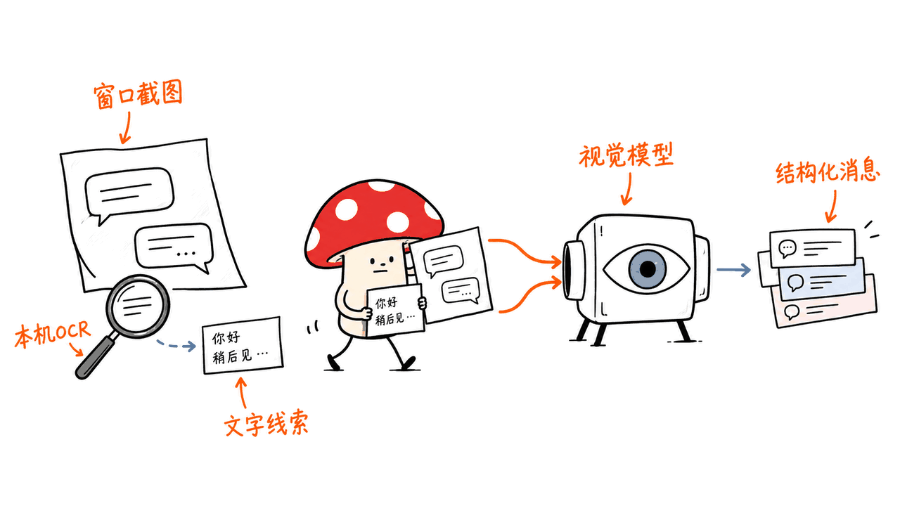
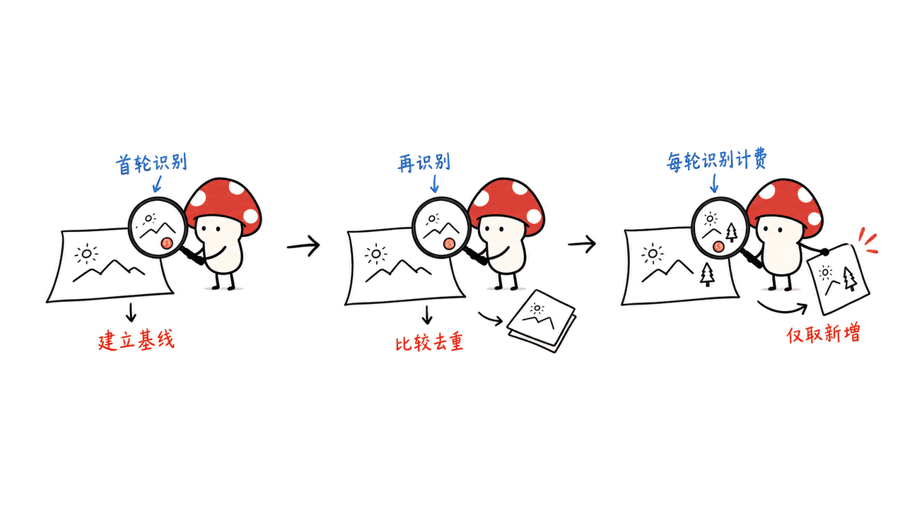
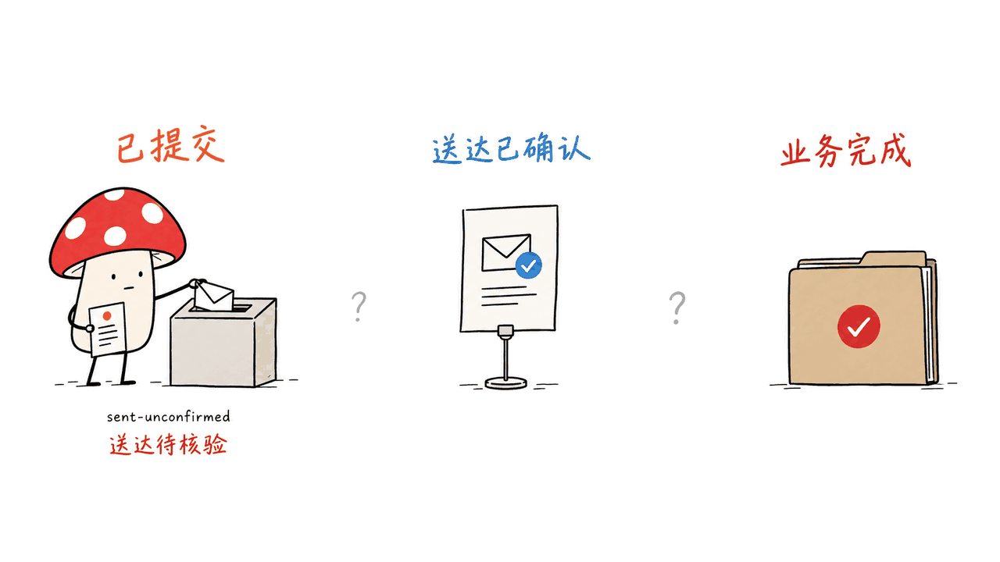

UseChat 把本机可见的微信窗口变成 Agent 可以调用的消息工具：读取当前可见内容、提交文本或附件、持续观察指定对话。它由神念拆分开源，仓库采用 MIT 许可，首个连接器支持 macOS 和 Windows。它负责连接器与桌面动作，消息总结、回复内容和业务判断仍由上层 Agent 完成。

我们抓取了官方仓库和作者 10 月 14 日的介绍，并检查固定版本源码。本机完成构建、类型检查及模拟测试：132 项测试中 129 通过、3 项 CLI 演练测试失败；没有安装原生 Helper、读取真实聊天、发送消息或调用付费视觉模型。下文把可复核的实现与尚未验证的桌面体验分开说明。

仓库：https://github.com/CosmosShadow/usechat

作者介绍：https://shennian.net/blog/usechat

固定源码：`485c8080a0594d1fda5194556ac6da73a5e209a0`；核验日期：2026 年 10 月 16 日。

## 它如何让 Agent 看懂微信？

UseChat 的主路径是窗口截图、本机 OCR、视觉模型结构化，再由核心层做校验、排序和状态处理。它没有从聊天数据库提取完整历史，也不是微信官方个人消息 API。

| 部分 | 职责 | 容易误解的地方 |
| --- | --- | --- |
| 原生 Helper | 窗口发现、截图、OCR、鼠标键盘、剪贴板与文件操作 | 安装 npm CLI 不会自动装好这一层 |
| Model Provider | 把截图和 OCR 提示交给用户配置的视觉模型 | 本地 OCR 不会自动取消图片 Token |
| TypeScript Core | 归一化、消息标识、ledger、发送状态与 trace | 自生成消息标识不是平台官方消息 ID |
| 上层 Agent | 总结、决定回复内容、编排任务 | UseChat 本身不等于完整智能客服 |

macOS Helper 使用 Swift 与系统能力，Windows Helper 使用 C#/.NET 等组件。模型接口是支持图片输入的 OpenAI-compatible Chat Completions；作者推荐 `qwen3.5-flash`，但空白配置不会替用户自动填好模型。



源码入口：
https://github.com/CosmosShadow/usechat/blob/485c8080a0594d1fda5194556ac6da73a5e209a0/packages/model-provider/src/index.ts

## read、write、watch 各自意味着什么？

`read` 读取指定对话当前可见的窗口内容，可以返回 Markdown 或 JSON；`--limit 20` 不是承诺从数据库找回最近二十条完整历史。窗口、登录状态、客户端布局和模型识别都会影响可见结果。

`write` 默认要求确认；显式 `--yes` 可用于已经授权的非交互流程。它能处理文本或单个附件。返回 `sent-unconfirmed` 的含义是提交动作完成，不能直接当成收件人已收到、已读或业务任务完成。

`watch` 是可见窗口轮询。首轮建立基线，后续对识别结果做比较和去重；它不是微信服务端推送或覆盖所有离线历史的消息订阅。当前实现每轮仍经过读取和视觉结构化，不能因为“没有新消息”就把该轮费用当成零。

还有一个集成细节：CLI 有 `watch`，但当前 `serve --stdio` 暴露的是 `doctor`、`read`、`write`。这是项目自定义的一行 JSON 请求、一行 JSONL 响应协议；仅有 stdio 并不等于实现了原生 MCP 协商与工具协议。需要 MCP 的上层可以另做适配。



观察与工具服务：
https://github.com/CosmosShadow/usechat/blob/485c8080a0594d1fda5194556ac6da73a5e209a0/packages/core/src/wechat/watch.ts
https://github.com/CosmosShadow/usechat/blob/485c8080a0594d1fda5194556ac6da73a5e209a0/packages/cli/src/stdio-server.ts

## “一次识别0.003元”如何算，哪些费用没算？

作者的示例假设一次调用有 5,000 输入 Token（包括截图、提示词和 OCR）与 1,000 输出 Token。我们核对了百炼当前官方价格页：华北 2（北京）`qwen3.5-flash`、单次输入不超过 128K 的标准原价，输入为每百万 Token 0.20 元，输出为 2.00 元。

```text
5000 / 1000000 × 0.20 + 1000 / 1000000 × 2.00
= 0.003 元
```

这是按假设计算的识别层费用，不是本机实测账单，也不是每条微信消息的固定价格。截图大小、消息密度、布局识别、失败重试和上层回复模型都会改变总费用；地区与输入档位也需要对应。这里没有把缓存或批处理折扣当作当前工作流已获得的收益。

若每分钟识别一次，8 小时共 480 次，按同一假设是 1.44 元；若理想情况下持续每 3 秒识别一次，则是 9,600 次、28.8 元。后者是按 8 小时除以 3 秒做的次数预算，实际循环还受处理耗时影响，不是测得吞吐。便宜的单次调用仍然需要乘上轮询次数。

官方价格：https://help.aliyun.com/zh/model-studio/model-pricing

README 有一段把发送概括成不调用视觉模型，但开篇架构说明、作者介绍与 `openConversation` 源码都补充了例外：切换对话时可能需要视觉模型判断布局。因此应说“重复输入与提交由本机执行”，不宜说“所有发送永远零 Token”。

## 去重和发送成功，可以直接当成业务保证吗？

不能。画面没有官方消息 ID，项目用内容、发送者、类型、位置和上下文构造本地标识，这有助于识别重复观察。它解决的是界面观察与状态管理的一部分问题，并没有把有歧义的桌面动作变成服务端事务。

我们额外核对了直接发送路径：每次 `write` 会创建一份新的内存 outbound ledger，默认 trace ID 也由随机标识生成。这意味着“库中存在 ledger”不足以证明跨进程重试具备严格只发送一次语义。遇到 `sent-unconfirmed` 时，调用方应先核对实际状态，不能把相同命令重跑当作无副作用查询。

核心发送器有用户活动与接管机制，但当前直接 `write` 把活动等待阈值设为零，并关闭 takeover 检查。这个结论来自源码，不等于所有底层权限与窗口检查都被关闭；它说明不能把一个核心能力无条件宣称成每条 CLI 命令默认开启的保护。



对应源码：
https://github.com/CosmosShadow/usechat/blob/485c8080a0594d1fda5194556ac6da73a5e209a0/packages/core/src/wechat/runtime.ts

## 怎么开始接入？

CLI 要求 Node.js 18+。先用单独的配置文件准备参数，再显式安装对应平台 Helper；模型配置的 `baseUrl` 填兼容根地址，不要重复添加 `/chat/completions`。密钥配置项应指向环境变量名。

```bash
npm install -g @shennian/usechat
usechat --config ./usechat.config.json init
usechat --config ./usechat.config.json config set model.provider openai-compatible
usechat --config ./usechat.config.json config set model.baseUrl https://your-endpoint.example/v1
usechat --config ./usechat.config.json config set model.name your-vision-model
usechat --config ./usechat.config.json config set model.apiKeyEnv USECHAT_MODEL_API_KEY
# 从官方 Release 下载相应 Helper，并完成系统授权后再检查
usechat --config ./usechat.config.json doctor --json
```

Helper 下载入口：https://github.com/CosmosShadow/usechat/releases/tag/v0.1.0

macOS 需要相应的屏幕、辅助功能与输入等权限；Windows 需要已登录的可见桌面会话。运行在机器上不代表必然能在无桌面、SSH Session 0 或未登录微信时工作。远程视觉服务仍可能接收截图与 OCR 提示，选择本地工具不等于所有数据自动留在本机。

这里的可见窗口路径是技术实现说明，不是腾讯官方授权或平台认证的证明。作者也明确没有作这种承诺。

## 我们本机验证到哪一步？

源码构建与类型检查成功。本机没有 `corepack`，所以仓库根脚本最初在工具链入口失败；随后直接运行等价的 `pnpm -r build`、`pnpm -r --if-present typecheck` 与 `pnpm -r --if-present test`，未修改上游源码。

四个包合计 132 项测试：Core 108、Model Provider 6、SDK 1 均通过；CLI 的 17 项里 14 通过、3 失败，共 129 通过、3 失败。三项失败都期望未配置 Helper 的 dry-run 成功。在隔离临时配置、显式指向不存在 Helper 路径后，独立 CLI 演练同样返回 `manifest_missing`；源码在进入运行时的 dry-run 分支前就先解析 Helper，说明这个安装前演练入口存在需要核对的限制。

我们还检查了 CLI 版本、独立配置初始化和 doctor 的结构化诊断。没有安装或启动原生 Helper，没有读取或截图真实微信，没有实际发送，也没有验证两种操作系统的桌面成功率、自动回复闭环或成本优势倍数。

我的判断是，UseChat 最有价值的部分，是把窗口识别、结构化结果和可诊断动作封装成一个边界明确的连接器。真正接入产品时，上层仍需处理模型判断、目标会话、提交状态、重复触发和人工接管。它比一句“AI接管微信”更具体，也更便于逐步验收。

## 常见问题

### 它能读出所有聊天历史吗？

官方主路径只处理当前可见窗口；本篇没有验证完整历史恢复。

### 它是完整聊天机器人或MCP服务器吗？

它是连接器与本地工具运行时。回复策略由上层 Agent 完成，当前 stdio 服务是自定义 JSONL 工具协议。

### 模拟测试通过是否意味着真实微信已跑通？

不意味着。本篇报告构建、类型检查、模拟测试和配置诊断，并保留三项失败；没有真实聊天读写验收。

延伸阅读：Mac 桌面自动化工具与连接器的边界。
https://blog.mushroom.cv/blog/peekaboo-macos-native-ui-agent/

---

> © 2026 Author: Mycelium Protocol. 本文采用 [CC BY 4.0](https://creativecommons.org/licenses/by/4.0/deed.zh) 授权——欢迎转载和引用，须注明作者姓名及原文链接，不得去除署名后以原创发布。

<!--EN-->

UseChat exposes a visible local WeChat window as tools an agent can call: read visible content, submit text or attachments, and observe a selected conversation. Extracted from Shennian and released under MIT, its first connector supports macOS and Windows. Summaries, reply text and business decisions belong to the upper-level agent.

We retrieved the repository and the author's October 14 introduction, then inspected pinned source. Build and type checks passed; 129 of 132 package tests passed, with three CLI dry-run failures. We did not install the native Helper, read real chats, send messages or call a paid visual model.

Repository: https://github.com/CosmosShadow/usechat

Author introduction: https://shennian.net/blog/usechat

Source pin: `485c8080a0594d1fda5194556ac6da73a5e209a0`. Review date: October 16, 2026.

## How does the connector understand WeChat?

The path is screenshot, local OCR, visual-model structuring, then core validation, ordering and state handling. It does not recover a complete history from the chat database or act as an official personal-message API.

| Component | Responsibility | Boundary |
| --- | --- | --- |
| Native Helper | Windows, capture, OCR, input, clipboard and files | Separate explicit installation |
| Model Provider | Sends images and OCR hints to a configured visual endpoint | OCR does not remove image tokens |
| TypeScript Core | Normalization, message keys, ledger, send states and traces | Local keys are not platform message IDs |
| Upper-level agent | Summarization, reply drafting and orchestration | Not supplied as a complete service by the connector |

The macOS Helper is Swift-based; Windows uses C#/.NET components. The provider accepts image-capable OpenAI-compatible Chat Completions services. The author recommends qwen3.5-flash, but a blank configuration does not preselect it.


Provider source: https://github.com/CosmosShadow/usechat/blob/485c8080a0594d1fda5194556ac6da73a5e209a0/packages/model-provider/src/index.ts

## What do read, write and watch promise?

`read` returns the currently visible conversation as Markdown or JSON. A limit of 20 is not a guarantee of retrieving the latest 20 historical messages from storage. `write` normally asks for confirmation; explicitly authorized non-interactive workflows can use `--yes`. A `sent-unconfirmed` result records submission, not recipient delivery, reading or business completion.

`watch` polls the visible window. The first observation establishes a baseline; later recognized results are compared and deduplicated. Each loop still reads and structures the view, so unchanged content can still incur a model call.

The CLI offers watch, but the current stdio server exposes only doctor, read and write. Its one-line JSON/JSONL tool protocol is custom; stdio alone does not establish native MCP protocol support.


Watch: https://github.com/CosmosShadow/usechat/blob/485c8080a0594d1fda5194556ac6da73a5e209a0/packages/core/src/wechat/watch.ts

Tool server: https://github.com/CosmosShadow/usechat/blob/485c8080a0594d1fda5194556ac6da73a5e209a0/packages/cli/src/stdio-server.ts

## What does the 0.003-yuan example include?

The author's example assumes 5,000 input tokens including images and 1,000 output tokens. We checked the official Beijing qwen3.5-flash standard price for inputs up to 128K: 0.20 yuan per million input tokens and 2.00 yuan per million output tokens. The calculation gives 0.003 yuan for one assumed recognition call.

This is not a measured invoice or a per-message fixed fee. It excludes upper-level reasoning and replies, extra layout calls and retries. Image sizes, message density, region and pricing tier matter. One call per minute for eight hours would mean 480 calls and 1.44 yuan under that assumption. Dividing eight hours by three seconds gives a theoretical 9,600 calls and 28.8 yuan; actual loop time also includes processing, so this is a budget scenario rather than measured throughput.

Prices: https://help.aliyun.com/zh/model-studio/model-pricing

One README paragraph describes sending as model-free, but the architecture note, author introduction and openConversation implementation identify exceptions: switching conversations may require visual layout classification. Native typing and submission do not make every write universally token-free.

## Are deduplication and submission transactional guarantees?

No. Message keys combine observed content and context rather than official server IDs. The direct write path creates a fresh in-memory outbound ledger per call, with a randomly generated default trace ID. The presence of a ledger therefore does not prove cross-process exactly-once delivery.

The core sender includes user-activity and takeover mechanisms, but direct write sets activity-wait thresholds to zero and disables takeover checking. This does not mean every permission and window guard is disabled; it means a core capability is not necessarily an active default on every CLI path. Check actual state before repeating an uncertain submission.


Runtime: https://github.com/CosmosShadow/usechat/blob/485c8080a0594d1fda5194556ac6da73a5e209a0/packages/core/src/wechat/runtime.ts

## Setup and verification scope

Node.js 18+ is required. Install the CLI, initialize a separate configuration, choose an image-capable endpoint and configure a key environment-variable name. Use the API root as baseUrl, without duplicating chat/completions. Install the platform Helper explicitly from the release and grant the required system permissions before doctor checks.

```bash
npm install -g @shennian/usechat
usechat --config ./usechat.config.json init
usechat --config ./usechat.config.json config set model.provider openai-compatible
usechat --config ./usechat.config.json config set model.baseUrl https://your-endpoint.example/v1
usechat --config ./usechat.config.json config set model.name your-vision-model
usechat --config ./usechat.config.json config set model.apiKeyEnv USECHAT_MODEL_API_KEY
usechat --config ./usechat.config.json doctor --json
```

Helper release: https://github.com/CosmosShadow/usechat/releases/tag/v0.1.0

Windows needs a logged-in visible desktop. Remote visual services may receive screenshots and OCR hints. The visible-window implementation is not evidence of Tencent authorization or platform certification; the author makes no such promise.

Our machine lacked corepack, so the initial root wrapper failed before build. Equivalent direct pnpm recursive build and typecheck commands passed without source changes. Core passed 108 tests, provider six and SDK one; CLI passed 14 and failed three, totaling 129 passed and three failed. The failed cases expected dry-run to work without Helper setup. An independent CLI run using an isolated configuration and explicitly missing Helper returned manifest_missing; Helper resolution happens before the runtime's dry-run return.

We also checked version, isolated initialization and doctor diagnostics. No native Helper, real WeChat interaction, paid inference, cross-platform UI acceptance or comparative cost/success benchmark was performed. The useful contribution is an inspectable connector boundary, while upper-level agents still own reply policy and the handling of uncertain results.

## Frequently asked questions

### Does it recover the full chat history?

The documented path operates on the visible window. We did not validate complete history recovery.

### Is it a full chatbot or native MCP server?

It is a connector/runtime. Reply policy is external, and the current stdio service uses a custom JSONL protocol.

### Do package tests prove live WeChat works?

No. This review records mock-backed tests and configuration checks, including three failures, without live-chat acceptance.

---

> © 2026 Author: Mycelium Protocol. Licensed under [CC BY 4.0](https://creativecommons.org/licenses/by/4.0/) — free to share and adapt with attribution. You must credit the author and link to the original; removing attribution and republishing as original is not permitted.
